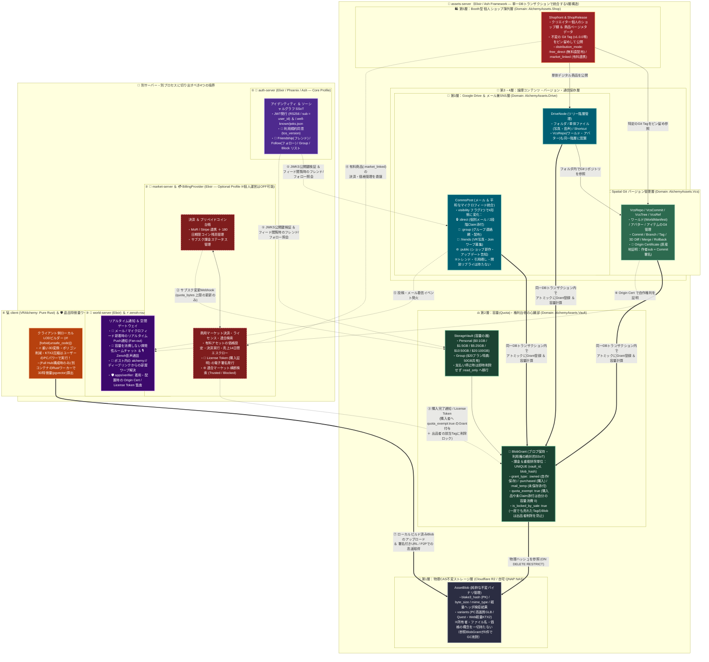

# assets-server（設計たたき台）

> **ステータス**: **draft** — 目標アーキテクチャのたたき台。実装正本ではない。  
> **現行正本**: [assets-server.md](assets-server.md)（GET capability モデル含む。x0003 / x001c / x001d）  
> **動機**: 現行 GET（認証済み読み取り capability）の先にある **BlobGrant / 5 層 + 外部境界** の目標像。課金・市場連動は改善計画の billing / market 帯（評価版で ID が変わりうる）  
> **関連**: [trust-boundary.md](trust-boundary.md)、[assets-threat-model.md](assets-threat-model.md)（手口×対策）、[overview.md](overview.md)

---

## この文書が保証すること / しないこと

| 保証する | 保証しない |
|:---|:---|
| assets-server を **5 層 + 外部 4 境界** に分ける目標像を図示する | 現行コードがこの層構造であること |
| **BlobGrant** を「保持・利用権の SSoT」、**AssetBlob** を「物理 CAS（所有者概念なし）」と置く | GET 認可・Quota・決済の実装詳細がコードと一致すること |
| 単一 DB トランザクション境界で Drive / Comms / Vcs / Shop → Grant を結ぶ方針 | Stage 2+ PostgreSQL・Ash Domain 分割のスケジュール |
| auth / market+billing / world+zenoh / client(+盗難特徴量) を **別プロセス境界** に切る | それらのサーバーが既に存在する／本リポジトリに揃っていること |

**現行との関係**: GET capability 文書化（P1-1）と **CasObject / BlobRef + reserved put**（x003f / P1-2）は正本済み。本 draft は残る **BlobGrant / StorageVault / 5 層** の目標像。Grant 採用時は保証表とコードを揃えてから正本へ昇格する。

---

## 現状 → 目標の写像（要約）

| 現行（assets-server.md） | 本 draft |
|:---|:---|
| `CasObject`（物理）+ `BlobRef` UNIQUE(owner_sub, blake3)（x003f） | `AssetBlob`（=CasObject）+ `BlobGrant`（権利・Quota 単位）に昇格 |
| `QuotaLedger`（used + reserved） | `StorageVault`（Personal / Group）+ Grant の `quota_exempt` |
| GET: Bearer 存在のみ（所有者照合なし） | Grant 有無で GET 可否（購入・メール一時・出品ロックを含む） |
| Vault / Folder / Commit は「保証しない」 | Drive / Vcs / Shop を同一 TX 境界の上位層として置く |
| 課金・Ash・Origin Cert は後続 | market/billing・Origin Cert・client LOD を外部境界へ明示 |

---

## 目標構成図

---

## 層の境界（draft）

| 層 | Domain（仮） | 置くもの | 置かないもの |
|:---|:---|:---|:---|
| 1 物理 CAS | （ストレージ） | `AssetBlob`（blake3 PK・size・mime・variants） | 所有者・ファイル名・価格・Quota |
| 2 Vault | `AlchemyAssets.Vault` | `StorageVault` / `BlobGrant`（権利・容量・削除ロック） | 決済実行・価格・License 署名本体 |
| 3 Drive | `AlchemyAssets.Drive` | `DriveNode` / `CommsPost`（階層・visibility） | トレンド SNS・開放リプライ・揮発チャット |
| 4 Vcs | `AlchemyAssets.Vcs` | Repo/Commit/Tree/Ref・Origin Cert | リアルタイム部屋状態・着用監査の実行 |
| 5 Shop | `AlchemyAssets.Shop` | Shopfront / ShopRelease・Tag ピン・distribution_mode | MoR/Stripe・エスクロー・連合検索 |

## 外部境界（draft）

| 境界 | 役割 | assets との接点 |
|:---|:---|:---|
| auth-server | JWT / JWKS / Friendship・Follow・Group・Block | Bearer 検証・フィード visibility 照会 |
| market + billing | 課金・コイン・License Token・連合マーケット | Vault の `quota_bytes` 更新、購入完了 → Grant |
| world + zenoh | Push・揮発チャット・音声・ワープ・verifier | 投稿イベント、Origin Cert / License 監査 |
| client (+ optional 特徴量) | LOD/KTX2 ローカルビルド、任意で pgvector | Blob アップロード / 署名 URL・P2P 取得 |

---

## GET / BlobGrant（目標メモ）

現行 GET 方針は正本に閉じた。目標モデルでは **GET 可否の SSoT は `BlobGrant`**（物理 `AssetBlob` は所有者を持たない）。

| grant_type（仮） | Quota | 典型用途 |
|:---|:---|:---|
| `:owned` | 消費する | 自作アップロード・Drive 保存 |
| `:purchased` | `quota_exempt` | market 購入完了通知で付与 |
| `:mail_temp` | `quota_exempt`（未 Claim） | Comms 添付の一時保持 |

段階導入（Grant 表 → owner/license 照合）はスライス化時に決める。**検証を外す／fail-open にはしない。**

---

## 未決・次の問い

- `BlobRef(owner_sub, blake3)` から `UNIQUE (vault_id, blob_hash)` / BlobGrant への移行単位
- `:free_direct` の GET を「Grant 必須」とするか「公開 Tag は読み取り capability のみ」とするか
- Stage 1 SQLite で Shop/Drive/Vcs を同じ TX に載せる範囲（最初は Vault + Blob のみか）
- 脅威モデル目標列（PoP / Immutable Tag / Safe HTTP 等）のスライス分割順 — [assets-threat-model.md](assets-threat-model.md)

採用して正本化するときは、本ファイルを昇格するか [assets-server.md](assets-server.md) へ取り込み、保証表とコードを一致させる。セキュリティ完了条件は脅威モデルの **目標の防御** を写す。
