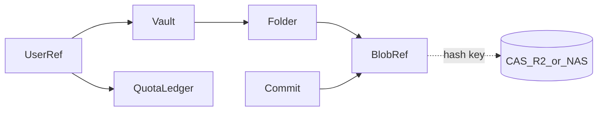

# assets-server

> **正本コード**: [`assets-server/`](../../../assets-server/)（未実装・`.gitkeep` のみ）  
> **ステータス**: Slice C 以降（ER フル設計はしない。境界と最小オブジェクトモデルのみ固定）

Slice A/B では実装しない。アセット Commit / Quota / R2・NAS 配信は overview の⑤⑥⑦経路として後続。

## 保証すること / しないこと（設計時点）

| 保証する（将来） | 保証しない（後回し） |
|:---|:---|
| メタデータ（所有者・階層・Commit・Quota）を DB に置く | GLB/KTX2 本体を DB に置く |
| 不変バイナリを CAS（R2 / NAS）に hash キーで置く | サーバー側メッシュ LOD 計算（client がビルド） |
| Quota 超過のアップロード拒否 | pgvector 指紋・盗品検疫キュー |
| auth `sub` を所有者参照として使う | Origin Cert / License Token（market と同時） |
| | グループ共有 Vault 50GB / billing プラン履歴フルモデル |

## 層の境界

| 層 | 置くもの | 置かないもの |
|:---|:---|:---|
| DB (Ash) | owner, vault, commit meta, quota 使用量, content hash 参照 | GLB/KTX2 本体 |
| CAS (R2/NAS) | 不変バイナリ（BLAKE3 等の hash キー） | ユーザー階層・権限 |
| client | LOD ビルド（PC 版 + Quest 軽量） | サーバー CPU でのメッシュ処理 |

## 最小オブジェクトモデル（概念）

Ash Resource / マイグレーションを書く直前まで、テーブル列・FK・index のフル ER は作らない。  
最初に含めてよい概念エンティティ:

| エンティティ | 役割 |
|:---|:---|
| UserRef | auth の `sub` 参照のみ（ユーザー SSoT は auth） |
| Vault / Folder | インベントリ階層のメタ |
| BlobRef | `blake3` + `size` + `mime`（CAS へのポインタ） |
| Commit | `parent` / `message` / `tree_root` |
| QuotaLedger | 使用バイト数 |

## 後続で足すもの（Slice C 以降でもさらに後ろ）

- pgvector 指紋・検疫キュー
- Origin Cert / License Token
- グループ共有 Vault
- billing 連携のプラン履歴
