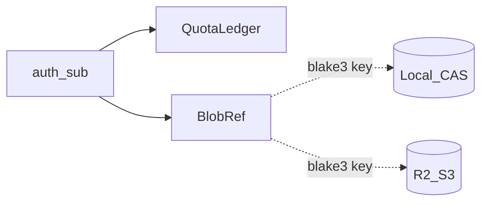

# assets-server

> **正本コード**: [`assets-server/`](../../../assets-server/)  
> **ステータス**: x0003（ローカル CAS + Quota）+ **x001c**（S3/R2 バックエンド切替）。client は Manifest の blake3 経由で取得

## 図上の位置

[overview.md](overview.md) の⑤⑥⑦経路のサーバー側。バイナリ置き場は **local disk** または **S3 互換（R2）**（env 切替）。署名 URL 直結は後続。

## 保証すること / しないこと

| 保証する | 保証しない |
|:---|:---|
| メタ（BlobRef / QuotaLedger）を SQLite に置く | GLB/KTX2 本体を DB に置く |
| 不変バイナリを CAS（BLAKE3 キー）に置く | Vault / Folder / Commit（Spatial VCS） |
| `ASSETS_CAS_BACKEND=local\|s3` で置き場切替（x001c） | client CDN 直結・署名 URL 必須化 |
| Quota 超過のアップロード拒否（既定 1GiB） | 課金連動 Quota / pgvector / Origin Cert / Ash 本格 |
| auth `sub` を所有者・Quota キーとして使う | 既存 local CAS の自動マイグレーション |

## 層の境界

| 層 | 置くもの | 置かないもの |
|:---|:---|:---|
| DB (Ecto SQLite) | owner_sub, blake3, size, mime, used_bytes | GLB/KTX2 本体 |
| CAS local | 不変バイナリ（BLAKE3 hex ファイル名） | ユーザー階層・権限 |
| CAS s3（R2） | 同上（キー = prefix + BLAKE3） | JWT / Quota |
| HTTP API | 門番・代理 PUT/GET | ストレージ固有の URL 契約 |
| client | download + BLAKE3 + wgpu 描画 | サーバー側メッシュ処理 / LOD |

## API

| Method | Path | Auth | 内容 |
|:---|:---|:---|:---|
| GET | `/health` | 不要 | 生存確認 |
| POST | `/api/v1/blobs` | Bearer | raw body アップロード |
| GET | `/api/v1/blobs/:blake3` | Bearer | 本体ダウンロード（backend から代理） |
| GET | `/api/v1/quota` | Bearer | `{used_bytes, limit_bytes}` |

同一 BLAKE3 の再アップロードは CAS 再書込なし・Quota 非加算。

## 最小オブジェクトモデル

| エンティティ | 役割 |
|:---|:---|
| BlobRef | `blake3` + `size` + `mime` + `owner_sub` |
| QuotaLedger | `owner_sub` + `used_bytes` + `limit_bytes` |



## 起動

```bash
cd auth-server && docker compose up -d && cd ..
cd assets-server && docker compose up -d
bash .scripts/smoke-assets.sh
bash .scripts/smoke-assets-glb.sh   # Coin fixture → CAS
# R2: .workspace/0_doc/manual/assets-cas-r2.md · bash .scripts/smoke-assets-r2.sh
```

## 後続

- 署名 URL / client → R2 直 DL
- Vault / Folder / Commit
- Ash、pgvector、Origin Cert
