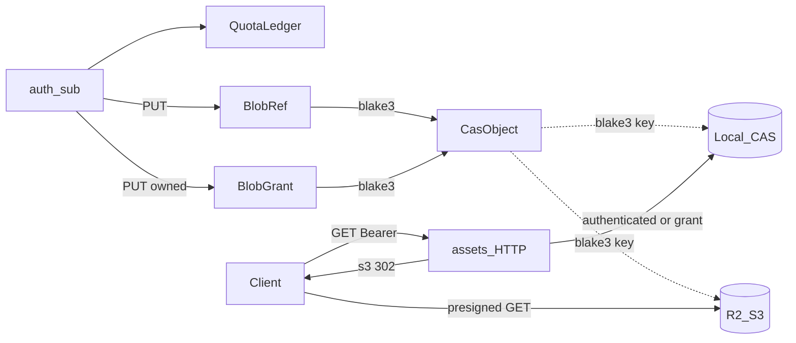

# assets-server

> **正本コード**: [`assets-server/`](../../../assets-server/)  
> **ステータス**: x0003（ローカル CAS + Quota）+ **x001c**（S3/R2 バックエンド）+ **x001d**（s3 時 GET は署名 URL 302）+ **x003f**（CasObject / BlobRef 分離 + `reserved_bytes` put 補償）+ **x004f**（BlobGrant 台帳 + `access`）  
> **目標たたき台**: [assets-server-draft.md](assets-server-draft.md)（5 層全体。GET 既定を Grant 必須にする案 B は後続）  
> **脅威（手口×対策）**: [assets-threat-model.md](assets-threat-model.md)

## 図上の位置

[overview.md](overview.md) の⑤⑥⑦経路のサーバー側。バイナリ置き場は **local disk** または **S3 互換（R2）**（env 切替）。s3 時の GET は **presigned URL へ 302**（client → R2 直 DL）。

## 方針（現行 = 案 A、目標 = 案 B）

| | 内容 |
|:---|:---|
| **現行（x004f / 案 A）** | PUT で `:owned` Grant を必ず立てる。GET 既定は **認証済み読み取り capability**（部屋メッシュ DL を壊さない）。任意で `access=grant_required` なら Grant 必須 |
| **目標（案 B）** | GET 可否の SSoT は常に `BlobGrant`。部屋メッシュも入室連動の読取 Grant（または短命トークン）が先。別スライス |

## 保証すること / しないこと

| 保証する | 保証しない |
|:---|:---|
| メタ（CasObject / BlobRef / BlobGrant / QuotaLedger）を SQLite に置く | GLB/KTX2 本体を DB に置く |
| 不変バイナリを CAS（BLAKE3 キー）に置く | Vault / Folder / Commit（Spatial VCS） |
| `CasObject`（物理・所有者なし）と `BlobRef`（owner×blake3）を分離（x003f） | StorageVault / `:purchased` / `:mail_temp` |
| PUT finalize で uploader に `:owned` `BlobGrant`（x004f） | room スコープ grant・Manifest 連動付与（→ 案 B） |
| PUT: `reserved_bytes` 予約 → TX 外 CAS put → used 振替。失敗時は**予約解放のみ**（CAS は消さない＝並行同一 hash 安全） | Oban・予約期限切れジョブ・署名 URL 直 PUT・orphan CAS の定期 GC |
| `ASSETS_CAS_BACKEND=local\|s3` で置き場切替（x001c）。**test では runtime が CAS env を無視**（x001e） | 公開バケット・CDN カスタムドメイン |
| s3 時 GET は短命署名 URL へ 302（x001d） | Upload の署名 URL 直 PUT |
| Quota 超過のアップロード拒否（既定 1GiB；`used + reserved`） | 課金連動 Quota / pgvector / Origin Cert / Ash 本格 |
| auth `sub` を **PUT・Quota の所有者キー**、Grant の `grantee_sub` として使う | GET 既定を Grant 必須にすること（案 B） |
| GET 既定（`access=authenticated`）は **認証済み読み取り capability**（下表） | 部屋配布済み hash の秘密性 |
| GET `access=grant_required` は **当該 `auth_sub` の BlobGrant 必須**（無ければ 403） | License Token / market Webhook |
| `ASSETS_METRICS_ADDR`（または `ASSETS_METRICS=1`→`127.0.0.1:9103`）時のみ **専用 loopback Bandit** で `GET /metrics`（x0049）。公開 Endpoint には載せない | OTLP / PromEx / Tunnel・公網スクレイプ；Phoenix 同一ポート上の `/metrics` |

## GET capability モデル（現行・コード一致）

`GET /api/v1/blobs/:blake3` の門番:

| 検査 | 現行 | 備考 |
|:---|:---|:---|
| Bearer JWT（auth JWKS） | **必須** | `AuthenticateUser` → `auth_sub`。未認証は 401 |
| blake3 が `cas_objects` に存在 | **必須** | なければ 404 |
| `CasObject.access` | **必須・fail-closed** | 既知値のみ許可。`authenticated` / `grant_required`。**未知・不正値は 403**（公開に落とさない） |
| `auth_sub` が当該 hash の `BlobGrant` を持つ | **`grant_required` のときのみ** | 無ければ 403。`authenticated` では照合しない |
| License / 購入証明 | **しない** | draft / market 後続 |
| 公開バケット直リンク | **しない** | s3 でも API 経由の短命 presigned GET（302） |

**存在オラクル（意図）**: 未存在は **404**、`grant_required` で Grant 無しは **403**。存在有無は区別できる。秘匿は hash を渡さない運用と案 B に委ねる（本 API は存在秘匿を保証しない）。

意図する運用前提: Manifest 等で blake3 を渡された **入室済み・認証済み client** がメッシュを取る経路（`access=authenticated`）。非公開・Drive 相当は `grant_required`。hash 秘匿や「配布済みでも読めない」は案 B（room Grant）後続。公開読取 API は `Blobs.fetch/2` のみ（門番なし `download/1` は置かない）。

PUT（`POST /api/v1/blobs`）は実バイト再送（PoP）必須。任意ヘッダ `x-alchemy-blob-access: grant_required`（未指定=`authenticated`、未知値=400）。`auth_sub` で `reserved_bytes` 予約 → TX 外 CAS put → `BlobRef` + `:owned` `BlobGrant` 確定と used 振替。同一 owner の再 PUT は `:existing`（Quota 非加算）。**別 owner の同 bytes は自 ref + 自 Grant を作成し自 Quota を消費**（CAS は put_if_absent；`access` / mime は先勝ち）。**要求 `access` が既存 CasObject と不一致なら 409 `access_conflict`**（黙って先勝ち成功にはしない）。補償パスは **予約解放のみで CAS.delete しない**。

## 層の境界

| 層 | 置くもの | 置かないもの |
|:---|:---|:---|
| DB (Ecto SQLite) | CasObject(size/mime/access)、BlobRef(owner×blake3)、BlobGrant(grantee×blake3)、used/reserved | GLB/KTX2 本体 |
| CAS local | 不変バイナリ（BLAKE3 hex ファイル名） | ユーザー階層・権限 |
| CAS s3（R2） | 同上（キー = prefix + BLAKE3） | JWT / Quota |
| HTTP API | 門番・PUT 代理・GET（local=代理 / s3=302） | ストレージ固有の永続 URL 契約 |
| client | download（リダイレクト追従）+ BLAKE3 + wgpu | サーバー側メッシュ処理 / LOD |

## API

| Method | Path | Auth | 内容 |
|:---|:---|:---|:---|
| GET | `/health` | 不要 | 生存確認 |
| POST | `/api/v1/blobs` | Bearer | raw body アップロード。任意 `x-alchemy-blob-access`。既存と不一致は 409 |
| GET | `/api/v1/blobs/:blake3` | Bearer | 既定: 認証済み capability。`grant_required`: Grant 必須（無ければ 403）。未知 access は 403。local: 200 / s3: 302 |
| GET | `/api/v1/quota` | Bearer | `{used_bytes, reserved_bytes, limit_bytes}`（自 `auth_sub`） |

## 最小オブジェクトモデル

| エンティティ | 役割 |
|:---|:---|
| CasObject | `blake3` PK + `size` + `mime` + `access`（**物理メタ。所有者なし**） |
| BlobRef | UNIQUE(`owner_sub`, `blake3`) → CasObject（**Quota 単位**） |
| BlobGrant | UNIQUE(`grantee_sub`, `blake3`) + `grant_type`（**権利台帳。GET は grant_required 時のみ参照**） |
| QuotaLedger | `owner_sub` + `used_bytes` + `reserved_bytes` + `limit_bytes` |



## 起動

```bash
cd auth-server && docker compose up -d && cd ..
cd assets-server && docker compose up -d
bash .scripts/smoke-assets.sh
bash .scripts/smoke-assets-glb.sh   # Coin fixture → CAS
# R2 + 302: .workspace/0_doc/manual/assets-cas-r2.md · bash .scripts/smoke-assets-r2.sh
```

## 後続

- **案 B**: GET 既定を Grant 必須へ。room join 連動読取 Grant / 短命トークン（部屋を壊さない移行）
- [assets-server-draft.md](assets-server-draft.md) の Vault / purchased / 5 層
- [assets-threat-model.md](assets-threat-model.md) 目標列（予約期限ジョブ・Immutable Tag・配信ドメイン分離・Safe HTTP・jti 等）
- カスタムドメイン / CDN キャッシュ本配信
- 署名付き Upload（client → R2 直 PUT）— Content-Length 固定署名を必須に
- Ash、pgvector、Origin Cert
