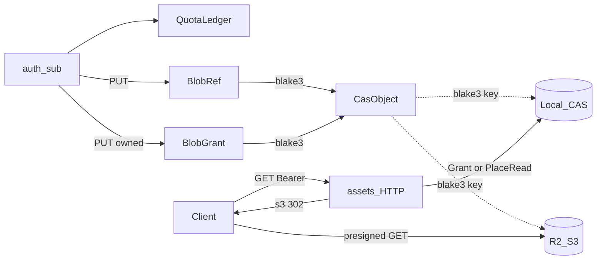

# assets-server

> **正本コード**: [`assets-server/`](../../../assets-server/)  
> **ステータス**: x0003（ローカル CAS + Quota）+ **x001c**（S3/R2 バックエンド）+ **x001d**（s3 時 GET は署名 URL 302）+ **x003f**（CasObject / BlobRef 分離 + `reserved_bytes` put 補償）+ **x004f**（BlobGrant 台帳）+ **x0054**（inventory PUT 経路）+ **x0058**（Personal Vault 薄皮）+ **x005c/x005d**（DriveNode folder/blob/prefab）+ **x005e**（Prefab.Payload スキーマ検証）+ **x005f/x0060/x0061**（take-out/put-back/roundtrip）+ **x0062–x0065**（Vcs promote/commit/ref/cert・ItemRef repo@rev）+ **x006b**（PlaceRead）+ **x006c**（GET 案 B）+ **x006d**（Drive HTTP list/take_out）+ **x006e**（Drive HTTP put_back）+ **x006f**（CasObject.access 列廃止）+ **x0074**（reserved reaper / orphan CAS GC）+ **x0075**（BLAKE3 常駐 Port）+ **x007f**（prefab take_out 多子展開）  

> **目標たたき台**: [assets-server-draft.md](assets-server-draft.md)（5 層全体）  
> **脅威（手口×対策）**: [assets-threat-model.md](assets-threat-model.md)

## 図上の位置

[overview.md](overview.md) の⑤⑥⑦経路のサーバー側。バイナリ置き場は **local disk** または **S3 互換（R2）**（env 切替）。s3 時の GET は **presigned URL へ 302**（client → R2 直 DL）。

## 方針（現行 = 案 B + x006f）

| | 内容 |
|:---|:---|
| **現行（x006c 案 B + x006f）** | GET 可否の SSoT は常に **BlobGrant** またはカバーする **PlaceRead**（x006b）。`CasObject` は bytes メタのみ（`access` 列なし） |
| **移行段（x004f 案 A・完了）** | 台帳 + 任意 `grant_required`。GET 既定 capability は x006c で廃止。列は x006f で削除 |

## 保証すること / しないこと

| 保証する | 保証しない |
|:---|:---|
| メタ（CasObject / BlobRef / BlobGrant / QuotaLedger）を SQLite に置く | GLB/KTX2 本体を DB に置く |
| 不変バイナリを CAS（BLAKE3 キー）に置く。ダイジェストは常駐 `blake3-hash --serve` Port（x0075；リクエスト毎 CLI なし） | Folder / Commit（Spatial VCS）・Group Vault；並行ハッシュスループット |
| `Assets.Vault.personal/1` が Quota と一致する used/reserved/limit を返す（vault_id=`owner_sub` 暫定・x0058） | UUID vault_id 移行・`:read_only`・課金プラン連動 |
| `CasObject`（物理・所有者なし・size/mime のみ）と `BlobRef`（owner×blake3）を分離（x003f / x006f） | StorageVault / `:purchased` / `:mail_temp` |
| PUT finalize で uploader に `:owned` `BlobGrant`（x004f） | room スコープ grant・Manifest 連動付与以外の Grant 種別 |
| `POST /api/v1/inventory/blobs` は inventory 用パス契約（x0054）。中身は通常 PUT と同じ（常に owned Grant・x006f） | DriveNode / Prefab / Vault 表・client UI |
| Drive `take_out`（x007f）: blob → 単一 blake3；prefab → Payload 子 mesh（`blake3`+`local_id`+任意 `trs`）。payload + 各子に Grant。欠落は全体 `:no_grant` | folder / vcs_repo take-out；payload blake3 を blobs に載せる；host 一括 spawn；`save_prefab` 時の子 Grant 必須化（take_out 側で弾く） |
| 同一 blake3 を `/blobs` と `/inventory/blobs` から別 owner が PUT しても共存（x006f） | mime/size 先勝ちの変更；CasObject あり・refcount=0 の GC |
| PUT: `quota_reservations` + `reserved_bytes` 予約 → TX 外 CAS put → used 振替。失敗時は**予約解放のみ**（compensate は CAS 非削除＝並行同一 hash 安全）（x003f / x0074） | Oban・署名 URL 直 PUT；S3 バケット全 listing |
| TTL 超過予約の reaper 解放 + CasObject 無し orphan bytes の grace GC（GenServer・x0074）。削除は quarantine→再検証→discard/restore。中断後は q-only を再試行し、CasObject ありなら restore 成功時のみ候補 drop | 実行中 PUT をゼロ失敗にする超短 TTL；S3 listing 全走査；exists? 一時障害の完全排除 |
| 予約行削除と `reserved_bytes` 減算は同一 TX（n==1 のときだけ減算）。空 PUT（0 bytes）可 | マイグレ前の blake3 不明 reserved（0 クランプ済み） |
| `ASSETS_CAS_BACKEND=local\|s3` で置き場切替（x001c）。**test では runtime が CAS env を無視**（x001e） | 公開バケット・CDN カスタムドメイン |
| s3 時 GET は短命署名 URL へ 302（x001d） | Upload の署名 URL 直 PUT |
| Quota 超過のアップロード拒否（既定 1GiB；`used + reserved`） | 課金連動 Quota / pgvector / Origin Cert / Ash 本格 |
| auth `sub` を **PUT・Quota の所有者キー**、Grant の `grantee_sub` として使う | — |
| GET は常に **当該 `auth_sub` の BlobGrant**、またはカバーする **PlaceRead**（x006b / x006c） | License Token / market Webhook；Bearer 単独の認証済み capability |
| PlaceRead 検証は world JWKS（`WORLD_JWKS_URL` / `WORLD_JWT_ISSUER`）。`sub` 一致必須。hash ∈ **seal-time scene** のみ（`extra_blake3` 無効）。place_hashes 応答の identity 照合 | PlaceRead TTL 専用 UI；連合ミラー；extra による inventory バイパス |
| client は受理済み `world_seal` + Room Token で PlaceRead を取得し `x-alchemy-place-read` 付き GET（x006c） | PlaceRead 期限前の専用リフレッシュ UI |
| `ASSETS_METRICS_ADDR`（または `ASSETS_METRICS=1`→`127.0.0.1:9103`）時のみ **専用 loopback Bandit** で `GET /metrics`（x0049）。公開 Endpoint には載せない | OTLP / PromEx / Tunnel・公網スクレイプ；Phoenix 同一ポート上の `/metrics` |

## GET capability モデル（現行 = 案 B・コード一致）

`GET /api/v1/blobs/:blake3` の門番:

| 検査 | 現行 | 備考 |
|:---|:---|:---|
| Bearer JWT（auth JWKS） | **必須** | `AuthenticateUser` → `auth_sub`。未認証は 401 |
| blake3 が `cas_objects` に存在 | **必須** | なければ 404 |
| `auth_sub` が当該 hash の `BlobGrant` を持つ **または** PlaceRead がカバー | **常時**（x006c） | どちらも無ければ 403 |
| License / 購入証明 | **しない** | draft / market 後続 |
| 公開バケット直リンク | **しない** | s3 でも API 経由の短命 presigned GET（302） |

**存在オラクル（意図）**: 未存在は **404**、Grant/PlaceRead 無しは **403**。存在有無は区別できる（本 API は存在秘匿を保証しない）。

意図する運用前提: 部屋メッシュは **入室済み client** が PlaceRead（または uploader の `:owned` Grant）で GET。inventory / Drive は Grant。公開読取 API は `Blobs.fetch/2` のみ（門番なし `download/1` は置かない）。

PUT（`POST /api/v1/blobs`）は実バイト再送（PoP）必須。`x-alchemy-blob-access` はパースしない（x006f）。インベントリ用は **`POST /api/v1/inventory/blobs`**（x0054）で同じ upload（常に `:owned` Grant）。`auth_sub` で `reserved_bytes` 予約 → TX 外 CAS put → `BlobRef` + `:owned` `BlobGrant` 確定と used 振替。同一 owner の再 PUT は `:existing`（Quota 非加算）。**別 owner の同 bytes は自 ref + 自 Grant を作成し自 Quota を消費**（CAS は put_if_absent；mime/size は先勝ち）。補償パスは **予約解放のみで CAS.delete しない**。

## 層の境界

| 層 | 置くもの | 置かないもの |
|:---|:---|:---|
| DB (Ecto SQLite) | CasObject(size/mime)、BlobRef、BlobGrant、QuotaLedger、QuotaReservation、CasOrphanCandidate | GLB/KTX2 本体；`access` 列 |
| CAS local | 不変バイナリ（BLAKE3 hex ファイル名） | ユーザー階層・権限 |
| CAS s3（R2） | 同上（キー = prefix + BLAKE3） | JWT / Quota |
| HTTP API | 門番・PUT 代理・GET（local=代理 / s3=302） | ストレージ固有の永続 URL 契約 |
| client | download（リダイレクト追従）+ BLAKE3 + wgpu | サーバー側メッシュ処理 / LOD |

## API

| Method | Path | Auth | 内容 |
|:---|:---|:---|:---|
| GET | `/health` | 不要 | 生存確認 |
| POST | `/api/v1/blobs` | Bearer | raw body アップロード。owned Grant 付与 |
| POST | `/api/v1/inventory/blobs` | Bearer | インベントリ用パス（x0054）。中身は通常 PUT と同じ（x006f） |
| GET | `/api/v1/blobs/:blake3` | Bearer（任意 `x-alchemy-place-read`） | 常時 Grant **または** PlaceRead カバー（x006c）。local: 200 / s3: 302 |
| GET | `/api/v1/drive/nodes` | Bearer | owner Drive 一覧（`parent_id` 任意・x006d） |
| POST | `/api/v1/drive/take_out` | Bearer + JSON `{node_id}` | blob: 単一 blake3；prefab: 子 mesh 列（`blake3`+`local_id`+任意 `trs`・x007f）。host には node_id を渡さない |
| POST | `/api/v1/drive/put_back` | Bearer + JSON `{name, payload, parent_id?}` | Prefab.Payload 検証 → `save_prefab`（x006e；部屋 entity は変更しない） |
| GET | `/api/v1/quota` | Bearer | `{used_bytes, reserved_bytes, limit_bytes}`（自 `auth_sub`） |

## 最小オブジェクトモデル

| エンティティ | 役割 |
|:---|:---|
| CasObject | `blake3` PK + `size` + `mime`（**物理メタ。所有者なし・access なし・x006f**） |
| BlobRef | UNIQUE(`owner_sub`, `blake3`) → CasObject（**Quota 単位**） |
| BlobGrant | UNIQUE(`grantee_sub`, `blake3`) + `grant_type`（**権利台帳。GET の SSoT の一方・x006c**） |
| QuotaLedger | `owner_sub` + `used_bytes` + `reserved_bytes` + `limit_bytes` |
| QuotaReservation | `owner_sub`×`blake3` + `bytes` + `reserved_at`（TTL reaper・x0074） |
| CasOrphanCandidate | `blake3` + `noticed_at`（grace 後 GC・x0074） |
| Vault（薄皮） | `Assets.Vault.personal/1` — QuotaLedger 上の Personal ビュー（表なし・x0058）。`vault_id = owner_sub`（暫定） |
| DriveNode | `node_id` UUID PK + `owner_sub` + `parent_id` nullable + `kind`（folder/blob/prefab/vcs_repo）+ `name` + `blake3` nullable + `vcs_repo_id` nullable（x005c/x005d） |
| Prefab.Payload | JSON スキーマ（schema_version=1 + children[{local_id, blake3, trs?}]）+ 非有限 TRS 拒否（x005e） |
| VcsRepo | `repo_id` UUID PK + `owner_sub` + `node_id` nullable（x0062） |
| VcsCommit | `commit_id` + `repo_id` + `author_sub` + `tree_json`（不変・x0062） |
| VcsRef | `ref_id` + `repo_id` + `name` + `kind`（branch/tag）+ `commit_id` + `is_frozen`（Tag は true、x0064） |
| VcsCert | `cert_id` + `subject_sub` + `target_kind` + `target_id` + `target_hash` + `signature`（Ed25519・不変・x0065） |
| ItemRef | 型: `{:blake3, hex}` \| `{:repo_rev, repo_id, rev}`。`Assets.ItemRef.resolve/2` でブロブ参照解決（x0063） |



## 起動

```bash
cd auth-server && docker compose up -d && cd ..
cd assets-server && docker compose up -d
bash .scripts/smoke-assets.sh
bash .scripts/smoke-assets-glb.sh   # Coin fixture → CAS
# R2 + 302: .workspace/0_doc/manual/assets-cas-r2.md · bash .scripts/smoke-assets-r2.sh
```

## 後続

- **インベントリラダー（B+2→C+3）**: [inventory-ladder.md](../roadmap/inventory-ladder.md)。Wave 0–4 **done**（x0054–x0065）。**x006d** take-out + **x006e** put-back UI + **x007b** scene despawn + **x007f** Prefab 多子展開 / Live Inventory / XR→Desktop 委譲。
- **PlaceRead（x006b）+ 案 B（x006c）+ access 列廃止（x006f）**: **done**。PlaceRead TTL UI / take-out `extra_blake3` は後続
- [assets-server-draft.md](assets-server-draft.md) の Vault / purchased / 5 層
- [assets-threat-model.md](assets-threat-model.md) 目標列（予約期限ジョブ・Immutable Tag・配信ドメイン分離・Safe HTTP・jti 等）
- カスタムドメイン / CDN キャッシュ本配信
- 署名付き Upload（client → R2 直 PUT）— Content-Length 固定署名を必須に
- Ash、pgvector
- Origin Cert 鍵管理本番化（秘密鍵を secrets manager から注入。`cert_signing_priv_key` は runtime config のみ）
- VcsRepo 共有・fork・Transfer（現在 owner-only）
