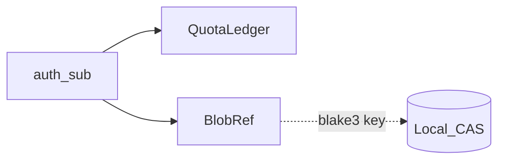

# assets-server

> **正本コード**: [`assets-server/`](../../../assets-server/)  
> **ステータス**: Slice C-A（ローカル CAS + Quota）。client は C-C で Manifest の blake3 経由で取得

## 図上の位置

[overview.md](overview.md) の⑤⑥⑦経路のサーバー側。C-A ではローカルディスク CAS のみ（R2/NAS は後続）。

## 保証すること / しないこと（Slice C-A）

| 保証する | 保証しない |
|:---|:---|
| メタ（BlobRef / QuotaLedger）を SQLite に置く | GLB/KTX2 本体を DB に置く |
| 不変バイナリをローカル CAS に BLAKE3 キーで置く | R2 / NAS 切替 |
| Quota 超過のアップロード拒否（既定 1GiB） | Vault / Folder / Commit（Spatial VCS） |
| auth `sub` を所有者・Quota キーとして使う | pgvector / Origin Cert / Ash 本格ドメイン |

## 層の境界

| 層 | 置くもの | 置かないもの |
|:---|:---|:---|
| DB (Ecto SQLite) | owner_sub, blake3, size, mime, used_bytes | GLB/KTX2 本体 |
| CAS (local disk) | 不変バイナリ（BLAKE3 hex ファイル名、`b3sum` で計算） | ユーザー階層・権限 |
| client（C-B） | download + BLAKE3 + wgpu 描画 | サーバー側メッシュ処理 / LOD |

## API（C-A）

| Method | Path | Auth | 内容 |
|:---|:---|:---|:---|
| GET | `/health` | 不要 | 生存確認 |
| POST | `/api/v1/blobs` | Bearer | raw body アップロード |
| GET | `/api/v1/blobs/:blake3` | Bearer | 本体ダウンロード |
| GET | `/api/v1/quota` | Bearer | `{used_bytes, limit_bytes}` |

同一 BLAKE3 の再アップロードは CAS 再書込なし・Quota 非加算。

## 最小オブジェクトモデル（C-A 実装済み）

| エンティティ | 役割 |
|:---|:---|
| BlobRef | `blake3` + `size` + `mime` + `owner_sub` |
| QuotaLedger | `owner_sub` + `used_bytes` + `limit_bytes` |



## 起動

```bash
cd auth-server && docker compose up -d && cd ..
cd assets-server && docker compose up -d
bash .scripts/smoke-assets.sh
bash .scripts/smoke-assets-glb.sh   # Coin fixture → CAS
```

## 後続（C+）

- Vault / Folder / Commit
- R2 / NAS、Ash、pgvector、Origin Cert
