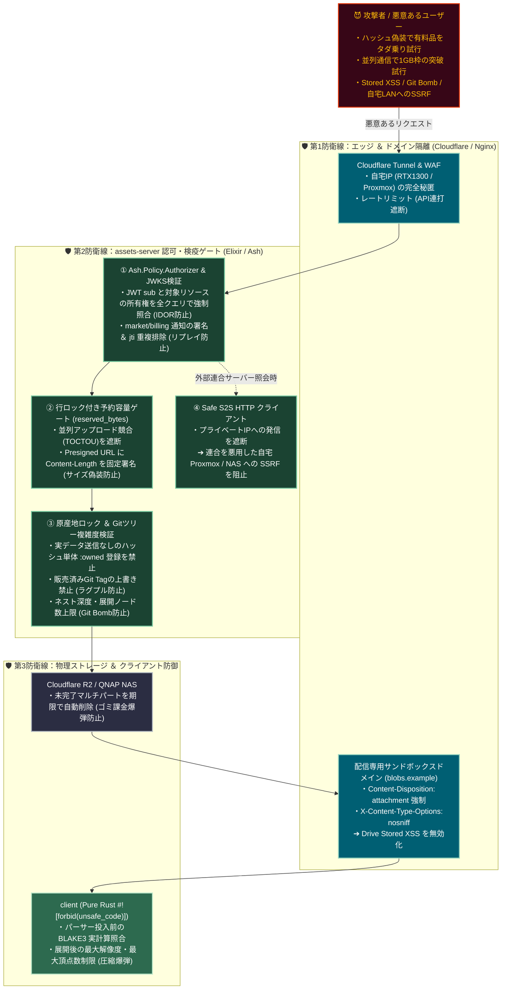

# assets 脅威モデル（手口 × 対策）

> **正本**: 本ファイル（CAS / Quota / 将来 BlobGrant・Drive・Vcs・Shop・連合）  
> **索引**: [trust-boundary.md](trust-boundary.md)（全経路の要約表）  
> **現行保証**: [assets-server.md](assets-server.md)  
> **目標層構造**: [assets-server-draft.md](assets-server-draft.md)  
> **出典メモ**: 5 層 draft に対するレッドチーム整理（Argon）。文言は Alchemy の保証表形式に正規化

目的: **攻撃者がどこを突くか**と、**誰がどの層で止めるか**を固定する。  
「100% 不可能」ではなく、**現状の防御 / 目標の防御 / 保証しない**を明示する。検証のスキップや fail-open は行わない。

## この文書が保証すること / しないこと

| 保証する | 保証しない |
|:---|:---|
| assets 周辺の主要攻撃ベクトルを番号付きで列挙する | 列挙が全攻撃空間を尽くすこと |
| 各手口に対し **現状 / 目標 / 非保証** を書く | 目標列が現行コードで実装済みであること |
| 防衛レイヤー図と「黄金の 4 規則」を設計制約として残す | 新規依存（Ash Policy・Oban・pgvector 等）の導入承認 |

---

## 索引（8 ベクトル）

| # | 手口（短縮） | 主被害 | 主防衛層 |
|:---|:---|:---|:---|
| ① | ハッシュだけの `:owned` 登録（所有権ロンダリング） | 有料アセットのタダ乗り・Drive/Git への偽帰属 | PoP / 原産地ロック /（補助）形状指紋 |
| ② | 並列 PUT・サイズ偽装・未完了 multipart（TOCTOU / 課金爆弾） | Quota 突破・R2 課金 | `reserved_bytes` 行ロック・署名 Content-Length・ライフサイクル |
| ③ | 販売後 Tag すり替え（Rug Pull）・Git Bomb | 購入者損害・参加者 OOM | Immutable Tag・ツリー展開コスト上限 |
| ④ | Drive 上の HTML/SVG による Stored XSS | JWT 窃取・アカウント乗っ取り | 配信ドメイン分離・sandbox / nosniff / attachment |
| ⑤ | 連合 URL を私有 IP にした SSRF | 自宅 Proxmox / NAS / ルータ管理面への到達 | Safe HTTP Client（解決後 IP 遮断） |
| ⑥ | Drive / Comms IDOR・mail_temp 横取り Claim | 非公開ファイル・DM 添付の窃取 | Ash Policy（actor ↔ owner / Grant）全 Action |
| ⑦ | billing/market 通知のリプレイ・偽造 | Quota 改ざん・偽購入 Grant | 署名検証 + `jti` べき等 |
| ⑧ | Zip/PNG/GLB 圧縮爆弾 | サーバ/クライアント OOM | サーバはヘッダのみ・client 展開上限 |

---

## 1. 経済圏・ストレージ破壊

### ① ハッシュ値だけの送信による有料アセット横取り（所有権ロンダリング）

**手口**

- 同一ワールドで他人の有料アバター等の `blake3`（およびローカルキャッシュ）はゲスト端末にも届きうる（「見る権利」優先）。
- CAS の重複排除ショートカットとして「既存 hash ならバイト送信なしで `:owned` Grant / Drive 登録完了」とすると、攻撃者は **hash だけ**を送り「自分がアップロードした」と偽れる。

**被害**: 有料品の無断「所有」登録、ショップ原産地の汚染、Quota を払わずに Drive/Git へピン留め。

| | 内容 |
|:---|:---|
| **現状の防御** | 同一 owner の再 PUT は自 `BlobRef` で `:existing`（Quota 非加算）。別 owner は実バイト再送で自 ref + Quota（owner 付け替えなし・x003f）。hash-only 登録 API は無い。GET は認証済み capability のため、**hash を知る認証主体は読める**（confidentiality 非保証） |
| **目標の防御** | (1) **Proof of Possession**: 既存 hash でも別 vault が `:owned` を得るには実バイト再送＋サーバ側 blake3 再計算、またはチャンク範囲 PoP を必須にする。(2) **先願原産地ロック**: Origin Cert / `is_locked_by_sale` 付き hash は、`parent_origin_id` なしの「新規オリジナル」Commit・署名を DB で拒否。(3) 頂点ずらし等は出品時 **3D 指紋（pgvector 等）** で隔離（Optional ワーカー） |
| **保証しない** | hash 秘匿そのもの（部屋内配布で hash は見える）。指紋照合の完全再現率 |

### ② 並列リクエストによる Quota 突破（TOCTOU）と R2 課金爆弾

**手口**

- 残り 100MB の主体が 100MB 要求を多数並列送信し、`used + size <= quota` の読み取りと更新の隙間で全通過させる。
- 「1KB」と申告して署名 URL を取り、実際は巨大 PUT、または multipart を未完了のまま放置してストレージ課金を膨らませる。

| | 内容 |
|:---|:---|
| **現状の防御** | PUT 代理時に `reserved_bytes` 条件付き予約 → TX 外 CAS put → `used_bytes` 振替（x003f）。失敗時は**予約解放のみ**（CAS.delete しない＝並行同一 hash / cross-owner PoP と安全に両立）。**Upload 用署名 URL 直 PUT は未実装**（保証しない側） |
| **目標の防御** | 受付 TX 内の予約を StorageVault へ昇格。期限切れはジョブで予約破棄。Presigned PUT は **Content-Length（と可能なら checksum）を署名に固定**。バケットは **未完了 multipart のライフサイクル削除**（例: 24h） |
| **保証しない** | クライアント側の帯域枯渇 DoS 全般；CDN 課金のゼロ化 |

### ③ ショップ販売後の Git Tag すり替え（Rug Pull）と Git Bomb

**手口**

- 販売後に `v1.0.0` が指す Commit を空・巨大オブジェクトへ強制上書き（`git tag -f` 相当）。
- 小さな Tree で同一サブツリーを多段ネストし、配置時に指数的展開で参加者端末を OOM。

| | 内容 |
|:---|:---|
| **現状の防御** | Spatial VCS / Shop は未実装（[assets-server.md](assets-server.md) 保証外） |
| **目標の防御** | 一度でも `ShopRelease` や外部配布に出た `VcsRef`（`:tag`）は **更新・削除禁止**（Immutable Ref；修正は新 Tag）。Commit 受理時に **最大ネスト深度・展開エンティティ上限・DAG（ループ禁止）** をサーバで静的検証 |
| **保証しない** | クライアントが独自に不正 Tree をローカル解釈すること（サーバが受理した Tree 以外を信じる場合） |

---

## 2. アカウント・拠点インフラ

### ④ Drive 経由 Stored XSS（アカウント乗っ取り）

**手口**: Drive に悪意ある HTML/SVG を置き、同一サイトオリジンでブラウザ表示させると JWT 等が窃取される。

| | 内容 |
|:---|:---|
| **現状の防御** | Drive UI / ユーザ生成コンテンツ配信は未実装。blob GET は API（Bearer）経由 |
| **目標の防御** | **配信ドメインを API/Web と完全分離**。レスポンスに `Content-Security-Policy: sandbox`、`X-Content-Type-Options: nosniff`、`Content-Disposition: attachment`（または非実行 MIME）を強制 |
| **保証しない** | ユーザが別アプリでファイルを開いたときの OS 側挙動 |

### ⑤ 連合メタデータ取得を餌にした SSRF（自宅 LAN 侵入）

**手口**: 連合先を `http://192.168.x.x` / `127.0.0.1:8006` 等と名乗り、assets（または S2S 主体）に JWKS・メタ取得をさせて Proxmox / NAS / ルータ管理面へアクセスさせる。

| | 内容 |
|:---|:---|
| **現状の防御** | assets からの連合 S2S は未実装。world/auth の S2S は別境界（[trust-boundary.md](trust-boundary.md)） |
| **目標の防御** | 外部向け HTTP クライアントは **DNS 解決後の接続先 IP** を検査し、RFC1918・ループバック・リンクローカル・IPv6 ULA 等への接続を **ソケット確立前に拒否** |
| **保証しない** | 正規の公開連合ノード自体の悪性（FederationPolicy / Blocked は別層） |

### ⑥ IDOR（非公開 Drive / DM 添付の盗み見・横取り Claim）

**手口**: `drive_node_id` / `comms_post_id` 等を変え、他人の private や `:mail_temp` を Claim する。

| | 内容 |
|:---|:---|
| **現状の防御** | Drive / Comms 未実装。`access=authenticated`（既定）は認証済みなら hash 既知で読める。`access=grant_required` は BlobGrant 必須。**未知 `access` は fail-closed（403）**（x004f / 案 A） |
| **目標の防御** | GET 既定も Grant 必須（案 B）+ Ash Policy（または同等）で Read/Action すべてに **actor が有効 BlobGrant 保有** をクエリに注入。書き忘れで公開に落ちないこと |
| **保証しない** | `authenticated` かつ hash が既に部屋・公開フィードで配布済みのオブジェクトの「秘密性」。GET の 403/404 による存在オラクル |

### ⑦ 決済・購入トークンのリプレイと偽造

**手口**: 「quota を 100GB に」「この hash を購入済みに」の通知を複製・偽造する。

| | 内容 |
|:---|:---|
| **現状の防御** | billing / market Webhook 未実装 |
| **目標の防御** | S2S 通知は **署名必須**（JWKS または HMAC + 短い受理窓）。処理済み **`jti` を永続化し再送無視**（べき等） |
| **保証しない** | market 鍵漏洩後の新規正当署名イベント（鍵ローテ・revoke は運用） |

### ⑧ 圧縮爆弾（Zip / PNG / GLB）によるメモリ枯渇

**手口**: 小さなファイルが展開後に巨大化し、サムネ生成や client ロードで OOM。

| | 内容 |
|:---|:---|
| **現状の防御** | assets は本体を画像/メッシュとして展開しない。client は BLAKE3 照合後にロード（上限は今後の課題） |
| **目標の防御** | **サーバはヘッダ数バイト検疫に留め展開しない**。client（`#![forbid(unsafe_code)]` ローダ）で **展開後ピクセル上限・頂点上限** をデコード前に強制 |
| **保証しない** | 不正ファイルをサーバ外の任意ツールで開いた場合 |

---

## 3. 防衛レイヤー図

---

## 4. 黄金の 4 規則（設計・実装で外さない）

1. **「ハッシュを知っている＝ファイルを持っている／所有している」とみなさない**  
   部屋内で hash は見える。`:owned` や原産地主張には **実バイト検証（PoP）** と、商用ロック済み hash の無断オリジナル登録拒否を必須にする。

2. **容量は `used_bytes + reserved_bytes` を行ロックで見る**  
   受付時に予約し、完了で振替・期限で破棄。直 PUT を許すなら署名に **正確な Content-Length** を縛る。

3. **販売・配布に出した Git Tag は書き換えない（Immutable Tag）**  
   修正は必ず新 Tag。購入者・配布先が指す Commit を出品者が事後改ざんできないこと。

4. **S2S 連合は私有 IP を弾き、ファイル配信は API と別ドメインに隔離する**  
   SSRF で拠点管理面へ届かせない。ブラウザ XSS で JWT を同オリジン窃取させない。

---

## 現状コードとの短い対応（実装済み境界）

| 項目 | 現行 assets |
|:---|:---|
| GET | Bearer 必須・owner 照合なし（①⑥の confidentiality は非保証として文書化済み） |
| PUT / Quota | サーバ代理 + `reserved_bytes` 同期予約／振替。補償は予約解放のみ・CAS 非削除（x003f）；直 PUT・期限切れジョブ・orphan GC は未 |
| Dedup | CasObject は共有。cross-owner は実バイト再送で自 BlobRef + 自 Quota（owner 付け替えなし）。**Grant 層が無い**ため①の本格面は draft 以降 |
| Drive / Vcs / Shop / 連合 / billing | 未（③④⑤⑥⑦の目標列） |

スライス化するときは、本表の **目標の防御** を完了条件に写し、保証表とコードを一致させてから「現状の防御」へ昇格する。
