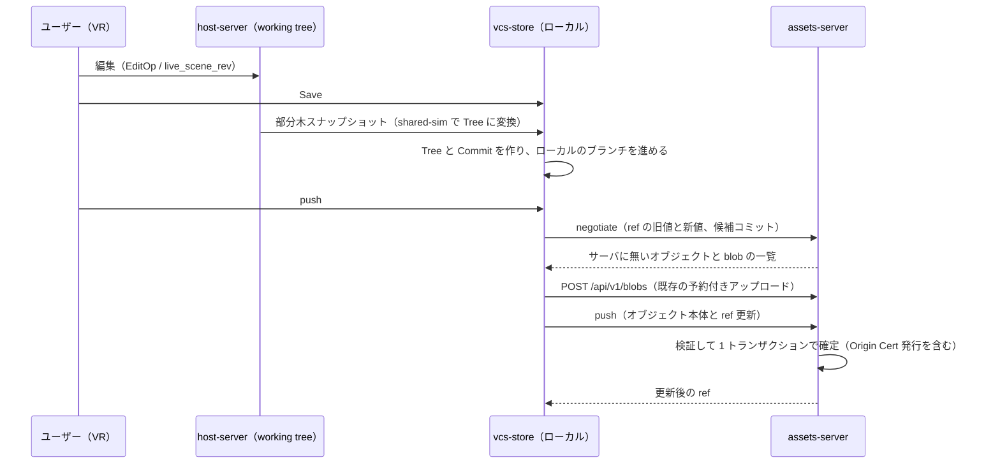
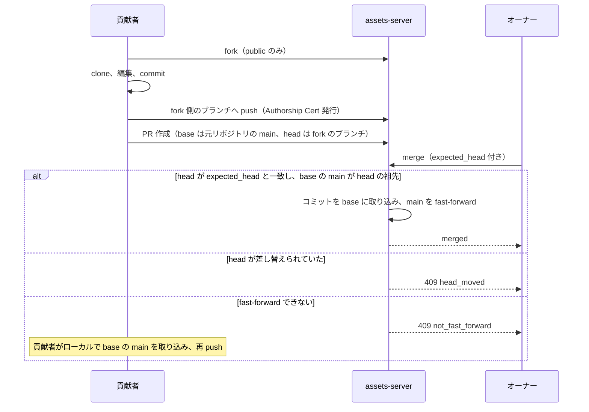
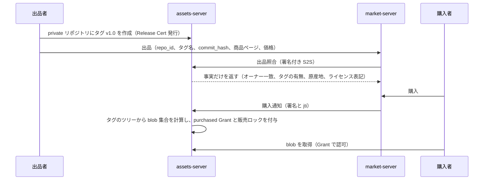

# assets VCS 設計たたき台（ローカルリポジトリ → push → Pull Request → main）

> **ステータス**: **draft** — 目標設計のたたき台。実装正本ではない（codec [x00c8](../../roadmap/slices/x00c8-vcs-object-codec.md) / 内容アドレス [x00c9](../../roadmap/slices/x00c9-vcs-content-addressed.md) / Cert v2+origins [x00ca](../../roadmap/slices/x00ca-origin-cert-v2-origins.md) **done**）  
> **スコープ**: アイテム（Prefab）先行。ワールドは後続  
> **現行正本**: [assets-server.md](assets-server.md)（Vcs 薄皮 x0062–x0065・codec x00c8・内容アドレス x00c9・**Origin Cert v2 + 原産地台帳 x00ca**。v1/x0096 は廃止）  
> **関連**: [assets-server-draft.md](assets-server-draft.md)（5 層目標像）· [assets-threat-model.md](assets-threat-model.md)（手口×対策）· [mvcc_xpbd.md](../../roadmap/mvcc_xpbd.md) §4.7（ライブ tip / 明示 Save）· [inventory-ladder.md](../../roadmap/inventory-ladder.md)  
> **ライセンス階層**: `assets-server` / `client` = MPL-2.0。オブジェクト形式（codec）= `protocol/`（Apache-2.0）。`market-server` = BSL-1.1（本書は境界だけを書く）

---

## この文書が保証すること / しないこと

| 保証する | 保証しない |
|:---|:---|
| ローカルリポジトリ → push → PR → main の目標像と、責務の置き場所を固定する | 現行コードがこの形であること |
| 決定済みの方針（§1）と、未決事項（§19）を区別して書く | 未決事項の結論 |
| 公開範囲・Quota・Origin Cert・market 境界・解析懸念について判断理由を残す | market-server の価格・決済・License Token の実装詳細 |

---

## 1. 決定事項

| 項目 | 決定 |
|:---|:---|
| 作業の流れ | ローカル（client）でリポジトリを作って commit し、assets-server に push して main へマージする |
| 公開範囲 | サーバ上のリポジトリ単位で `private` / `public` |
| マージ | 実装は fast-forward のみ（衝突はクライアント側で解消）。データモデルと API はサーバ側 3-way マージを後から足せる形にする |
| スコープ | アイテム（Prefab）先行。ワールドは後続 |
| 共同作業 | public リポジトリの fork と Pull Request |
| 認証 | ローカル操作も含め、常にログイン済みが前提 |
| main への直接 push | ブランチごとに保護を選べる。既定は保護なし（オーナーが直接 push できる）（§8） |
| Quota 負担 | fork した人。一般化すると「リポジトリのオーナーが、そのリポジトリから到達できる blob の容量を負担する」（§10） |
| 内容ライセンス | 任意で表記できる（§12） |
| public → private | GitHub と同じ「切り離し」。fork は public のまま独立して残る（§9.3） |
| Origin Cert | 「コミット受理時に作者へ（Authorship）」と「タグ作成時にオーナーへ（Release）」の 2 種類。ブランチへのマージには出さない（§11） |
| market に出す単位 | private リポジトリの Release（不変タグ）。リポジトリ本体は private のまま（§13） |
| 正規エンコード | **B: 決定的 CBOR のサブセット（Alchemy プロファイル）を自前 codec で実装**。Rust 単一実装（`protocol/`）をサーバから Port で呼ぶ（§6.5・§6.6） |
| 先行する防御 | VCS 本体より先に、現行の穴を塞ぐ 2 スライスを進める: [x00b4](../../roadmap/slices/x00b4-prefab-child-grant-required.md)（保存時の子 Grant 必須化）· [x00b5](../../roadmap/slices/x00b5-spawn-ticket-ownership-binding.md)（配置時の所有権バインド）（§14.4） |

---

## 2. 保証する / しない（目標）

| 保証する | 保証しない |
|:---|:---|
| コミットとツリーは内容アドレス（blake3）で、ローカルとサーバで同じ ID になる | オフラインでのリポジトリ作成・コミット |
| ref が進むのは compare-and-swap と fast-forward 検証の両方を通ったときだけ。途中で失敗したら ref は動かない | サーバ側 3-way マージ（拡張点だけ用意・§16） |
| サーバに新しく入るコミットの `author_sub` は、push した本人（JWT の sub）と一致する | クライアント署名付きコミット |
| 保護されたブランチは PR マージでしか進まない | PR のレビューコメント・承認フロー |
| private リポジトリの refs・コミット・ツリー・blob はオーナー以外に読めない（存在も 404 で隠す） | 未ログインでの public 閲覧 |
| public リポジトリは認証済みユーザーなら誰でも読めて fork できる | private リポジトリの fork・コラボレーター権限 |
| Origin Cert は、コミットの作者と受理時刻をサーバ鍵の署名で証明する | CA チェーン・失効・複数署名 |
| 検証に失敗したら常に拒否する（fail-closed） | 購入者・同室者・ワールド訪問者のクライアントからのコンテンツ抽出の防止（§14） |

---

## 3. 用語

| 用語 | 意味 |
|:---|:---|
| ローカルリポジトリ | client 側に置くオブジェクトストアと refs。`git init` / `git clone` で作るもの |
| リモートリポジトリ | assets-server 上の `VcsRepo` |
| working tree | 編集中の状態。VR 内では host の `live_scene_rev`（x00b3）がこれにあたる |
| Save | working tree をローカルリポジトリへ commit すること（x00b3 の「明示 Save」） |
| Release | 不変のタグ（`VcsRef` kind=tag）。market に出す単位 |

---

## 4. 責務配置

| 置き場所 | 保証すること | 保証しないこと |
|:---|:---|:---|
| `protocol/`（新モジュール。例: `vcs_object`） | Tree / Commit の正規エンコード・厳格デコード・ハッシュ。サーバ用 Port バイナリ | 保存・マージ・認可 |
| 新しい純粋クレート（例: `alchemy-vcs-core`、MPL-2.0） | ツリーの diff と 3-way merge（IO なし） | ファイル IO・ネットワーク・エンコード形式の定義 |
| `client/shared-sim` | 編集中のシーン部分木とアイテムツリーの相互変換（`local_id` と entity の対応づけ） | オブジェクトの保存・ハッシュ形式・マージの判断 |
| 新しいクレート（例: `client/vcs-store`） | ローカルのオブジェクトストア・refs・HEAD・remote 設定。init / clone / commit / branch / fetch / pull / push | シーン編集・描画 |
| `client/app` | Save・push・PR・公開範囲・ブランチ保護・ライセンス設定の UI | オブジェクト形式の知識 |
| `assets-server`（`Assets.Vcs`） | 受理時の検証・ref 更新・ブランチ保護・visibility・fork・PR・FF マージ・Quota・Origin Cert・購入 Grant の受け口 | マージアルゴリズム本体、価格・決済・License Token の署名 |
| `market-server`（BSL-1.1・未導入） | 価格・決済・エスクロー・License Token | Tree / blob の中身を読むこと（§14.1） |

`shared-sim` に保存やマージを入れない理由: `shared-sim` は「IO を持たない決定論シミュレーション基盤」という保証で切られているため。

---

## 5. オブジェクトモデル

### 5.1 種類

| 種類 | ID | 中身 |
|:---|:---|:---|
| Blob | blake3（既存 CAS） | メッシュ・テクスチャなどのバイト列。変更なし |
| Tree | 正規バイト列の blake3 | アイテムの子一覧と、任意のライセンス表記 |
| Commit | 正規バイト列の blake3 | ツリー・親・作者・メッセージ |

### 5.2 Tree v1（アイテム）

現行 `Prefab.Payload` v1 と同じ論理構造に、ライセンス表記を足す。

| フィールド | 内容 |
|:---|:---|
| `children[]` | `local_id`（1〜255 バイトの UTF-8）、`blake3`、任意の `trs`（f32 LE 40 bytes・x00c8） |
| `license` | 任意。SPDX 式または `LicenseRef-*`（§12） |
| `license_text` | 任意。独自ライセンス本文の blob の blake3 |

不変条件: `children` は `local_id` のバイト順で昇順に並べ、重複を許さない。`local_id` は 3-way マージの単位になるため一意でなければならない（現行の `Payload.validate` は「空でないこと」しか見ていない）。

### 5.3 Commit v1

| フィールド | 内容 |
|:---|:---|
| `tree` | Tree の blake3 |
| `parents[]` | 0〜2 個。0 = ルート、1 = 通常、2 = 将来のマージコミット。順序に意味がある（先頭 = 取り込み先の系統） |
| `generation` | ルートは 1、それ以外は「親の generation の最大値 + 1」。祖先判定の打ち切りに使う |
| `author_sub` | 作者の sub（1〜255 バイト、`\|` を含まない） |
| `created_at_ms` | クライアントが申告する非負の時刻 ms（CBOR uint。参考値。信頼できる時刻は Origin Cert 側に持つ） |
| `message` | UTF-8、上限 4 KiB |

現行の祖先判定は深さ 64 で打ち切っている（[`Assets.Vcs`](../../../assets-server/lib/assets/vcs.ex) の `@max_ff_depth`）。これでは実運用の履歴長に耐えない。generation があれば「辿っている側の generation が古い側を下回ったら打ち切り」で有界に判定できる。

### 5.4 上限（初期値の案）

| 項目 | 上限 |
|:---|:---|
| Tree の子の数 | 4096（SceneBudget x00a2 と同じ桁） |
| 1 回の push で新しく入るコミット数 | 256 |
| オブジェクト 1 個のバイト数 | 1 MiB |
| 祖先探索で訪問するコミット数 | 10,000 |

---

## 6. 正規エンコード（詳細）

### 6.1 なぜ必要か

1. **ID の一致**: ローカルで作ったコミットの ID とサーバが計算する ID が一致しないと、push のたびに ID の付け替えが起きる。
2. **可鍛性の排除**: 同じ内容を別のバイト列で表せると、同じアイテムに別々の ID が付く。重複排除が効かなくなり、「別物のオリジナル」と主張する余地も生まれる（脅威モデル①）。
3. **ID の永続性**: コミット ID は Origin Cert・タグ・market の Release から永久に参照される。エンコード結果がライブラリのバージョンや実装言語によって変わってはいけない。

つまり必要なのは次の 2 点。

- 同じ論理内容からは、常に同じバイト列が作られる
- 厳格デコードを通るバイト列は、1 つの論理内容につき 1 通りしかない

### 6.2 形式の比較

| 形式 | 決定性の根拠 | 浮動小数 | Rust 側 | Elixir 側 | スキーマ拡張 | 評価 |
|:---|:---|:---|:---|:---|:---|:---|
| protobuf | **仕様では保証されない**。フィールド順・packed・既定値の省略・未知フィールドの扱いは実装依存で、デコーダは非正規形も受け入れる | バイナリなので文字列化の問題はない | `prost` が既にある | ライブラリなし（新規 Hex 依存か Port） | フィールド番号で容易 | 既存資産は使えるが、永続 ID の根拠が「prost の現在の出力」になる |
| 正規化 JSON（RFC 8785 JCS） | 仕様あり | **数値の文字列化を ECMAScript 方式に揃える必要がある**（Jason の出力とは一致しない） | 新規クレートか自作 | Jason ＋ 数値とエスケープの自作処理 | キー追加で容易 | 読みやすいが、言語間の微妙なズレが最も起きやすい |
| 決定的 CBOR（RFC 8949 §4.2） | 仕様あり | 最短表現の規則（f16 になる場合もある）が細かい | 新規クレート（多くはデコード時に決定性を強制しない） | 新規 Hex 依存 | 整数キーで容易 | 標準だが、両側とも新規依存と追加実装が要る |
| 固定バイナリ（Git 型） | **本書の仕様そのもの**（固定順・固定幅・長さ前置・子はソート済み） | IEEE 754 の生ビット（NaN・Inf・-0.0 は拒否） | 自作（依存なし。blake3 は既存） | 自作も可能（バイナリパターンマッチが得意） | `kind` / `version` バイトで明示的に版上げ | 依存ゼロで、決定性が構造から保証される。デバッグ用ツールは自作が要る |

### 6.3 サーバ側の実装経路

| 経路 | 内容 | 長所 | 短所 |
|:---|:---|:---|:---|
| **Port（推奨）** | `protocol/` に codec と `vcs-object --serve` バイナリを置き、`blake3-hash --serve` と同じ `{:packet, 4}` の常駐 Port プールで呼ぶ | 実装が Rust の 1 か所だけで済む。x0039 の ManifestSeal（Elixir が JSON を渡し、Rust が正規化して hash する）と同じ型。assets-server の Dockerfile は protocol クレートを既にビルドしている。将来の 3-way マージも同じ方式で呼べる | Port が落ちると push が止まる（fail-closed なので許容）。Port の入出力用に小さな JSON 契約が要る |
| Elixir ネイティブ | 固定バイナリなら、Elixir のバイナリパターンマッチで厳格デコードを書ける | Port に依存しない | 実装が 2 つになる。ゴールデンベクタ（x0079 の DemoScene ベクタと同型）を CI で回してズレを防ぐ必要がある |
| 新規 Hex 依存 | protobuf / CBOR ライブラリを入れる | 実装量が減る | 新規依存は人の承認が必要。ライブラリが prost と同じバイト列を出す保証もない |

### 6.4 最終候補 A: 固定バイナリ（Git 型）— 不採用（比較のため残す）

- 新規依存がない（Rust は既存の blake3 だけ、Elixir は何も足さない）。
- 「厳格デコードを通る ⇔ 正規形」が構造から成り立つので、再エンコードして比較する必要がない。
- 任意フィールドを足すときは `version` を上げ、新旧のレイアウトを別々にデコードする。

レイアウトの骨子（数値はリトルエンディアン）:

```text
Tree v1
  u8   kind = 0x01
  u8   version = 0x01
  u32  child_count                 (<= 4096)
  child × child_count              (local_id のバイト順で厳密に昇順)
    u16  local_id_len (1..=255) + UTF-8 bytes
    [32] blake3
    u8   has_trs (0 | 1)
    has_trs = 1 のとき: translation[3] rotation[4] scale[3] を IEEE 754 生ビットで
                        (幅は shared-sim の TRS 型に合わせる。§19)
  u16  license_len (0 = なし, <= 255) + ASCII bytes
  u8   has_license_text (0 | 1)
  has_license_text = 1 のとき: [32] license_text の blake3
  (末尾に余りバイトがあれば拒否)

Commit v1
  u8   kind = 0x02
  u8   version = 0x01
  [32] tree
  u8   parent_count (0..=2)
  [32] × parent_count              (重複禁止。順序に意味がある)
  u64  generation
  u16  author_sub_len (1..=255) + UTF-8 bytes（'|' 禁止）
  i64  created_at_ms
  u32  message_len (<= 4096) + UTF-8 bytes
  (末尾に余りバイトがあれば拒否)

ID = blake3(上記バイト列の全体)
  先頭の kind バイトにより、Tree と Commit のハッシュ空間が分かれる
```

厳格デコードで拒否するもの:

- 未知の `kind` / `version`
- 余りバイト、長さの超過
- 子の未ソート・重複
- 不正な UTF-8
- NaN / Inf / -0.0 のビット（エンコーダ側は -0.0 を +0.0 に正規化してから書く）
- `has_*` が 0 / 1 以外
- 親の重複

### 6.5 最終候補 B: 決定的 CBOR のサブセット（Alchemy プロファイル）— 採用

RFC 8949 §4.2.1（Core Deterministic Encoding）を満たしたうえで、使う型をさらに絞ったもの。CBOR の厳格なサブセットを内容アドレスに使う先例として、IPFS の DAG-CBOR がある（規則の細部は異なる）。

プロファイルの規則:

| 規則 | 内容 | 理由 |
|:---|:---|:---|
| 使う型 | 符号なし整数・バイト列・UTF-8 テキスト・配列・マップだけ | 型が少ないほど正規形の規則が単純になる |
| 使わない型 | 浮動小数・タグ・負の整数・null / undefined・不定長 | CBOR の正規化で最も実装差が出るのは浮動小数の最短表現。null と「キー省略」の二重表現も避ける |
| 長さ・数値の頭部 | 常に最短形 | RFC 8949 §4.2.1 の要求 |
| マップのキー | 符号なし整数だけ。昇順・重複禁止 | 符号なし整数なら「エンコード後のバイト順 = 数値順」になり、キー順の流派（バイト順か長さ優先か）による差が出ない |
| 任意フィールド | 値が無いときはキーごと省略する | 同じ意味を 2 通りに書けないようにする |
| 浮動小数の値（TRS） | IEEE 754 **f32** リトルエンディアン 40 bytes（translation[3]+rotation[4]+scale[3]；NaN / Inf / -0.0 は意味検証で拒否。x00c8） | CBOR の浮動小数規則に関わらずに済む |
| ハッシュ | 32 バイトのバイト列 | — |
| 未知のキー | 拒否する | 検証できないものを受理しない。キーを足すときは、サーバのデコーダを先に更新してからクライアントを更新する |

オブジェクトの形（CBOR 診断表記）:

```text
Tree
{
  0: 1,                                    / kind = tree /
  1: [                                     / children（local_id のバイト順で昇順） /
       {0: "hat", 1: h'<32 bytes>', 2: h'<TRS: 40 bytes f32 LE>'},
       {0: "pin", 1: h'<32 bytes>'}        / trs が無い子はキー 2 を省略 /
     ],
  2: "CC-BY-4.0",                          / license（任意） /
  3: h'<32 bytes>'                         / license_text（任意） /
}

Commit
{
  0: 2,                                    / kind = commit /
  1: h'<32 bytes>',                        / tree /
  2: [h'<32 bytes>'],                      / parents（ルートは空配列。最大 2） /
  3: 7,                                    / generation /
  4: "user-123",                           / author_sub /
  5: 1763172000000,                        / created_at_ms (non-negative uint; major 1 forbidden) /
  6: "帽子の色を変更"                      / message /
}

ID = blake3(エンコード結果の全体)
  キー 0（kind）の値が違うので、Tree と Commit のハッシュ空間は分かれる
```

注意: 汎用の CBOR エンコーダの出力が、このプロファイルの正規形になるとは限らない（浮動小数やキー順の扱いがライブラリごとに違う）。書き手が何であっても、受理するのは厳格デコーダを通ったバイト列だけとする。

実装: 自前の小さな codec（数百行規模）にすれば新規依存はない。既存ライブラリ（Rust / Elixir の CBOR パッケージ）を使う場合は新規依存なので人の承認が必要で、使ったとしても上の規則を強制する厳格検証は別に要る。

### 6.6 A と B の比較と決定

| 観点 | A: 固定バイナリ | B: 決定的 CBOR のサブセット |
|:---|:---|:---|
| 決定性 | 構造から成り立つ | 厳格デコーダが最短頭部・キー昇順・型制限を強制することで成り立つ |
| 標準・相互運用 | 独自（本書が仕様） | RFC 8949 のサブセット。連合先や外部の検証者が汎用ライブラリで**読める**（書くときはプロファイルを守る必要がある） |
| デバッグ | 専用のダンプツールが要る | 汎用ツールで診断表記に変換して読める |
| スキーマ拡張 | 任意フィールドを足すたびに新しいレイアウト（version を上げて別デコーダ） | 任意キーを足すだけ。既存オブジェクトのバイト列と ID は変わらない |
| ワールドへの拡張 | SceneEntry 相当の多数のフィールド（親子・flags・色・コライダなど）を固定レイアウトで管理するのは重い | 整数キーのマップで吸収しやすい |
| 自前実装の量 | 最小 | やや多い（頭部の長さ規則・マップ・型判定）が、数百行規模 |
| 依存 | なし | 自前 codec ならなし |
| サイズ | 最小 | キーと型の頭部のぶん少し大きい（オブジェクトが小さいので実害は小さい） |
| zero-copy | 固定オフセットでビューを取れる | パースが要る（VCS オブジェクトはホットパスではないので実害は小さい） |

**決定: B（決定的 CBOR のサブセット、自前 codec）**

- 次に来るワールドはスキーマが大きく、変化も多い。B なら任意キーを足すだけで済み、既存のコミット ID を変えずに拡張できる。
- 連合先や他の運営者の market、外部の検証ツールが、汎用の CBOR ライブラリで中身を読める。
- CBOR の落とし穴（浮動小数の最短表現、キー順の流派、ライブラリが正規形を強制しないこと）は、型を絞ったサブセットにすればほぼ消える。自前で書けば新規依存も要らない。

検討の記録（A を選ぶ場合の判断材料）:

- **「他の実装」が指すもの**: Alchemy 自身の Rust コード以外で、オブジェクトを読み書きするもの全般。たとえばコミュニティ製のツール（Blender アドオン、Web ビューア）、他の運営者の連合サーバや market、外部の監査ツール、将来の別言語（Zig など）での書き直し。ただし Rust の codec は WASM や C ABI 経由で他言語から再利用できるので、これだけでは決め手にならない。
- **Rust 実装だけで進める場合の本当の差は、スキーマ拡張のしやすさ**: 純粋な固定バイナリに任意フィールドを足すと、「そのフィールドが無い内容」を旧レイアウトでも新レイアウトでも書けてしまう。同じ内容に 2 つの ID が付く（§6.1 の可鍛性）ので、「無いときは旧版で書く」といった規則を版ごとに積み上げる必要がある。
- **A でも拡張に備える方法**: 固定部分のあとに、正規化した TLV 拡張領域（タグ昇順・重複禁止・無いときは省略）を置けば拡張できる。ただしその時点で実装の複雑さは B とほぼ同じになり、独自形式である点だけが残る。
- **結論**: オブジェクトのスキーマがほとんど変わらないと見込めるなら A。ワールドまで同じ仕組みで版管理し、スキーマが育っていく前提なら B。Alchemy は後者なので B を採る。

実装の前提（A でも B でも同じだった項目）:

- Rust の単一実装（`protocol/`）を、サーバからは Port で呼ぶ（§6.3）。
- ゴールデンベクタ（固定入力 → 固定 blake3）で形式の安定性を CI に縛る。
- Port の契約（案）: 要求は `kind` とバイト列。応答は `hash`、検証結果、Elixir が DB に入れるための要約（親・generation・author_sub・子の blake3 一覧・license）。

### 6.7 参考: protobuf を使う場合の条件

既存の proto ツールチェーンを優先したい場合は、次をすべて満たすこと。

- 正規プロファイルを文書で定める（map 型と未知フィールドを禁止、repeated は packed、proto3 の既定値省略をそのまま正とする）。
- サーバの Port で「デコード → prost で再エンコード → 入力とバイト一致」を必須にする。
- prost のバージョンを固定し、ゴールデンベクタで出力が変わらないことを CI で縛る。
- 連合先や別言語の実装が同じ出力を出す保証はないことを、非保証として明記する。

---

## 7. フロー

### 7.1 オーナーがローカルで commit して push する



push 時の検証（すべて 1 トランザクションで確定する。どれか 1 つでも失敗したら何も書かない）:

1. JWT（既存の `AuthenticateUser`）と、リポジトリへの書き込み権（オーナー）
2. 対象ブランチが保護されていないこと（§8）
3. 各オブジェクトを Port で厳格デコードし、ハッシュが申告と一致すること
4. 親がサーバ上か同じ push 内にあり、generation が整合すること
5. サーバに新しく入るコミットの `author_sub` が、push した本人と一致すること
6. ツリーが参照する blob が CAS にあり、オーナーが使える Grant（`:owned` または `:imported`）を持つこと。public リポジトリでは、`:purchased` しか持たない blob を拒否する（§13）
7. ref の現在値が申告した旧値と一致し（CAS）、旧値が新値の祖先であること（FF）
8. 確定時に、オブジェクト・`vcs_repo_commits`・`vcs_repo_blobs`・原産地台帳・Origin Cert・ref をまとめて書く

### 7.2 fork して Pull Request を出す



マージ要求には、オーナーが確認した head のコミット（`expected_head`）を含める。確認したあとに fork 側の head が差し替えられていたら、409 で拒否する（レビュー後のすり替え防止）。

---

## 8. ブランチ保護

| 項目 | 内容 |
|:---|:---|
| 設定単位 | ブランチごと（`vcs_refs.protected`）。オーナーが切り替える |
| 既定 | 保護なし。main にもオーナーが直接 push できる |
| 保護あり | 直接 push とブランチ削除を 403 `ref_protected` で拒否する。PR マージでだけ進む |
| タグ | 保護設定とは関係なく常に不変（既存の `is_frozen`） |

---

## 9. 公開範囲と認可

### 9.1 認可

| 操作 | private | public |
|:---|:---|:---|
| refs・コミット・ツリー・blob の読み取り、`ItemRef` の解決 | オーナー | 認証済みユーザー全員 |
| push | オーナー | オーナー（他の人は fork 側へ push） |
| fork | 不可 | 認証済みユーザー全員 |
| PR 作成（このリポジトリを base にする） | オーナー自身のブランチから | fork を持つ人 |
| PR マージ・visibility 変更・ブランチ保護の変更 | オーナー | オーナー |

非オーナーが private リポジトリにアクセスしたときは、403 ではなく 404 を返して存在を漏らさない。

### 9.2 blob の読み取り

現行の GET は「BlobGrant または PlaceRead」が必須。ここに「読めるリポジトリの `vcs_repo_blobs` に含まれている」（RepoRead）を足す（**x00cb** 実装済み）。public だからといって検証せずに返す形にはしない。

### 9.3 public → private の切り替え（詳細）

前提として押さえておくこと:

- public だった間に、内容は誰でも読めて clone・fork できた。private にしても、すでに取られたコピーは取り戻せない。
- 内容ライセンス（CC など）を付けていた場合、配布済みの版に与えた許諾は通常撤回できない。
- fork した人は、自分の fork が参照する blob の容量をすでに負担している（§10）。

選択肢:

| 案 | fork の扱い | 評価 |
|:---|:---|:---|
| A. 切り離し（GitHub と同じ） | fork は public のまま、独立したリポジトリになる。元リポジトリに向けて開いていた PR は自動でクローズする | **決定** |
| B. 連鎖して非公開 | fork も読めなくする | fork 所有者の権利と Quota 負担を無視する。ローカル clone は消せないので実効性もない |
| C. 切り替え禁止 | fork があれば private にできない | 安全だが、オーナーが以後の更新を隠す自由を奪う |
| D. fork を削除 | 強制削除 | 破壊的なので却下 |

A を選んだときに起きること:

| 対象 | 結果 |
|:---|:---|
| 既存の fork | 切り替え時点までのコミット・blob・Origin Cert をそのまま持ち続ける（自分の `vcs_repo_commits` / `vcs_repo_blobs` / BlobRef があるため）。元リポジトリの以後の更新は取得できない（404） |
| fork 元の表示 | `forked_from_repo_id` は残し、`upstream_detached_at` を記録して「元リポジトリは非公開」と表示する |
| 元リポジトリへの PR | open のものは `closed`（理由: upstream の非公開化）にする |
| 他人の `ItemRef`（`repo@rev`） | 解決できなくなる（404）。すでに封印済みの部屋の scene hash は、既存の PlaceRead の範囲で読める（遡って取り消すことは保証しない） |
| Origin Cert | 影響なし。内容アドレスなので、コミットのバイト列と証明書があれば検証できる |

private 化は「以後の更新を見せない」操作であって、削除要請（権利侵害の取り下げ）の代わりにはならない。取り下げは別のモデレーション手続きとして扱う（本書の範囲外）。切り替える前に、UI で「公開済みの内容は fork とローカル clone に残る」と警告する。

### 9.4 private → public の切り替え

- 全ブランチ・全タグ・全履歴が読めるようになる。UI で警告し、履歴を出したくない場合は「最新スナップショットだけを新しいリポジトリに push する」方法を案内する。
- 参照 blob の中に、オーナーが `:purchased`（購入品の利用権）しか持たないものがあれば拒否する。購入品の再配布を防ぐため（§13）。

---

## 10. Quota と GC

原則: **リポジトリのオーナーが、そのリポジトリから到達できる blob の容量を負担する**（同じオーナーの中では重複排除）。Quota は現行どおり `BlobRef(owner_sub, blake3)` 単位で課金する。

| 操作 | 誰の Quota が増えるか | 付与する Grant |
|:---|:---|:---|
| 自分でアップロード | アップロードした人（現行どおり） | `:owned` |
| fork | fork した人（fork 先から到達できる blob のうち、まだ自分の BlobRef が無いもの） | `:imported` |
| PR を開く | 増えない（head のコミットは fork 側にあり、fork した人が負担済み） | なし |
| PR をマージ | base のオーナー（新しく取り込む blob のうち、まだ自分の BlobRef が無いもの） | `:imported` |

`:imported`（新設）は「容量は消費するが、原産地は主張しない」Grant。脅威モデルの黄金規則 1「hash を知っている＝所有ではない」と矛盾させないため、fork やマージでは `:owned` を付与しない。付与の根拠は、fork・マージの時点で読み取り権（public リポジトリ、または自分のリポジトリへの PR）があることに置く。同じバイト列を本人が後からアップロードした場合は、実バイトによる PoP があるので `:owned` に格上げしてよい。

Quota が足りないときは、fork / マージを 413 で拒否する（予約 → 確定は既存の `reserved_bytes` の流れに乗せる）。

GC:

- 物理バイトは、BlobRef が 1 つでも残っている限り消さない（既存の CasObject / orphan GC の流れ）。
- リポジトリを削除したとき、オーナーの BlobRef を外してよいのは、同じオーナーの他のリポジトリ（`vcs_repo_blobs`）と Drive からの参照が 0 になった blob だけ。
- 元リポジトリが削除・非公開化されても、fork 側の BlobRef が残るので fork は壊れない。

---

## 11. Origin Cert（詳細）

### 11.1 何を証明するか

Origin Cert は assets-server の鍵による署名で、「認証された主体 S が、内容 C（コミットハッシュ）を、時刻 T にこのサーバへ提出した」ことを証明する。サーバが正しく証明できるのは自分が観測したことだけなので、subject は「その瞬間に本人確認できた人」でなければならない。

### 11.2 タイミングの比較

| タイミング | subject | 長所 | 短所 |
|:---|:---|:---|:---|
| push 受理時（新しいコミットごと） | 作者（= push した本人。JWT で検証済み） | 最も早い時刻が残り、先願の証拠になる。fork・PR マージ後も同じ証明書が使える（内容アドレス）。作者を後から偽れない | コミット数ぶんの署名と行が要る（Ed25519 の署名は軽い） |
| main へのマージ時 | マージした人 | 「公式に採用された」ことは示せる | fork 経由のコミットの作者を証明できない。時刻が遅れるので先願の証拠として弱い。main は可変なので、後で巻き戻ると意味が曖昧になる |
| タグ作成時 | タグを打った人（オーナー） | 不変物に署名するので「この版を正式に出した」証明になる。market と verifier が使う単位と一致する | 作者は証明しない |
| 要求されたとき（遅延発行） | — | 行が少ない | 署名時刻が要求時刻になり、先願の証拠にならない |

### 11.3 決定: 2 種類に分ける

Git の慣行（コミット署名とタグ署名はあるが、ブランチには署名しない）と、ソフトウェア供給網の慣行（不変の成果物に、生成した時点で署名する）に合わせる。

| 種類 | 発行タイミング | subject | 束ねるもの | 用途 |
|:---|:---|:---|:---|:---|
| Authorship Cert | コミットがサーバに初めて入ったとき（push 受理、`promote_prefab`、将来のサーバ側マージコミット作成） | コミットの作者 | `commit_hash`（ツリー・親・作者を含む） | 作者と先願の証明 |
| Release Cert | タグ作成時 | タグを打ったオーナー | `repo_id` ＋ タグ名 ＋ `commit_hash` | 正式版の証明。market 出品・verifier の監査 |

ブランチ（main を含む）へのマージには証明書を出さない。誰がいつマージしたかは、PR の行（`merged_by` / `merged_at`）に監査記録として残す。

### 11.4 v2 署名メッセージ（案）

```text
v2|commit|{commit_hash}|{author_sub}|{issued_at_ms}|{kid}
v2|release|{repo_id}|{tag_name}|{commit_hash}|{signer_sub}|{issued_at_ms}|{kid}
```

- `issued_at_ms` を署名に含める。v1 は時刻を署名しておらず、DB の `inserted_at` を書き換えられると先願の証拠にならない。
- `kid` で鍵ローテーションに備える。
- `|` 区切りは v1 と同じ。`author_sub` は `|` を禁止済みで、タグ名も既存の `Ref` 検証で `|` を禁止済み。
- コミットのバイト列と証明書があれば、DB を引かずに検証できる（blake3 の一致 ＋ 署名）。v1 は対象の行を DB で引く必要があった。

### 11.5 原産地（先願）台帳

`vcs_blob_origins(blake3, first_commit_hash, author_sub, first_seen_at)` を、blob がコミット経由で初めてサーバに入ったときに 1 行だけ書く。脅威モデル①の「先願原産地ロック」と、market 出品時の照合（§13）に使う。照合は完全一致（同じ blake3）だけで、改変コピーの検出は扱わない（§14.5）。

### 11.6 rebase・fork・マージとの関係

| 操作 | 証明書への影響 |
|:---|:---|
| 貢献者が自分のコミットを rebase して push | 新しいコミットに新しい Authorship Cert が付く。古いコミットの証明書も、その古いバイト列に対しては有効なまま |
| fork | 新しい証明書は出ない（コミットは同じハッシュのまま共有される） |
| PR の FF マージ | 新しい証明書は出ない（fork への push 時に発行済み） |
| オーナーが他人のコミットをローカルで rebase して push | `author_sub` が push した本人と違うので拒否する。作者の偽装を防ぐため。他人のコミットは PR 経由で取り込む |
| 将来のサーバ側マージコミット | マージコミットの作者 = マージした人として Authorship Cert を発行する。親として貢献者のコミットが残るので、その証明書も生きる |
| squash マージ | 提供しない（作者の証明が消えるため） |

---

## 12. 内容ライセンス

| 項目 | 内容 |
|:---|:---|
| 置き場所 | Tree の任意フィールド `license`（§5.2）。Git でリポジトリに `LICENSE` ファイルを置くのと同じ考え方 |
| 値 | SPDX 式（例: `CC-BY-4.0`、`CC0-1.0`、`CC-BY-NC-4.0`）、または `LicenseRef-*` ＋ 本文 blob（`license_text`） |
| 表示 | リポジトリのページには、既定ブランチの先頭コミットのライセンスを出す |
| 変更 | 新しいコミットで変える。過去の版のライセンスはその版に残る（配布済みの版への許諾は遡って変わらない） |
| fork | 内容の一部なので、そのまま引き継がれる |
| 強制 | サーバはライセンスを解釈・強制しない（非保証）。market 出品時の判断材料にはなる（market 側のポリシー） |

リポジトリのメタデータではなくツリーに置く理由: ライセンスは版ごとに付くものなので、コミットハッシュと Origin Cert に束ねておけば「どの版がどの条件で配られたか」を後から証明できる。

Alchemy 自体のコードライセンス（MPL-2.0 など）や商標（[`TRADEMARKS.md`](../../../TRADEMARKS.md)）とは別物。

---

## 13. market-server との境界

### 13.1 「private を market に出す」というイメージについて

おおむね合っている。正確には「private リポジトリそのもの」ではなく、**private リポジトリの Release（不変タグ）を出品する**。[assets-server-draft.md](assets-server-draft.md) の Shopfront / ShopRelease（「不変の Git Tag をピン留めして公開」）とも一致する。

| 対象 | 扱い |
|:---|:---|
| リポジトリ本体 | private のまま。履歴・他のブランチ・他のタグは購入者に見えない |
| 購入者が得るもの | market が署名した License Token と、そのタグのツリーが参照する blob だけを対象にした `:purchased` Grant（Quota を消費しない） |
| 購入者ができないこと | リポジトリの閲覧・fork・履歴の取得。購入した blob を public リポジトリに push すること、それを含むリポジトリを public にすること |
| 出品者ができないこと | 売れたタグの付け替え・削除（Immutable Tag・脅威モデル③）、売れた blob の削除（`is_locked_by_sale`） |
| public リポジトリ | 誰でも読めるので、無料配布は public にするだけで足りる。public のタグを有料で出すことは妨げないが、保護は何もない |

`:purchased` Grant の範囲は「そのタグのツリーから計算した blob 集合」に限る。リポジトリ全体の `vcs_repo_blobs` を使うと、他の版の blob まで読めてしまう。

### 13.2 出品と購入の流れ



### 13.3 責務の分担

| 処理 | assets-server（MPL-2.0） | market-server（BSL-1.1） |
|:---|:---|:---|
| Release の実体 | タグ・ツリー・blob・Release Cert | 参照（`repo_id` / タグ名 / `commit_hash`）だけを持つ |
| 出品時の照合 | 事実を返す（出品者がオーナーか、タグがあるか、原産地台帳で他人の blob が含まれるか、ライセンス表記） | 返された事実をもとに、出品を許可するかを決める |
| 購入 | 署名付きの購入通知を検証し（署名 ＋ `jti` のべき等・脅威モデル⑦）、`:purchased` Grant と販売ロックを付与する | 価格・決済・エスクロー・License Token の発行 |
| 商品ページ | — | 出品者が用意したタイトル・説明・サムネイル・価格 |

---

## 14. 解析・抽出の懸念

「解析される」経路は 2 つある。分けて考える。

### 14.1 market-server（とその運営者）が中身を解析する

**対策: market-server を中身から切り離す（content-blind）。**

- market-server が持つのは、参照（`repo_id` / タグ名 / `commit_hash`）と、出品者が自分で用意した商品ページの素材だけにする。
- assets-server は market-server に blob や Tree の読み取り権を与えない。サイズや子の数などの要約が必要なら、assets-server が数値だけを返す。
- 連合先や第三者が market を運営しても、渡るのはハッシュとメタデータだけになる。ハッシュから中身は復元できない（候補のファイルを持っている人が「一致するか」を確かめることはできる）。

残る限界: assets-server の運営者は CAS を読める。サーバ側の保存時暗号化は、鍵を持つ運営者自身には効かない。運営者からも隠すには、クライアント側で暗号化して鍵を購入者だけに配る方式（E2E）が必要になる。ただし 14.2 の理由で効果が限られ、重複排除も効かなくなる。将来の検討事項とし、本書では保証しない。

### 14.2 購入者や同じ部屋にいる人が、クライアントから抽出する

**原理的に完全には防げない。** 描画するには、復号済みのデータがクライアントのメモリと GPU に載る必要がある。誰かが購入したアバターを部屋で着れば、同室者全員のクライアントがそれを受け取って描画する（脅威モデル①の「見る権利」優先）。client は MPL-2.0 で公開されているので、難読化しても秘密にはならない。

そのため「抽出させない」ではなく、「抽出しても得をしにくくする」層を重ねる。

| 層 | 内容 | 状態 |
|:---|:---|:---|
| 配るものを最小にする | 購入者に渡るのはタグ時点のスナップショットだけ。履歴・他のブランチ・編集用の元データは private リポジトリに残る。元データ（高解像度・編集用）と配布用データ（最適化済み）を分け、配布用だけをリリースする運用を推奨する | 本設計で実現 |
| サーバの取得制限 | Grant か PlaceRead か RepoRead（x00cb）がなければ取得できない | 現行 ＋ 本設計 |
| プラットフォーム上の利用監査 | 着用・配置時に world-server の verifier が License Token / Origin Cert を確認する。抽出したデータを再アップロードしても、完全一致なら原産地台帳で作者違いを検出できる | 目標（assets-server-draft の外部境界③） |
| 出所の証拠 | Origin Cert（署名付きの受理時刻）で先願を示し、削除要請の根拠にする | 本設計で実現 |
| 利用規約 | 抽出・再配布の禁止と、取り下げの手続き | 運用 |
| ローカルキャッシュの暗号化 | キャッシュを直接コピーするだけの手口に対してハードルを上げる。GPU からの取得は防げない | 任意・非保証 |

### 14.3 ワールドとアイテムの比較（運用での防御）

想定している運用: ワールドは private リポジトリの Release として公開し、訪問者を Guest にして編集できなくする。

**Guest が止めるもの・止めないもの**

| 止めるもの（公式の操作） | 止めないもの |
|:---|:---|
| canonical scene への書き込み（現行も writer = `owner_sub` ∪ `editor_subs` だけ・x009d） | 訪問者のクライアントへのデータ配布。描画のため、訪問者は Room Token で PlaceRead を取得し、ワールドのメッシュを全部ダウンロードする（現行の client が入室時に行っている） |
| ワールドのオブジェクトを自分の Drive やリポジトリに保存すること（§7.1 の push 検証で、Grant の無い blob を参照するコミットは拒否される） | 改造したクライアントによる、ダウンロード済みデータの抽出・解析 |
| private リポジトリの履歴・ブランチ・他の版の閲覧（訪問者が使うのは部屋単位の PlaceRead で、RepoRead ではない） | — |

つまり Guest 運用は「公式の手段では複製・編集できない」ことは保証するが、「解析できない」ことは保証しない。この意味で、ワールドとアイテムの防御水準は同じになる。

| 観点 | ワールド | アイテム |
|:---|:---|:---|
| データを受け取る人 | 訪問者全員 | 持ち主と、取り出した部屋の同室者 |
| 公式の手段での複製 | 不可（Guest ＋ push 検証） | 不可（take_out は Grant 必須、push 検証） |
| 改造クライアントによる抽出 | 防げない | 防げない |
| 抽出物を公式の場で使うこと | 監査で抑える（完全一致は原産地台帳、改変はライセンス階層③） | 同左。加えて着用・配置時に License Token を確認できる |

アイテムについての方針: 解析そのものは防げない前提に立ち、次の 3 点を守ることを目標にする。

1. **公式の経路では一切コピーできない**: take_out は Grant 必須。他人の blob を参照するコミットは push で拒否する。
2. **抜いても公式の場では使えない**: 着用・配置時の verifier による License Token / Origin Cert 監査。完全一致の再アップロードは原産地台帳で作者違いを検出する。
3. **出所を証明できる**: Origin Cert の署名付き受理時刻を、取り下げ請求の根拠にする。

追加の選択肢（将来・非保証）: 同室者には閲覧用のバリアント（LOD を下げたもの、子構成を焼き込んで編集用の構造を持たないもの）だけを配り、完全版は持ち主にだけ配る。同室者が抜き出しても価値が下がる。ただし持ち主（購入者）は常に完全版を持つので、購入者による抽出には効かない。クリエイターがバリアントを用意する手間と容量も増える。

### 14.4 防げるところ（サーバ側で強制する対策）

host-server はユーザーの PC で動くので、改造されている前提で扱う。部屋の中で受け取ったデータの抽出はトレードオフとして受け入れる。そのうえで、**認可の判定はすべて world-server / assets-server で行い、host-server の判定には頼らない**。

| 優先 | 対策 | 防ぐもの | 現状 |
|:---|:---|:---|:---|
| 1 | **配置時の所有権バインド**: take_out 時に assets-server が短命の署名付きチケット（SpawnTicket: `sub`・`room_id`・blake3 一覧・`jti`・数十秒の `exp`）を発行する。world-server は scene / overlay への追記時にチケットを検証する（assets の公開鍵で署名検証、`room_id` の一致、`sub` が部屋の参加者であること、blake3 がチケットに含まれること、`jti` は 1 回限り） | 「hash を知っているだけ」で読み取り権を得ること（改造 host が他人の hash を自分の部屋に置いて PlaceRead で読む経路） | **実装済み**（[x00b5](../../roadmap/slices/x00b5-spawn-ticket-ownership-binding.md)）。`extra_blake3` は無効のまま（配置はチケット経路） |
| 2 | **保存時の子 Grant 必須化**: `save_prefab` / `create_prefab_node` / `promote_prefab` / `ItemRef` `repo_rev` で、子の blob すべてに Grant を要求する | 部屋で見かけた他人の hash を自分の Drive やリポジトリに保存し、後の経路（VcsRepo の take_out など）で読み取り権に化けること | **実装済み**（[x00b4](../../roadmap/slices/x00b4-prefab-child-grant-required.md)）。判定は `Assets.Blobs.assert_child_grants/2`。take_out 側の子 Grant 検証（x007f）は多層防御として残す |
| 3 | push 時の Grant 検証（§7.1）、`:purchased` だけの blob を public に出さない（§9.4・§13）、原産地台帳で他人の販売ロック済み blob を「新しいオリジナル」として受理しない（脅威モデル①） | 公式経路での複製・再配布・偽の原産地主張 | 本設計で実現 |
| 4 | **大量取得の抑制**: assets-server の GET に `sub` 単位の量と頻度の上限、PlaceRead の発行に `sub` 単位の上限を設ける（既存の x0071 / x0084 は IP と Room Token の `jti` 単位） | 多数の部屋を巡回して自動で収集すること | 一部（PlaceRead 発行のレート制限のみ） |
| 5 | PlaceRead の寿命を seal に縛る（既存）。必要なら TTL を短くする | 部屋を出たあとも長く取得し続けること | 現行（退出時の即時失効は非保証） |
| 6 | 閲覧用バリアント（§14.3）、ローカルキャッシュの暗号化 | 同室者による抽出の価値、キャッシュの単純コピー | 将来・任意 |

1 の補足:

- ワールド制作者が canonical scene にメッシュを置くときも、同じチケットを使う（制作者は自分の blob に `:owned` Grant を持つ）。
- 将来 private リポジトリの Release をワールドとして公開するときは、assets-server がタグの blob 集合をまとめて証明するチケットを発行する形に広げる。
- チケットを要求するのは新しい追記だけにする。既存の scene（DemoScene など）は遡及検査しない（x00b5 Phase 0）。

受け入れるトレードオフ（防がない）:

- 部屋の host（host-server の運用者）は、その部屋に置かれたデータをすべて受け取る。
- 参加者の改造クライアントは、受け取ったデータを抽出できる。

### 14.5 OSS ツリーに置かないもの

改変されたコピー（頂点をずらしたメッシュなど）の検出、知覚ハッシュ、pgvector による類似度判定、購入者ごとの電子透かしとその検出閾値は、ライセンス階層③（Proprietary・別リポジトリ）の領域。本 OSS ツリーには注入点だけを置き、実装しない（`Assets.Quarantine.Worker` と同じ考え方）。

---

## 15. サーバのデータモデル変更

| テーブル | 変更 |
|:---|:---|
| `vcs_repos` | `visibility`（private / public）、`default_branch`（`"main"`）、`forked_from_repo_id`、`upstream_detached_at` を追加 |
| `vcs_objects`（新規） | `(hash, kind, bytes)`。Tree / Commit の正規バイト列 |
| `vcs_commits` | 主キーを `commit_hash` に変更。`generation` など、Port の要約から索引用の列を持つ。`parent_commit_id` と `tree_json` は廃止 |
| `vcs_commit_parents`（新規） | `(commit_hash, idx, parent_hash)` |
| `vcs_repo_commits`（新規） | `(repo_id, commit_hash)`。fork や PR でオブジェクトを複製せずに共有する |
| `vcs_repo_blobs`（新規） | `(repo_id, blake3)`。push・fork・マージ時に更新し、読み取り認可と GC の参照元に使う |
| `vcs_blob_origins`（新規） | `(blake3, first_commit_hash, author_sub, first_seen_at)`（§11.5） |
| `vcs_refs` | `commit_id` を `commit_hash` に変更し、`protected` を追加 |
| `vcs_pull_requests`（新規） | `base_repo_id`、`base_ref`、`head_repo_id`、`head_ref`、`author_sub`、`status`（open / merged / closed）、`close_reason`、`merge_strategy`（今は `ff_only` のみ。`three_way` は予約）、`merged_commit_hash`、`merged_by`、`merged_at` |
| `vcs_certs` | `cert_kind`（commit / release）、`issued_at_ms`、`kid`、`message_version` を追加 |
| `blob_grants` | `grant_type` に `imported` を追加（market 導入時に `purchased`） |

---

## 16. サーバ側 3-way マージへの拡張点

- コミットの `parents` が配列なので、マージコミットをそのまま表現できる。
- PR に `merge_strategy` を持たせておけば、`three_way` を足すだけで API の形を変えずに済む。
- マージアルゴリズムは `alchemy-vcs-core` に 1 つだけ実装し、クライアントの pull と同じものをサーバも使う。サーバからは §6.3 と同じ Port 方式で呼ぶ（Rustler NIF を避ける既存方針 x0075 / x008d と整合し、新規 Hex 依存もない）。
- アイテムのマージ単位は child（`local_id`）。両側が同じ `local_id` を別々の内容に変えた場合と、片側が削除して片側が変更した場合は衝突とする。
- サーバが作るマージコミットの作者はマージした人で、Authorship Cert を発行する（§11.6）。

---

## 17. 既存からの移行

| 対象 | 移行 |
|:---|:---|
| x0062 の UUID コミット | `promote_prefab` を内容アドレスのルートコミット生成に置き換える（**x00c9**）。既存 UUID/`tree_json` 行の in-place 再エンコードは **未実装** — x00c9 は開発/hermetic DB 向け **破壊的 DROP+再作成**（本番 UUID VCS 未出荷前提）。将来本番データがある場合は別 Slice で移行パスを足す |
| Origin Cert v1 | **x00ca** で v2 のみ発行・検証。v1 行は移行時 DELETE（互換検証なし） |
| `ItemRef` | `rev` は ref 名かコミットハッシュにする。「オーナーか」のチェックを「読めるか」（§9.1）に変える — **x00cb** |
| `DriveNode(kind=vcs_repo)` の take_out | 現在は非保証。`repo@main` を取り出せるようにする |
| `Prefab.Payload` | `local_id` の一意性検証を追加する（§5.2） |

---

## 18. スライス分割案（ID は採番時に決める）

VCS と独立に先行するもの（§14.4。現行の穴を塞ぐので優先度が高い。着手順は小さい x00b4 から）:

- [x00b4](../../roadmap/slices/x00b4-prefab-child-grant-required.md) — 保存時の子 Grant 必須化（`save_prefab` / `create_prefab_node` / `promote_prefab` / `ItemRef` の `repo_rev`）。assets-server のみ
- [x00b5](../../roadmap/slices/x00b5-spawn-ticket-ownership-binding.md) — 配置時の所有権バインド（assets の SpawnTicket 発行、world の検証、host / client の受け渡し）

VCS 本体（ID は着手時に採番）:

1. オブジェクト形式: `protocol/` に §6 で選んだ形式の codec・厳格デコード・ゴールデンベクタ・Port バイナリ — **[x00c8](../../roadmap/slices/x00c8-vcs-object-codec.md)**
2. サーバ DB の移行（内容アドレス・parents・generation・objects・repo_commits）と `promote_prefab` の置き換え — **[x00c9](../../roadmap/slices/x00c9-vcs-content-addressed.md)**
3. Origin Cert v2（Authorship / Release、`issued_at_ms`・`kid`）と原産地台帳 — **[x00ca](../../roadmap/slices/x00ca-origin-cert-v2-origins.md)**
4. visibility、RepoRead（GET 認可）、`ItemRef` の読み取り判定、private の 404 — **[x00cb](../../roadmap/slices/x00cb-vcs-visibility-reporead.md)**
5. push API（negotiate → blob アップロード → push）、サーバ側の検証、ブランチ保護 — **[x00cc](../../roadmap/slices/x00cc-vcs-push.md)**
6. client のローカルストア（`vcs-store`: init / clone / commit / branch / fetch / push）＋ HTTP negotiate/push — **[x00cd](../../roadmap/slices/x00cd-vcs-http-store.md)**（本 Slice は init / commit / push + HTTP；clone/fetch は後続）
7. shared-sim の部分木 ⇔ ツリー変換と Save UI（x00b3 の「明示 Save」負債をここで回収）
   - **UI 先行切り出し:** Context ラジアル「保存」→ Drive put_back — **[x00ce](../../roadmap/slices/x00ce-grab-radial-drive-save.md)**（**done**；VCS commit は Drive 詳細パネル後続）
8. fork、`:imported` Grant、Quota
9. PR（作成・クローズ・FF マージ・`expected_head`）と、public → private 時の切り離し
10. 内容ライセンスの表示と設定 UI
11. （後続）サーバ側 3-way マージと衝突表示
12. （後続・market 導入時）出品照合 API、購入通知の受け口、`:purchased` Grant、販売ロック
13. （後続）ワールドへの拡張

---

## 19. 未決事項

- TRS の精度: **v1 は f32 LE 40 bytes（x00c8 で確定）**。f64 への版上げは将来のスキーマ拡張（整数キー追加ではなく TRS バイト長の別キー）で検討
- 到達不能になったコミット（rebase 前など）の保持期間と GC
- fork 時の `vcs_repo_commits` 複製のスケール（大きなリポジトリでは、fork 元を辿る方式も検討する）
- 未ログインでの public 閲覧を将来許すか
- 他人のコミットや blob を含む Release を market に出品できるか（market 側のポリシー。assets-server は事実を返すだけ）
- E2E 暗号化（§14.1）を将来検討するか
- SpawnTicket の詳細（参加者判定・鍵・既存 scene の扱いなど）は [x00b5](../../roadmap/slices/x00b5-spawn-ticket-ownership-binding.md) で確定・実装済み

← [assets-server.md](assets-server.md) · [assets-server-draft.md](assets-server-draft.md)
