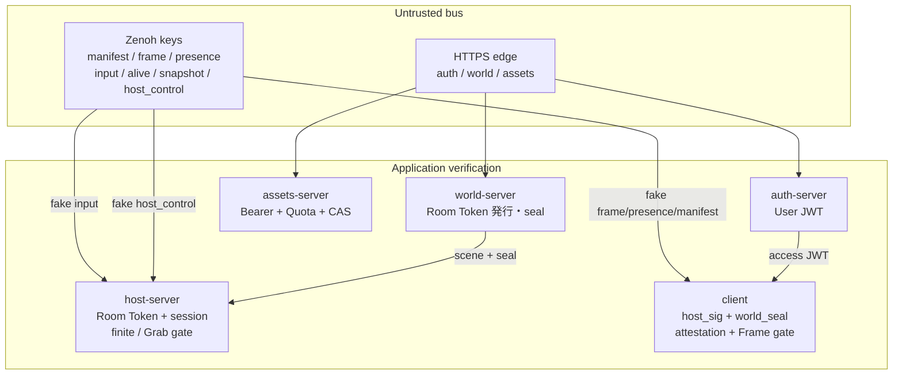

# Trust boundary（脅威モデル）

> **正本**: 本ファイル（x0031 / P4-3）  
> 関連: [overview](overview.md) · [protocol](protocol.md) · [zenoh-router](zenoh-router.md) · [client](client.md) · [auth-server](auth-server.md)

目的: **未認証の publisher が各経路に到達したとき、誰が何を防ぐか**を一箇所に固定する。  
「保証しない」一覧の繰り返しではなく、**脅威 → 防御責任 → 非保証**の対応表とする。

## 信頼境界の図

**原則:** zenohd は Token を見ない（[zenoh-router](zenoh-router.md)）。防御は **host / client / HTTP 門番**のアプリ層にある。transport TLS（x0022）は盗聴耐性であり、なりすましの唯一の防御ではない。

## Zenoh キー × 脅威 × 防御

| Zenoh key 族 | 偽 publish の被害 | 現状の防御 | 保証しない |
|:---|:---|:---|:---|
| `…/input` | なりすまし操作・物理発散 | host: Room Token（bind）+ Ed25519 session（x0023）+ `is_finite` / magnitude / Grab 距離（x0021） | zenohd ACL・帯域上限 |
| `…/frame` | 偽描画・NaN | client: `host_sig` + Manifest `host_pub`（attestation）+ finite / tick / snapshot（x0023–x0024） | 確実配送 ACK |
| `…/presence` | 偽スロット・偽退室表示・旧 Presence replay | client: pin + `host_sig` + generation/revision ゲート（x0025 / x003a） | Presence の world 署名 |
| `…/manifest` | 改ざん配置・偽 host_pub・旧 seal replay・同一 gen 鍵すり替え | `world_seal` + HostAttestation + **`(generation, revision)` 単調ゲート** + **同一 gen 内 `host_pub` 固定**（x0026 / x003a）；失敗は **discard**（x0038） | UGC 編集 ACL；完全な handoff UX；二重 host の generation フリップフロップ |
| `…/alive` | 偽 Delete で退室 | host: liveliness を検証済み jti に紐付け（x0022） | WAN liveliness ACL |
| `…/snapshot` | 偽全置換 | client: Frame と同じ host_sig / finite 前提で適用 | queryable 認証の別チャネル |
| `…/host_control` | 遠隔プロセス停止 | **既定オフ**（x001e）。launcher 経路は localhost IPC（x0032） | WAN 上の無認証 Zenoh control |

キー式の一覧は [zenoh-router.md](zenoh-router.md) の MVP 表および protocol の `*_key` ヘルパ。

## HTTP 門番

| 経路 | 偽 / 不正リクエストの被害 | 現状の防御 | 保証しない |
|:---|:---|:---|:---|
| auth `/api/*` | 資格情報窃取・なりすまし JWT | TLS（Tunnel prod）+ 認証フロー；release シード fail-closed（x001e） | `/dev/*` を公網に出すこと |
| world Room Token / scene / seal | 不正入室・偽 scene | Bearer + host role（x0021）+ owner 系 + visibility ACL（x0034–x0036） | Group ACL / 一覧 UI；client アクセスレベル仮 UI（x0037）は門番ではない |

| assets GET/PUT | 容量食い・他人 blob 読み | Bearer + Quota 原子更新（x002d）；GET は認証済み読み取り capability（[client.md](client.md)） | BlobGrant（所有者/license） |

## ホスト端末プロセス境界

| 経路 | 脅威 | 防御 |
|:---|:---|:---|
| Zenoh `host_control` | WAN peer が shutdown を送る | 既定購読しない（`ALCHEMY_HOST_CONTROL` opt-in・x001e） |
| launcher → host | ローカルのみ graceful stop | TCP `127.0.0.1` + ワンタイムトークン（x0032） |
| client Exit → host | 誤って全員の部屋を落とす | client 終了 ≠ host 終了（launcher が分離監視） |

## 参照スライス

| ID | 境界まわり |
|:---|:---|
| x001e | Tunnel prod / host_control off / seed / assets CI |
| x0021 | Token refresh / clamp / host role |
| x0022 | liveliness jti / WAN TLS |
| x0023–x0026 | session / Frame 検証 / snapshot / attestation / seal |
| x0030 | shared-sim（分類の単一正本；信頼境界の変更なし） |
| x0032 | launcher localhost IPC（実装済み） |
| x0038 | Manifest / Presence 検証失敗は discard（leave しない） |
| x0039 | canonical ManifestSeal（署名 oracle 廃止） |
| x003a | `(host_generation, revision)` 単調ゲート（replay 拒否） |
