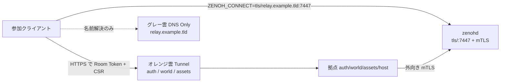

# relay-server DNS / Let's Encrypt（追加章）

> **正本の WAN 運用**（world が署名する短命 mTLS・zenohd の client CA 検証・systemd・smoke）は [`relay-server-wan.md`](relay-server-wan.md)。  
> 本書は **DNS Only（グレー雲）でドメイン名を付け、サーバ証明書を Let's Encrypt で自動更新する** 追加手順のみ。

第一級トランスポートは **`tls/<host>:7447`**（[`config.wan.json5`](../../../relay-server/config.wan.json5)）。`quic/` 待受や公網平文 `tcp/` は現状の保証外（目標アーキの将来案）。

## 1. 概要

HTTP の auth / world / assets は Cloudflare Tunnel（オレンジ雲）で拠点 IP を秘匿できる。一方 `zenohd` の `7447` は Tunnel の HTTP プロキシを通れないため、**DNS Only（グレー雲）の A レコード**で外部 VPS の IP を返す。

client 証明書は拠点 world が署名する。この VPS が持つのは zenohd の **サーバ証明書**（本書）と、検証用の **client CA 証明書**（WAN 正本）である。



## 2. 前提

- 独自ドメインを Cloudflare DNS で管理していること
- [`relay-server-wan.md`](relay-server-wan.md) の配置を先に済ませていること（zenohd、拠点 world の `MTLS_CA_*`、VPS の `root_ca_certificate` が同じ client CA）
- 7447/tcp は mTLS 待受として到達できること（ufw は WAN 正本の節）

## 3. Cloudflare DNS（DNS Only）

1. DNS > レコード追加
   - Type: `A`
   - Name: `relay`（例: `relay.example.tld`）
   - IPv4: 外部 VPS のグローバル IP
   - Proxy: **DNS only（グレー雲）** ※オレンジ雲にしない
2. 確認（Cloudflare Anycast IP ではなく VPS IP が返ること）

```bash
nslookup relay.example.tld
```

## 4. ファイアウォール

新規の許可は WAN 正本と同じく **`ufw allow 7447/tcp`**（入場は mTLS）。送信元 IP の固定リストは推奨しない（任意硬化）。本書のために別ポートは開けない。

ベンダーのセキュリティグループも 7447/tcp をクライアントから到達できるようにする。SSH は送信元を絞ったままにする。

すでに送信元 IP 限定の 7447 ルールがあり、未知回線からも入室したい場合は、WAN 正本の ufw 節に従って `7447/tcp` の許可へ切り替える。

## 5. Let's Encrypt（サーバ証明書）+ 自動更新

差し替えるのは zenohd の **listen_certificate / listen_private_key** だけ。`enable_mtls` / `root_ca_certificate`（client CA 証明書）/ `access_control` は残す。client CA の秘密鍵は拠点 world に置いたまま（[`relay-server-wan.md`](relay-server-wan.md)）。

### 5-1. Certbot + Cloudflare DNS-01

**API トークン（最小権限）**: Cloudflare ダッシュボード → マイプロフィール → API トークン → 「ゾーン DNS を編集する（Edit zone DNS）」テンプレート。ゾーンリソースは **特定のゾーン（Specific zone）** に対象ドメインだけを選ぶ。Global API Key は使わない。

```bash
sudo apt update
sudo apt install -y certbot python3-certbot-dns-cloudflare

sudo mkdir -p /etc/letsencrypt
sudo tee /etc/letsencrypt/cloudflare.ini > /dev/null <<EOF
dns_cloudflare_api_token = ここに発行したCloudflareのAPIトークンを貼り付け
EOF
sudo chmod 600 /etc/letsencrypt/cloudflare.ini

sudo certbot certonly \
  --dns-cloudflare \
  --dns-cloudflare-credentials /etc/letsencrypt/cloudflare.ini \
  -d relay.example.tld \
  --agree-tos \
  --non-interactive \
  -m your-admin-email@example.tld
```

生成物: `/etc/letsencrypt/live/relay.example.tld/{fullchain.pem,privkey.pem}`

**権限**: `privkey.pem` は通常 `root:root` / `600`。WAN 正本の `alchemy-zenohd` が非 root で動く場合はそのまま読めない。次のいずれかで **zenohd 実行ユーザが読める** ようにする。

- `ssl-cert` グループ等へ鍵を共有し、サービスをそのグループ付きで動かす
- deploy hook で `/etc/alchemy/tls/` へ copy し、`chown` / `chmod` してから zenohd を再起動する（パスも copy 先に合わせる）

### 5-2. WAN config への反映

正本は常に [`relay-server/config.wan.json5`](../../../relay-server/config.wan.json5)。VPS 上のコピーでサーバ証明書パスだけ差し替える（**listen は `tls/`、`enable_mtls` / `root_ca_certificate` / `access_control` は残す**）。

```json5
listen: {
  endpoints: [
    "tls/0.0.0.0:7447",
  ],
},
transport: {
  link: {
    tls: {
      // 非 root の場合は copy 先（例: /etc/alchemy/tls/server-*.pem）を指す
      listen_private_key: "/etc/letsencrypt/live/relay.example.tld/privkey.pem",
      listen_certificate: "/etc/letsencrypt/live/relay.example.tld/fullchain.pem",
      // 検証用。署名鍵は拠点 world の MTLS_CA_KEY_*（同じ client CA）
      root_ca_certificate: "/etc/alchemy/tls/client-ca-cert.pem",
      enable_mtls: true,
    },
  },
},
```

client / host は公開 CA なので `ZENOH_TLS_ROOT_CA` は不要。接続先:

```bash
ZENOH_CONNECT=tls/relay.example.tld:7447
```

`tls/` のとき host / client は Token 要求に CSR を付ける。world が `mtls` を返せば、その証明書でこのホスト名へ接続する。env 名は実装どおり `AUTH_URL` / `WORLD_URL` / `ASSETS_URL`（[`edge/client.env.example`](../../../edge/client.env.example)）。

### 5-3. 更新フック（zenohd 再読込）

証明書更新後に zenohd を再起動しないと古い証明書が残る。

systemd 例:

```bash
sudo tee /etc/letsencrypt/renewal-hooks/deploy/restart-relay-server.sh > /dev/null << 'EOF'
#!/bin/bash
set -e
systemctl restart alchemy-zenohd
logger -t certbot-relay-server "Restarted alchemy-zenohd after certificate renewal"
EOF
sudo chmod +x /etc/letsencrypt/renewal-hooks/deploy/restart-relay-server.sh
```

ドライラン（deploy hook も回す）:

```bash
sudo certbot renew --dry-run --run-deploy-hooks
```

**注意**: `--run-deploy-hooks` 付き dry-run でも本番の `alchemy-zenohd` が再起動され、**短断が発生する**。メンテ窓で実行するか、検証後に hook を置く。

### 5-4. Docker で zenohd を動かす場合（任意）

イメージは **タグまたは digest を pin** する（`latest` のみは再現性が無い）。例: `eclipse/zenoh:<version>` を運用記録に残す。マウントは `/etc/letsencrypt` 丸ごと（`live` のシンボリックリンク解決のため）と WAN config、および client CA 証明書。**平文 TCP publish ポートを増やさない。**

## 6. 接続確認

```powershell
Test-NetConnection relay.example.tld -Port 7447
# AUTH_URL / WORLD_URL / ASSETS_URL
# ZENOH_CONNECT=tls/relay.example.tld:7447
# 拠点 world の MTLS_CA_* が有効であること（CSR → mtls）
```

疎通 smoke: [`relay-server-wan.md`](relay-server-wan.md) および `bash .scripts/smoke-zenoh-wan.sh`（TCP 待受のみ。TLS 握手は見ない）。

## 7. 本書が扱わないもの（正本へ）

| 項目 | 参照 |
|:---|:---|
| client CA の置き場所・world の署名・入室 | [`relay-server-wan.md`](relay-server-wan.md) |
| Relay Agent（world が `mtls` を返さないとき） | [`relay-server-wan.md`](relay-server-wan.md) · [`relay-agent/`](../../../relay-agent/) |
| role CN ACL・`wire_cap` | [`config.wan.json5`](../../../relay-server/config.wan.json5) · [`relay-server.md`](../architecture/relay-server.md) |
| 7447 の ufw | [`relay-server-wan.md`](relay-server-wan.md) ufw 節 |
| node-info 自動発見 / Connect Override UI | 未実装。接続先は `ZENOH_CONNECT` で指定する |

## 8. トラブルシュート（DNS / LE 固有）

| 症状 | 確認 |
|:---|:---|
| `RemoteAddress` が `104.21.x.x` / `172.67.x.x` | オレンジ雲になっている → **グレー雲**へ |
| TCP は通るが TLS 失敗 | SAN と `ZENOH_CONNECT` ホスト名、fullchain マウント、zenohd 再起動。client 証明書側は WAN 正本（world CA と `root_ca_certificate` の一致） |
| 更新後に突然切れる | deploy hook 未設定 / dry-run で hook 未実行 |
