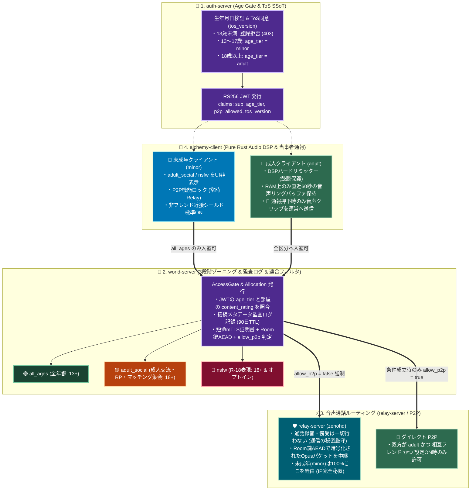

# Alchemy 音声通話・未成年保護・分散連合ゾーニング 実装計画書 (Voice Safety & Zoning Spec)

## 1. 背景と目的（法務・コンプライアンス要件のシステム実装）

Alchemy に音声通話機能（Zenoh Audio Streaming および相互フレンド間ダイレクト P2P）を実装するにあたり、日本国内法およびグローバル法規制（米国 COPPA、欧州 DSA / 英国 OSA）の双方に準拠するため、以下の **3大原則** をアーキテクチャおよびコードレベルで強制する。

1. **電気通信事業法・出会い系サイト規制法への対応（収益化ステージ分離とゾーニング）**
   - Stage 1（完全無料の非営利・個人運営）と Stage 2（サブスク・マーケット課金開始＝電気通信事業届出済み）を環境変数・設定で切り替え可能にする。
   - 「異性交際・出会いを主目的とした利用の禁止」を利用規約（`tos_version`）で同意強制しつつ、コミュニティ主導の成人向け交流（VR結婚相談RP、飲酒集会等）は **18歳未満をシステム的に完全遮断した中間ゾーニング（`adult_social`）** へ隔離することで、出会い系サイト規制法のリスクを構造的に排除する。
2. **日本の「通信の秘密（電気通信事業法第4条）」の厳守と犯罪抑止の両立**
   - **サーバー側での録音・AI常時傍受の完全禁止**: `relay-server` (`zenohd`)、`host-server`、`world-server` のいずれにおいても、通話音声ペイロードの保存・復号・傍受は一切行わない（既存の `x0069` Room 鍵 AEAD により、中継経路での盗聴も暗号学的に遮断する）。
   - **当事者録音（クライアント側オンメモリ60秒リングバッファ）による証拠提出**: 恐喝・児童誘引（グルーミング）・ハラスメント発生時は、被害者自身の `alchemy-client` が RAM 上に一時保持している直近60秒の音声クリップを、**被害者本人の意思（通報ボタン押下）によってのみ** 運営へ暗号化送信する方式を採る。
   - **通信メタデータ（接続監査ログ）の90日保存**: 音声の中身は残さず、捜査機関からの照会・開示請求に対応するための最小限の接続メタデータ（`user_id`, 接続元IP/Port, `room_id`, 入退室タイムスタンプ）のみを90日間保存し、自動パージする。
3. **グローバル基準の未成年保護（13歳未満排除・未成年P2P完全無効化・空間シールド）**
   - **13歳未満（COPPA対象）の登録ハードブロック**: `auth-server` の Age Gate で13歳未満のアカウント作成を拒否する。
   - **未成年（13〜17歳：`minor`）のダイレクトP2P強制無効化**: フレンド相手であってもダイレクト P2P 接続による自宅グローバル IP アドレス露出（居住地特定リスク）を防ぐため、`age_tier == :minor` が関与する通信は **100% `zenoh-router` (`relay-server`) 経由に強制固定** する。
   - **クライアント側 0秒セーフティ（DSP リミッター＆パーソナルスペース）**: 音量テロを防ぐハードリミッターと、非フレンド急接近時の音声・アバター自動減衰を `alchemy-client` に標準実装する。

---

## 2. 全体アーキテクチャとデータフロー



---

## 3. コンポーネント別実装仕様

### Phase 1: `alchemy-protocol`（Protobuf ワイヤ契約の拡張）

対象リポジトリ: `protocol` (`alchemy-protocol`)

1. **ゾーニング区分（`ContentRating`）と年齢区分（`AgeTier`）の定義**
   - 既存の Room / World 関連 `.proto` および Audio / Report 関連 `.proto` に以下の列挙型とフィールドを追加する（既存フィールド番号は壊さないこと）。

```protobuf
// コンテンツ・部屋の3段階ゾーニング区分
enum ContentRating {
  CONTENT_RATING_UNSPECIFIED = 0;
  CONTENT_RATING_ALL_AGES = 1;      // 🟢 全年齢 (13歳以上)
  CONTENT_RATING_ADULT_SOCIAL = 2;  // 🟡 18+ 成人交流・飲酒・結婚相談RP等 (性的表現なし・未成年遮断)
  CONTENT_RATING_NSFW = 3;          // 🔴 18+ R-18 成人向け表現 (オプトイン必須)
}

// ユーザーの年齢区分 (生年月日自体はワイヤに流さず区分のみ伝達)
enum AgeTier {
  AGE_TIER_UNSPECIFIED = 0;
  AGE_TIER_MINOR = 1;  // 13〜17歳 (P2P強制無効・all_agesのみ)
  AGE_TIER_ADULT = 2;  // 18歳以上
}
```

2. **音声ストリームパケット（`AudioFrame`）の定義**
   - Zenoh の現行 `wire_cap` キー体系（`alchemy/dev/room/{room_id}/{wire_cap}/audio/{sender_id}`）上で流す音声ペイロードを定義する。
   - **必須要件**: `x0069` の Room 鍵 AEAD で暗号化されるペイロード内部に、`sender_user_id`、`sequence`、`timestamp_ms`、`opus_payload`、および通報時の改ざん防止検証用の軽量トークン（または AEAD AAD バインド）を含める。

---

### Phase 2: `auth-server`（Age Gate・未成年判定・利用規約バージョンの強制）

対象リポジトリ: `auth-server` (Elixir / Phoenix / Ash)

1. **ユーザー登録・更新時の Age Gate（13歳未満排除と `age_tier` 算出）**
   - `User` リソースに `birth_date`（または登録時年齢確認結果）を保持し、登録アクションで以下を検証する：
     - **13歳未満**: アカウント作成を拒否（HTTP 403 / Validation Error: COPPA 準拠）。
     - **13歳以上〜18歳未満**: `age_tier = :minor` として判定。
     - **18歳以上**: `age_tier = :adult` として判定。
   - ※生年月日（`birth_date`）そのものは個人情報保護のため外部公開や JWT への直接埋め込みを行わず、計算された `age_tier`（`"minor"` | `"adult"`）と `p2p_allowed`（`age_tier == :adult` の場合のみ `true` 可）のみを JWT クレームに含める。

2. **利用規約（`tos_version`）の同意チェック強化**
   - 既存の `tos_agreed` / `tos_agreed_at` / `tos_version` カラムを活用し、サーバー設定の `REQUIRED_TOS_VERSION`（通話時の当事者録音通報への同意、出会い目的利用の禁止、13歳以上確認を含む規約バージョン）と一致しない場合は、ログイン後のトークン更新や `world-server` 入室時に規約再同意を要求するエラーコードを返す。

---

### Phase 3: `world-server`（3段階ゾーニング・P2P遮断・90日接続監査ログ・当事者通報API）

対象リポジトリ: `world-server` (Elixir Umbrella)

1. **3段階ゾーニングと連合カタログフィルタリング**
   - Room / Session スキーマに `content_rating`（`:all_ages` | `:adult_social` | `:nsfw`、デフォルト `:all_ages`）を追加する。
   - **一覧取得 API（Catalog Filter）**:
     - リクエスト元の JWT が `age_tier == "minor"` の場合、サーバー側クエリで `:adult_social` および `:nsfw` の部屋を **100% 除外** して返却する。
     - 外部の連合サーバー（Federation Node）から S2S 同期された部屋リストについても、連合ポリシー（`FederationPolicy.max_allowed_rating`）およびユーザーの `age_tier` でフィルタリングする。
   - **入室ゲート（Hard AccessGate）**:
     - `alchemy://` ディープリンクや API 直叩きで入室要求（Allocation / Room Token 発行）が来た際、`age_tier == "minor"` のユーザーが `:adult_social` または `:nsfw` の部屋へ入ろうとした場合は **必ず `403 Forbidden` で物理遮断** する。
   - **部屋の途中昇格（Rating Promotion）時の未成年自動退室**:
     - ホストが稼働中の部屋の `content_rating` を `:all_ages` から `:adult_social` または `:nsfw` へ変更した場合、部屋内に滞在している `age_tier == "minor"` の参加者の Room Token を即時失効させ、退室イベント（ホームへの強制帰還）を発火する。

2. **未成年保護のためのダイレクトP2P強制無効化**
   - 入室・Allocation レスポンス（および通話ピア交渉）において、以下のいずれかに該当する場合は **`allow_p2p: false` を強制刻印** し、通信経路を `relay-server` (`zenohd`) 1本にロックする：
     - 自分自身の `age_tier == "minor"`
     - 通話相手の `age_tier == "minor"`
     - 2人が相互フレンド（Friendship 成立）ではない

3. **「通信の秘密」に配慮した接続メタデータ監査ログ（90日自動削除）**
   - **絶対禁止事項**: 通話音声データやテキストチャット本文を常時ログ記録してはならない。
   - **実装する監査ログ（`ConnectionAuditLog`）**:
     - 入室（Room Token / 短命 mTLS 証明書発行）時に、`user_id`、`client_ip`、`client_port`、`room_id`、`content_rating`、`allocated_at`、`cert_serial_or_fingerprint` のみを DB（または専用監査テーブル）に記録する。
     - Oban ジョブまたは定期クリーンアップ Task により、**作成から90日を経過したレコードを自動的に `DELETE`** する。

4. **当事者録音クリップ添付の通報受付 API（`POST /api/v1/moderation/voice_reports`）**
   - 被害者クライアントが「🚨 通報ボタン」を押した際のみ呼び出されるエンドポイントを作成する。
   - 受信データ：
     - `reporter_user_id`（JWT から取得）
     - `reported_user_id`
     - `room_id`
     - `reason_category`（`:grooming_minor`, `:extortion_crime`, `:harassment`, `:nsfw_in_all_ages` 等）
     - `encrypted_pcm_or_opus_clip`（直近最大60秒以内の音声バイナリ。R2 の非公開・証拠保全用隔離バケットへ保存し、DB にはオブジェクトキーと BLAKE3 ハッシュのみ記録する）

---

### Phase 4: `relay-server` (`zenohd`) の音声ルーティングと ACL 整合

対象リポジトリ / ディレクトリ: `relay-server/config.wan.json5`

1. **現行 `wire_cap` キー体系での音声トピック ACL 確認**
   - 既存の `x004e` / `x0069` で確立した `alchemy/dev/room/{room_id}/{wire_cap}/...` 構造を維持する。
   - `CN=alchemy-guest` および `CN=alchemy-host` が音声サフィックス（例：`.../audio/*`）に対して `put` (ingress) および `declare_subscriber` (ingress) / `put` (egress) を行えるよう、`config.wan.json5` の ACL ルールを確認・調整する。
   - **非保存の徹底**: `zenohd` 側では音声トピックに対する Storage プラグインやファイル書き出しを一切有効にしない（純粋なオンメモリ通過のみ）。

---

### Phase 5: `alchemy-client`（Pure Rust 音声パイプライン・0秒セーフティ・60秒リングバッファ）

対象リポジトリ: `client` (`alchemy-client`)

1. **Pure Rust DSP による「0秒セーフティ（空間シールド＆鼓膜保護）」**
   - `#![forbid(unsafe_code)]` 方針を維持し、`client/audio` の再生パイプラインに以下を組み込む：
     - **ハードリミッター / コンプレッサー**: 各ピアのデコード後・空間ミキシング最終段にピークリミッター（例：`-1.0 dBFS` 天井）を挿入し、過大入力ノイズ（音量テロ）からユーザーの聴覚を保護する。
     - **パーソナルスペース減衰（非フレンド急接近シールド）**: 相手が非フレンドの場合、アバター間距離が閾値（例：`1.2m`）以内に近づいた際に音声ゲインとアバター不透明度を自動で減衰させる（未成年 `minor` モードではデフォルト強制 ON）。
     - **0秒ローカルミュート＆ブロック**: 特定ユーザー ID を指定した瞬間、ネットワーク受信層で該当 `sender_user_id` の音声パケットとアバター描画を即座に破棄（Fast Discard）する。

2. **オンメモリ60秒リングバッファ（Voice Clip Ring Buffer）の実装**
   - **平常時の動作（ディスク書き込みゼロ）**:
     - 通話中、自分が聴取しているミキシング前（または発言者タグ付き）の直近 **60秒間** の Opus パケット（または低ビットレート PCM チャンク）を、固定サイズの循環バッファ（`VecDeque` / Ring Buffer）として **RAM 上にのみ** 保持する。
     - 60秒を超えた古いフレームはメモリ上から順次上書き消去し、クライアント終了時にも完全に破棄する（ローカルディスクには1バイトも書き出さない）。
   - **通報時の動作（ユーザー明示操作時のみ送信）**:
     - ユーザーが UI 上で特定プレイヤーを選択し「🚨 直近60秒の音声を添えて通報」を実行した時のみ、リングバッファ内の該当データを切り出し、`world-server` の `/api/v1/moderation/voice_reports` へ HTTPS POST 送信する。

---

## 4. 実装ステップと Cursor エージェントへのガードレール

### 守るべきガードレール（既存実装との整合性）
1. **Zenoh キー式と Ephemeral mTLS の維持**:
   - 現行の `alchemy/dev/room/{room_id}/{wire_cap}/...` キー体系（`x004e`）および Room 鍵 AEAD（`x0069`）を壊さず、その上に音声パケットとゾーニング判定を統合すること。
2. **新規クレート・依存追加の最小化**:
   - Elixir 側・Rust 側ともに、既存の依存クレートで実装可能な部分（リングバッファ、ACL、Ash リソース拡張、DSP リミッター計算等）は新規依存を追加せずに実装すること。もし Opus エンコード/デコード等で新規クレートが必要な場合は、実装前に人間に承認を求めること。

### 推奨する実装順序
- **Step 1**: `alchemy-protocol` に `ContentRating`, `AgeTier`, 音声・通報関連のスキーマを追加。
- **Step 2**: `auth-server` に13歳未満ブロック、`age_tier` 算出、JWT クレーム埋め込みを実装。
- **Step 3**: `world-server` に3段階ゾーニング（一覧フィルタ・入室ハードゲート・途中昇格時の未成年退室）、P2P 許可判定（未成年は常時 `allow_p2p: false`）、90日接続監査ログ、音声通報受付 API を実装。
- **Step 4**: `alchemy-client` に未成年 UI フィルタ、DSP ハードリミッター、パーソナルスペース減衰、オンメモリ60秒リングバッファ通報機能を実装。

---

## 5. 実装前に詰める設計判断（オープン）

スライス分割前に方針を固定する項目。未決のまま着手すると保証表と API がぶれる。

### 5.1 通報クリップの改ざん防止（送信者帰属）

| 問い | 現状のギャップ |
|:---|:---|
| 誰が「この音声は当該ユーザーが送った」と検証できるか？ | Room 鍵 AEAD（`x0069`）は参加者**共有鍵**。部屋の外からの改ざんは防げるが、**同室の参加者なら他人の `sender_user_id` を名乗るフレームを作れる** |

- **保証したいこと**: 被害者クライアントが切り出した直近60秒クリップについて、運営側が「報告対象ユーザーの送信フレームである」ことを、共有鍵だけでは崩れない根拠で検証できること。
- **候補**:
  1. **送信者ごとのフレーム署名**（短命 mTLS クライアント鍵、または通話セッション鍵）を `AudioFrame` に付与し、リングバッファにも署名付きで保持する。
  2. 通報時にクライアントが「聴取済みミキシング後 PCM」だけを送り、**送信者帰属は保証しない**（ハラスメントの「何が聞こえたか」の証拠に限定し、話者 ID はメタデータとして扱う）。
- **決めないと困るスライス**: 音声ワイヤ契約（`AudioFrame`）、通報 API、保証表の「何を証拠として主張するか」。
- **暫定推奨**: 証拠として話者帰属を主張するなら候補 1。運用が「聴取内容の保全」に留まるなら候補 2 を明示し、保証表に「送信者帰属は非保証」と書く。

### 5.2 JWT クレームは `age_tier` のみにするか

| 問い | 論点 |
|:---|:---|
| `p2p_allowed` を JWT に載せるか？ | `p2p_allowed` は `age_tier` から導けるうえ、**相互フレンド・相手の年齢・ユーザー設定**は通話相手が決まるまで確定しない。JWT に載せると「クレーム＝最終許可」と誤読されやすい |

- **保証したいこと**: auth は年齢区分の SSoT、world が入室・Allocation 時に経路（relay 固定 / 将来の P2P）を最終判定すること。
- **候補**:
  1. JWT には `age_tier`（および既存の `tos_version` 等）のみ。`allow_p2p` は world の Allocation / ピア交渉レスポンスにのみ刻印。
  2. 計画書どおり `p2p_allowed` もクレームに含めるが、「adult なら true 可」の**必要条件**であり、充分条件ではない旨をクレーム名・ドキュメントで明示する。
- **決めないと困るスライス**: auth JWT、world Allocation、クライアントの経路選択。
- **暫定推奨**: 候補 1（層間インターフェース原則：本質的に知りたい情報だけを渡す）。ダイレクト P2P 本体が未実装の間は、実質「全員 relay」で未成年保護要件は満たされる。

### 5.3 Stage 1 / Stage 2（収益化ステージ）で何が切り替わるか

| 問い | 論点 |
|:---|:---|
| 環境変数・設定で切り替える「ステージ」の具体物は何か？ | §1 に Stage 1（完全無料・非営利）と Stage 2（課金＝電気通信事業届出済み）とあるが、コンポーネント別仕様に**どの API・ログ・UI・機能が変わるか**が未記載 |

- **保証したいこと**: ステージ切替が「届出前にやってはいけないこと」をコードで止められること（または少なくとも運用チェックリストと一致すること）。
- **候補（切替対象の洗い出し）**:
  - 監査ログの保存期間・項目の差（あるか／同じ90日か）
  - 通話・通報・マッチング系 UI の表示差
  - `market-server` / Billing 接続の有無（BSL 境界）
  - 電気通信事業・出会い系規制への文言・ToS バージョン差
- **決めないと困るスライス**: ToS 強制、監査ログ、課金接続。ステージを「ドキュメントのみ」にするなら、その旨を明記してコードゲートを後回しにする。
- **暫定推奨**: 初回スライス群では **コード切替を置かず**、ToS バージョンと運用手順で Stage を管理する。課金導入 Slice で Stage 2 ゲートを定義する。

### 5.4 年齢区分は自己申告であることの保証表への明記

| 問い | 論点 |
|:---|:---|
| `age_tier` は何を保証するか？ | `birthday` は登録時入力。政府 ID 連携や親の同意フローは本計画に含まれない |

- **保証する**: 申告された生年月日から算出した区分に基づき、登録拒否（13歳未満）・カタログ除外・入室拒否・（将来）P2P 無効化を**一貫して適用**すること。
- **保証しない**: 申告の真実性、なりすまし防止、保護者同意、公的年齢証明。
- **決めないと困る場所**: auth / world / client の保証表、利用規約文言、監査・開示請求時の説明。
- **必須**: 各コンポーネントの保証表に「申告ベースの `age_tier`」と書き、COPPA「13歳未満排除」は**ゲートの存在**を保証し、実年齢の証明までは保証しないと明記する。

### 5.5 通報クリップの保存先（世界境界）

| 問い | 論点 |
|:---|:---|
| 暗号化クリップのオブジェクト置き場はどこか？ | `world-server` に R2 保存経路は現状なし。`assets-server` 経由か、world 専用隔離バケットかでライセンス・検疫境界が変わる |

- **候補**:
  1. **world が隔離バケットへ直接 PUT**（Moderation 専用・公開 CAS と分離）。既存 `req` で足りるなら新規依存不要の可能性あり。
  2. **assets-server に moderation 用 API** を追加し、world はメタデータのみ持つ。OSS の assets にヒューリスティックを置かない制約は守る（単なるオブジェクト保管）。
- **決めないと困るスライス**: 通報受付 API、運用の証拠保全手順。
- **暫定推奨**: 候補 1（通報は world のモデレーション責務に閉じる）。assets の通常 CAS と混ぜない。

### 5.6 90日パージの実装手段

| 問い | 論点 |
|:---|:---|
| Oban を導入するか？ | 計画書は Oban を例示しているが、world の依存に Oban は無い。`RoomKeyRotator` 相当の GenServer 定期削除なら新規依存なし |

- **暫定推奨**: **GenServer 定期パージ**（Oban 追加は人が承認するまでしない）。ガードレール「新規依存は人に回す」に合わせる。