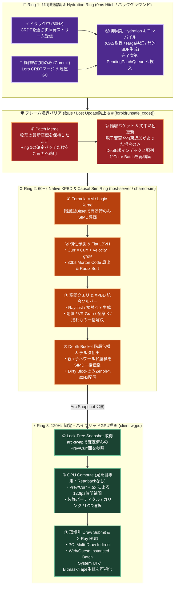

# Alchemy: Zero-Base Spatial Lifecycle & Native XPBD Dataflow Architecture

- **対象リポジトリ / モジュール**: `FRICK-ELDY/alchemy` (`client`, `host-server`, `shared-sim`)
- **目的**: VR空間内での複数人リアルタイム共同編集（Hierarchy / Inspector / Node Graph / Asset Spawn）において、CPUキャッシュ・SIMD・メモリ帯域・GPU性能を物理的限界まで引き出すゼロベース（第一原理）空間ライフサイクル仕様。
- **物理エンジン方針**: ステートフルな外部物理エンジン（Rapier3d等）を廃止し、`MVCC Tape` 自体をメモリ空間とする **Alchemy Native Physics（1次元 Morton LBVH ＋ 統合 XPBD ソルバー）** を実装する。
- **言語・安全性制約**: 100% Pure Rust (`#![forbid(unsafe_code)]` 原則維持、メモリキャストは `bytemuck::Pod` / `Zeroable` を経由)。

---

## 1. 設計哲学 (Core Philosophy)

従来のゲームエンジンが持つ `MonoBehaviour`（個体別の `Awake` / `Update` / `OnDestroy` 仮想関数ループ）、ポインタベースのツリー構造（Pointer Chasing）、および外部物理エンジンとの二重メモリ管理（Dual-State Sync）をエンジン内部から完全に排除する。

空間内のすべての状態を **「5つの第一原理プリミティブ」** に還元し、時間の進行を **「3つの独立した非同期リング（編集・物理・知覚）」** と **「MVCC（世代別連続メモリ）」** で結合することで、ロック待ち（Hitch）と物理暴発が原理的に発生しないリアルタイム共同開発空間を実現する。

---

## 2. 5つの第一原理プリミティブ (Five First-Principles Primitives)

エンジン内部（`shared-sim`）にはオブジェクトもポインタ木も存在せず、以下の5つのプリミティブのみで構成される。

| プリミティブ | 役割・物理的実体 | 対応する人間向け概念 (UX View) |
| :--- | :--- | :--- |
| **1. `Atom`** | **不変ハッシュ塊 (Immutable CAS Blob)**<br>メッシュ(GLB)、静的SDF/BVH、KTX2テクスチャ、音声、コンパイル済みAST等の不変バイト列。`BLAKE3` (32Byte) で識別され、全スレッド・P2P間でゼロコピー共有される。 | `Content` |
| **2. `Tape<T>`** | **世代管理された1次元連続メモリ列 (Epoch SoA Column)**<br>64Byteキャッシュラインにアラインされた `#[repr(C)]` (`bytemuck::Pod`) の1次元配列。実データの行インデックス（`row_id`）はスポーン時から固定され、移動しない。 | `Component`, `Struct` |
| **3. `Topology`** | **平坦化空間スケジュール (Indirect Schedule & Flat LBVH)**<br>実データ配列（`Tape`）を並び替えるのではなく、「どの順番で行を計算・描画するか」を表す1次元の間接インデックス配列（Depthバケット、オイラーツアー区間、Morton LBVH）。 | `Scene`, `Object`, `Node` |
| **4. `Kernel`** | **純粋データ変換器 (Dataflow Pure Function)**<br>入力 `Tape` を受け取り、出力 `Tape` へ書き出す関数（Native XPBD Solver / Formula VM Bytecode / Wasmtime / wgpu Compute Shader）。 | `Behavior` |
| **5. `Impulse`** | **因果順序付き差分パッチ & 準備マスク (Causal Patch & Bitmask)**<br>確定操作のCRDTパッチ、ドラッグ中の揮発ストリーム、および各行の有効状態を示す64bitの `ReadinessMask`。 | `Event` |

---

## 3. 3連リング・MVCC ＆ Native XPBD ライフサイクル

編集（非同期）、シミュレーション（60Hz固定）、レンダリング（90〜120Hz）の3つの時間軸を、**安全なフレーム境界ブリッジ（数マイクロ秒）** と **2面スナップショット（`EpochPrev` / `EpochCurr`）** で結合する。



---

## 4. Alchemy Native Physics: 外部物理エンジンを不要にする統合設計

Rapier3d 等の外部エンジンを廃し、`EpochSheet` 上の配列操作だけで物理・IK・Grab・Raycastを完結させる。

### 4.1 なぜ XPBD（拡張位置ベース動力学）なのか？
1. **メモリ二重管理と「幽霊オブジェクト」の完全消滅**:
   `EpochCurr`（現在位置）と `EpochPrev`（1フレーム前位置）の2枚の `Tape` 自体が物理エンジンの全状態となる。外部ワールドへの登録・削除が不要であり、`ReadinessMask::PHYSICS` ビットを `0` にするだけで即座に当たり判定が消える。
2. **VRの無茶な操作でも絶対に発散（爆発）しない**:
   力（Force）ではなく位置のズレ（Positional Constraint）をコンプライアンス $\alpha$（柔らかさ）付きで直接解決するため、VR内で複数人が同じオブジェクトを引っ張り合ったり壁の中にスポーンさせても、`NaN` や無限大速度へ発散しない。
3. **剛体・VR Grab・Full-Body IK・揺れもの（SpringBone）の完全統一**:
   すべてが `ConstraintRow`（2点間の距離・角度・目標位置拘束）として単一のソルバーループで処理される。

### 4.2 1次元空間インデックス (`Flat Morton LBVH`)
ポインタを使った木構造のBVHを持たず、毎フレーム以下の手順で1次元配列上に空間インデックスを構築する（数千オブジェクトで $< 0.2\text{ms}$）。
1. 各コライダーのAABB中心座標 $(x, y, z)$ をシーン境界で正規化し、ビットを交互に並べた **30bit Morton Code（Z階曲線）** を算出する。
2. `(morton_code, row_id)` のペア配列を Radix Sort で1次元ソートする。これにより、3D空間上で近くにあるオブジェクトがメモリ配列上でも必ず隣り合う。
3. ソート済み配列から階層バウンディングボックス配列（Flat LBVH）を生成し、VRレーザーポインタの **Raycast** や近傍衝突ペア抽出をポインタ追跡なしで高速実行する。

### 4.3 サポートするコライダー形状の厳選
車輪の再発明（複雑な凹メッシュ同士のGJK/EPA実装沼）を避けるため、コライダーは以下の5種類に限定する。
- **動的・汎用プリミティブ（4種）**: `Sphere`（球）、`Capsule`（カプセル：アバター身体・手足）、`Box`（OBB/AABB：小道具・UIパネル）、`Ray`（レーザー・接地判定）。これらは内積とクランプのみの十数行の純粋関数で厳密解が求まる。
- **静的ワールド地形（1種）**: `StaticSDF / StaticBVH`。複雑な背景メッシュは、インポート時にクライアント側（`alchemy-asset-compiler`）で事前計算した符号付き距離場（SDF）または静的フラットBVHを `Atom`（CAS）として保存し、ランタイムは $O(1)$ で参照する。

---

## 5. 6つの技術的危険性を封じる「毒消し（Safeguards）」仕様

実装時に必ず守るべき6つの安全設計ルール。

1. **実データ `Tape` のインデックス不変原則（参照崩壊の防止）**
   - `EpochSheet` 内の実データ行（`row_id`）はスポーン時から破棄まで絶対に移動させない。親子階層の変更（Reparent）時は、間接参照配列である `FlatTopology`（`depth_sorted_rows` と `euler_order`）のみを再構築する。
2. **Patch Merge 方式による Lost Update の防止と `#![forbid(unsafe_code)]` 遵守**
   - Ring 1（非同期編集）は配列全体をコピーせず、`PendingPatch`（変更された `row_id` とフィールドの差分）のみをキューに積む。フレーム境界で `EpochCurr` に対してパッチを適用し、完了したスナップショットを `Arc`（`arc-swap`）で Ring 3 へロックフリー公開する。
3. **CRDT 履歴爆発（OOM）の防止と `IS_GRABBED` 拘束**
   - VR内でオブジェクトやギズモを掴んで動かしている最中の 60Hz 連続座標は Loro CRDT に書き込まず、Zenoh の揮発ストリームで送信し、物理側は `ReadinessMask::GRABBED` ビットによりコントローラー座標への強固な XPBD 位置拘束として処理する。**手を離して位置が確定した瞬間（Commit）の1回だけ** CRDT に記録する。
4. **階層型ビットセット（Hierarchical Bitset）による疎空間の1命令スキップ**
   - 64行ごとの有効状態を1つの `u64`（Summary Word）に集約する。アクティブでない64行の塊は `tzcnt`（`trailing_zeros()`）命令1発でスキップし、オブジェクト数が10万個でも実働数個なら数マイクロ秒で走査を終える。
5. **CPU と GPU の明確な責務境界（GPU Readback ゼロ原則）**
   - 当たり判定（Raycast / Grab / 物理衝突 / 主要IK）に関わる座標はすべて CPU（Ring 2）で計算・確定させる。GPU Compute（Ring 3）は「60Hz➔120fpsの時間補間」「装飾パーティクル」「視界カリング＆3階層LOD選択」の見た目専用とし、GPU ➔ CPU の書き戻し（Readback）は一切行わない。
6. **System UI への「Bitmask & Tape X-Ray」デバッグレンズ統合**
   - インゲーム `btop` パネル内に、選択または視線ヒットした `row_id` の `ReadinessMask`（2進数点灯状態）、`EpochPrev` / `EpochCurr` の生数値、所属 `depth`、Morton Code をリアルタイム表示する診断ビューを標準搭載する。

---

## 6. Rust コア構造体定義 (`shared-sim` 実装仕様)

```rust
#![forbid(unsafe_code)]

use bytemuck::{Pod, Zeroable};

/// 世代番号付き行識別子 (ABA問題防止・インデックス不変)
#[repr(C)]
#[derive(Clone, Copy, Debug, PartialEq, Eq, Hash, Pod, Zeroable)]
pub struct NodeHandle {
    pub row_id: u32,
    pub generation: u32,
}

/// 準備完了＆物理状態ビットマスク (Awake/OnDestroyおよび物理モードを統合)
#[repr(transparent)]
#[derive(Clone, Copy, Debug, PartialEq, Eq, Pod, Zeroable)]
pub struct ReadinessMask(pub u64);

impl ReadinessMask {
    pub const ALLOCATED: u64 = 1 << 0; // 行確保済み (Ghost表示可)
    pub const TRANSFORM: u64 = 1 << 1; // 座標確定済み
    pub const MESH: u64      = 1 << 2; // GLB頂点バッファ準備完了
    pub const SHADER: u64    = 1 << 3; // Naga WGSL検証完了
    pub const COLLIDER: u64  = 1 << 4; // LBVH / Raycast 対象
    pub const DYNAMIC: u64   = 1 << 5; // XPBD 重力・慣性移動対象
    pub const GRABBED: u64   = 1 << 6; // VR手で保持中 (Kinematic追従拘束)
    pub const SLEEPING: u64  = 1 << 7; // 静止スリープ中 (計算・送信スキップ)
    pub const LOGIC: u64     = 1 << 8; // Formula VM 評価対象
    pub const TOMBSTONE: u64 = 1 << 63; // 削除予約

    #[inline(always)]
    pub const fn is_ready(self, required: u64) -> bool {
        (self.0 & (required | Self::TOMBSTONE)) == required
    }
}

/// コライダー形状プリミティブ (16Byte アライン)
#[repr(C, align(16))]
#[derive(Clone, Copy, Debug, Default, Pod, Zeroable)]
pub struct ColliderShape {
    /// 0: None, 1: Sphere, 2: Capsule, 3: Box, 4: StaticSdfAtom
    pub shape_type: u32,
    /// Sphere: [r, 0, 0], Capsule: [r, half_h, 0], Box: [hx, hy, hz]
    pub extents: [f32; 3],
}

/// XPBD 統合拘束行 (剛体ジョイント・VR Grab・IK・SpringBone揺れものを単一表現)
#[repr(C, align(32))]
#[derive(Clone, Copy, Debug, Default, Pod, Zeroable)]
pub struct XpbdConstraintRow {
    pub node_a: u32,
    pub node_b: u32,           // ワールド固定点(Grab等)の場合は u32::MAX
    pub target_distance: f32,  // 目標距離
    pub compliance: f32,       // 柔らかさ α (0.0 = 剛体/ハード拘束, >0.0 = バネ/揺れもの)
    pub damping: f32,          // 減衰係数
    pub anchor_offset_a: [f32; 3],
}

/// 描画ワイヤ・高精度ワールド空間構造体 (binary64 境界 & XPBD高精度位置兼用)
#[repr(C, align(32))]
#[derive(Clone, Copy, Debug, Default, Pod, Zeroable)]
pub struct WorldTransformf64 {
    pub position: [f64; 3],
    pub inv_mass: f64,         // 逆質量 (0.0 = 静的/固定オブジェクト)
    pub rotation: [f32; 4],    // Quaternion (x, y, z, w)
    pub scale: [f32; 3],
    pub frame_delta_xyz: [f32; 3], // 1tick変位 Δx (フェイルオーバー & 120fpsエルミート補間用)
    pub flags: u32,
    pub _pad0: u32,
}

/// 間接参照トポロジー＆空間インデックス (実データ行を動かさずに順序のみ管理)
#[derive(Clone, Debug, Default)]
pub struct FlatTopology {
    pub parent_of: Vec<u32>,
    /// Depth順の row_id 配列 (親➔子 並列Transform伝播用)
    pub depth_sorted_rows: Vec<u32>,
    pub depth_offsets: Vec<u32>,
    /// オイラーツアー進入・退出順序 (Hierarchy UI の O(1) 折りたたみ・部分木一括操作用)
    pub euler_tin: Vec<u32>,
    pub euler_tout: Vec<u32>,
    pub euler_order: Vec<u32>,
    /// XPBD 並列実行用のグラフ彩色バッチ (同じノードを共有しない独立拘束グループ)
    pub constraint_color_batches: Vec<XpbdConstraintRow>,
    pub color_batch_offsets: Vec<u32>,
}

/// 1世代分の連続メモリシート (SoA)
#[derive(Clone, Debug, Default)]
pub struct EpochSheet {
    pub epoch_id: u64,
    /// 64行ごとの有効サマリビット (0のワードは tzcnt で1命令スキップ)
    pub active_summary_words: Vec<u64>,
    pub readiness: Vec<ReadinessMask>,
    pub world_transforms: Vec<WorldTransformf64>,
    pub colliders: Vec<ColliderShape>,
    pub asset_atoms: Vec<[u8; 32]>,
    pub owner_scope: Vec<u32>,
    pub dirty_summary_words: Vec<u64>,
}
```

---

## 7. Cursor向け段階的実装ロードマップ (Implementation Steps)

1. **Step 1: `shared-sim::tape` & `EpochSheet` の実装**
   - 上記のコア構造体、`.is_finite()` サニタイズゲート、および `active_summary_words`（`u64::trailing_zeros` を用いた高速ビット走査イテレータ）を実装する。
2. **Step 2: `shared-sim::topology` (Depth Bucket & Euler Tour) の実装**
   - 実データの `row_id` を固定したまま、親子関係から `depth_sorted_rows` と `euler_order` を生成する Baker と、親➔子トランスフォーム一括伝播を実装する。
3. **Step 3: `shared-sim::spatial` (30bit Morton Code & Flat LBVH) の実装**
   - 座標から Morton Code を計算して1次元ソートし、VRコントローラーからの **Raycast** と **カプセル押し出し（アバター歩行・飛行）** を実装する（Phase 1 物理完成）。
4. **Step 4: `shared-sim::xpbd` (統合 XPBD ソルバー) の実装**
   - `EpochPrev` と `EpochCurr` の差分から慣性移動を行い、VR Grab・IK・バウンス・揺れものを `XpbdConstraintRow` で一括解決するループを実装する（Phase 2 物理完成）。
5. **Step 5: `client` GPU-Driven 補間 ＆ 仮想 Hierarchy UI の接続**
   - `Arc<EpochSheet>` の新旧2面を `wgpu` Storage Buffer へ差分転送して 120fps 補間シェーダーを回し、`euler_order` を直接参照する仮想スクロール Hierarchy UI と `Bitmask X-Ray` デバッグパネルを実装する。
   - **Display TRS 方針（x0091 採択）:** 画面に見える／掴む TRS の権威は wire Curr `EntityPose` ではなく **Prev/Curr + α / ABA（GPU `out` ＋ CPU 双子）**。描画だけ補間して Grab を Curr に残すレガシーは **撤廃**。カメラ eye の Curr 据え置きは残債（後続で display 化）。詳細は [slices/x0091-epoch-out-scenegpu-draw.md](slices/x0091-epoch-out-scenegpu-draw.md)「方針（レガシー撤廃 → 新方式）」。