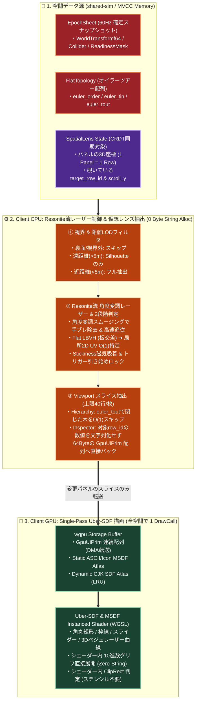
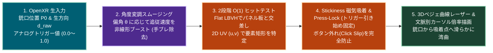

# Alchemy: Zero-Base Spatial UI ("Spatial Lens & Uber-SDF") Architecture

- **対象リポジトリ / モジュール**: `FRICK-ELDY/alchemy` (`client/system_ui`, `client/render`, `shared-sim`)
- **目的**: UnityのCanvasやResoniteのUIXに相当する「3D空間内の汎用UI・インスペクター・ヒエラルキー・ノードグラフ基盤」において、大量のパネルを展開し60Hzで変化する数値を同時表示・共同編集しても、CPU・メモリ・GPU・通信帯域が一切逼迫しないゼロベース（第一原理）設計を定義する。
- **前提土台**: `docs/architecture/zero_base_spatial_lifecycle.md` で定義した `EpochSheet`（MVCC連続メモリ）、`FlatTopology`（オイラーツアー配列）、および `Flat Morton LBVH` と完全統合する。

---

## 1. なぜ従来の「Canvas / UIX」は空間にたくさん出すと重くなるのか？

Unity（uGUI）やResonite（UIX）の設計をそのまま踏襲すると、インスペクターやヒエラルキーを10〜20枚出した時点でフレームレートが崩壊する。その構造的死因は以下の4点にある。

1. **「UIパーツ ＝ 3Dエンティティ（Slot / GameObject）」という設計ミス**
   - ボタン1個、テキスト1個、レイアウト枠1個をすべて3D空間のノード（Slot）として生成するため、インスペクターを1枚開くと数百個、20枚開くと数千〜数万個の3Dノードと親子ツリーが空間に生まれ、毎フレームの階層Transform伝播と物理ツリー更新でCPUがパンクする。
2. **毎フレームの「文字列アロケーション」と「CPUメッシュ再構築（Rebatch）」**
   - 60Hzで動くオブジェクトの座標（例: `Position.X = 12.345`）を表示するたび、CPU側で `format!("{:.3}", val)` によるヒープ確保と、フォントグリフの頂点ポリゴン（Quadメッシュ）の再構築が毎フレーム発生する。
3. **ドローコール（DrawCall）とクリッピング（Mask）の爆発**
   - パネルごと、スクロール枠（ステンシルバッファ）ごと、テキストと画像ごとに別々のDrawCallが発行され、空間内でパネルが増えるほどCPU ➔ GPUのコマンド発行負荷が線形に増大する。
4. **3Dレーザー判定とUIツリーのネットワーク同期負荷**
   - VRコントローラーのレーザー（Raycast）を数千個のUIボタンの3Dコライダーに対して総当たり判定し、さらにUI内部のスクロールや折りたたみで生成される大量のSlot群をネットワーク同期してしまうため、帯域とCRDT履歴が爆発する。

---

## 2. ゼロベースの第一原理：「UIはオブジェクトではなく、Tapeを覗く光学レンズ（Lens）である」

エンジン内部から「UIオブジェクトのツリー」と「動的テキストメッシュ」を完全に廃止する。
空間内のインスペクターやヒエラルキーとは、**「① 空間に浮かぶたった1枚の板（Quad）の上に、② `EpochSheet`（MVCC Tape）の指定した行を、③ GPUシェーダーが直接覗き込んで描画する『光学レンズ（Spatial Lens）』」** として定義する。

| 従来の Canvas / UIX の概念 | ゼロベース設計（Spatial Lens UI）の物理実体 | ハードウェア上の劇的効果 |
| :--- | :--- | :--- |
| **UIパネル内の数百個のSlot / Node** | **空間上は「外枠の板（OBB）」たった1行のみ**<br>中身は1次元の `GpuUiPrim`（64Byte固定長構造体）のスライス | パネルを50枚出しても、3D空間のノードとコライダーは50個しか増えない |
| **`format!()` による数値文字列化** | **Zero-String 数値直結レンダリング**<br>数値を文字列にせず固定小数点でGPUへ渡し、シェーダーが直接数字グリフを引く | 60Hzで動く数千個の座標を表示しても、CPU文字列処理とヒープ確保が **0 Byte** |
| **ボタン・枠・文字のポリゴンメッシュ** | **Single-Pass Uber-SDF & MSDF Shader**<br>角丸矩形・枠線・影・文字・ベジェ曲線を1つの距離場シェーダーで数学的に描画 | 空間内の全UIパネル（数十枚・数万要素）が **合計 1 DrawCall** で描画完了する |
| **大量のUIボタンへの3D Raycast** | **Resonite流 角度変調レーザー × 2段階 $O(1)$ 吸着判定**<br>`Flat LBVH` で外枠の板だけ当て、板の内部は2D UV計算と磁気吸着（Stickiness）で特定 | 手ブレを完全吸収しつつ、ボタン数に依存せず数ナノ秒でヒット判定が終わる |
| **数万ノードのHierarchyスクロール** | **Euler Tour 直結スライス & 距離LOD**<br>画面内の30行分だけ `euler_order` から $O(1)$ 抽出し、遠いパネルは自動で簡略化 | 10万ノードのワールドでも、遠くにパネルが大量にあっても重くならない |

---

## 3. 全体アーキテクチャ＆パイプライン図（Mermaid）



---

## 4. 重くならず編集しやすい5つのコアメカニズム

### 4.1 「1パネル ＝ 空間上は1枚の板」と CRDT の超軽量同期
- ユーザーがインスペクターやヒエラルキーを空間に出したとき、`EpochSheet` に生成されるエンティティは **「パネルの外枠（幅・高さを持った1枚の板）」の1行だけ** である。
- 複数人で同じパネルを囲んで共同編集する際、ZenohおよびCRDT（Loro）で同期するのは以下の **32Byte程度のメタデータのみ** とする。
  - `panel_row_id`: パネル自体の空間座標行
  - `lens_kind`: `Hierarchy` / `Inspector` / `NodeGraph` / `CustomUIX`
  - `target_handle`: 今どのオブジェクト（`NodeHandle`）を覗いているか
  - `scroll_offset`: スクロール位置 $(x, y)$ と展開ビットマスク
- パネルの中身のボタンや数値はネットワークで一切送らず、各クライアントのCPU/GPUが手元の `EpochSheet` を見てローカルで瞬時に投影する。

### 4.2 文字列化ゼロ！「GPUシェーダー内 数値グリフ直接展開」
インスペクター上で毎秒60回変化する `Position`、`Rotation`、`Scale`、パフォーマンス統計（`btop`）などの数値は、**CPU側で一切文字列（`String`）に変換しない**。
1. CPUは `EpochSheet` から読んだ `f64` / `f32` の数値を、表示桁数に応じた整数部と小数部（固定小数点 `i32` × 2）に1命令で丸め、`GpuUiPrim` のペイロードにそのまま書き込む。
2. GPUのフラグメントシェーダー（WGSL）が、UV座標から「今何桁目の文字を描画しているか」を判定し、シェーダー内の整数除算と剰余（$\lfloor v / 10^k \rfloor \bmod 10$）によって `0`〜`9`、`-`、`.` のMSDFグリフUVを直接引いて描画する。
3. **効果**: 空間内にインスペクターを30枚並べて数千個の座標がリアルタイムに変動していても、CPUのテキストフォーマット負荷とヒープアロケーションは **完全にゼロ** になる。

### 4.3 オイラーツアー配列（`euler_tout`）を用いた $O(1)$ 仮想ヒエラルキー
ワールド内に10万個のノードがあっても、ヒエラルキーパネルが1フレームに生成する `GpuUiPrim` は **「パネルの表示枠（Viewport）に収まる30〜40行分だけ」** に厳格に制限する。
- `FlatTopology` の `euler_order` を上から走査する際、ユーザーが折りたたんだ（Collapsed）親ノード $u$ に遭遇したら、ツリーを辿るのではなく **インデックスを $i \leftarrow \text{euler\_tout}[u] + 1$ へ1命令でジャンプ** する。
- これにより、何万個の子孫を持つ巨大なグループが折りたたまれていても、CPUは $O(1)$（1クロック）で丸ごとスキップして次の表示行を抽出できる。

### 4.4 Resonite流「Interaction Lasers」の数理モデルと2段階 $O(1)$ ヒットテスト

Resoniteのレーザーが持つ「細かいボタンを狙う時は手ブレがピタッと止まり、大きく手を振ると遅延ゼロで追従し、ボタンに吸い付く（Stickiness）」という極上の操作感を、`settings.json` の設定項目および2段階 $O(1)$ ヒットテストと完全統合する。



#### ① 角度変調スムージング (Angle-Modulated Laser Smoothing)
コントローラーの生の向きベクトル $\mathbf{d}_{\text{raw}}$ と、現在のスムージング済みレーザー向きベクトル $\mathbf{d}_{\text{smooth}}$ のなす角度（偏角）を $\theta = \arccos(\text{clamp}(\mathbf{d}_{\text{smooth}} \cdot \mathbf{d}_{\text{raw}}, -1, 1))$ とする。
Resoniteの5つのレーザー設定パラメータ（`smooth_speed`, `modulate_start_angle`, `modulate_end_angle`, `modulate_exponent`, `modulate_speed_multiplier`）に基づき、実効スムージング速度 $S_{\text{eff}}$ を以下の式で算出する：

$$t_{\text{mod}} = \text{clamp}\left(\frac{\theta - \theta_{\text{start}}}{\theta_{\text{end}} - \theta_{\text{start}}}, 0.0, 1.0\right)$$

$$S_{\text{eff}} = S_{\text{base}} \cdot \left(1.0 + (M_{\text{speed}} - 1.0) \cdot (t_{\text{mod}})^{p}\right)$$

$$\mathbf{d}_{\text{smooth}}' = \text{normalize}\left(\text{lerp}\left(\mathbf{d}_{\text{smooth}}, \mathbf{d}_{\text{raw}}, 1.0 - e^{-S_{\text{eff}} \Delta t}\right)\right)$$

- **微小移動時 ($\theta < \theta_{\text{start}}$)**: $t_{\text{mod}} = 0$ となり、低い基本速度 $S_{\text{base}}$（`Laser smooth speed`）が適用され、生理的な手の震え（Tremor）を強力にフィルタリングする。
- **大移動時 ($\theta \ge \theta_{\text{start}}$)**: 手を大きく動かすと指数 $p$（`Modulate exponent`）のカーブに従って追従速度が最大 $M_{\text{speed}}$ 倍（`Modulate speed multiplier`）まで跳ね上がり、遅延（重たさ）を一切感じさせずに視線先へ追いつく。

#### ② 2段階 $O(1)$ ヒットテストと「Laser Stickiness（磁気吸着）」
1. **Stage A（3D空間 ➔ 2Dパネル平面）**:
   スムージング後のレイ $(\mathbf{p}_0, \mathbf{d}_{\text{smooth}}')$ を `Flat Morton LBVH` 上で「パネルの外枠の板（OBB）」と交差させ、パネル上の局所2D座標 $\mathbf{u}_{\text{raw}} = (u, v)$ を求める。
2. **Stage B（$O(1)$ 要素特定 ＆ Stickiness 吸着）**:
   - 割り算1回（$\lfloor (v + \text{scroll\_y}) / H_{\text{row}} \rfloor$）または $16 \times 16$ グリッド索引により、直下のインタラクティブ要素 $E$（矩形 $R_E$）を $O(1)$ で特定する。
   - **Stickiness（吸着）**: 前フレームでホバーしていた要素 $E_{\text{prev}}$ の矩形 $R_{\text{prev}}$ に対し、`laser_stickiness`（$k_{\text{sticky}} \in [0, 1]$）に応じた拡張マージン $M = k_{\text{sticky}} \times 24\text{px}$ を設ける。$\mathbf{u}_{\text{raw}}$ が拡張枠内にある間はターゲットを $E_{\text{prev}}$ に維持し、最終的なカーソル座標 $\mathbf{u}_{\text{final}}$ を要素内部へ引き寄せる：
     $$\mathbf{u}_{\text{final}} = \text{lerp}\left(\mathbf{u}_{\text{raw}}, \text{clamp}(\mathbf{u}_{\text{raw}}, R_{\text{prev}}), k_{\text{sticky}} \cdot 0.65\right)$$
   - **トリガー引き始めロック (Trigger Press-Lock)**: VRで最も多い操作ミスは「人差し指で物理トリガーを引く瞬間に銃口が下にブレてボタンから外れる（Click Slip）」ことである。アナログトリガーの押し込み量 $a \in [0, 1]$ が $a > 0.08$ を超えて上昇中（$\Delta a > 0$）の間は、約 $150\text{ms}$ 間カーソル座標をロックし、確実なクリックとダブルクリック（`double_click_interval` 時間窓＋空間許容半径内）を保証する。

#### ③ 手元の向きと吸着点を自然に繋ぐ「3Dベジェ曲線レーザー」と文脈別カーソル倍率
Stickinessやスムージングが効いている間、コントローラー銃口の生の向き $\mathbf{d}_{\text{raw}}$ と、パネル上の実際の吸着着弾点 $\mathbf{p}_{\text{hit}}$ には角度のズレが生じる。直線のレーザーを描画すると手元からレーザーが折れ曲がって見えてしまうため、Resoniteと同様に **二次ベジェ曲線** で描画する。
- **始点 $\mathbf{P}_0$**: コントローラーのレーザー射出位置
- **終点 $\mathbf{P}_2$**: スムージング＆Stickiness吸着後の3D着弾点 $\mathbf{p}_{\text{hit}}$（距離 $L = \|\mathbf{P}_2 - \mathbf{P}_0\|$）
- **制御点 $\mathbf{P}_1$**: $\mathbf{P}_0 + \mathbf{d}_{\text{raw}} \cdot (L \times 0.45)$（銃口からは生の向きへ真っ直ぐ飛び出し、先端に向かって滑らかに湾曲してボタンへ吸い付く）
- **Cursor Multipliers（コンテキスト別カーソル変化）**: ホバー対象の種別に応じて、レーザー先端カーソルの基本サイズ（`base_cursor_size`）に `grab_multiplier`（掴める3D物体）、`interaction_multiplier`（ボタン）、`text_multiplier`（文字入力欄・アイビーム形状化）、`slider_multiplier`（数値スライダー・左右矢印化）を乗算し、視覚と微細なHaptics振動でフィードバックする。
- **Show lasers in desktop mode**: デスクトップの一人称モードにおいても、設定ON時は手元から画面中央（またはフリーカーソル位置）へ向かうレーザーを完全描画し、他プレイヤーとの「ここを見ている・指している」という非言語コミュニケーション（レーザーポインティング）を維持する。

#### ④ VR編集に特化した「数値スクラブ」と「Tear-Off ピン留め」
- **数値スライダー・スクラブ操作**: インスペクターの数値欄（`DirectNumber`）をレーザーで撃ちながらトリガーを引いて手を左右に動かすと、仮想キーボードを出さずに数値を連続増減できる（ドラッグ中はZenoh揮発ストリーム、トリガーを離した瞬間にCRDTへ1回Commit）。
- **Tear-Off（ベリッと剥がしてピン留め）**: ヒエラルキー内の特定のノードや、インスペクターの特定のコンポーネント欄をグリップボタンで掴んで空間へ引き出すと、その部分だけを覗く新しい小型 `SpatialLens` パネルとして空間に独立配置できる。

### 4.5 距離に応じた「3段階 Spatial UI LOD」
自分から遠く離れた場所に出しっぱなしにしたインスペクターがGPUを圧迫するのを防ぐため、カメラからの距離 $d$ に応じて自動的に描画モードを切り替える。
- **LOD 0 ($d < 3.0\text{m}$：作業距離)**: 120Hz フルMSDF文字描画 ＋ ホバーアニメーション ＋ 60Hz数値ライブ更新。
- **LOD 1 ($3.0\text{m} \le d < 10.0\text{m}$：中距離)**: CPUでのプリミティブ再構築を停止（キャッシュ済みのカラーバーと大きな見出しのみ描画し、細かい数値文字のシェーダー評価をスキップ）。
- **LOD 2 ($d \ge 10.0\text{m}$ または裏面)**: 中身の `GpuUiPrim` 描画を完全にゼロにし、パネル外枠の半透明スモークガラス板（1 Quad）のみを描画する。

---

## 5. 技術的危険性と「毒消し（Safeguards）」仕様

このゼロベースUI設計を実装する上で直面する4つの技術的地雷と、その回避策を定義する。

### 🚨 危険①：日本語（CJK数万文字）による MSDF フォントアトラスの VRAM 爆発
- **問題**: 英数字とアイコンだけなら $512 \times 512$ のテクスチャ1枚に収まるが、日本語のノード名やスクリプト、チャットを表示するために全漢字のMSDFを事前生成するとVRAMを数十MB消費し、Web版やQuest版を圧迫する。
- **🛡️ 毒消し（2層ハイブリッド・フォントアトラス）**:
  1. **Tier 1: 常駐 Static MSDF Atlas ($512 \times 512$, RGBA8)**: ASCII文字、数字（`0`〜`9`）、演算記号、UI基本アイコンを事前ベイクして常駐させる。インスペクターの数値や英語ラベルは100%これだけで高速描画する。
  2. **Tier 2: オンデマンド CJK SDF Atlas ($2048 \times 2048$, R8, LRUキャッシュ)**: 日本語や絵文字を含む任意文字列は、Pure Rust の `cosmic-text`（シェイピング）＋ `etagere`（2D矩形パッカー）を用い、**「今画面に表示されている文字だけ」をオンデマンドでラスタライズしてアトラスの空き領域に詰める**。溢れた古い文字はLRUで自動破棄する。

### 🚨 危険②：半透明パネルの重なりによる「GPUオーバードロー（Fill-rate 枯渇）」
- **問題**: VR空間で半透明（グラスモーフィズム）のインスペクターを何枚も前後に重ねて配置すると、同じピクセルに対して高負荷なSDFシェーダーとブラー処理が何重にも走り、Quest等のモバイルGPUでフレームレートが急落する。
- **🛡️ 毒消し（パネル単位Zソート ＆ 背面パネルの不透明フォールバック）**:
  - パネルの背景板は不透明に近いダークスモーク（$\alpha = 0.92$、背景ブラーなし）を標準とし、現在レーザーが当たっている「アクティブな最前面の1枚」にのみリッチなハイライト演出を適用する。
  - パネル内の不透明要素（ボタンやスライダー背景）は深度バッファ（Depth Write）を有効にして手前から描画し、背面に隠れたパネルのピクセルシェーダーをGPUの **Early-Z カリング** でハードウェア的にスキップさせる。

### 🚨 危険③：シェーダー内数値展開における浮動小数点精度限界と「直接テキスト入力」の矛盾
- **問題**: WGSLシェーダー内の `f32` 除算で10進数を展開すると、`0.30000004` のような丸め誤差で末尾桁がチラつく。また、ユーザーが数値をクリックしてキーボードから `12.5` と手打ち（または数式を入力）したい瞬間には文字列バッファが必要になる。
- **🛡️ 毒消し（固定小数点パック ＆ Active Input 1枠昇格）**:
  - **閲覧・ドラッグ中（99.9%の要素）**: CPU側で値を `i64` の固定小数点（$\text{round}(v \times 10^4)$）に変換し、上位・下位ビットに分けて `GpuUiPrim` に格納する。シェーダー側は整数の除算・剰余のみでグリフを決定するため、浮動小数点の桁落ちチラつきが100%消滅する。
  - **キーボード入力中（最大1要素のみ）**: ユーザーが特定の数値欄をクリックして「文字入力モード（Active Focus）」に入った**たった1つの欄だけ**、通常のテキスト入力バッファ（カーソル・範囲選択付き）へ一時的に昇格させ、Enterキー確定時に数値へパースしてCRDTへCommitする。

### 🚨 危険④：ユーザー定義UI（UIX相当）での無限レイアウト再計算ループ
- **問題**: ユーザーが空間内で独自のUIパネル（スコアボードや制御盤）を組めるようにした際、複雑なネスト構造を作られると毎フレームのFlexbox計算が重くなる。
- **🛡️ 毒消し（Dirty時のみの1次元 Flexbox ベイク）**:
  - レイアウト計算（Pure Rustの `taffy` クレートまたは軽量1パスFlexソルバー）は毎フレーム回さず、**「パネルのサイズまたは構造が変わったフレーム（Dirty時）に1回だけ」** 計算し、確定した各要素の2D矩形 $(x, y, w, h)$ をキャッシュする。毎フレーム変わるのはバインドされた「色」と「数値」の差し替えのみとする。

---

## 6. Rust & WGSL コア構造体定義 (`client/system_ui` 実装仕様)

### 6.1 1要素64Byte固定の GPU UI プリミティブ (`GpuUiPrim`)
角丸矩形、テキスト、数値直結フィールド、ノードグラフのベジェ曲線のすべてを、単一の64Byte構造体（キャッシュライン1本分）で表現する。

```rust
#![forbid(unsafe_code)]

use bytemuck::{Pod, Zeroable};

/// UIプリミティブ種別 (Uber-Shader内の分岐を最小化)
#[repr(u32)]
#[derive(Clone, Copy, Debug, PartialEq, Eq)]
pub enum UiPrimKind {
    RoundedBox = 0,     // 背景パネル・ボタン・トグル・スライダー枠
    MsdfGlyph = 1,      // 文字グリフ / アイコン (Static or Dynamic Atlas)
    DirectNumber = 2,   // Zero-String 数値直結描画 (シェーダー内で10進数展開)
    CubicBezierWire = 3,// ノードグラフの結線ワイヤー & 湾曲レーザー描画
}

/// GPU Storage Bufferへ直送される 64Byte (1キャッシュライン) 固定長UIプリミティブ
#[repr(C, align(16))]
#[derive(Clone, Copy, Debug, Default, Pod, Zeroable)]
pub struct GpuUiPrim {
    /// パネル局所座標系での矩形 [x, y, width, height] (Bezier時は [p0.x, p0.y, p3.x, p3.y])
    pub rect: [f32; 4],
    /// スクロール枠のクリッピング矩形 [min_x, min_y, max_x, max_y] (ステンシル不要)
    pub clip_rect: [f32; 4],
    /// 汎用ペイロード:
    /// - RoundedBox: [corner_radius, border_thickness, glow, 0]
    /// - MsdfGlyph:  [u0, v0, u1, v1] (アトラスUV)
    /// - DirectNumber: [int_part_low, int_part_high, frac_part_x10000, precision_and_sign]
    /// - CubicBezierWire: [ctrl1_x, ctrl1_y, ctrl2_x, ctrl2_y]
    pub payload: [u32; 4],
    /// 所属する空間パネルのインデックス (u16) + UiPrimKind (u8) + ホバー/押下状態フラグ (u8)
    pub panel_and_kind: u32,
    /// メインカラー (RGBA8 Unorm packed in u32)
    pub color_rgba: u32,
    /// ボーダーまたはセカンダリカラー (RGBA8 Unorm packed in u32)
    pub border_rgba: u32,
    /// インタラクション用逆引きID (レーザーヒット時にどの行/フィールドかをO(1)特定)
    pub binding_id: u32,
}

const _: () = assert!(core::mem::size_of::<GpuUiPrim>() == 64);

/// 空間内に浮かぶ1枚のUIパネル (3D空間上はこの1構造体＝1枚のOBB板としてのみ存在する)
#[repr(C, align(16))]
#[derive(Clone, Copy, Debug, Default, Pod, Zeroable)]
pub struct GpuPanelHeader {
    /// カメラ相対のパネル3Dワールド行列 (4x4)
    pub world_matrix: [[f32; 4]; 4],
    /// パネルの仮想ピクセル解像度 [width_px, height_px] と 物理サイズ [width_m, height_m]
    pub dimensions: [f32; 4],
    /// このパネルに属する GpuUiPrim の Storage Buffer 内開始インデックスと個数
    pub prim_start_index: u32,
    pub prim_count: u32,
    /// 距離LOD (0: Full, 1: Reduced, 2: Glass Plate Only)
    pub lod_level: u32,
    pub _pad: u32,
}
```

### 6.2 Resonite準拠「Interaction Lasers & Cursor」設定・状態マシン実装
Resonite Wikiの `Interaction Lasers`・`Cursor Settings`・`General Controls` の全設定項目を再現し、角度変調スムージング、Stickiness吸着、トリガー引き始めロック、3Dベジェ曲線制御点生成を行うPure Rust実装。

```rust
/// ホバー対象のコンテキスト種別 (Cursor Settings の倍率切り替え用)
#[derive(Clone, Copy, Debug, PartialEq, Eq)]
pub enum CursorContextKind {
    None,
    Grab,        // 3Dオブジェクトのグラブ可能状態
    Interaction, // 汎用UIボタン・トグル
    Text,        // テキスト入力欄
    Slider,      // 数値スクラブ・スライダー
}

/// Resonite準拠 Interaction Lasers & Cursor 設定 (settings.json にシリアライズ保存)
#[derive(Clone, Copy, Debug)]
pub struct InteractionLaserConfig {
    /// 基本スムージング速度 (低いほど手ブレを吸収、高いほど機敏: 推奨 12.0)
    pub laser_smooth_speed: f32,
    /// 加速変調を開始する偏角 (度: 推奨 1.5°)
    pub modulate_start_angle_deg: f32,
    /// 加速変調が最大に達する偏角 (度: 推奨 18.0°)
    pub modulate_end_angle_deg: f32,
    /// 変調カーブの指数 (推奨 1.8)
    pub modulate_exponent: f32,
    /// 最大偏角時のスムージング速度倍率 (推奨 8.0倍)
    pub modulate_speed_multiplier: f32,
    /// インタラクティブ要素への磁気吸着力 (0.0=吸着なし 〜 1.0=強吸着: 推奨 0.5)
    pub laser_stickiness: f32,
    /// デスクトップ一人称モードでもレーザーを描画するか
    pub show_lasers_in_desktop_mode: bool,
    /// ダブルクリック判定の時間窓 (秒: 推奨 0.35s)
    pub double_click_interval_sec: f32,

    // --- Cursor Settings ---
    pub base_cursor_size: f32,
    pub grab_multiplier: f32,
    pub interaction_multiplier: f32,
    pub text_multiplier: f32,
    pub slider_multiplier: f32,
}

impl Default for InteractionLaserConfig {
    fn default() -> Self {
        Self {
            laser_smooth_speed: 12.0,
            modulate_start_angle_deg: 1.5,
            modulate_end_angle_deg: 18.0,
            modulate_exponent: 1.8,
            modulate_speed_multiplier: 8.0,
            laser_stickiness: 0.5,
            show_lasers_in_desktop_mode: false,
            double_click_interval_sec: 0.35,
            base_cursor_size: 1.0,
            grab_multiplier: 1.25,
            interaction_multiplier: 1.15,
            text_multiplier: 0.9,
            slider_multiplier: 1.2,
        }
    }
}

/// 片手分のレーザー実行時状態
#[derive(Clone, Debug)]
pub struct HandLaserState {
    pub smoothed_dir: [f32; 3],
    pub sticky_target_binding: u32,
    pub sticky_rect_px: [f32; 4], // [x, y, w, h]
    pub locked_uv_px: [f32; 2],
    pub prev_trigger_val: f32,
    pub press_lock_timer: f32,
    pub last_click_time: f64,
    pub last_click_binding: u32,
}

impl HandLaserState {
    /// 1. 角度変調スムージングにより手ブレを除去しつつ高速な手の動きに追従する
    #[inline]
    pub fn update_smoothed_direction(
        &mut self,
        raw_dir: [f32; 3],
        cfg: &InteractionLaserConfig,
        dt: f32,
    ) -> [f32; 3] {
        let dot = (self.smoothed_dir[0] * raw_dir[0]
            + self.smoothed_dir[1] * raw_dir[1]
            + self.smoothed_dir[2] * raw_dir[2])
            .clamp(-1.0, 1.0);
        let angle_deg = dot.acos().to_degrees();

        let span = (cfg.modulate_end_angle_deg - cfg.modulate_start_angle_deg).max(0.001);
        let t_mod = ((angle_deg - cfg.modulate_start_angle_deg) / span).clamp(0.0, 1.0);
        let boost = 1.0 + (cfg.modulate_speed_multiplier - 1.0) * t_mod.powf(cfg.modulate_exponent);
        let eff_speed = cfg.laser_smooth_speed * boost;

        let alpha = 1.0 - (-eff_speed * dt).exp();
        let nx = self.smoothed_dir[0] + (raw_dir[0] - self.smoothed_dir[0]) * alpha;
        let ny = self.smoothed_dir[1] + (raw_dir[1] - self.smoothed_dir[1]) * alpha;
        let nz = self.smoothed_dir[2] + (raw_dir[2] - self.smoothed_dir[2]) * alpha;
        let len_inv = 1.0 / (nx * nx + ny * ny + nz * nz).sqrt().max(1e-6);

        self.smoothed_dir = [nx * len_inv, ny * len_inv, nz * len_inv];
        self.smoothed_dir
    }

    /// 2. パネル局所2D座標での Stickiness 磁気吸着とトリガー引き始めロック (Click-Slip防止)
    #[inline]
    pub fn apply_stickiness_and_press_lock(
        &mut self,
        raw_uv_px: [f32; 2],
        hovered_binding: u32,
        hovered_rect: [f32; 4],
        trigger_analog: f32,
        cfg: &InteractionLaserConfig,
        dt: f32,
    ) -> ([f32; 2], u32) {
        // アナログトリガーを引き始めた瞬間 (0.08超 & 上昇中) は 150ms カーソルをロック
        let d_trig = trigger_analog - self.prev_trigger_val;
        self.prev_trigger_val = trigger_analog;
        if trigger_analog > 0.08 && d_trig > 0.01 && self.sticky_target_binding != 0 {
            self.press_lock_timer = 0.15;
        }
        if self.press_lock_timer > 0.0 {
            self.press_lock_timer = (self.press_lock_timer - dt).max(0.0);
            return (self.locked_uv_px, self.sticky_target_binding);
        }

        // Stickiness 拡張マージン判定 (最大 24px)
        let margin = cfg.laser_stickiness * 24.0;
        if self.sticky_target_binding != 0 && cfg.laser_stickiness > 0.0 {
            let [rx, ry, rw, rh] = self.sticky_rect_px;
            let in_expanded = raw_uv_px[0] >= rx - margin
                && raw_uv_px[0] <= rx + rw + margin
                && raw_uv_px[1] >= ry - margin
                && raw_uv_px[1] <= ry + rh + margin;

            if in_expanded {
                let clamped_x = raw_uv_px[0].clamp(rx + 2.0, rx + rw - 2.0);
                let clamped_y = raw_uv_px[1].clamp(ry + 2.0, ry + rh - 2.0);
                let pull = cfg.laser_stickiness * 0.65;
                let final_uv = [
                    raw_uv_px[0] + (clamped_x - raw_uv_px[0]) * pull,
                    raw_uv_px[1] + (clamped_y - raw_uv_px[1]) * pull,
                ];
                self.locked_uv_px = final_uv;
                return (final_uv, self.sticky_target_binding);
            }
        }

        // 新規ターゲットへ更新
        self.sticky_target_binding = hovered_binding;
        self.sticky_rect_px = hovered_rect;
        self.locked_uv_px = raw_uv_px;
        (raw_uv_px, hovered_binding)
    }

    /// 3. 銃口の生方向(raw_dir)から吸着着弾点(hit_pos)へ滑らかに繋がる二次ベジェ制御点を算出
    #[inline]
    pub fn compute_laser_bezier_points(
        origin: [f32; 3],
        raw_dir: [f32; 3],
        snapped_hit_pos: [f32; 3],
    ) -> ([f32; 3], [f32; 3], [f32; 3]) {
        let dx = snapped_hit_pos[0] - origin[0];
        let dy = snapped_hit_pos[1] - origin[1];
        let dz = snapped_hit_pos[2] - origin[2];
        let dist = (dx * dx + dy * dy + dz * dz).sqrt();
        let ctrl_dist = dist * 0.45;
        let control_pt = [
            origin[0] + raw_dir[0] * ctrl_dist,
            origin[1] + raw_dir[1] * ctrl_dist,
            origin[2] + raw_dir[2] * ctrl_dist,
        ];
        (origin, control_pt, snapped_hit_pos)
    }

    /// 4. コンテキスト別のカーソル表示サイズ算出
    #[inline]
    pub const fn resolve_cursor_scale(
        cfg: &InteractionLaserConfig,
        ctx: CursorContextKind,
    ) -> f32 {
        let mult = match ctx {
            CursorContextKind::None => 1.0,
            CursorContextKind::Grab => cfg.grab_multiplier,
            CursorContextKind::Interaction => cfg.interaction_multiplier,
            CursorContextKind::Text => cfg.text_multiplier,
            CursorContextKind::Slider => cfg.slider_multiplier,
        };
        cfg.base_cursor_size * mult
    }
}
```

### 6.3 Zero-String 数値直結パッカー（CPU側：文字列アロケーション完全ゼロ）
`EpochSheet` の `f64` 座標を、ヒープ確保も文字列フォーマットも一切使わずに `GpuUiPrim` へ詰める関数。

```rust
impl GpuUiPrim {
    /// f64の数値を文字列化せず、固定小数点整数として1命令でパックする (小数点以下4桁表示の例)
    #[inline(always)]
    pub fn pack_direct_number(
        rect: [f32; 4],
        clip_rect: [f32; 4],
        panel_idx: u16,
        value: f64,
        decimals: u32,
        color_rgba: u32,
        binding_id: u32,
    ) -> Self {
        let safe_val = if value.is_finite() { value } else { 0.0 };
        let is_negative = u32::from(safe_val < 0.0);
        let abs_val = safe_val.abs();

        // 整数部と小数部(×10000)に分解 (シェーダー内でのf32丸め誤差を完全に防ぐ)
        let int_part = abs_val.trunc() as u64;
        let frac_part = ((abs_val.fract() * 10_000.0).round() as u32).min(9999);
        let meta = (decimals.min(4) & 0xFF) | (is_negative << 8);

        Self {
            rect,
            clip_rect,
            payload: [
                int_part as u32,
                (int_part >> 32) as u32,
                frac_part,
                meta,
            ],
            panel_and_kind: (u32::from(panel_idx) << 16) | (UiPrimKind::DirectNumber as u32),
            color_rgba,
            border_rgba: 0,
            binding_id,
        }
    }
}
```

### 6.4 オイラーツアー直結・仮想ヒエラルキー抽出器（$O(1)$ サブツリースキップ）
10万ノードのヒエラルキーから、現在スクロールで見えている最大40行分だけを `euler_tout` ジャンプで高速抽出する。

```rust
use crate::topology::FlatTopology;
use crate::tape::EpochSheet;

pub struct HierarchyLensState {
    pub scroll_row_offset: usize,
    pub visible_row_limit: usize, // 例: 36行
    /// 折りたたまれている row_id のビットセット
    pub collapsed_mask: Vec<u64>,
}

impl HierarchyLensState {
    #[inline(always)]
    fn is_collapsed(&self, row_id: u32) -> bool {
        let word = (row_id as usize) >> 6;
        let bit = (row_id as usize) & 63;
        self.collapsed_mask.get(word).copied().unwrap_or(0) & (1u64 << bit) != 0
    }

    /// 10万ノードあっても画面内の数十行だけを O(visible_rows) で抽出する
    pub fn extract_visible_rows(
        &self,
        topo: &FlatTopology,
        _sheet: &EpochSheet,
        out_visible_rows: &mut Vec<u32>,
    ) {
        out_visible_rows.clear();
        let total = topo.euler_order.len();
        let mut cursor = 0usize;
        let mut skipped_visible = 0usize;

        while cursor < total && out_visible_rows.len() < self.visible_row_limit {
            let row_id = topo.euler_order[cursor];

            // スクロール位置に達したら出力配列へ追加
            if skipped_visible >= self.scroll_row_offset {
                out_visible_rows.push(row_id);
            } else {
                skipped_visible += 1;
            }

            // もしこのノードが折りたたまれていたら、子孫ツリー全体を O(1) でジャンプ！
            if self.is_collapsed(row_id) {
                cursor = (topo.euler_tout[row_id as usize] as usize) + 1;
            } else {
                cursor += 1;
            }
        }
    }
}
```

---

## 7. Cursor向け段階的実装ロードマップ (Implementation Steps)

1. **Step 1: `client/render::ui_uber_shader` (1 DrawCall SDF/MSDF パイプライン) の実装**
   - `GpuPanelHeader` と `GpuUiPrim` の Storage Buffer バインディングを作成し、角丸矩形・クリッピング・Static MSDF文字・`DirectNumber`（シェーダー内数値展開）・ベジェ曲線レーザーを1パスで描画する WGSL シェーダーを実装する。
2. **Step 2: `client/system_ui::lens_hierarchy` & `lens_inspector` の実装**
   - `FlatTopology::euler_order` / `euler_tout` を使った仮想スクロール Hierarchy レンズと、選択した `row_id` の `WorldTransformf64` や `ReadinessMask` を文字列アロケーションゼロで `GpuUiPrim` に変換する Inspector レンズを実装する。
3. **Step 3: Resonite流 `InteractionLaserConfig` と 2段階 $O(1)$ 吸着ヒットテストの接続**
   - `HandLaserState` による角度変調スムージング、`Flat Morton LBVH` でのパネル板交差、Stickiness磁気吸着、およびトリガー引き始めロック（Press-Lock）を実装し、VRトリガードラッグで座標を60Hzスクラブ操作 ➔ リリース時にCRDTへCommitする編集ループを完成させる。
4. **Step 4: 動的 CJK アトラス (`cosmic-text` + `etagere`) と Tear-Off ピン留めの実装**
   - 日本語ノード名を表示するためのオンデマンド LRU アトラスと、インスペクターの任意の項目を掴んで空間に別パネルとしてピン留めする UX を追加する。