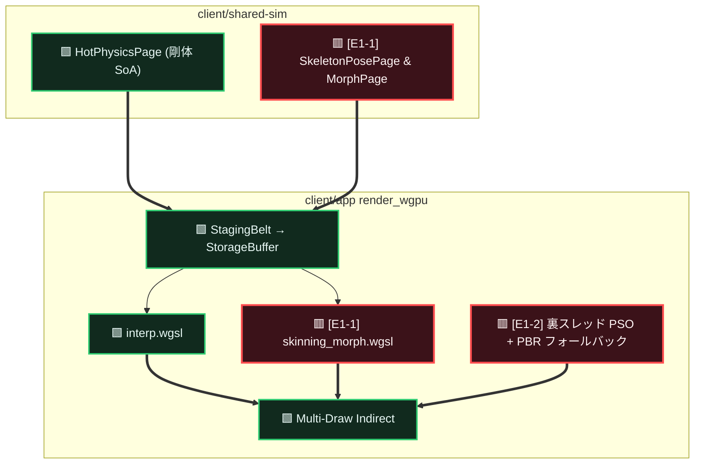
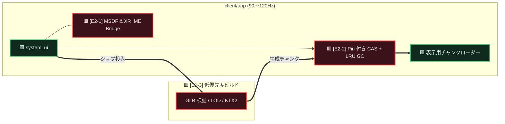

# Alchemy 拡張ギャップメモ — 体感・運用4点

* **種別**: `memo/` 提案。正本ではない
* **対象外（本メモでは扱わない）**: 決定論 math、SHM IPC、Dual-AST→Wasm/WGSL、Spatial AoI、HKDF 階層鍵
  → それぞれ [`mvcc_xpbd.md`](../mvcc_xpbd.md) / [`spatial_interest.md`](../spatial_interest.md) / 既存 Room AEAD・epoch に委譲
* **目的**: VR ヒッチ根絶とクリエイト／長時間運用に効く、現行ロードマップで言語化が薄い4束を固定する

---

## 1. 優先度（Expansion Wave）

品質本線（MVCC）・規模本線（Spatial Interest）の **P0〜** とは番号を共有しない。ここでは **E1 / E2** のみ。

### E1：ヒッチ根絶 + アバター描画メモリ

| ID | 項目 | 導入対象 | 要点 |
| :--- | :--- | :--- | :--- |
| **E1-1** | **スキニングのメモリ設計** (MVCC Skinning & GPU Morph) | `client/shared-sim` `client/app` (render) | ボーン変形・BlendShape を `MvccPageArena` の専用 SoA ページ（`SkeletonPosePage` / Morph 重み）に置き、`wgpu` Compute 一括スキニング → Multi-Draw Indirect へ直結する。 |
| **E1-2** | **PSO の非同期ビルド** (Async Pipeline & Fallback) | `client/app` (render) | カスタムシェーダーの `RenderPipeline` 生成を裏スレッドへ。完了までは標準 PBR で代替し、描画スレッド停止を避ける。 |
| **E1-3** | **LOD ビルドの負荷分離** (Low-Priority Builder) | `client/app` または将来 `asset-worker` | GLB 検証・ポリゴン削減・KTX2 を 90〜120Hz 描画から切り離す。**最初は同一プロセス内の低優先度ジョブでよい**；不足が実測されたら独立プロセスへ昇格。 |

### E2：空間内入力とローカルストレージ保護

| ID | 項目 | 導入対象 | 要点 |
| :--- | :--- | :--- | :--- |
| **E2-1** | **文字描画と IME 統合** (MSDF Font & XR IME Bridge) | `client/app` (`system_ui`) | MSDF 動的アトラス（斜め視認）と、OpenXR 中の OS 日本語 IME 候補を 3D パネルへブリッジする。 |
| **E2-2** | **ローカルキャッシュ GC** (CAS Pinning & LRU GC) | `client/app` (assets) | 入室中 Manifest / 編集中ハッシュを Pin し、容量上限超過時に Pin=0 の古い BLAKE3 チャンクを LRU パージする。 |

---

## 2. 保証する / しない（この4点共通）

| 保証する（目標） | 保証しない（当面） |
| :--- | :--- |
| カスタムシェーダー導入中でも描画スレッドを同期 PSO ビルドで止めないこと（E1-2） | ユーザーシェーダーの完全検証・課金・検疫ヒューリスティック本体 |
| アバター姿勢・モーフ重みが物理ページと分離された SoA 世代として扱えること（E1-1） | フルボディ IK / SpringBone / VRM 製品仕様の完成 |
| 重いアセット変換が VR フレーム予算を奪わないこと（E1-3） | 最初から独立 OS プロセス必須であること |
| VR 内で日本語変換候補を読める入力路があること（E2-1） | 全言語・全 OS IME の完全パリティ |
| ローカル CAS が上限を超えて無限肥大しないこと（E2-2） | P2P 配信・サーバ側 GC・検疫閾値 |

---

## 3. 組み込み図（3領域に圧縮）

### 3.1 スキニング + 非同期 PSO（E1-1 / E1-2）

### 3.2 アセット負荷分離 + CAS GC + MSDF/IME（E1-3 / E2-1 / E2-2）

---

## 4. 依存の目安

| 項目 | 依存 |
| :--- | :--- |
| E1-1 | MVCC ページ／出版契約が使えること（`HotPhysicsPage` と同系の世代・転送） |
| E1-2 | ユーザー／カスタム WGSL 投入路があること（無くても「将来ヒッチしない器」として先行可） |
| E1-3 | 既存 GLB decode budget（x0085 系）と矛盾させない。プロセス分離は実測後 |
| E2-1 | `system_ui` / OpenXR セッション上のテキスト入力面 |
| E2-2 | ローカル CAS と Manifest 参照ハッシュが列挙できること。サーバ GC（x0074）とは別レイヤ |

---

## 5. やらないこと（このメモの範囲）

* AoI / セル購読キーの確定
* Room 鍵の HKDF 階層化
* host↔app 共有メモリ IPC
* Dual-AST → Wasm 実行系の標準化
* Spot-Check 閾値・ヒューリスティックの OSS 混入
