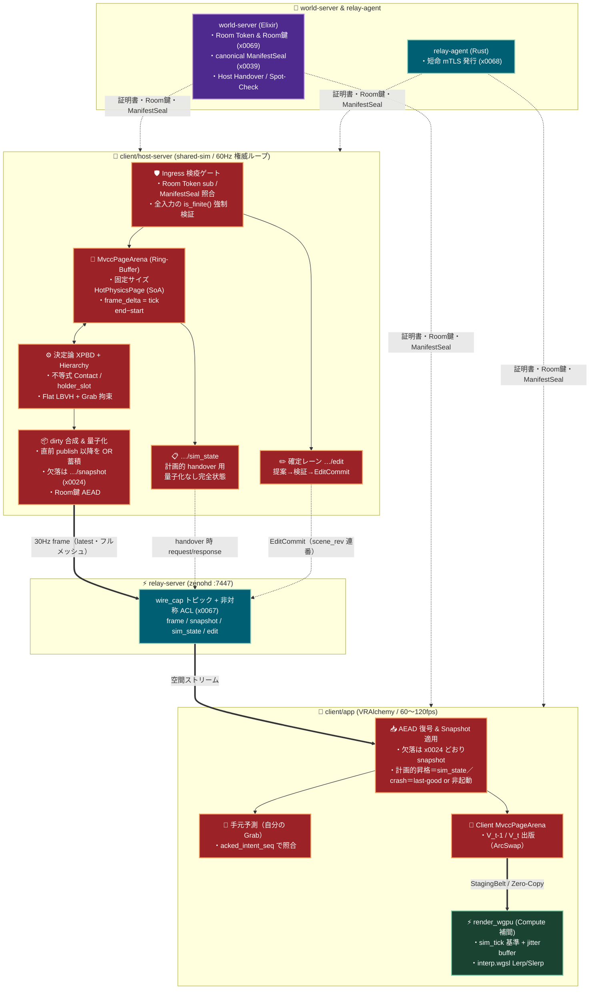
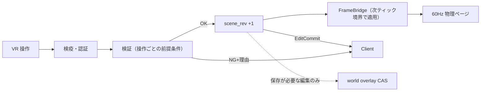
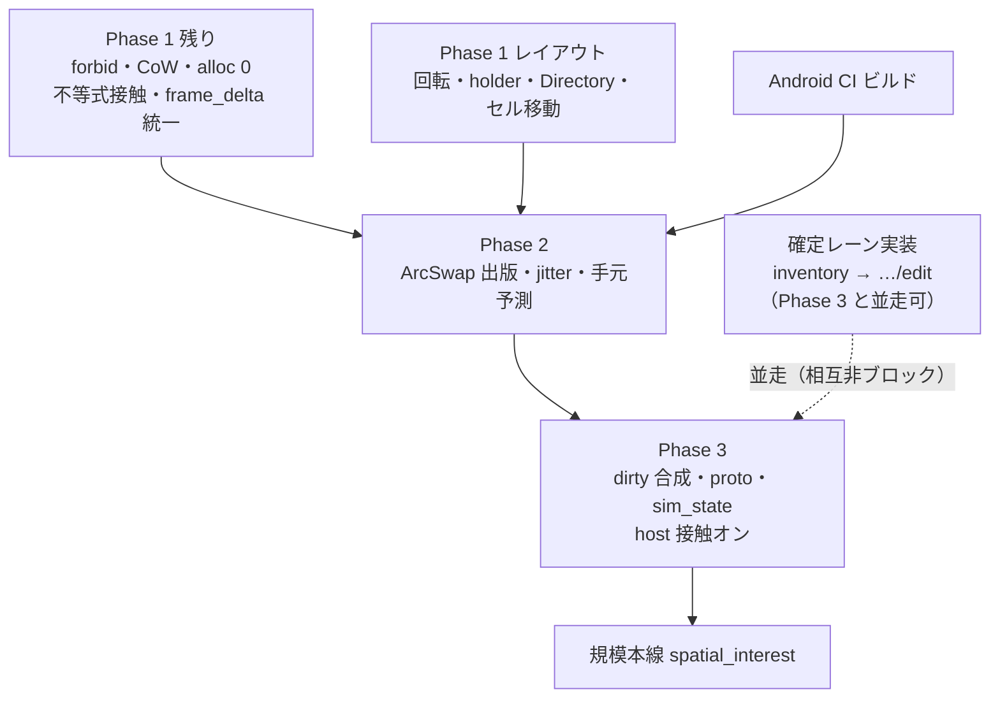

# `FRICK-ELDY/alchemy` 向け「MVCC $\times$ XPBD」空間物理・同期基盤 統合実装指示書

* **対象リポジトリ**: `https://github.com/FRICK-ELDY/alchemy`
* **対象コンポーネント**: `client/` ワークスペース（**既存** `shared-sim` の進化、`host-server`, `app`）、`protocol/`
* **改善計画上の位置**: [improvement-plan-2026-11-12.md](../0_doc/evaluation/improvement-plan-2026-11-12.md) — **P1-1 / P1-4 / P1-5 完了後**に Phase 1。**P1-2** = Phase 1（shared-sim 能力）+ Phase 3（host 配線）で閉じる、**P1-3** = Phase 1、**P3-2** = Phase 2 に吸収
* **本線の役割**: **品質本線**（近傍物理・ゼロアロ・handover 速度・補間）。同一 Room の大規模 CCU（1000 人 horizon）は規模本線 [spatial_interest.md](spatial_interest.md)（improvement-plan **P3-7**）
* **関連スライス**: `x0020` (Desktop 正本), `x0039` (`ManifestSeal`), `x0053` (体感並行補間), `x0067` (Zenoh 非対称 ACL), `x0068` (短命 mTLS), `x0069` (Room 鍵 AEAD), `x0024`（frame tick 連番 + 欠落時 snapshot）
* **レビュー取り込み**: [mvcc_xpbd_review_proposal.md](mvcc_xpbd_review_proposal.md)（2026-11-13）の P0/P1 を本版に反映。未決事項は §6
* **現状**: Phase 1 は **着手ゲート + scaffold まで**（[x00a3](slices/x00a3-mvcc-phase1-scaffold.md)）。接触・ゼロアロ・真の CoW・レイアウト予約・クレート直下 `forbid` は **文書反映済み・コード未着手**（実装 P0 と混同しない）
* **最優先規約**: 全 Rust クレートにおいて `#![forbid(unsafe_code)]` を**クレート直下（`lib.rs` / 該当 `main.rs`）**に宣言し、既存の `./.scripts/ci.sh rust`・`./.scripts/ci.sh protocol`・`make smoke-desktop-handthrough` を常に Green に保つこと。差分配信の用語は **dirty 合成 + x0024 snapshot**（`V_ack` / 「XOR デルタ」は使わない）。

---

## 0. improvement-plan との差し込み順（着手ゲート）

```text
P0 closed
  → P1-1 kick/epoch + P1-4 handover accept + P1-5 SceneBudget（必須ゲート）✓
  → Phase 1 残り（P1-2 shared-sim 能力＝不等式接触 + P1-3 ゼロアロ + CoW/レイアウト確定；host 接触オンは Phase 3）
  → Phase 2（= P3-2 Frame 補間 / wgpu Compute + 手元予測 + 出版契約）
  → Phase 3（host 権威ループ + dirty デルタ + sim_state handover + 確定レーン並走）
    → 規模本線: spatial_interest.md（P3-7；アウトライン並走可・実装は Phase 3 後）
P1-6 / P2（vault・UI/docs/CI）は Phase 1 と並行可。P3-1 / P3-3 以降は独立。
確定レーン（§4.7）の設計確定は今、実装は Phase 3 と並走可（inventory 一般化）。
```

| ゲート | 条件 | 破ってはならないこと |
|:---|:---|:---|
| Phase 1 着手 | P1-1 / P1-4 / P1-5 が否定系付きで closed。決定論・NaN 検疫・alloc 上限テスト方針が合意済み | 権限ゲート前に host/app へ本線配線しない |
| Phase 2 着手 | Phase 1 のビット一致リプレイ・接触回帰・alloc 上限・真の CoW・レイアウト予約が Green。CI を壊さないアダプタ境界が決まっている | 現行 `xpbd.rs` の薄修だけで P1-2 を「closed」にして本指示書を棚上げしない |
| Phase 3 着手 | Phase 2 のシェーダ検証・描画経路が Green。Room AEAD（x0069）・wire_cap をバイパスしないデルタ契約が protocol 側で明示。handover は §4.8（計画的＝`…/sim_state`、crash＝§4.8 正本規則）に従う（**Q1 は文書方針として採用済み**） | 独自トランスポートや検証スキップで帯域を稼がない。`V_ack` 型の受信者別 ACK を新設しない（x0024 契約を壊さない）。Phase 1 で host 本線の接触オンだけをして P1-2 を閉じない |

**作業の性質**: `shared-sim` は既に存在する（`EpochSheet` / XPBD / LBVH / FrameBridge）。Phase 1 はクレート**新設ではなく**、現行テープ → `HotPhysicsPage` / `MvccPageArena` への**段階置換・進化**である。現行 XPBD はまだ `EpochSheet` 上で動き、`mvcc/` は独立 scaffold — ページ移行時に回転・holder・ディレクトリをまとめて入れる。

**依存・ビルド注意**:
* `wide` / `glam`（shared-sim 未依存）等の**新規依存は人承認後**（guardrails / §6 Q5）。承認前は既存依存とスカラー実装で正しさを優先する。
* `.cargo/config.toml` のターゲット別 `rustflags` はワークスペース全体に効くため、Phase 1 ではまず単体テスト用フィーチャ／局所設定から段階導入し、一括強制しない。Rust/LLVM は `a*b+c` を暗黙 FMA 化しないため、`-fma` の有無だけでは決定論は変わらない（明示 `mul_add` と `libm` 固定・演算順の方が効く）。
* Quest 最優先のため、決定論の厳密化より先に **`aarch64-linux-android` の CI ビルド 1 本**を入れる（§5 Phase 1）。

---

## 1. 背景と目的（Executive Summary）

本指示書は、近傍物理の品質と 60〜120fps の低遅延 VR/Desktop 体験のための**物理・状態本線**として、**Ring-Buffer MVCC（多版同時実行制御）** と **決定論的 SIMD XPBD（拡張位置ベースダイナミクス）**、および **`wgpu` Compute Shader 補間パイプライン** を現在の `alchemy` アーキテクチャへ無理なく統合するための実装仕様書である。

同一 Room の大規模 CCU（horizon としての 1,000 人）は本指示書 Phase 1–3 では保証しない。規模本線は [spatial_interest.md](spatial_interest.md)（AOI / セル購読 / avatar LOD）である。

この統合により、以下の技術的メリットを達成する（いずれも**品質 KPI**；規模 KPI ではない）：
1. **実行時アロケーション $0\text{ bytes/frame}$**: 事前確保された**固定サイズ** SoA ページと Dirty Bitmask による真の Copy-on-Write（`make_mut` / retain・release 対称の `commit_snapshot`）。サイズ目安: 現行 `GpuTransferableSoA` 約 49KB → 回転列予約後 **SoA 約 73KB**；`holder_*` 込みの **`HotPhysicsPage` 全体は約 79KB+**（「64KB 必須」ではない）。
2. **描画スレッドを sim から外した 120fps GPU 補間**: `client (app)` が確定スナップショット（$V_{t-1}$ と $V_t$）を `wgpu` Storage Buffer へ転送し、Compute Shader 上で位置 Lerp・回転 Slerp を完結。**出版契約**は Phase 2 で `arc-swap`（承認済み依存）＋事前確保 `Arc` 再利用として明示する。§4.3 のアリーナ API は `&mut`；Phase 1 の参照カウントは通常の `u16` で十分（アトミックは出版契約と同時に意味を持つ）。
3. **計画的 handover 時の物理速度復元**: 60Hz 1ティック分の変位 $\Delta \mathbf{x}$（および予約する $\Delta \theta$）をページに保持し、**描画用 frame とは別の `…/sim_state`（§4.8）**で旧ホストから量子化なし状態を渡す。**crash 時**は §4.8 の正本規則（accept 候補の last-good／snapshot 供給源／取れないときの非起動）に従い、速度は近似または 0。完全復元は保証しない（Q1 採用済み）。
4. **O(popcnt) 差分抽出による帯域圧縮（フルメッシュ前提）**: 直前に **publish した frame（全員共通）** 以降の dirty 合成と Smallest-Three 量子化によりペイロードを圧縮する。受信者別 `V_ack` は使わない（x0024: tick 連番・欠落は `…/snapshot`）。大規模 CCU は [spatial_interest.md](spatial_interest.md) が担当する。
5. **構造変更の確定レーン（§4.7）**: 生成・削除・親子・プロパティ編集は inventory の「提案→検証→確定」を一般化し、物理ページ（毎ティック姿勢）と分離する。VR 内共同創作の前提。

---

## 2. 絶対厳守ガードレール（Non-Goals & Architecture Constraints）

Cursor エージェントは実装にあたり、以下の **7つのアーキテクチャ制約** を絶対に破ってはならない。

### 🚫 1. 独自トランスポート層（生 `quinn` / 生 `WebTransport`）の新設禁止
* 初期提案書にあった `net/transport.rs`（生の `quinn` や `web-sys::WebTransport` を直接叩く通信層）は **一切作成しないこと**。
* ネットワーク通信はすべて現行の **`relay-server` (`zenohd`) + `relay-agent` (短命 mTLS `x0068`) + `wire_cap` 非対称 ACL (`x0067`) + Room 鍵 AEAD (`x0069`)** のパイプラインを通すこと。

### 🚫 2. `unsafe` コードおよび `crossbeam-epoch` / `mimalloc` の導入禁止
* `alchemy` のセキュリティ原則（RCE 根絶）に従い、**`shared-sim` / `host-server` のクレート直下**（`lib.rs` 等）に `#![forbid(unsafe_code)]` を宣言すること。モジュール単位だけの宣言では `mvcc/` 等が漏れるため不十分。`app` は XR で `unsafe` が必要なので対象外。
* `crossbeam-epoch` や `mimalloc` は導入しない。MVCC の世代管理は事前確保配列 `Box<[HotPhysicsPage]>` に対するインデックス（`PageId(u16)`）と参照カウント（Phase 1 は `u16`、出版契約導入時に必要なら原子化）で Safe Rust として実装し、GPU 転送可能な部分のみ `bytemuck`（`Pod`, `Zeroable`）。SIMD の `wide` は**人承認後**；Phase 1 はスカラー正しさ優先可（§6 Q5）。
* alloc 計測用のテスト専用クレートで `GlobalAlloc` に限って `unsafe` を許可する場合は**人承認事項**（§6 Q4）。本番コードには入れない。

### 🚫 3. `client` 単一クレートへの密結合禁止（既存 `shared-sim` への集約）
* `client/` はワークスペース（`shared-sim` + `app` + `host-server`）である。MVCC と XPBD のコアロジックを `app` 内に直書きせず、**既存の `client/shared-sim/`** を進化させてそこに配置し、`host-server`（60Hz 権威計算）と `app`（予測・補間・描画）の双方から共通利用すること。空の新クレートを増やさない。

### 🚫 4. `protocol/` の `binary64` (`f64`) 空間契約の破壊禁止
* ワイヤ境界（`protocol/`）の空間座標が `binary64` (`f64`) である契約を維持するため、**「空間セル原点（`cell_origin: [f64; 3]` または `cell_id: [i32; 3]`）は `f64` 精度、セル内の局所物理座標（`HotPhysicsPage`）は `f32`（$\pm 32.0\text{ m}$ 以内）」** の 2 階層ハイブリッド座標系を採用する。
* これにより、ワールド原点から何キロメートル離れても浮動小数点精度劣化（頂点揺れ）を防ぎつつ、XPBD ソルバーと `wgpu` Compute Shader はネイティブな `f32` SIMD で最高速実行できる。

### 🚫 5. Untrusted Host / Guest 検疫ゲートのバイパス禁止
* 外部から受信した座標・速度・回転・Grab 入力は、MVCC ページへ書き込む前に必ず `f32::is_finite()` / `f64::is_finite()` のサニタイズを通すこと（`NaN` / `Inf` による XPBD 発散・ワールド崩壊の防止）。
* Canonical `ManifestSeal` (`x0039`) および Room Token の `sub` 権限検証を通過したエンティティのみ、MVCC ページの `active_mask` ビットを点灯させること。

### 🚫 6. VR 特化機能（Raycast・Grab・親子 Slot 階層・接触の正しさ）の欠落禁止
* 単純な均一サイズ球体/カプセルの空間ハッシュだけでは VR 空間は成立しない。以下を必ず組み込むこと：
  1. **空間ハッシュ（近傍衝突・AOI 用）＋ Flat LBVH（30-bit モートン曲線ソートによる VR レーザー UI Raycast・異種サイズ AABB 判定用）** の併用。ここでの「AOI」は**物理近傍・Raycast**であり、配信 interest の完成を意味しない → 🚫7 / [spatial_interest.md](spatial_interest.md)。
  2. **`holder_slot` + `is_grabbed_mask`**: 誰が掴んでいるかをページが持つ（`NO_HOLDER = u8::MAX`）。`is_grabbed_mask` は要約ビット。現行 host の先着・横取り禁止・手渡しを明文化し、同時要求は**スロット番号が小さい方**（決定論タイブレーク）。リース期限で切断時の固着を防ぐ（§6 Q7）。
  3. **Depth バケット順の親子 Slot 階層伝播**: XPBD 解決後、フラット化されたトポロジ配列を走査してワールド座標を一括更新。Undo は前提条件付き（他人の変更を上書きしない）。
  4. **接触は不等式制約**（離れていれば何もしない＝引き寄せない）。箱は外接球近似のまま積まない；箱 vs 平面／球 vs 箱から始め、箱 vs 箱へ（P1-2）。等式距離制約の流用で閉じない。

### 🚫 7. Phase 1–3 完了をもって大規模 CCU / フルメッシュ同期を保証しない
* Phase 1–3 の DoD に「同一 Room 1000 人」「Room 全体フルメッシュのままスケール」を入れない。
* AOI / セル購読分割 / avatar sync LOD /（後段の）権威セル分割は **[spatial_interest.md](spatial_interest.md)** が第一級仕様である。
* 本指示書の dirty デルタはフルメッシュ前提のペイロード最適化に留まる。規模を宣言する PR・文書では必ず規模本線を参照すること。
* 差分の基準は **x0024**（直前 publish・欠落は snapshot）。受信者別 ACK や独自 reliable チャネルを新設しない。
* 1 スナップショットあたりページ数が `MAX_PAGES_PER_SNAPSHOT` を超えたら **Err**（切り捨て・黙殺しない）。大規模は規模本線のセル分割と同時に上限を見直す。

---

## 3. ワークスペース構成とデータフロー設計

### 3.1 ディレクトリ・クレート構成 (`client/` ワークスペース)

```text
alchemy/
├── .cargo/
│   └── config.toml                  # ターゲット別 rustflags（段階導入；Android も）
├── protocol/                        # 既存ワイヤ契約 SSoT (PROTOCOL_PIN) / peer-delivery (x0024)
└── client/                          # Pure Rust ワークスペース
    ├── Cargo.toml                   # members = ["shared-sim", "host-server", "app"]（既存）
    ├── shared-sim/                  # 【Phase 1 進化】既存クレート。EpochSheet/XPBD から段階置換
    │   ├── Cargo.toml
    │   └── src/
    │       ├── lib.rs               # #![forbid(unsafe_code)]（クレート直下・必須）
    │       ├── tape.rs / bridge.rs  # 【移行期間】現行 Epoch 経路。アダプタ経由で共存可
    │       ├── mvcc/                # 【Phase 1】HotPhysicsPage / MvccPageArena / EntityDirectory
    │       │   ├── mod.rs
    │       │   ├── page.rs          # HotPhysicsPage（固定サイズ SoA）+ holder / drot 予約
    │       │   ├── arena.rs         # MvccPageArena（真の CoW: make_mut / retain·release）
    │       │   └── directory.rs     # EntityDirectory / CellId / PageSlot
    │       ├── xpbd/                # 【Phase 1】現行 xpbd.rs をモジュール分割・決定論化
    │       │   ├── mod.rs
    │       │   ├── math_det.rs      # 決定論補助（sqrt は IEEE の 1/sqrt で足りる場合あり）
    │       │   ├── broadphase.rs    # Spatial Hash + Flat LBVH（セル局所 ±32m に揃える）
    │       │   ├── graph_color.rs   # Bitmask Constraint Graph Coloring
    │       │   ├── hierarchy.rs     # Depth 順 Slot 親子 & Undo（前提条件付き）
    │       │   └── solver.rs        # XPBD（Grab / 不等式 Contact / 箱形状）
    │       └── delta_codec.rs       # 直前 publish 以降の dirty 合成 & Smallest-Three
    ├── host-server/                 # 【Phase 3】60Hz 権威 + 30Hz デルタ + sim_state / edit
    │   └── src/
    │       └── ...                  # SimBackend 抽象化・WireDirtyAccumulator
    └── app/                         # 【Phase 2】補間・手元予測・出版契約
        └── src/
            ├── owned_prediction.rs  # 自分の user_root / Grab の予測と照合
            └── render_wgpu/
                ├── mvcc_uploader.rs
                ├── compute_interp.rs
                └── shaders/
                    └── interp.wgsl
```

### 3.2 アーキテクチャ統合データフロー図



> **規模注記**: 上図の `30Hz frame` は現行どおり**フルメッシュ**である。セル購読分割・avatar LOD は [spatial_interest.md](spatial_interest.md)。**差分基準は受信者別 ACK ではなく直前 publish（x0024）**。

---

## 4. コアデータ構造と実装仕様（Safe Rust 100%）

### 4.1 クロスプラットフォーム決定論のための `.cargo/config.toml`

**誰がクロスアーキテクチャ決定論を必要とするか**:
* Q1（handover）を `sim_state` 丸渡しにした帰結として、計画的昇格とクライアント予測照合は **同一バイナリ内ビット一致で足りる**（クロスアーキ必須ではない）。
* **Q2**（Spot-Check 再シミュレーション）を採る場合のみ、x86_64 ↔ aarch64（Quest）一致が必須。Q2 未決のうちは DoD を「同じバイナリ・同じアーキテクチャ」に限定する。

Rust/LLVM は通常の `a * b + c` を暗黙 FMA 化しない。効くのは (1) 明示 `mul_add` の有無統一、(2) 三角関数等の `libm` 固定、(3) `powi` 回避（`d * d`）、(4) SIMD リダクション順の固定、(5) `HashMap` 反復をソルバー順に使わない（常に `entity_id` / `row_id` 昇順）。`+avx2` 必須化は AVX2 無し CPU を落とすので、段階導入・必須にしない。

```toml
# .cargo/config.toml（段階導入例。一括強制しない）
[target.x86_64-unknown-linux-gnu]
rustflags = ["-C", "target-feature=+avx2"]

[target.x86_64-pc-windows-msvc]
rustflags = ["-C", "target-feature=+avx2"]

[target.aarch64-apple-darwin]
rustflags = ["-C", "target-feature=+neon"]

[target.aarch64-linux-android]
# Quest。まず build が通ること（決定論より先）
rustflags = ["-C", "target-feature=+neon"]

[target.wasm32-unknown-unknown]
rustflags = ["-C", "target-feature=+simd128"]
```

### 4.2 `shared-sim/Cargo.toml`（追加分のみ・現行を消さない）

**正本はリポジトリ上の `client/shared-sim/Cargo.toml`**。現行依存（`alchemy-protocol` / `arc-swap` / `bytemuck`、workspace 継承の package メタ）を維持する。以下は**将来の追加候補だけ**の差分スケッチであり、このブロックで Cargo.toml を置き換えないこと。

```toml
# --- 現行（維持。version/edition/license は workspace）---
# alchemy-protocol = { workspace = true }
# arc-swap = { workspace = true }
# bytemuck = { workspace = true }

# --- 追加候補（人承認後・§6 Q5）。承認前はスカラー実装 ---
# glam = { version = "0.29", features = ["bytemuck", "libm"] }
# wide = "0.7"
```

### 4.3 `HotPhysicsPage` と `MvccPageArena`（`shared-sim/src/mvcc/page.rs`, `arena.rs`）

1 ページあたり $1,024$ エンティティを格納する SoA。`frame_delta`（`delta_*`）の意味は **確定したティックの end − start（拘束解決後）** に統一する。サブステップ内の作業値は別スクラッチに置き、`frame_delta` にサブステップ予測変位を書かない（経路ごとに意味が食い違うと速度暴発の再発源になる）。

**レイアウト予約（Phase 1・P0）**: 回転系（`drot_*` / `inv_inertia_*`）と `holder_slot` を後から足すと GPU・wire・テストを総入れ替えになるため、ソルバーが回転を使わなくても列と保存・復元経路だけ先に通す。初回 activate 時は `delta = 0`（原点から飛んだような偽速度を入れない）。

```rust
#![forbid(unsafe_code)]

use bytemuck::{Pod, Zeroable};

pub const ENTITIES_PER_PAGE: usize = 1024;
pub const BITMASK_WORDS: usize = ENTITIES_PER_PAGE / 64; // 16 words
pub const HISTORY_TICKS: usize = 128;
/// スナップショットあたりのページ上限（1024×64 = 65,536 entity）。超過は Err（黙って切り捨てない）
pub const MAX_PAGES_PER_SNAPSHOT: usize = 64;
pub const NO_HOLDER: u8 = u8::MAX; // 255。Room の DoS 天井は USER_ROOT_SLOTS_MAX=32 なので余裕あり
pub const CELL_SIZE_M: f64 = 64.0;       // 局所座標公称 [-32, 32)
pub const CELL_HYSTERESIS_M: f32 = 2.0;  // |local| > 34 で隣セルへ（§6 Q8）

/// GPU StorageBuffer へそのまま転送可能な POD 部分
#[repr(C, align(64))]
#[derive(Clone, Copy, Pod, Zeroable)]
pub struct GpuTransferableSoA {
    pub pos_x: [f32; ENTITIES_PER_PAGE],
    pub pos_y: [f32; ENTITIES_PER_PAGE],
    pub pos_z: [f32; ENTITIES_PER_PAGE],
    pub inv_mass: [f32; ENTITIES_PER_PAGE],

    /// 60Hz 1ティック分の変位 = tick 確定後の end − start（量子化しない；昇格は §4.8）
    pub delta_x: [f32; ENTITIES_PER_PAGE],
    pub delta_y: [f32; ENTITIES_PER_PAGE],
    pub delta_z: [f32; ENTITIES_PER_PAGE],
    pub damping: [f32; ENTITIES_PER_PAGE],

    pub rot_x: [f32; ENTITIES_PER_PAGE],
    pub rot_y: [f32; ENTITIES_PER_PAGE],
    pub rot_z: [f32; ENTITIES_PER_PAGE],
    pub rot_w: [f32; ENTITIES_PER_PAGE],

    /// 回転ベクトル（軸×角度 rad）。ω = dθ/dt。Phase 1 で列予約、剛体 XPBD は後半〜Phase 3
    pub drot_x: [f32; ENTITIES_PER_PAGE],
    pub drot_y: [f32; ENTITIES_PER_PAGE],
    pub drot_z: [f32; ENTITIES_PER_PAGE],
    pub inv_inertia_x: [f32; ENTITIES_PER_PAGE],
    pub inv_inertia_y: [f32; ENTITIES_PER_PAGE],
    pub inv_inertia_z: [f32; ENTITIES_PER_PAGE],
}

/// CPU 側ページ。末尾パディング等により **Pod ではない**（GPU 転送は `soa` のみ）。
#[repr(C, align(64))]
#[derive(Clone, Copy)]
pub struct HotPhysicsPage {
    pub soa: GpuTransferableSoA,
    pub cell_origin_x: f64,
    pub cell_origin_y: f64,
    pub cell_origin_z: f64,
    pub active_mask: [u64; BITMASK_WORDS],
    /// 現 Tick で変化したビット（fork でクリア。送信側は WireDirtyAccumulator で OR 蓄積）
    pub dirty_entity_mask: [u64; BITMASK_WORDS],
    /// holder_slot != NO_HOLDER の要約（ソルバー高速判定）
    pub is_grabbed_mask: [u64; BITMASK_WORDS],
    pub sleeping_mask: [u64; BITMASK_WORDS],
    /// 掴み所有者（user_root スロット index 0..）。NO_HOLDER=255 = 未所持。
    /// 有効値は `0..USER_ROOT_SLOTS_MAX`（現行 32）。帯拡大で 255 に届く場合は型を見直す（今は天井 32 と両立）。
    pub holder_slot: [u8; ENTITIES_PER_PAGE],
    pub holder_since_tick: [u32; ENTITIES_PER_PAGE],
}

impl HotPhysicsPage {
    /// クォータニオンは有限かつノルム² ∈ [0.9, 1.1] を要求し正規化。ゼロ quat は拒否。
    /// 初回 activate 直後の書き込みでは delta を 0 にする（偽速度防止）。
    pub fn try_set_kinematic_pose(/* … */) -> bool { /* 検疫ゲート */ false }
}

#[derive(Clone, Copy, Debug, PartialEq, Eq)]
pub struct PageId(pub u16);

#[derive(Clone, Copy, Debug, PartialEq, Eq, Hash, PartialOrd, Ord)]
pub struct CellId(pub [i32; 3]);

#[derive(Clone, Copy, Debug, PartialEq, Eq)]
pub struct PageSlot {
    pub cell: CellId,
    pub page: PageId,
    pub local: u16,
}

/// 固定長履歴スロット（毎 commit で Vec を作らない）。`len > MAX_PAGES_PER_SNAPSHOT` は commit が Err
pub struct SnapshotSlot {
    pub tick: u64,
    pub len: usize,
    pub pages: [PageId; MAX_PAGES_PER_SNAPSHOT],
}

/// Phase 1: 参照カウントは u16（&mut self 主体なので Atomic は不要）
pub struct MvccPageArena {
    pool: Box<[HotPhysicsPage]>,
    ref_counts: Box<[u16]>,
    history: [SnapshotSlot; HISTORY_TICKS],
    alloc_cursor: usize,
    latest_tick: u64,
}

impl MvccPageArena {
    /// 新世代を先に retain → 旧世代を release → 固定長へコピー（プール漏れ・窓内再利用を防ぐ）
    pub fn commit_snapshot(&mut self, tick: u64, pages: &[PageId]) -> Result<(), ArenaError> { /* … */ }

    /// 参照 >1 なら fork してから &mut を返す（真の CoW）。共有ページを直接書かない。
    pub fn make_mut(&mut self, id: &mut PageId) -> Result<&mut HotPhysicsPage, ArenaError> { /* … */ }

    pub fn fork_page(&mut self, src: PageId) -> Option<PageId> { /* dirty クリア付き */ None }
    pub fn get_snapshot(&self, tick: u64) -> Option<&SnapshotSlot> { None }
}
```

**EntityDirectory（Phase 1 設計・P0）**: wire の正 ID は `entity_id: u32`。`local` はページ配置ヒント。セル越えは同一ティック内で「A から外す → B に入れる」を原子的に行い、ヒステリシスでフラッピングを防ぐ。規模本線の配信セルと同じ系にする（[spatial_interest.md](spatial_interest.md)）。

### 4.4 決定論的数学関数と XPBD ソルバー（`shared-sim/src/xpbd/math_det.rs`, `solver.rs`）

XPBD の位置予測（$\Delta t_{\text{sub}} = \Delta t / N_{\text{sub}}$、$N_{\text{sub}}$ = サブステップ数）。**`\Delta\mathbf{x}_{\text{frame}}$ はティック全体の変位**なので、最初のサブステップでは割って使う（割らないとサブステップ数変更で速度が暴発する）：

$$
\tilde{\mathbf{x}}_i = \mathbf{x}_i + \frac{\Delta \mathbf{x}_{i,\text{frame}}}{N_{\text{sub}}} + \Delta t_{\text{sub}}^2 \mathbf{g}
\quad\text{（以降のサブステップは `sub_prev` を使う）}
$$

$$
\Delta \lambda = \frac{-C(\tilde{\mathbf{x}}) - \tilde{\alpha} \lambda}{\sum w_i |\nabla_{\mathbf{x}_i} C|^2 + \tilde{\alpha}}, \quad \delta \mathbf{x}_i = w_i \nabla_{\mathbf{x}_i} C \Delta \lambda
$$

**接触（P1-2）**: 等式距離制約の流用は禁止。penetration $> 0$ のときだけ押し出す不等式制約とする。箱は外接球近似のまま積まない（少なくとも箱 vs 平面・球 vs 箱）。

**数学**: IEEE 754 で正確に丸める `f32` 四則と `sqrt` はプラットフォーム間でも一致する。`1.0 / x.sqrt()` で精度と決定論の両方を得られるため、マジック定数＋ニュートン法の `det_inv_sqrt` は**不要**（相対誤差の悪化を招くだけ）。三角関数・`powf` 等を使う場合のみ純 Rust `libm` に固定（依存承認後）。`powi(2)` は `d * d` に置き換える。

```rust
// client/shared-sim/src/xpbd/math_det.rs
#![forbid(unsafe_code)]

#[inline]
pub fn det_normalize3(x: f32, y: f32, z: f32) -> (f32, f32, f32, f32) {
    let len_sq = (x * x) + (y * y) + (z * z);
    if len_sq <= 1e-12 {
        return (0.0, 1.0, 0.0, 0.0);
    }
    let inv_len = 1.0 / len_sq.sqrt();
    let len = len_sq * inv_len;
    (x * inv_len, y * inv_len, z * inv_len, len)
}

/// 接触: 離れていれば何もしない（引き寄せない）
fn solve_contact(/* … */, penetration: f64) {
    if penetration <= 0.0 {
        return;
    }
    // 押し出しのみ（法線方向）。摩擦は別パスで μ * lambda クランプ
}
```

### 4.5 Smallest-Three 回転量子化 & dirty 差分コーデック（`shared-sim/src/delta_codec.rs`）

**差分の基準（x0024 整合・文言 P0）**:
* 基準 = **直前に publish した frame（全員共通）**。受信者別 `V_ack` / reliable ACK チャネルは作らない。
* `RenderFrame.tick` は **publish 通し番号（net_tick）**。物理ティックは別フィールド `sim_tick` で載せる（Phase 3・PROTOCOL_PIN）。
* 欠落は既存どおり `…/snapshot` を get（定期キーフレームを frame に流さない）。
* host は 60Hz 計算・おおむね 2 ティックに 1 回送信するため、**送らないティックの dirty を OR で蓄積**する（`fork_page` が dirty をクリアしても、止まって見えない退行を防ぐ）。publish 成功時だけクリア。
* 冗長デルタ窓 K（直近 K publish の OR）は任意・おすすめ（§6 Q6）。K>1 なら `FRAME_TICK_GAP_RESYNC` を広げられる。
* **`WireDirtyAccumulator` のキー契約（必須）**: プール index（`PageId.0`）で OR する場合、CoW fork 後の付け替えと `release` 後のスロット再利用で **別エンティティへ dirty が残留**しうる。**文書上の既定は (A)**: `alloc_page` / 再利用時に当該 slot の `clear_slot` を必ず呼び、fork 元→先への absorb は新 `PageId` に対して行う。**(B) 世代付きキー**・**(C) entity_id 側蓄積**は代替（採用するならスライスで明示）。DoD に「reuse 後に旧 dirty が新ページへ混入しない」テストを含める。

描画用 frame は位置＋回転（量子化可）。昇格用の変位・角速度は **frame に毎回載せない**（§4.8）。wire 上の ID は **`entity_id: u32` を正**（`local` はヒント）。復元は `q` と `-q` が同一姿勢であることをテストで固定する。

```rust
// client/shared-sim/src/delta_codec.rs
#![forbid(unsafe_code)]

use crate::mvcc::page::{HotPhysicsPage, BITMASK_WORDS};

/// 送信間隔分の dirty 合成。page_slot キーなら alloc/reuse 時に clear_slot 必須（上記契約）
pub struct WireDirtyAccumulator {
    acc: Box<[[u64; BITMASK_WORDS]]>,
}

impl WireDirtyAccumulator {
    pub fn absorb(&mut self, page_slot: usize, page: &HotPhysicsPage) { /* OR */ }
    pub fn clear_slot(&mut self, page_slot: usize) { /* alloc/reuse 時 */ }
    pub fn clear_after_publish(&mut self) { /* zero all */ }
}

#[derive(Clone, Copy, Debug, PartialEq)]
pub struct EntityDeltaRecord {
    pub entity_id: u32,
    pub local_hint: u16,
    pub pos_xyz: [f32; 3], // 後段でセル局所 16bit 量子化可（§規模・P2）
    pub packed_quat: u32,  // Smallest-Three 32-bit
}

/// クォータニオンを 32-bit（最大成分 2bit + 残り 3×10bit）に。符号は最大成分を正に揃える。
pub fn pack_quaternion_smallest_three(qx: f32, qy: f32, qz: f32, qw: f32) -> u32 { /* … */ 0 }
pub fn unpack_quaternion_smallest_three(packed: u32) -> (f32, f32, f32, f32) { /* q≡-q */ (0.,0.,0.,1.) }

/// out バッファ再利用（毎 tick Vec::new しない）
pub fn extract_dirty_records_into(
    page: &HotPhysicsPage,
    entity_of: &[u32; 1024],
    acc_mask: &[u64; BITMASK_WORDS],
    out: &mut Vec<EntityDeltaRecord>,
) {
    out.clear();
    // acc_mask & active を popcnt 走査…
    let _ = (page, entity_of, acc_mask);
}
```

### 4.6 `wgpu` Compute Shader 補間パイプライン（`client/app/src/render_wgpu/shaders/interp.wgsl`）

`client (app)` 側で $V_{t-1}$ と $V_t$ の `GpuTransferableSoA` を `wgpu::BufferUsages::STORAGE` バッファとしてバインドし、CPU ループを一切回さずに GPU 上で補間行列を生成する。

```wgsl
// client/app/src/render_wgpu/shaders/interp.wgsl

struct GpuTransferableSoA {
    pos_x: array<f32, 1024>,
    pos_y: array<f32, 1024>,
    pos_z: array<f32, 1024>,
    inv_mass: array<f32, 1024>,

    delta_x: array<f32, 1024>,
    delta_y: array<f32, 1024>,
    delta_z: array<f32, 1024>,
    damping: array<f32, 1024>,

    rot_x: array<f32, 1024>,
    rot_y: array<f32, 1024>,
    rot_z: array<f32, 1024>,
    rot_w: array<f32, 1024>,
};

struct InterpUniforms {
    /// カメラが属するセル原点と対象ページのセル原点の差分 (CPU側で f64 減算後に f32 化した相対オフセット)
    cell_rel_offset: vec3<f32>,
    interp_alpha: f32,
    entity_count: u32,
    _pad0: vec3<u32>,
};

@group(0) @binding(0) var<storage, read> state_prev: GpuTransferableSoA;
@group(0) @binding(1) var<storage, read> state_curr: GpuTransferableSoA;
@group(0) @binding(2) var<storage, read_write> out_matrices: array<mat4x4<f32>, 1024>;
@group(0) @binding(3) var<uniform> uniforms: InterpUniforms;

fn quat_to_mat4(pos: vec3<f32>, q: vec4<f32>) -> mat4x4<f32> {
    let x2 = q.x + q.x;
    let y2 = q.y + q.y;
    let z2 = q.z + q.z;
    let xx = q.x * x2;
    let xy = q.x * y2;
    let xz = q.x * z2;
    let yy = q.y * y2;
    let yz = q.y * z2;
    let zz = q.z * z2;
    let wx = q.w * x2;
    let wy = q.w * y2;
    let wz = q.w * z2;

    return mat4x4<f32>(
        vec4<f32>(1.0 - (yy + zz), xy + wz, xz - wy, 0.0),
        vec4<f32>(xy - wz, 1.0 - (xx + zz), yz + wx, 0.0),
        vec4<f32>(xz + wy, yz - wx, 1.0 - (xx + yy), 0.0),
        vec4<f32>(pos.x, pos.y, pos.z, 1.0)
    );
}

@compute @workgroup_size(64)
fn cs_interpolate_entities(@builtin(global_invocation_id) gid: vec3<u32>) {
    let idx = gid.x;
    if (idx >= uniforms.entity_count) {
        return;
    }

    let alpha = clamp(uniforms.interp_alpha, 0.0, 1.0);

    // 1. カメラ相対のセル内位置補間 (V_t-1 -> V_t)
    let p0 = vec3<f32>(state_prev.pos_x[idx], state_prev.pos_y[idx], state_prev.pos_z[idx]);
    let p1 = vec3<f32>(state_curr.pos_x[idx], state_curr.pos_y[idx], state_curr.pos_z[idx]);
    let camera_rel_pos = mix(p0, p1, alpha) + uniforms.cell_rel_offset;

    // 2. 最短経路保証付きクォータニオン補間 (Nlerp)
    let q0 = vec4<f32>(state_prev.rot_x[idx], state_prev.rot_y[idx], state_prev.rot_z[idx], state_prev.rot_w[idx]);
    var q1 = vec4<f32>(state_curr.rot_x[idx], state_curr.rot_y[idx], state_curr.rot_z[idx], state_curr.rot_w[idx]);
    if (dot(q0, q1) < 0.0) {
        q1 = -q1;
    }
    let rot = normalize(mix(q0, q1, alpha));

    // 3. インスタンス描画用の変換行列を出力
    out_matrices[idx] = quat_to_mat4(camera_rel_pos, rot);
}
```

> Phase 2 で `GpuTransferableSoA` に `drot_*` / `inv_inertia_*` を足したら、WGSL 構造体も同じ並びで更新する（レイアウト契約）。

### 4.7 確定レーン（構造変更・inventory の一般化）

60Hz 物理ページは「毎ティックの姿勢」だけを扱う。**生成・削除・親子・プロパティ編集**（VR 内創作）は別レーンで「提案 → 検証 → 確定」する。既存の inventory spawn/despawn（Room AEAD・署名・レート・`control_seq`・overlay revision CAS）を一般化する。設計確定は今（P0）、実装は Phase 3 と並走可。



* 競合は `base_scene_rev` 一括拒否ではなく、`Reparent { expected_parent }` / `SetField { expected_value_hash }` など**操作対象ごとの楽観ロック**（関係ない編集は並走可）。
* `EditCommit` は latest の `frame` に混ぜず、連番 `scene_rev`。欠けたら snapshot（x0024 と同じ考え方）。snapshot に `scene_rev` を含める。
* 物理ページは「生成＝空き local」「削除＝active 下ろし」「親子＝トポロジ再構築フラグ」だけ知り、編集の意味は持たない。
* Undo は逆操作の提案＋前提条件（今の親が自分の `to` のままのときだけ）。掴み所有は holder（§4.3）で tick 内決定・frame 返却、保存不要。
* 権威分担は §6 Q3（案: ライブ確定順は host、永続は world overlay）。

### 4.8 ホスト状態の引き継ぎ（`…/sim_state`）

現状 host は Manifest entries から物理を起こしており、直前 frame から速度を再開する経路が無い。計画的 handover の「速度完全復元」は **描画用 frame の量子化値から復元するのではなく**、旧ホスト（または snapshot）から量子化なし状態を渡して初めて意味を持つ。**Q1 はこの方針を文書として採用済み**（反対があれば差し戻し）。

* キー案: `…/sim_state`（request/response、Room AEAD、host 署名）。ペイロードに `sim_tick` / `scene_rev` / 各エンティティの f64 位置・f32 姿勢・`delta`・`drot`・`holder`・flags。
* **計画的 handover**: 旧ホストが直接渡し、新ホストは受け取った tick から再開（同一バイナリなら軌道ビット一致を DoD にできる）。
* **突然落ち（crash）時の正本規則**（split-brain / 位置ジャンプ防止）:
  1. **誰が昇格するか**は既存の handover accept / lease 契約（x00a1 二段階 accept、x0080 系）に従う。未 accept 候補は物理を起こさない。
  2. **姿勢の正本（優先順）**:
     1. 昇格候補が保持する **last-good**（最後に x0024 どおり適用に成功した frame。欠番なし）。これがあれば **旧 host の snapshot は不要**（ローカル正本で足りる）。
     2. last-good が無く entity 表が **unknown**（gap 未収束）のときだけ `…/snapshot` 取り直しを試みる。
  3. **crash 時の snapshot 供給源**（現行契約: `…/snapshot` は **旧 host の queryable** — `peer-delivery.md`）:
     * 旧 host がまだ応答する → 既存どおり get して置換収束してから起動。
     * 旧 host が落ちて queryable が死んでいる → **peer からの snapshot 取得は期待しない**（現行ワイヤに代替供給源は無い。world 保持表や peer ミラーは将来拡張であり、本指示書 Phase 3 では必須にしない）。
  4. **取れないときの起動／非起動（fail-open 禁止）**:
     * **last-good あり** → それで物理開始可。速度は下記 7。
     * **last-good なし（unknown）かつ snapshot 不可** → **lease の有無にかかわらず、物理ループも `…/frame` publish も開始しない**。行うのは **snapshot 再試行のみ**（cooldown は x0024 準拠）。**空 Manifest / 初期 TRS だけで「成功起動」してはならない**。権限・出口の回復は **別候補の accept／owner claim 経路（x00a1 / x0080）** であり、「lease 待ち＝物理を止めたまま権威を握り続ける」ではない。
  5. **全 accept 候補が last-good 無し＆旧 host 死**のとき、本 Phase では fail-closed のまま部屋が止まることを許容する。**運用上の回復は再 nominate／owner claim（x00a1 / x0080）**。world 保持 snapshot や peer ミラーは **将来拡張**（Phase 3 必須にしない）。
  6. 複数候補が同時に「最新」を主張する場合の tie-break（連鎖）: **`scene_rev` 大 → `sim_tick`（無ければ `net_tick`）大 → accept 順 → 同順ならセッション公開鍵の辞書順**（決定論的・x00a1 候補集合上）。world の lease が付いた 1 ホストだけが権威になるまで他は物理を開始しない。
  7. **速度近似**: last-good が **2 frame 以上**あるときだけ、直前 2 点の差 / 送信間隔で近似。**1 frame のみ**（または snapshot 1 枚だけで収束した直後）は **速度 0**（近似スキップ）。完全復元は保証しない。
* 新ホストは受け取った状態をすべて `is_finite`・速度上限・セル範囲で検疫してからページに書く。

---

## 5. 段階的実装ロードマップと完了条件（Definition of Done）

既存の CI や E2E を一切壊さずに導入するため、必ず以下の **3 フェーズ順** に実装とテストを進めること。  
§0 の着手ゲートを満たす前に次 Phase へ進まないこと。improvement-plan の **P1-2 / P1-3 / P3-2** はここで閉じる。

**DoD に含めないもの**: 同一 Room の大規模 CCU・フルメッシュ解除・interest キー族。それらは [spatial_interest.md](spatial_interest.md) のマイルストーン（32→64→128、1000 は horizon）が担当する。

**現状**: 着手ゲート（P1-1/4/5）と scaffold（x00a3）まで。以下は **Phase 1 残り＋以降**。

### Phase 1: 既存 `shared-sim` の進化とヘッドレス決定論テスト（host/app 本線は触らない）

**前提**: improvement-plan **P1-1 / P1-4 / P1-5** closed。  
**吸収**: **P1-2** の *shared-sim 側能力*（不等式接触＋箱形状のヘッドレス保証）、**P1-3**（hot-path zero-alloc）。  
**スコープ境界**: host の `step_dt(..., bounds: None)` は **意図的に触らない**。host で接触をオンにする（`bounds: Some`）・本番経路の回帰は **Phase 3**（P1-2 の host 配線完了）。Phase 1 で P1-2 を「closed」と書いてはならない（improvement-plan は Phase 1=能力、Phase 3=host 有効化と読む）。

1. **作業内容**:
   * `shared-sim` / `host-server` のクレート直下に `#![forbid(unsafe_code)]`（**コード未着手**・次の実装スライスで入れる）。
   * 空クレートを増やさない。`mvcc`（真の CoW・固定長履歴・回転/holder 予約・`EntityDirectory`）、`xpbd` 分割（不等式 Contact・スクラッチ再利用・`frame_delta` 意味統一）、`delta_codec` 骨格。
   * 現行 `EpochSheet` 経路は共存。本線切替・host 接触オンは Phase 3。
   * `aarch64-linux-android` の CI ビルド 1 本（Quest）。
   * alloc 計測方法は人承認後に確定（§6 Q4）。作業配列は `out: &mut Vec` / スクラッチ `clear()` にそろえる。
   * `commit_snapshot` が `MAX_PAGES_PER_SNAPSHOT` 超過で Err（切り捨てない）。
2. **単体テスト要件**（shared-sim / ヘッドレスのみ）:
   * **アロケーション上限（P1-3）**: 1k entity・500 Tick で tick あたり確保回数が上限以下。履歴ページが窓内で再利用されない・プールが枯れない。
   * **真の CoW**: `make_mut` が共有ページを fork し履歴側が変わらない。`commit_snapshot` の retain/release 対称。
   * **接触回帰（P1-2・shared-sim）**: `contact_never_attracts`；2 箱積みで隙間・重なりが閾値以内。等式距離の流用で閉じない。**host `bounds` 有効化は Phase 3 DoD**。
   * **決定論リプレイ**: **同じバイナリ・同じアーキテクチャ**で Tick 50→100 のページハッシュがビット一致。クロスアーキは Q2 次第。
   * **NaN / Inf / 過大角速度検疫**: 書き込みゲートが汚染しない。初回 activate の delta=0。
   * **列の保存・復元（位置＋`drot` 予約）**: 量子化なしラウンドトリップで列が一致。**剛体回転 XPBD の軌道ビット一致は Phase 1 後半〜Phase 3**（列予約と混同しない）。
   * **セル越え**: どのティックの snapshot でもエンティティがちょうど 1 ページにだけ存在。ヒステリシスでフラッピングしない。ページ数超過が Err。
   * **`frame_delta` 統一（shared-sim）**: `FrameBridge` / XPBD 経路で end−start。現行 host `step_dt` は既に tick 変位へ上書き済みのため Phase 1 では host を変えず、意味の食い違い再導入を禁止するコメント／テストで固定。

### Phase 2: `client (app)` への MVCC バッファ & `wgpu` Compute 補間統合（`x0053` / **P3-2**）

**前提**: Phase 1 DoD Green。  
**吸収**: improvement-plan **P3-2**（Frame 補間 / jitter buffer）。

1. **作業内容**:
   * 既存 `epoch_mirror` / Prev-Curr を `MvccPageArena` アダプタへ寄せる。
   * 出版契約: 承認済み `arc-swap` ＋事前確保 `Arc` の再利用（毎 tick `Arc::new` しない）。
   * 補間を受信時刻基準から **`sim_tick` / `host_time_ms` 基準 + 1〜2 フレーム jitter buffer** に。
   * **手元予測**: 自分の `user_root` と自分が掴んでいる物はローカル即時反映し、host 結果で照合（Keep / Blend / Snap）。それ以外は補間。
   * `interp.wgsl` を組み込み、セル原点差分は CPU 側 `f64` 減算 → `cell_rel_offset`。WGSL に回転系列を反映。
2. **検証条件**:
   * `./.scripts/ci.sh rust` が警告ゼロ。
   * `interp.wgsl` の naga バリデーション。
   * 予測: Grab 拒否で Snap；ジッタ下でも手元物が手から閾値以上離れない。

### Phase 3: `host-server` 権威ループ統合と dirty デルタ配信・handover

**前提**: Phase 2 DoD Green。Room AEAD / wire_cap 契約が明示。handover は §4.8 に従う（**Q1 採用済み** — 追加の「合意待ち」ゲートは設けない）。

1. **作業内容**:
   * `ALCHEMY_SIM_BACKEND=mvcc_xpbd|epoch_xpbd` で切替可能な権威ループ。Ingress 検疫 → Fork/`make_mut` → XPBD（**接触オン＝`bounds: Some`**）→ 階層 → Commit。ここで P1-2 の host 配線を閉じる。
   * 30Hz: `WireDirtyAccumulator`（§4.5 の reuse クリア契約）＋ `extract_dirty_records_into`。Room AEAD + wire_cap。欠落は x0024 snapshot。
   * **proto 一括**（PROTOCOL_PIN を 1 回）: `sim_tick` / `redundancy` / `acked_intent_seq` / `Entity.holder` / 投げ `release_v*/w*`（クライアント計算・host クランプ）/ 必要なら量子化ポーズ。
   * **`…/sim_state`**: 計画的 handover。crash は §4.8（last-good／旧 host snapshot 死時は非起動・Manifest 冷起動禁止・1 frame なら速度 0）。
   * **確定レーン**（§4.7）: `…/edit` + `EditCommit`（wire_cap ACL・`AeadKind` 追加）。inventory 一般化。**物理ページ本線（本 Phase）と並走可**（互いにブロッキングしない）。
2. **検証条件**:
   * `./.scripts/ci.sh rust` / `protocol` Green。`make smoke-desktop-handthrough` Green。
   * host 接触オンでも既存地面・Grab 回帰が通る（P1-2 host 完了）。
   * `planned_handover_continues_trajectory`（同一バイナリ）。crash: last-good で起動可／unknown+snapshot 不可なら物理・frame publish 非起動（Manifest 冷起動しない）。`crash_handover_single_frame_velocity_zero`（1 frame last-good → 速度 0）。`dirty_survives_skipped_net_tick` / publish ゲート蓄積 / **reuse 後 dirty 混入なし**（既定 A）。
   * 規模 CCU・セル購読・avatar LOD の合格条件は**含めない**（🚫7）。

### 全体の流れ（修正後）



### 次文書（規模本線）

Phase 3 DoD Green の後（アウトライン整備は並走可）、配信の空間インデックス実装は **[spatial_interest.md](spatial_interest.md)**（improvement-plan **P3-7**）に従う。本指示書を増やすことでフルメッシュ同期のままスケールしたことにしてはならない。

---

## 6. 未決事項（人の判断が必要）

詳細根拠は [mvcc_xpbd_review_proposal.md](mvcc_xpbd_review_proposal.md) §18。実装を進める前に決めるもの:

| ID | 問い | 方針 |
|:---|:---|:---|
| Q1 | handover は計画的＝`sim_state` 丸渡し、突然落ち＝§4.8 でよいか | **採用済み**。crash: last-good 優先；unknown+snapshot 不可なら物理・frame 非起動（lease 有無問わず）。全候補失敗時の回復は再 nominate／owner claim。1 frame は速度 0 |
| Q2 | Spot-Check は再シミュレーションか | 未決。決まるまで決定論 DoD は同一アーキ内ビット一致 |
| Q3 | 確定レーンの権威は host か world か | 暫定: ライブ順は host、永続は world overlay（inventory 同型） |
| Q4 | alloc 計測（テスト専用クレートの `unsafe` vs `dhat` 等） | 人承認待ち。本番 `forbid` は維持 |
| Q5 | `glam` / `wide` を shared-sim に入れるか | 人承認待ち。Phase 1 はスカラー正しさ優先可 |
| Q6 | 冗長デルタ窓 K | まず K=1 で欠落計測。K=2 は Quest Wi-Fi データ後 |
| Q7 | 掴みタイブレーク（小スロット優先）とリース時間 | 暫定: 小スロット勝ち + リース。不公平なら tick 回転方式へ |
| Q8 | セル 64m（局所 ±32m）と巨大建造物 | 暫定: 基準点が属するセル。物が複数セルにまたがる扱いは規模本線と同時に詰める |
