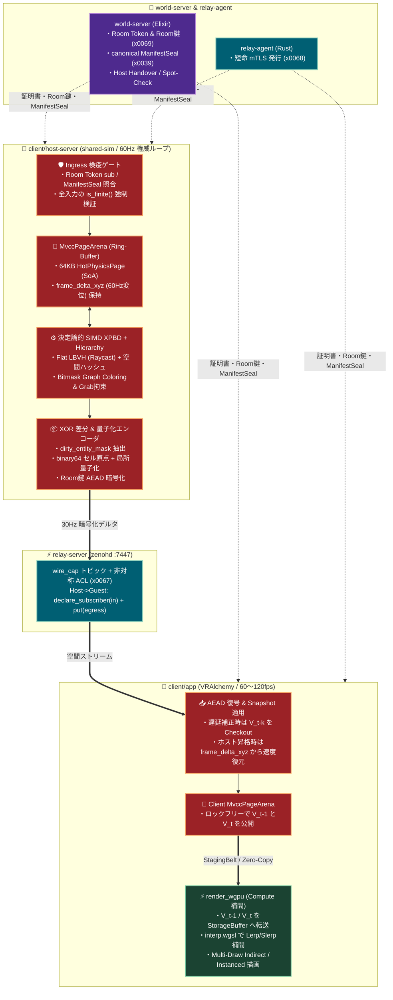

# `FRICK-ELDY/alchemy` 向け「MVCC $\times$ XPBD」空間物理・同期基盤 統合実装指示書

* **対象リポジトリ**: `https://github.com/FRICK-ELDY/alchemy`
* **対象コンポーネント**: `client/` ワークスペース（**既存** `shared-sim` の進化、`host-server`, `app`）、`protocol/`
* **改善計画上の位置**: [improvement-plan-2026-11-12.md](../0_doc/evaluation/improvement-plan-2026-11-12.md) — **P1-1 / P1-4 / P1-5 完了後**に Phase 1。P1-2 / P1-3 は Phase 1、P3-2 は Phase 2 に吸収
* **関連スライス**: `x0020` (Desktop 正本), `x0039` (`ManifestSeal`), `x0053` (体感並行補間), `x0067` (Zenoh 非対称 ACL), `x0068` (短命 mTLS), `x0069` (Room 鍵 AEAD)
* **最優先規約**: 全 Rust クレートにおいて `#![forbid(unsafe_code)]` を厳守し、既存の `./.scripts/ci.sh rust`・`./.scripts/ci.sh protocol`・`make smoke-desktop-handthrough` を常に Green に保つこと。

---

## 0. improvement-plan との差し込み順（着手ゲート）

```text
P0 closed
  → P1-1 kick/epoch + P1-4 handover accept + P1-5 SceneBudget（必須ゲート）
  → Phase 1（P1-2 接触 + P1-3 ゼロアロを DoD に含む）
  → Phase 2（= P3-2 Frame 補間 / wgpu Compute）
  → Phase 3（host 権威ループ + XOR デルタ）
P1-6 / P2（vault・UI/docs/CI）は Phase 1 と並行可。P3-1 / P3-3 以降は独立。
```

| ゲート | 条件 | 破ってはならないこと |
|:---|:---|:---|
| Phase 1 着手 | P1-1 / P1-4 / P1-5 が否定系付きで closed。決定論・NaN 検疫・alloc 上限テスト方針が合意済み | 権限ゲート前に host/app へ本線配線しない |
| Phase 2 着手 | Phase 1 のビット一致リプレイ・接触回帰・alloc 上限が Green。CI を壊さないアダプタ境界が決まっている | 現行 `xpbd.rs` の薄修だけで P1-2 を「closed」にして本指示書を棚上げしない |
| Phase 3 着手 | Phase 2 のシェーダ検証・描画経路が Green。Room AEAD（x0069）・wire_cap をバイパスしないデルタ契約が protocol 側で明示 | 独自トランスポートや検証スキップで帯域を稼がない |

**作業の性質**: `shared-sim` は既に存在する（`EpochSheet` / XPBD / LBVH / FrameBridge）。Phase 1 はクレート**新設ではなく**、現行テープ → `HotPhysicsPage` / `MvccPageArena` への**段階置換・進化**である。

**依存・ビルド注意**:
* `wide` 等の**新規依存は人承認後**（guardrails）。承認前は既存依存（`glam` / `bytemuck` 等）で進める。
* `.cargo/config.toml` の `-fma` / ターゲット別 `rustflags` はワークスペース全体に効くため、Phase 1 ではまず単体テスト用フィーチャ／局所設定から段階導入し、一括強制しない。

---

## 1. 背景と目的（Executive Summary）

本指示書は、1,000 人規模の同一空間マルチプレイと 60〜120fps の低遅延 VR/Desktop 体験を両立するため、**Ring-Buffer MVCC（多版同時実行制御）** と **決定論的 SIMD XPBD（拡張位置ベースダイナミクス）**、および **`wgpu` Compute Shader 補間パイプライン** を現在の `alchemy` アーキテクチャへ無理なく統合するための実装仕様書である。

この統合により、以下の 4 つの技術的メリットを同時に達成する：
1. **実行時アロケーション $0\text{ bytes/frame}$**: 事前確保された $64\text{ KB}$ 境界の SoA ページ（`HotPhysicsPage`）と Dirty Bitmask による Copy-on-Write（CoW）管理。
2. **ロックフリーな 120fps GPU 補間描画**: `client (app)` の描画スレッドが MVCC の確定スナップショット（$V_{t-1}$ と $V_t$）をロック待ちゼロで `wgpu` Storage Buffer へ転送し、Compute Shader 上で位置 Lerp・回転 Slerp を完結。
3. **0秒ホスト引き継ぎ（Handover / Takeover）時の物理速度完全復元**: 60Hz 1ティック分の変位 $\Delta \mathbf{x} = \mathbf{x}_t - \mathbf{x}_{t-1}$ を MVCC ページおよび差分フレームに保持することで、30Hz 受信のゲストが新ホストに昇格した瞬間でもオブジェクトの速度が半減・暴発しない。
4. **O(1) 差分抽出による帯域圧縮**: MVCC の世代間 `dirty_entity_mask` 比較と Smallest-Three クォータニオン量子化により、既存の Zenoh + Room 鍵 AEAD パイプライン上のペイロードサイズを極小化。

---

## 2. 絶対厳守ガードレール（Non-Goals & Architecture Constraints）

Cursor エージェントは実装にあたり、以下の **6つのアーキテクチャ制約** を絶対に破ってはならない。

### 🚫 1. 独自トランスポート層（生 `quinn` / 生 `WebTransport`）の新設禁止
* 初期提案書にあった `net/transport.rs`（生の `quinn` や `web-sys::WebTransport` を直接叩く通信層）は **一切作成しないこと**。
* ネットワーク通信はすべて現行の **`relay-server` (`zenohd`) + `relay-agent` (短命 mTLS `x0068`) + `wire_cap` 非対称 ACL (`x0067`) + Room 鍵 AEAD (`x0069`)** のパイプラインを通すこと。

### 🚫 2. `unsafe` コードおよび `crossbeam-epoch` / `mimalloc` の導入禁止
* `alchemy` のセキュリティ原則（RCE 根絶）に従い、**既存** `shared-sim` を含む全クレートの先頭に `#![forbid(unsafe_code)]` を宣言すること（既に宣言済みなら維持）。
* `crossbeam-epoch` や `mimalloc` は導入しない。MVCC の世代管理は事前確保配列 `Box<[HotPhysicsPage]>` に対するインデックス（`PageId(u16)`）と `AtomicU16` の参照カウントのみで 100% Safe Rust として実装し、メモリ転送には `bytemuck`（`Pod`, `Zeroable`）、SIMD には Safe ラッパーである `wide` クレートを使用する（**`wide` は人承認後**）。

### 🚫 3. `client` 単一クレートへの密結合禁止（既存 `shared-sim` への集約）
* `client/` はワークスペース（`shared-sim` + `app` + `host-server`）である。MVCC と XPBD のコアロジックを `app` 内に直書きせず、**既存の `client/shared-sim/`** を進化させてそこに配置し、`host-server`（60Hz 権威計算）と `app`（予測・補間・描画）の双方から共通利用すること。空の新クレートを増やさない。

### 🚫 4. `protocol/` の `binary64` (`f64`) 空間契約の破壊禁止
* ワイヤ境界（`protocol/`）の空間座標が `binary64` (`f64`) である契約を維持するため、**「空間セル原点（`cell_origin: [f64; 3]` または `cell_id: [i32; 3]`）は `f64` 精度、セル内の局所物理座標（`HotPhysicsPage`）は `f32`（$\pm 32.0\text{ m}$ 以内）」** の 2 階層ハイブリッド座標系を採用する。
* これにより、ワールド原点から何キロメートル離れても浮動小数点精度劣化（頂点揺れ）を防ぎつつ、XPBD ソルバーと `wgpu` Compute Shader はネイティブな `f32` SIMD で最高速実行できる。

### 🚫 5. Untrusted Host / Guest 検疫ゲートのバイパス禁止
* 外部から受信した座標・速度・回転・Grab 入力は、MVCC ページへ書き込む前に必ず `f32::is_finite()` / `f64::is_finite()` のサニタイズを通すこと（`NaN` / `Inf` による XPBD 発散・ワールド崩壊の防止）。
* Canonical `ManifestSeal` (`x0039`) および Room Token の `sub` 権限検証を通過したエンティティのみ、MVCC ページの `active_mask` ビットを点灯させること。

### 🚫 6. VR 特化機能（Raycast・Grab・親子 Slot 階層）の欠落禁止
* 単純な均一サイズ球体/カプセルの空間ハッシュだけでは VR 空間は成立しない。以下の 3 点を必ず組み込むこと：
  1. **空間ハッシュ（近傍衝突・AOI 用）＋ Flat LBVH（30-bit モートン曲線ソートによる VR レーザー UI Raycast・異種サイズ AABB 判定用）** の併用。
  2. **`is_grabbed_mask`（Bitmask）**: Desktop/XR Grab 中のエンティティは逆質量 $w_i = 0$（Kinematic 相当）または高剛性ターゲット拘束として XPBD ソルバーに統合。
  3. **Depth バケット順の親子 Slot 階層伝播**: XPBD 解決後、フラット化されたトポロジ配列（親 $\to$ 子の Depth 順）を走査してローカル座標からワールド座標を一括更新。

---

## 3. ワークスペース構成とデータフロー設計

### 3.1 ディレクトリ・クレート構成 (`client/` ワークスペース)

```text
alchemy/
├── .cargo/
│   └── config.toml                  # クロスプラットフォーム決定論用 (-fma 設定)
├── protocol/                        # 既存ワイヤ契約 SSoT (PROTOCOL_PIN)
└── client/                          # Pure Rust ワークスペース (#![forbid(unsafe_code)])
    ├── Cargo.toml                   # members = ["shared-sim", "host-server", "app"]（既存）
    ├── shared-sim/                  # 【Phase 1 進化】既存クレート。EpochSheet/XPBD から段階置換
    │   ├── Cargo.toml
    │   └── src/
    │       ├── lib.rs               # #![forbid(unsafe_code)]（維持）
    │       ├── tape.rs / bridge.rs  # 【移行期間】現行 Epoch 経路。アダプタ経由で共存可
    │       ├── mvcc/                # 【Phase 1 追加】HotPhysicsPage / MvccPageArena
    │       │   ├── mod.rs
    │       │   ├── page.rs          # HotPhysicsPage (64KB SoA), ColdEntityPage, ReadinessMask
    │       │   └── arena.rs         # MvccPageArena (Ring-Buffer CoW, 128 Tick 履歴)
    │       ├── xpbd/                # 【Phase 1】現行 xpbd.rs をモジュール分割・決定論化
    │       │   ├── mod.rs
    │       │   ├── math_det.rs      # FMA非依存・多項式近似による厳密決定論数学関数
    │       │   ├── broadphase.rs    # Spatial Hash Grid + 30-bit Morton Flat LBVH (Raycast対応)
    │       │   ├── graph_color.rs   # 64-bit Bitmask Constraint Graph Coloring
    │       │   ├── hierarchy.rs     # Depth バケット順 Slot 親子階層伝播 & 孤児自動 Reparent
    │       │   └── solver.rs        # 決定論的 SIMD XPBD ソルバー (Grab / Capsule / Contact)
    │       └── delta_codec.rs       # (V_now XOR V_ack) 差分抽出 & Smallest-Three 量子化
    ├── host-server/                 # 【Phase 3 統合】60Hz 権威計算 & 30Hz 署名/AEAD デルタ配信
    │   └── src/
    │       └── ...                  # 現行 XPBD ループと並行・段階置換可能な SimBackend 抽象化
    └── app/                         # 【Phase 2 統合】VRAlchemy クライアント (60〜120fps)
        └── src/
            └── render_wgpu/
                ├── mvcc_uploader.rs # V_t-1 と V_t ページの StorageBuffer Zero-Copy 転送
                ├── compute_interp.rs# Compute Pass ディスパッチ制御
                └── shaders/
                    └── interp.wgsl  # V_t-1 -> V_t 補間 (Lerp/Slerp) & インスタンス行列生成
```

### 3.2 アーキテクチャ統合データフロー図



---

## 4. コアデータ構造と実装仕様（Safe Rust 100%）

### 4.1 クロスプラットフォーム決定論のための `.cargo/config.toml`

x86_64、ARM64、WASM32 間で暗黙の FMA（融合積和演算: $a \times b + c$ の単一命令丸め）の有無による浮動小数点演算ズレを防ぐため、ワークスペースの `.cargo/config.toml` に以下を**段階導入**する（§0: 一括強制せず、まず Phase 1 単体テスト／フィーチャから）。

```toml
# .cargo/config.toml
[target.x86_64-unknown-linux-gnu]
rustflags = ["-C", "target-feature=+avx2,-fma"]

[target.x86_64-pc-windows-msvc]
rustflags = ["-C", "target-feature=+avx2,-fma"]

[target.aarch64-apple-darwin]
rustflags = ["-C", "target-feature=+neon"]

[target.wasm32-unknown-unknown]
rustflags = ["-C", "target-feature=+simd128"]
```

### 4.2 `shared-sim/Cargo.toml` の定義

```toml
[package]
name = "alchemy-shared-sim"
version = "0.1.0"
edition = "2021"

[dependencies]
bytemuck = { version = "1.21", features = ["derive"] }
glam = { version = "0.29", features = ["bytemuck", "libm"] }
wide = "0.7"
rustc-hash = "2.1"
```

### 4.3 `HotPhysicsPage` と `MvccPageArena`（`shared-sim/src/mvcc/page.rs`, `arena.rs`）

1 ページあたり $1,024$ エンティティを格納する SoA 構造体。**0秒ホスト引き継ぎ（Handover / Takeover）対策**として、前ティックからの 60Hz 変位 `delta_x`, `delta_y`, `delta_z`（$\Delta \mathbf{x} = \mathbf{x}_t - \mathbf{x}_{t-1}$）を明示的に保持する。

```rust
#![forbid(unsafe_code)]

use bytemuck::{Pod, Zeroable};
use std::sync::atomic::{AtomicU16, AtomicU64, Ordering};

pub const ENTITIES_PER_PAGE: usize = 1024;
pub const BITMASK_WORDS: usize = ENTITIES_PER_PAGE / 64; // 16 words
pub const HISTORY_TICKS: usize = 128;

/// GPU StorageBuffer へそのまま転送可能な POD 部分の SoA チャンク
#[repr(C, align(64))]
#[derive(Clone, Copy, Pod, Zeroable)]
pub struct GpuTransferableSoA {
    /// 空間セル内の局所座標 (単位: m, 範囲: [-32.0, 32.0])
    pub pos_x: [f32; ENTITIES_PER_PAGE],
    pub pos_y: [f32; ENTITIES_PER_PAGE],
    pub pos_z: [f32; ENTITIES_PER_PAGE],
    pub inv_mass: [f32; ENTITIES_PER_PAGE],

    /// 60Hz 1ティック分の変位ベクトル (delta_x = pos_curr - pos_prev)
    /// ※ 0秒ホスト昇格時の速度完全復元、およびクライアントのエルミート補間に使用
    pub delta_x: [f32; ENTITIES_PER_PAGE],
    pub delta_y: [f32; ENTITIES_PER_PAGE],
    pub delta_z: [f32; ENTITIES_PER_PAGE],
    pub damping: [f32; ENTITIES_PER_PAGE],

    /// 回転クォータニオン (x, y, z, w)
    pub rot_x: [f32; ENTITIES_PER_PAGE],
    pub rot_y: [f32; ENTITIES_PER_PAGE],
    pub rot_z: [f32; ENTITIES_PER_PAGE],
    pub rot_w: [f32; ENTITIES_PER_PAGE],
}

/// CPU 側の MVCC ページ全体（GPU 転送部 + 空間セル原点 + 各種 Bitmask）
#[repr(C, align(64))]
#[derive(Clone, Copy, Pod, Zeroable)]
pub struct HotPhysicsPage {
    pub soa: GpuTransferableSoA,

    /// binary64 (f64) ワイヤ契約と結合するための空間セル基準座標 (単位: m)
    /// ワールド座標 = cell_origin_f64 + f64::from(soa.pos_*)
    pub cell_origin_x: f64,
    pub cell_origin_y: f64,
    pub cell_origin_z: f64,
    pub _pad0: f64,

    /// ManifestSeal 検証を通過し、現在有効なエンティティのビットマスク
    pub active_mask: [u64; BITMASK_WORDS],
    /// 現 Tick で値が変化したエンティティのビットマスク (XOR 差分送信対象)
    pub dirty_entity_mask: [u64; BITMASK_WORDS],
    /// VR/Desktop Grab 中のエンティティマスク (1 の場合は Kinematic 拘束扱い)
    pub is_grabbed_mask: [u64; BITMASK_WORDS],
    /// 静止スリープ中のエンティティマスク
    pub sleeping_mask: [u64; BITMASK_WORDS],
}

impl HotPhysicsPage {
    pub fn zeroed_page() -> Self {
        bytemuck::Zeroable::zeroed()
    }

    /// Untrusted 入力に対する検疫付き書き込みゲート（NaN / Inf を完全遮断）
    pub fn try_set_kinematic_pose(
        &mut self,
        local_idx: usize,
        px: f32,
        py: f32,
        pz: f32,
        qx: f32,
        qy: f32,
        qz: f32,
        qw: f32,
    ) -> bool {
        if local_idx >= ENTITIES_PER_PAGE {
            return false;
        }
        if !(px.is_finite()
            && py.is_finite()
            && pz.is_finite()
            && qx.is_finite()
            && qy.is_finite()
            && qz.is_finite()
            && qw.is_finite())
        {
            return false;
        }
        let word = local_idx / 64;
        let bit = 1u64 << (local_idx % 64);
        if (self.active_mask[word] & bit) == 0 {
            return false; // ManifestSeal 未承認のエンティティへの書き込み拒否
        }

        let prev_x = self.soa.pos_x[local_idx];
        let prev_y = self.soa.pos_y[local_idx];
        let prev_z = self.soa.pos_z[local_idx];

        self.soa.pos_x[local_idx] = px;
        self.soa.pos_y[local_idx] = py;
        self.soa.pos_z[local_idx] = pz;
        self.soa.delta_x[local_idx] = px - prev_x;
        self.soa.delta_y[local_idx] = py - prev_y;
        self.soa.delta_z[local_idx] = pz - prev_z;

        self.soa.rot_x[local_idx] = qx;
        self.soa.rot_y[local_idx] = qy;
        self.soa.rot_z[local_idx] = qz;
        self.soa.rot_w[local_idx] = qw;

        self.dirty_entity_mask[word] |= bit;
        self.sleeping_mask[word] &= !bit;
        true
    }
}

#[derive(Clone, Copy, Debug, PartialEq, Eq)]
pub struct PageId(pub u16);

#[derive(Clone, Debug)]
pub struct WorldSnapshot {
    pub tick: u64,
    pub hot_pages: Vec<PageId>,
}

/// 実行時ヒープアロケーション 0 の Ring-Buffer MVCC アリーナ
pub struct MvccPageArena {
    pool: Box<[HotPhysicsPage]>,
    ref_counts: Vec<AtomicU16>,
    history_ring: Vec<Option<WorldSnapshot>>,
    alloc_cursor: usize,
    latest_tick: AtomicU64,
}

impl MvccPageArena {
    pub fn new(pool_capacity_pages: usize) -> Self {
        assert!(pool_capacity_pages >= 16 && pool_capacity_pages <= u16::MAX as usize);
        let pool = vec![HotPhysicsPage::zeroed_page(); pool_capacity_pages].into_boxed_slice();
        let ref_counts = (0..pool_capacity_pages).map(|_| AtomicU16::new(0)).collect();
        let mut history_ring = Vec::with_capacity(HISTORY_TICKS);
        history_ring.resize_with(HISTORY_TICKS, || None);

        let mut arena = Self {
            pool,
            ref_counts,
            history_ring,
            alloc_cursor: 0,
            latest_tick: AtomicU64::new(0),
        };

        // 初期スナップショット (Tick 0, 1ページ) を確保
        let initial_page = arena.alloc_free_page().expect("initial page alloc");
        arena.history_ring[0] = Some(WorldSnapshot {
            tick: 0,
            hot_pages: vec![initial_page],
        });
        arena
    }

    fn alloc_free_page(&mut self) -> Option<PageId> {
        let cap = self.pool.len();
        for _ in 0..cap {
            let idx = self.alloc_cursor;
            self.alloc_cursor = (self.alloc_cursor + 1) % cap;
            if self.ref_counts[idx].load(Ordering::Acquire) == 0 {
                self.ref_counts[idx].store(1, Ordering::Release);
                return Some(PageId(idx as u16));
            }
        }
        None
    }

    /// 指定ページを Copy-on-Write で Fork し、dirty_entity_mask をクリアした作業用 PageId を返す
    pub fn fork_page(&mut self, src: PageId) -> Option<PageId> {
        let dst = self.alloc_free_page()?;
        self.pool[dst.0 as usize] = self.pool[src.0 as usize];
        self.pool[dst.0 as usize].dirty_entity_mask = [0u64; BITMASK_WORDS];
        Some(dst)
    }

    pub fn page_ref(&self, id: PageId) -> &HotPhysicsPage {
        &self.pool[id.0 as usize]
    }

    pub fn page_mut(&mut self, id: PageId) -> &mut HotPhysicsPage {
        &mut self.pool[id.0 as usize]
    }

    /// 確定した次世代スナップショットをリングバッファへコミットし、古い世代の参照カウントを減算する
    pub fn commit_snapshot(&mut self, snapshot: WorldSnapshot) {
        let slot = (snapshot.tick as usize) % HISTORY_TICKS;
        if let Some(old) = self.history_ring[slot].take() {
            for pid in old.hot_pages {
                self.ref_counts[pid.0 as usize].fetch_sub(1, Ordering::AcqRel);
            }
        }
        let tick = snapshot.tick;
        self.history_ring[slot] = Some(snapshot);
        self.latest_tick.store(tick, Ordering::Release);
    }

    /// 描画スレッドや差分エンコーダから特定 Tick のスナップショットを取得する
    pub fn get_snapshot(&self, tick: u64) -> Option<&WorldSnapshot> {
        let slot = (tick as usize) % HISTORY_TICKS;
        self.history_ring[slot].as_ref().filter(|s| s.tick == tick)
    }

    pub fn latest_tick(&self) -> u64 {
        self.latest_tick.load(Ordering::Acquire)
    }
}
```

### 4.4 決定論的数学関数と XPBD ソルバー（`shared-sim/src/xpbd/math_det.rs`, `solver.rs`）

XPBD の位置更新式は以下の通りである（$\Delta t_{\text{sub}} = \Delta t / N_{\text{sub}}$）：

$$
\tilde{\mathbf{x}}_i = \mathbf{x}_i + \Delta \mathbf{x}_i + \Delta t_{\text{sub}}^2 \mathbf{g}
$$

$$
\Delta \lambda = \frac{-C(\tilde{\mathbf{x}}) - \tilde{\alpha} \lambda}{\sum w_i |\nabla_{\mathbf{x}_i} C|^2 + \tilde{\alpha}}, \quad \delta \mathbf{x}_i = w_i \nabla_{\mathbf{x}_i} C \Delta \lambda
$$

ここで、OS 標準の `sqrt` や三角関数の微妙な実装差異を避けるため、`math_det.rs` にニュートン・ラフソン法ベースの決定論的逆平方根・正規化を用意する。

```rust
// client/shared-sim/src/xpbd/math_det.rs
#![forbid(unsafe_code)]

/// IEEE 754 準拠かつ FMA 非依存の決定論的逆平方根
#[inline]
pub fn det_inv_sqrt(x: f32) -> f32 {
    if x <= 1e-12 || !x.is_finite() {
        return 0.0;
    }
    // 初期値をビット表現から決定論的に生成し、ニュートン法を 2 回反復
    let half_x = 0.5 * x;
    let i = x.to_bits();
    let j = 0x5f37_59df - (i >> 1);
    let mut y = f32::from_bits(j);
    y = y * (1.5 - (half_x * y * y));
    y = y * (1.5 - (half_x * y * y));
    y
}

#[inline]
pub fn det_normalize3(x: f32, y: f32, z: f32) -> (f32, f32, f32, f32) {
    let len_sq = (x * x) + (y * y) + (z * z);
    if len_sq <= 1e-12 {
        return (0.0, 1.0, 0.0, 0.0);
    }
    let inv_len = det_inv_sqrt(len_sq);
    let len = len_sq * inv_len;
    (x * inv_len, y * inv_len, z * inv_len, len)
}
```

### 4.5 Smallest-Three 回転量子化 & MVCC XOR 差分コーデック（`shared-sim/src/delta_codec.rs`）

`host-server` が 30Hz で Zenoh へ配信する際、`V_now` と `V_ack`（または直前配信 Tick）の `PageId` と `dirty_entity_mask` を比較し、変化したエンティティのみを抽出する。

```rust
// client/shared-sim/src/delta_codec.rs
#![forbid(unsafe_code)]

use crate::mvcc::page::{HotPhysicsPage, BITMASK_WORDS};

#[derive(Clone, Copy, Debug, PartialEq)]
pub struct EntityDeltaRecord {
    pub entity_local_idx: u16,
    /// binary64 セル原点からの相対座標 (f32)
    pub pos_xyz: [f32; 3],
    /// 0秒ホスト昇格用の 60Hz 1ティック変位ベクトル
    pub frame_delta_xyz: [f32; 3],
    /// Smallest-Three で 32-bit に圧縮された回転クォータニオン
    pub packed_quat: u32,
}

/// クォータニオン (x, y, z, w) を 32-bit (最大成分インデックス 2bit + 残り3成分各 10bit) に量子化
pub fn pack_quaternion_smallest_three(qx: f32, qy: f32, qz: f32, qw: f32) -> u32 {
    let comps = [qx, qy, qz, qw];
    let mut max_idx = 0usize;
    let mut max_val = comps[0].abs();
    for (i, &c) in comps.iter().enumerate().skip(1) {
        if c.abs() > max_val {
            max_val = c.abs();
            max_idx = i;
        }
    }
    let sign = if comps[max_idx] < 0.0 { -1.0f32 } else { 1.0f32 };
    // 1 / sqrt(2) ≈ 0.70710678
    const SCALE: f32 = 0.707_106_77;
    let mut packed = (max_idx as u32) << 30;
    let mut shift = 20u32;
    for (i, &c) in comps.iter().enumerate() {
        if i == max_idx {
            continue;
        }
        let v = ((c * sign) / SCALE).clamp(-1.0, 1.0);
        let q = (((v + 1.0) * 0.5) * 1023.0 + 0.5) as u32 & 0x3FF;
        packed |= q << shift;
        shift = shift.saturating_sub(10);
    }
    packed
}

/// ページ内の dirty_entity_mask から変更エンティティのみを O(popcnt) で高速抽出
pub fn extract_dirty_records(page: &HotPhysicsPage) -> Vec<EntityDeltaRecord> {
    let mut out = Vec::new();
    for word_idx in 0..BITMASK_WORDS {
        let mut mask = page.dirty_entity_mask[word_idx] & page.active_mask[word_idx];
        while mask != 0 {
            let bit_pos = mask.trailing_zeros() as usize;
            let idx = word_idx * 64 + bit_pos;
            out.push(EntityDeltaRecord {
                entity_local_idx: idx as u16,
                pos_xyz: [page.soa.pos_x[idx], page.soa.pos_y[idx], page.soa.pos_z[idx]],
                frame_delta_xyz: [
                    page.soa.delta_x[idx],
                    page.soa.delta_y[idx],
                    page.soa.delta_z[idx],
                ],
                packed_quat: pack_quaternion_smallest_three(
                    page.soa.rot_x[idx],
                    page.soa.rot_y[idx],
                    page.soa.rot_z[idx],
                    page.soa.rot_w[idx],
                ),
            });
            mask &= mask - 1; // 最下位ビットをクリア
        }
    }
    out
}
```

### 4.6 `wgpu` Compute Shader 補間パイプライン（`client/app/src/render_wgpu/shaders/interp.wgsl`）

`client (app)` 側で $V_{t-1}$ と $V_t$ の `GpuTransferableSoA` を `wgpu::BufferUsages::STORAGE` バッファとしてバインドし、CPU ループを一切回さずに GPU 上で補間行列を生成する。

```wgsl
// client/app/src/render_wgpu/shaders/interp.wgsl

struct GpuTransferableSoA {
    pos_x: array<f32, 1024>,
    pos_y: array<f32, 1024>,
    pos_z: array<f32, 1024>,
    inv_mass: array<f32, 1024>,

    delta_x: array<f32, 1024>,
    delta_y: array<f32, 1024>,
    delta_z: array<f32, 1024>,
    damping: array<f32, 1024>,

    rot_x: array<f32, 1024>,
    rot_y: array<f32, 1024>,
    rot_z: array<f32, 1024>,
    rot_w: array<f32, 1024>,
};

struct InterpUniforms {
    /// カメラが属するセル原点と対象ページのセル原点の差分 (CPU側で f64 減算後に f32 化した相対オフセット)
    cell_rel_offset: vec3<f32>,
    interp_alpha: f32,
    entity_count: u32,
    _pad0: vec3<u32>,
};

@group(0) @binding(0) var<storage, read> state_prev: GpuTransferableSoA;
@group(0) @binding(1) var<storage, read> state_curr: GpuTransferableSoA;
@group(0) @binding(2) var<storage, read_write> out_matrices: array<mat4x4<f32>, 1024>;
@group(0) @binding(3) var<uniform> uniforms: InterpUniforms;

fn quat_to_mat4(pos: vec3<f32>, q: vec4<f32>) -> mat4x4<f32> {
    let x2 = q.x + q.x;
    let y2 = q.y + q.y;
    let z2 = q.z + q.z;
    let xx = q.x * x2;
    let xy = q.x * y2;
    let xz = q.x * z2;
    let yy = q.y * y2;
    let yz = q.y * z2;
    let zz = q.z * z2;
    let wx = q.w * x2;
    let wy = q.w * y2;
    let wz = q.w * z2;

    return mat4x4<f32>(
        vec4<f32>(1.0 - (yy + zz), xy + wz, xz - wy, 0.0),
        vec4<f32>(xy - wz, 1.0 - (xx + zz), yz + wx, 0.0),
        vec4<f32>(xz + wy, yz - wx, 1.0 - (xx + yy), 0.0),
        vec4<f32>(pos.x, pos.y, pos.z, 1.0)
    );
}

@compute @workgroup_size(64)
fn cs_interpolate_entities(@builtin(global_invocation_id) gid: vec3<u32>) {
    let idx = gid.x;
    if (idx >= uniforms.entity_count) {
        return;
    }

    let alpha = clamp(uniforms.interp_alpha, 0.0, 1.0);

    // 1. カメラ相対のセル内位置補間 (V_t-1 -> V_t)
    let p0 = vec3<f32>(state_prev.pos_x[idx], state_prev.pos_y[idx], state_prev.pos_z[idx]);
    let p1 = vec3<f32>(state_curr.pos_x[idx], state_curr.pos_y[idx], state_curr.pos_z[idx]);
    let camera_rel_pos = mix(p0, p1, alpha) + uniforms.cell_rel_offset;

    // 2. 最短経路保証付きクォータニオン補間 (Nlerp)
    let q0 = vec4<f32>(state_prev.rot_x[idx], state_prev.rot_y[idx], state_prev.rot_z[idx], state_prev.rot_w[idx]);
    var q1 = vec4<f32>(state_curr.rot_x[idx], state_curr.rot_y[idx], state_curr.rot_z[idx], state_curr.rot_w[idx]);
    if (dot(q0, q1) < 0.0) {
        q1 = -q1;
    }
    let rot = normalize(mix(q0, q1, alpha));

    // 3. インスタンス描画用の変換行列を出力
    out_matrices[idx] = quat_to_mat4(camera_rel_pos, rot);
}
```

---

## 5. 段階的実装ロードマップと完了条件（Definition of Done）

既存の CI や E2E を一切壊さずに導入するため、必ず以下の **3 フェーズ順** に実装とテストを進めること。  
§0 の着手ゲートを満たす前に次 Phase へ進まないこと。improvement-plan の **P1-2 / P1-3 / P3-2** はここで閉じる。

### Phase 1: 既存 `shared-sim` の進化とヘッドレス決定論テスト（host/app 本線は触らない）

**前提**: improvement-plan **P1-1 / P1-4 / P1-5** closed。  
**吸収**: **P1-2**（body-body 接触）、**P1-3**（hot-path zero-alloc）。

1. **作業内容**:
   * 空クレートを増やさない。既存 `client/shared-sim/` に `mvcc`（`HotPhysicsPage`, `MvccPageArena`）、`xpbd` モジュール分割（`math_det`, 空間ハッシュ + 30-bit Morton LBVH Raycast, Bitmask Graph Coloring, カプセル接触・Grab 拘束ソルバー）、`delta_codec` を `#![forbid(unsafe_code)]` で追加／置換する。
   * 現行 `EpochSheet` / `xpbd.rs` / `spatial.rs` はアダプタまたはフィーチャで共存させ、host の本番経路を壊さない（本線切替は Phase 3）。
   * 未使用 `rapier3d` が残る場合は依存削除または理由コメント。overview / `client.md` の Rapier 残骸は P2-5 と協調して XPBD 記述へ更新する。
2. **単体テスト要件 (`cargo test -p alchemy-shared-sim`)** — improvement-plan 完了条件を含む:
   * **アロケーションゼロ検証（P1-3）**: 1,000 エンティティの更新と 128 Tick のコミット・巻き戻し（Rollback Checkout）を 500 Tick 連続実行しても、プール外のページ枯渇・パニック・tick あたり確保回数上限超過が起きないこと。
   * **body-body 接触回帰（P1-2）**: 2 箱フィクスチャが地面以外でも重ならないこと（ページ／アリーナ経路で保証。`step_dt(..., None)` のまま「intentionally off」で閉じない）。
   * **厳密決定論リプレイ検証**: Tick 50 のスナップショットをチェックアウトし、Tick 50 $\to$ 100 までを再計算した際、1 回目の Tick 100 のページバイト列（ハッシュ値）と 2 回目のバイト列が **1 ビットも違わず完全一致** すること。
   * **NaN / Inf 検疫検証**: `try_set_kinematic_pose` に `f32::NAN` や `f32::INFINITY`、あるいは `active_mask` が `0` のインデックスを渡した際、確実に `false` を返して内部状態が汚染されないこと。
   * **0秒ホスト昇格速度復元検証**: 受信した `pos_xyz` と `frame_delta_xyz` から `prev_pos = pos - frame_delta` を復元して XPBD を 1 Tick 回した際、ホスト側で連続実行した場合と同一の軌道を描くこと。

### Phase 2: `client (app)` への MVCC バッファ & `wgpu` Compute 補間統合（`x0053` / **P3-2**）

**前提**: Phase 1 DoD Green。  
**吸収**: improvement-plan **P3-2**（Frame 補間 / jitter buffer）。

1. **作業内容**:
   * `client/app` は既に `alchemy-shared-sim` に依存している。既存 `epoch_mirror` / Prev-Curr 経路を段階的に `MvccPageArena` アダプタへ寄せる。
   * ネットワーク（またはローカル IPC）から `RenderFrame` を受信した際、`client/app` 内の `MvccPageArena` にスナップショットをコミットするアダプタを実装する。
   * `render_wgpu` に `interp.wgsl` を組み込み、直前スナップショット $V_{t-1}$ と最新スナップショット $V_t$ の `GpuTransferableSoA` を Storage Buffer へアップロードして 60〜120fps で補間描画するパスを接続する（カメラ原点とセル原点の差分は CPU 側で `f64` 減算してから `cell_rel_offset: vec3<f32>` として Uniform に渡すことで、`binary64` 精度を維持する）。
2. **検証条件**:
   * `./.scripts/ci.sh rust`（`fmt` / `clippy` / `build` / `test`）が警告ゼロで通ること。
   * `wgpu::naga` による `interp.wgsl` のシェーダーバリデーション単体テストが通ること。

### Phase 3: `host-server` 権威ループ統合と XOR デルタ配信の有効化

**前提**: Phase 2 DoD Green。Room AEAD / wire_cap 契約が明示されていること。

1. **作業内容**:
   * 既存の `alchemy-shared-sim` 統合を MVCC ページ経路へ切り替える（環境変数またはフィーチャーフラグ `ALCHEMY_SIM_BACKEND=mvcc_xpbd|epoch_xpbd` で現行 Epoch/XPBD ループと即時切り替え・比較検証できるようにアダプタ化する。Rapier への回帰は必須としない）。
   * 60Hz ループ内で Ingress 検疫（Room Token `sub` 別 Grab/Intent 検証、`ManifestSeal` 照合、`is_finite()` 検査）$\to$ MVCC Page Fork $\to$ XPBD サブステップ解決 $\to$ Depth 順親子階層伝播 $\to$ MVCC Commit を実行する。
   * 30Hz デルタ配信時に `extract_dirty_records` で変更エンティティのみを抽出し、既存の Room 鍵 AEAD（`x0069`）と Zenoh `wire_cap` トピック経由で Publish する。
2. **検証条件**:
   * `./.scripts/ci.sh rust` および `./.scripts/ci.sh protocol` が Green であること。
   * `make smoke-desktop-handthrough` が Green で完走すること。