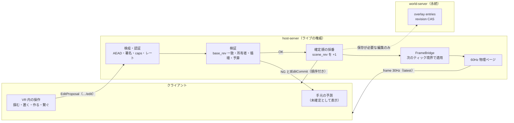
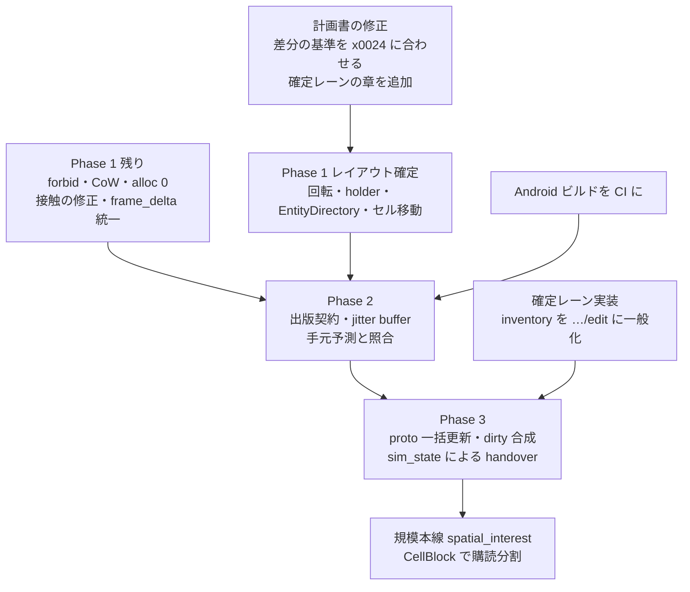

# MVCC × XPBD 実装指示書 レビューと改善提案

> **取り込み状況（2026-11-13）**: 本提案の P0/P1 は [`mvcc_xpbd.md`](mvcc_xpbd.md) と [`improvement-plan-2026-11-12.md`](../0_doc/evaluation/improvement-plan-2026-11-12.md) に**文書反映済み**。  
> **文書反映 ≠ コード完了**: `forbid` クレート直下・真の CoW・レイアウト予約・不等式接触・alloc DoD などの実装 P0 は未着手。後続エージェントは計画書の「現状」欄を正とする。未決 Q2–Q8 は `mvcc_xpbd.md` §6（Q1 は文書方針として採用済み）。本ファイルは壁打ちの正本アーカイブとして残す。

* **対象**: `.workspace/roadmap/mvcc_xpbd.md`（以下「計画書」）と Phase 1 の実装
* **読んだコード**: `FRICK-ELDY/alchemy` main `328ed24`（2026-11-13 11:51 JST）
* **前提として守る規約**: 全クレート `#![forbid(unsafe_code)]`、`crossbeam-epoch` / `mimalloc` 不使用、新しい依存は人の承認後、通信はすべて zenohd + 短命 mTLS + wire_cap ACL + Room AEAD（独自トランスポートは作らない）、Quest（Android）対応と VR 内での共同創作を最優先
* **表記**: `path:行` は上記コミット時点の行番号です。「計画書 §x」は `mvcc_xpbd.md` の節番号です。

---

## 0. 要約

### 0.1 まず押さえておきたい現状

読んでみて、全体の方向性（品質本線と規模本線の分離、NaN 検疫、f64 セル原点 + f32 局所座標、着手ゲート）はよく練られていると感じました。一方で、レビュー全体に効いてくる事実が 3 つあります。

1. **「Phase 1 完了」の中身は、着手ゲート（P1-1 / P1-4 / P1-5）と scaffold まで**です。スライス `x00a3` 自体が `status: in_progress` で、「XPBD 接触 / zero-alloc DoD（後続）: pending」と書かれています（`.workspace/roadmap/slices/x00a3-mvcc-phase1-scaffold.md:3,27`）。計画書 §5 Phase 1 の DoD（ビット一致リプレイ、alloc 上限、body-body 接触、handover 速度復元、`delta_codec`、`math_det`）はコード上にまだありません（`client/shared-sim/src` を grep しても該当するテストやモジュールは見つかりませんでした）。なので、以下の指摘の多くは **Phase 1 の残り作業の中で直せます**。今がちょうどいいタイミングです。
2. **今の XPBD は `HotPhysicsPage` をまったく使っていません**。ソルバーは `EpochSheet`（f64 の AoS 的な `WorldTransformf64`）の上で動いていて（`xpbd.rs:15-27`）、`mvcc/` は独立した骨組みです。ページ形式に移すときに、下の指摘（回転、ID、所有者）をまとめてレイアウトに入れるのが一番安くつきます。
3. **ネットワーク差分の仕組みは既にかなり良いものがあります**（x0024 の「publish した frame は tick 連番、欠けたら `…/snapshot` を取り直す」、`protocol/peer-delivery.md:17,27,37-59`）。計画書 §4.5 の「`V_now XOR V_ack`」という書き方は、この既存契約と食い違っているので、既存契約に合わせて書き直すのがよいと思います（指摘 1）。

### 0.2 指摘一覧（優先度つき）

優先度: **P0** = Phase 1 の残り作業で入れないと後で作り直しになる / **P1** = Phase 2・3 の着手前に仕様を決めておく / **P2** = 品質改善・後回しでもよい

| # | 指摘 | 種別 | 入れる Phase | 優先度 |
|:--|:--|:--|:--|:--|
| 1 | 差分の基準・欠落・30Hz 送信時の dirty の合成（既存 x0024 契約との整合） | 既出・修正 | 計画書修正は今、実装は Phase 3 | P1（文言修正は P0） |
| 2 | 回転の物理状態（角速度）が無い。そもそもソルバーが回転を積分していない | 既出・拡張 | Phase 1（レイアウト予約）/ Phase 3 | **P0** |
| 3 | 自分のアバター・掴んでいる物の手元予測と照合、投げの速度 | 既出 | Phase 2 | P1 |
| 4 | 掴みの所有者がページに無い・取り合いの結果が手元に返らない | 既出・修正（host は既に先着・横取り禁止） | Phase 1（ページ）/ Phase 3（wire） | P1 |
| 5 | 差分レコードの ID、ページ・セルとの対応、セル越えの移動 | 既出 | Phase 1（設計）/ Phase 3 | **P0** |
| 6 | 構造変更（生成・削除・親子・編集）を扱う「確定」レーン | 既出・具体化（inventory の仕組みを一般化） | 計画書に章を追加。実装は Phase 3 と並走 | **P0（設計）** |
| 7 | **新ホストが直前の物理状態を引き継ぐ経路が無い**（Manifest から作り直している） | 新規 | Phase 3 の前提 | **P0（前提確認）** |
| 8 | **接触制約が「引き寄せ」も起こす**／箱を球として扱う／host 本線では接触オフのまま | 新規 | Phase 1（P1-2） | **P0** |
| 9 | `commit_snapshot` が参照を持たない・`page_mut` が共有ページを直接書ける（CoW が守られない） | 既出・拡張 | Phase 1 | **P0** |
| 10 | 毎ティックのアロケーション（ページ側・既存ソルバー側の両方） | 既出・拡張 | Phase 1（P1-3） | **P0** |
| 11 | 決定論の設定（Android ターゲット、`-fma`、`det_inv_sqrt`、`powi`、誰に必要か） | 既出・拡張 | Phase 1 | P1 |
| 12 | `#![forbid(unsafe_code)]` がクレート直下に無く、`mvcc/` などに効いていない | 新規 | 今すぐ | **P0（1 行）** |
| 13 | `frame_delta` の意味が経路ごとに違う／計画書の XPBD 式がサブステップを考慮していない | 新規 | Phase 1 | P1 |
| 14 | 細かい指摘（初回 activate の速度、LBVH の O(n²)、AABB が回転無視、Undo の前提条件、`owner_scope` の名前など） | 新規 | 各所 | P2 |
| 15 | ペイロードサイズと量子化 | 既出・修正（現行より既に小さい） | Phase 3 | P2 |
| 16 | `AtomicU16` 参照カウントと出版契約 | 既出 | Phase 2 | P2 |

---

## 1. 差分の基準・欠落・30Hz 送信時の dirty の合成

### 問題

計画書 §4.5 は「`V_now` と `V_ack`（または直前配信 Tick）を比較」と書いていますが、

* `frame` は Zenoh の pub/sub で全員に同じバイト列を送るので、**受信者ごとの ACK を基準にはできません**。ACK 経路もありません（`client/app/src/bus/frame.rs:10-11` の非保証に「reliable-delivery ACK channel」）。
* 一方、既存の x0024 契約は既に「**全員共通の基準 = 最後に publish した frame**」「**tick は publish ごとに連番**」「**1 つでも欠けたら差分は適用せず `…/snapshot` を get して置き換える**」という、pub/sub に合った形になっています（`protocol/peer-delivery.md:37-59`、`protocol/src/lib.rs:408,428-`、`client/host-server/src/network_worker.rs:649-664`）。
* 計画書の `dirty_entity_mask` は 60Hz の 1 ティック分だけです。現行の host は 60Hz で回して 2 ティックに 1 回送ります（`host_loop.rs:25-29,428`）。計画書の fork は dirty をクリアする（計画書 §4.3 `fork_page`）ので、**送らないティックで動いて次のティックで止まった物の dirty が消えます**。現行の送信側は dirty ビットではなく「最後に送った姿勢 `last_sent` との比較」（`network_worker.rs:654-663`）なので、この問題は起きていません。新しいコーデックに置き換えるときに退行しやすいところです。
* `RenderFrame.tick` は **publish の通し番号（net_tick）**で、物理ティックではありません（`network_worker.rs:545,558-559`）。MVCC の履歴（tick 番号で引くリング）と wire の tick を対応づける情報が wire にありません。
* `FRAME_TICK_GAP_RESYNC = 1`（`protocol/src/lib.rs:408`）なので、パケットが 1 つ欠けるだけで snapshot の取り直しになり、クールダウンは 500ms です（`peer-delivery.md:59`）。Quest の Wi-Fi のように欠落がよくある環境では、取り直し中に止まって見える時間が出ます。

### 提案

1. **計画書の文言を直す（今すぐ）**: 「`V_ack`」をやめ、「基準 = 直前に publish した frame（全員共通）。欠落は x0024 どおり snapshot」と明記します。
2. **送信間隔分の dirty を合成する**: 送らないティックの dirty を OR で貯めます。

```rust
// shared-sim/src/delta_codec.rs（案）
pub struct WireDirtyAccumulator {
    /// ページごとの「前回 publish 以降に変わった」ビット（事前確保）
    acc: Box<[[u64; BITMASK_WORDS]]>, // len = プールのページ数
}

impl WireDirtyAccumulator {
    /// 毎 60Hz ティックの commit 直後に呼ぶ
    pub fn absorb(&mut self, page_slot: usize, page: &HotPhysicsPage) {
        if let Some(acc) = self.acc.get_mut(page_slot) {
            for (a, d) in acc.iter_mut().zip(page.dirty_entity_mask.iter()) {
                *a |= *d;
            }
        }
    }
    /// publish に成功したときだけクリア（publish ゲートで止まった間は貯め続ける）
    pub fn clear_after_publish(&mut self) {
        for acc in self.acc.iter_mut() {
            *acc = [0; BITMASK_WORDS];
        }
    }
}
```

3. **冗長デルタ窓で 1〜2 個の欠落を吸収する（任意・おすすめ）**: 各 frame に「直近 K 回の publish で変わったエンティティ」を最新値で載せます（latest 型なので古い値の再送ではなく最新値の重複送信）。受信側は `tick <= last + K` なら適用できるので、`FRAME_TICK_GAP_RESYNC` を K に広げられます。帯域は増えますが、動いている物はどのみち毎回載るので、増えるのは「止まった直後の物」だけです。

```rust
pub struct RedundantWindow<const K: usize> {
    ring: [[u64; BITMASK_WORDS]; K], // 1 ページ分の例。実際はページ数ぶん事前確保
    head: usize,
}
// 送信マスク = ring の全要素の OR（K=2 なら直近 2 回分）
```

4. **wire に物理ティックを載せる**: `RenderFrame` にフィールドを追加します（PROTOCOL_PIN を上げる）。

```proto
message RenderFrame {
  // ...既存...
  // 60Hz 物理ティック（MVCC 履歴の tick と同じ番号）。net_tick（= tick）とは別。
  uint64 sim_tick = 6;
  // このフレームが何回前の publish までの変更を含むか（冗長窓 K）。0 = 従来どおり。
  uint32 redundancy = 7;
}
```

5. **キーフレームは既存の `…/snapshot`（request/response）を使う**。定期キーフレームを `frame` に流すより、x0024 の「欠けたら get」を維持するほうが帯域と実装の両面で安く済みます。規模本線でセル分割したときも「frame = latest・欠落は snapshot」を維持すると `spatial_interest.md:82` に書かれているので、それと整合します。

### 追加すべきテスト

* `dirty_survives_skipped_net_tick`: ティック 1 で動き、ティック 2 で止まった物が、ティック 2 の publish に含まれる。
* `publish_gate_closed_keeps_accumulating`: publish ゲートが閉じている間の変更が、開いた後の最初の frame に含まれる。
* `redundant_window_absorbs_single_loss`: K=2 で 1 つ欠けても snapshot なしで収束する（エンティティ表が host と一致）。
* 既存の `network_worker.rs:772` などの catch-up テストを新コーデックでも通す（退行防止）。

### Phase / 優先度

計画書の文言修正は今（P0）。合成と `sim_tick` は Phase 3（P1）。冗長窓は Phase 3 か規模本線（P2）。

---

## 2. 回転の物理状態（角速度）が無い

### 問題

* `GpuTransferableSoA` には位置の変位 `delta_x/y/z` はあるが、回転の変化量がありません（`client/shared-sim/src/mvcc/page.rs:9-25`）。
* もっと根本的に、**今の XPBD は回転をまったく積分していません**。`predict_integrate` は位置だけを更新し（`xpbd.rs:52-91`）、制約も点同士の距離だけです（`xpbd.rs:140-251`）。host の非保証にも「Grab aim **rotation** follow（translation only）」とあります（`host-server/src/sim.rs:11`）。今は回転が Manifest の初期値のまま動かないので、「handover で回転が止まる」問題はまだ表に出ていませんが、箱が転がる・回る・手首の回転で物を回す、を入れた瞬間に出ます。
* 計画書の差分レコードは回転を 10bit の Smallest-Three で送ります（計画書 §4.5）。1 段の幅はおよそ 1.414/1023 ≈ 0.0014（角度でおよそ 0.1° 前後）で、描画には十分ですが、**ゲストが新ホストに昇格したとき、この量子化された値から物理を再開する**ことになります。
* Phase 1 DoD の速度復元テストは位置だけを見ています（計画書 `mvcc_xpbd.md:658`）。

### 提案

Phase 1 のうちにページのレイアウトへ回転系の列を **予約** しておきます（後から足すと GPU 側の WGSL 構造体・wire・テストを全部やり直すことになるため）。

```rust
#[repr(C, align(64))]
#[derive(Clone, Copy, Pod, Zeroable)]
pub struct GpuTransferableSoA {
    // ...既存の pos / inv_mass / delta / damping / rot ...
    /// 1 ティック分の回転変化を回転ベクトル（軸 × 角度, rad）で持つ。
    /// q_t = exp(dθ/2) * q_{t-1}。角速度 ω = dθ / dt。
    pub drot_x: [f32; ENTITIES_PER_PAGE],
    pub drot_y: [f32; ENTITIES_PER_PAGE],
    pub drot_z: [f32; ENTITIES_PER_PAGE],
    /// 慣性の逆数（対角, ローカル軸）。球なら 3 つ同じ値。
    pub inv_inertia_x: [f32; ENTITIES_PER_PAGE],
    pub inv_inertia_y: [f32; ENTITIES_PER_PAGE],
    pub inv_inertia_z: [f32; ENTITIES_PER_PAGE],
}
```

* 回転ベクトルで持つ理由: クォータニオンの差 `q_t * q_{t-1}^-1` は ±q の符号問題とノルムのずれが出やすく、外部入力の検疫（`is_finite` に加えて「大きさが π/dt 以下」）も書きやすいからです。
* XPBD の剛体化（Müller ら 2020 の rigid body XPBD）では、位置の補正と同時に姿勢の補正を `inv_inertia` で配分します。Phase 1 ではソルバーが回転を使わなくても、**列と保存・復元の経路だけ先に通す**のが目的です。
* wire: 昇格用の情報（`frame_delta_xyz` と `drot`）は、全員に毎回送る必要はありません。描画用の frame は位置＋回転だけにして、**handover 用の完全な状態は別経路**（指摘 7 の「ホスト状態の引き継ぎ」）で渡すのが帯域的にも素直です。
* 量子化: 描画用の frame は 32bit Smallest-Three で十分です。昇格の初期値に使う状態は量子化しない f32 で渡します。

### 追加すべきテスト

* `handover_restores_linear_and_angular_velocity`: 回転しながら飛ぶ箱を host A で N ティック回し、ティック k の状態を（量子化なしで）host B に渡して残りを回した結果が、A で回し続けた結果とビット一致（同じバイナリ・同じマシン）。
* `quantized_handover_error_bounded`: 32bit 量子化経由で渡した場合の姿勢誤差が 1 秒後に閾値以内（量子化経由を許すなら）。
* `drot_rejects_non_finite_and_overspeed`: 検疫ゲートが NaN と非現実的な角速度を拒否。

### Phase / 優先度

レイアウト予約と保存・復元のテストは Phase 1（**P0**）。剛体回転の XPBD 化そのものは Phase 1 後半〜Phase 3（P1）。

---

## 3. 自分のアバターと掴んでいる物の手元予測

### 問題

* クライアントは受信した frame を「運動学的なミラー」として持ち（`client/app/src/epoch_mirror.rs:1-11`、`inv_mass=0`・`DYNAMIC` なし）、`V_t-1 → V_t` を **受信時刻からの経過で** α 補間するだけです（`epoch_mirror.rs:21-25,199-207`）。
* 自分の移動（Intent の `move_*`）はホストが `user_root` を動かして frame で返します（`host-server/src/sim.rs:806-831`）。掴んでいる物もホストの Grab 拘束で動きます（`sim.rs:715-736`）。つまり **自分の手に持った物は「RTT + 送信間隔 33ms + 補間 1 区間」遅れて見えます**。VR では手と物がずれて見えるのが一番違和感の出るところです（頭の姿勢は OpenXR でローカルに取っているので、頭は遅れません: `surface/xr/wgpu_session.rs:357-366`）。
* 投げる動作は今は無く、離すと `frame_delta` を 0 にしています（`sim.rs:547-551`、非保証「throw impulse」`sim.rs:11`）。投げを入れるときに、**ホストに届いた手の位置の差分（ネットワークの揺らぎ込み）から速度を作ると不安定**になります。
* α が受信時刻基準で、jitter buffer がありません（P3-2 として Phase 2 に吸収予定と計画書 §5 にあります）。frame が遅れると α が 1 に張り付いて止まり、次で飛びます。

### 提案

レーンを 2 つに分けます。

1. **自分が所有しているもの（自分の user_root と、自分が掴んでいる物）**: クライアントがローカルで即座に動かし（予測）、ホストの結果が届いたら照合して、ずれが小さければ滑らかに寄せ、大きければスナップします。
2. **それ以外**: 今どおり補間（Phase 2 で jitter buffer 付きに）。

```rust
// client/app 側（案）。shared-sim に置いて host と同じ Grab 拘束関数を共有するとよい。
pub struct OwnedPrediction {
    /// 自分が送った Intent の seq と、そのときの予測姿勢（固定長リング）
    history: [PredSample; 64],
    head: usize,
}
#[derive(Clone, Copy, Default)]
pub struct PredSample {
    pub intent_seq: u64,
    pub pos: [f32; 3],
    pub rot: [f32; 4],
}

pub enum Reconcile {
    Keep,                 // 誤差が閾値以下
    Blend { secs: f32 },  // 数フレームかけて寄せる
    Snap,                 // 大きく外れた（取り合いに負けた等）
}
```

* 照合に必要なので、frame に「**このフレームで host が最後に適用したあなたの `intent_seq`**」を載せます。全員に同じ frame を送るので、`user_root` ごとの値として載せます（人数分の u64、最大 32 人: `USER_ROOT_SLOTS_MAX`）。

```proto
message RenderFrame {
  // ...
  // slot 番号 = index。host が適用した最後の intent_seq（照合用）。
  repeated uint64 acked_intent_seq = 8;
}
```

* **投げの速度はクライアントが計算して送る**: OpenXR のコントローラ速度（`xrLocateSpace` の velocity）または手元の直近数フレームの姿勢から、リリース時の線速度・角速度をクライアントで求め、Intent に載せます。ホストは上限でクランプして検疫します（既存の `finite.rs` の `clamp_*` と同じ考え方）。

```proto
message InputEvent {
  // ...
  // GRAB を離した Intent のときだけ有効。world 空間 m/s と rad/s。host がクランプ。
  float release_vx = 15; float release_vy = 16; float release_vz = 17;
  float release_wx = 18; float release_wy = 19; float release_wz = 20;
}
```

### 追加すべきテスト

* `owned_prediction_snaps_on_grab_denied`: 予測で掴んだが host が拒否（他人が先）→ Snap して手から外れる。
* `reconcile_blend_under_jitter`: 到着間隔に ±15ms の揺らぎを入れても、自分が持つ物の表示が手の位置から X mm 以上離れない。
* `release_velocity_clamped`: 上限を超える投げ速度・NaN がクランプ・拒否される。

### Phase / 優先度

Phase 2（P1）。`acked_intent_seq` と投げ速度の wire 追加は Phase 3 の proto 変更とまとめると PROTOCOL_PIN を 1 回で済ませられます。

---

## 4. 掴みの所有者と取り合い

### 問題（既出の指摘を修正）

* 前回「取り合いのルールが無い」と言いましたが、**host の現行経路には既にルールがありました**。`apply_grab` は他のスロットが掴んでいる物を掴ませない（`sim.rs:475-480,505-507`、先着・横取り禁止、モジュール docs の「no Steal」`sim.rs:4`）、距離ゲート（`sim.rs:509`）、手渡し `pass_held`（`sim.rs:329-362`）があります。
* 残る問題は次の 3 つです。
  1. `HotPhysicsPage.is_grabbed_mask` は 1bit で（`mvcc/page.rs:40`）、**誰が持っているかをページが持っていません**。現行は `PhysicsWorld.grabs`（スロットごとの配列）にあり、ページ形式に移すと、この情報を引き継ぐ場所がありません。handover 時にも誰が持っていたかが失われます。
  2. 掴みが拒否されても **クライアントに理由が返りません**。Intent は best-effort で（`peer-delivery.md:32`）、クライアントは frame を見て「動かなかった」ことで気づくしかありません。指摘 3 の予測を入れると、これが Snap の判断材料として必要になります。
  3. 同じティックに 2 人の Intent が届いたときの順序が、**受信順＝スロットのループ順**に依存します。決定論の観点では「同時ならスロット番号が小さい方」などと明文化しておくと、リプレイと Spot-Check で再現できます。

### 提案

ページに所有者の列を持たせ（1 バイトで足ります。`USER_ROOT_SLOTS_MAX = 32`）、リース（期限付きの所有）として扱います。

```rust
pub const NO_HOLDER: u8 = u8::MAX;

// HotPhysicsPage に追加（GPU 転送部ではなく CPU 側）
pub holder_slot: [u8; ENTITIES_PER_PAGE],       // NO_HOLDER = 誰も持っていない
pub holder_since_tick: [u32; ENTITIES_PER_PAGE], // 同時刻の調停・リース期限用
```

ルール（現行の振る舞いを明文化したもの＋少し追加）:

1. 掴めるのは `holder_slot == NO_HOLDER` のときだけ（横取り禁止、現行どおり）。
2. 同じティックで複数が要求したら、**スロット番号の小さい方**（決定論的なタイブレーク）。
3. リース: 持ち主の Intent が `GRAB_LEASE_TICKS`（例: 30 ティック = 0.5 秒）届かなければ自動で離す（切断・フリーズ時に物が宙に固まり続けない）。
4. 手渡し（`pass_held`）は「from が持っている ∧ to が空いている」を原子的に確認して付け替え（現行どおり）。
5. 結果は frame で返す: エンティティごとの持ち主を載せれば、拒否もクライアントが判断できます。

```proto
message Entity {
  // ...
  // 0 = 誰も持っていない、1..=32 = 持っている user_root スロット + 1
  uint32 holder = 16;
}
```

`is_grabbed_mask` は「`holder_slot != NO_HOLDER` の要約ビット」として残すと、ソルバー側の高速判定（ビット演算）はそのまま使えます。

### 追加すべきテスト

* `simultaneous_grab_lower_slot_wins`: 同じティックにスロット 3 と 1 が同じ箱を要求 → 1 が持つ。入力順を入れ替えても同じ。
* `grab_lease_expires_without_intent`: 持ち主の Intent が止まると N ティック後に離れる。
* `holder_survives_page_fork_and_handover`: fork・commit・状態引き継ぎを通しても holder が保たれる。
* 既存の `apply_grab` 系テストをページ経路でも通す。

### Phase / 優先度

ページへの列追加は Phase 1（P1）、wire の `holder` は Phase 3（P1）。

---

## 5. エンティティの ID、ページ・セル、セル越え

### 問題

* 計画書の差分レコードはページ内の `u16` 番号だけで（計画書 §4.5 `entity_local_idx`）、**どのページ・どのセルのものか**を表せません。
* 安定した ID は既に 2 種類あります: wire の `Entity.id`（Manifest の `entity_id`、`render_frame.proto:24`）と、テープ内の `NodeHandle { row_id, generation }`（`tape.rs:16-21`、ABA 対策済み）。ページの `local_idx` とこれらの対応表が計画書にありません。
* なお `EpochSheet.owner_scope` には実際には **`entity_id` が入っています**（`host-server/src/sim.rs:222,248,948`、`app/src/epoch_mirror.rs:128`）。名前と中身がずれているので、ページ側で同じ混乱を持ち込まないようにしたいところです（指摘 14 にも記載）。
* ±32m のセルを越えたときにページを移る処理、移動中の 1 ティックで両方のページに居る/どちらにも居ない状態の扱い、境界付近での行ったり来たり（ヒステリシス）が決まっていません。規模本線（`spatial_interest.md:67-71`）は「物理ページのセルと配信のセルを同じ系にする」と決めているので、ここの設計はそのまま配信の単位にもなります。

### 提案

```rust
/// セル座標（f64 原点 = cell * CELL_SIZE_M）
#[derive(Clone, Copy, Debug, PartialEq, Eq, Hash, PartialOrd, Ord)]
pub struct CellId(pub [i32; 3]);
pub const CELL_SIZE_M: f64 = 64.0;     // 局所座標は [-32, 32)
pub const CELL_HYSTERESIS_M: f32 = 2.0; // 局所 |x| > 34 で初めて隣へ移す

/// エンティティの居場所（事前確保した表。entity_id → slot）
#[derive(Clone, Copy, Debug, PartialEq, Eq)]
pub struct PageSlot { pub cell: CellId, pub page: PageId, pub local: u16 }

pub struct EntityDirectory {
    /// entity_id で引く。HashMap は反復順が不定なので「引くだけ」に使い、
    /// 反復が必要な処理は下の dense 配列（entity_id 昇順）を使う。
    by_entity: std::collections::HashMap<u32, PageSlot>,
    /// ページごとの local → entity_id（逆引き、u32::MAX = 空）
    entity_of: Box<[[u32; ENTITIES_PER_PAGE]]>,
}
```

* 局所座標の範囲を「±32m + ヒステリシス」まで許すと（f32 で ±34m でも精度は 4µm 程度）、境界での行ったり来たりを防げます。
* **セル移動は同じティック内で「A から外す → B に入れる」を 1 つの操作**として行い、wire には「移動」レコードを出します（受信側で一瞬消えて現れることを防ぐ）。

```rust
pub enum DeltaRecord {
    Pose { entity_id: u32, local: u16, pos_q: [u16; 3], quat: u32 },
    Migrate { entity_id: u32, from: CellId, to: CellId, to_local: u16 },
}
```

* wire 上の ID は **`entity_id`（u32）を正**にして、`local` は「受信側がページ配置を真似るときのヒント」に留めるのが安全です。`u16` だけだと、ページの付け替え・再利用の瞬間に別の物に適用される ABA 問題が出ます（テープ側で `generation` を入れたのと同じ理由です）。
* セル単位でまとめて送るなら、フレーム内をセルで区切ります（規模本線で購読キーを分けるときにそのまま使えます）。

```proto
message CellBlock {
  sint32 cx = 1; sint32 cy = 2; sint32 cz = 3;
  repeated Entity upserts = 4;   // 位置はセル局所でも可（その場合は量子化して bytes に）
}
```

### 追加すべきテスト

* `cell_crossing_is_atomic`: 境界を越える物が、どのティックの snapshot でもちょうど 1 つのページにだけ存在する。
* `hysteresis_prevents_flapping`: 境界 ±1m を往復しても移動レコードが出ない。
* `local_idx_reuse_is_aba_safe`: ページ内の番号を再利用しても、古い差分が新しい物に適用されない。
* `far_origin_precision`: 原点から 100km 離れたセルで、f64 原点 + f32 局所の往復誤差が 1mm 以下。

### Phase / 優先度

ID とディレクトリの設計は Phase 1（**P0**、ページを本格的に使う前に決めないと全部に響く）。`Migrate` と `CellBlock` の wire は Phase 3 または規模本線（P1）。

---

## 6. 構造変更と「確定」レーン（MonoBehaviour 的な設計からの置き換え）

### 問題

* 計画書は 60Hz の物理ページの話が中心で、**生成・削除・親子の付け替え・プロパティ編集**（VR 内での創作そのもの）が、ページとどう同期するかが書かれていません。
* コードを見ると、既に部品はそろっています。
  * フレーム境界でまとめて適用する変更キュー `PendingPatch` / `FrameBridge`（`tape.rs:134-167`、`bridge.rs:82-140`）。これは「ロジックは提案を出し、境界で確定する」構造そのものです。
  * 親子の付け替えと循環の拒否（`slot_graph.rs:122-`）、操作者ごとの Undo（`slot_undo.rs`）。
  * **inventory の spawn / despawn は、既に「提案 → 検証 → 確定」の形**になっています: Zenoh `…/inventory/spawn` を Room AEAD で受け、セッション署名と所有者の二重認証、レート制限、`control_seq` の単調性、world の overlay への **revision CAS** で確定し、物理には確定済みの `SceneEntry` だけを適用します（`host-server/src/inventory_spawn.rs:1-16`、`inventory_despawn.rs:1-13`）。
* 足りないのは、これを **生成・削除以外の編集にも一般化**する部分と、**確定した結果を全員に順序付きで届ける**部分です。
* 特に `SlotUndoStack::undo` は、元に戻すときに「今の親が自分が付け替えた先のままか」を確認せずに戻します（`slot_undo.rs:61-66`）。1 人なら問題ありませんが、**複数人だと、その間に他の人が付け替えた結果を Undo で上書き**してしまいます。

### 提案

前回お話しした「状態・ロジック・確定を分ける」を、既存の inventory の仕組みを一般化する形で具体化します。



ワイヤ（案）:

```proto
// 新しいキー …/edit（Room AEAD・wire_cap ACL に追加。inventory/spawn と同じ並び）
message EditProposal {
  bytes session_pub = 1;
  uint64 control_seq = 2;      // 送信者ごとに単調（既存 inventory と同じ）
  uint64 base_scene_rev = 3;   // 提案者が見ていた確定版
  uint64 op_id = 4;            // クライアント採番（照合用）
  repeated EditOp ops = 5;     // まとめて全部成功か全部失敗
  bytes sig = 6;
}
message EditOp {
  oneof op {
    Spawn spawn = 1;           // SceneEntry 相当
    Despawn despawn = 2;
    Reparent reparent = 3;     // child, expected_parent, new_parent
    SetField set_field = 4;    // entity, field_id, value, expected_value_hash
  }
}
message EditCommit {
  uint64 scene_rev = 1;        // 確定した版（全員共通・連番）
  uint64 op_id = 2;
  bytes author_session_pub = 3;
  bool accepted = 4;
  uint32 reject_reason = 5;
  repeated EditOp ops = 6;     // 確定した内容（受信者はこれを適用）
  bytes host_sig = 7;
}
```

ポイント:

1. **競合の判定は「操作ごとの前提条件」で行う**のがおすすめです。`base_scene_rev` が古いだけで全部拒否すると、関係ない編集同士でも衝突します。`Reparent { expected_parent }` や `SetField { expected_value_hash }` のように、**その操作が触るものが変わっていなければ通す**形（楽観ロックを対象ごとに）にすると、多人数でもほとんど衝突しません。
2. **確定の配送**: `EditCommit` は latest 型の `frame` に混ぜず、連番 `scene_rev` を持たせます。欠けたら snapshot（x0024 と同じ考え方）で取り直せるよう、snapshot に `scene_rev` を含めます。新しいトランスポートは不要で、Zenoh の put と queryable（既存の `…/snapshot` と同じ）で足ります。
3. **物理ページとの関係**: 確定した編集は `FrameBridge` のキューに入り、**次の 60Hz ティックの境界でまとめて適用**します（`bridge.rs:111-140` の流れのまま）。ページ側は「生成 = 空き local を確保して active を立てる」「削除 = active を下ろす + local を予約解除」「親子 = トポロジ再構築フラグ」だけを知っていればよく、編集の意味は持ちません。
4. **Undo は「逆操作の提案」**にします。`SlotTransition` に前提条件を足して、今の親が `to` のままのときだけ戻します。

```rust
impl SlotUndoStack {
    /// 他人の変更を上書きしない Undo。前提が崩れていたら Stale を返す。
    pub fn undo_checked(&mut self, graph: &mut SlotGraph) -> Result<Option<SlotTransition>, UndoError> {
        let Some(t) = self.undo.pop_back() else { return Ok(None) };
        if graph.parent(t.child) != t.to {
            // 自分の後に誰かが動かした。スタックからは捨てる（または保留）。
            return Err(UndoError::Stale);
        }
        // ...以降は既存の undo と同じ（graph.reparent(t.child, t.from) → redo に積む）
    }
}
```

5. **何を確定レーンに乗せるか**の線引き: 「残すべき変化」（生成・削除・親子・見た目や挙動のプロパティ・ジョイントの追加）は確定レーン、「毎ティック変わる物理状態」（位置・速度）はページと frame。掴む・離すは**両方にまたがる**ので、所有権（指摘 4 の holder）は host がティック内で決めて frame で返し、保存は不要、とするのが軽くて済みます。

### 追加すべきテスト

* `concurrent_reparent_same_child_one_wins`: 2 人が同じ子を同じ `expected_parent` で別の親に付け替え → 片方だけ確定、もう片方は理由付きで拒否。
* `non_overlapping_edits_both_commit`: 違う物への編集は `base_scene_rev` が同じでも両方確定。
* `undo_does_not_clobber_others`: A が付け替え → B が付け替え → A の Undo は Stale。
* `edit_applies_at_tick_boundary`: 確定した生成が、ちょうど次のティックの開始時にページに現れる（ティックの途中で現れない）。
* `scene_rev_gap_triggers_snapshot`: `EditCommit` を 1 つ落とすと snapshot で収束する。

### Phase / 優先度

計画書に「確定レーン」の章を追加して設計を決めるのは今（**P0**）。実装は Phase 3 と並走（inventory の一般化なので、物理ページ化を待たずに始められます）。

---

## 7. （新規）新ホストが直前の物理状態を引き継ぐ経路が無い

### 問題

* 計画書の大きな目標の 1 つは「0 秒 handover で速度を完全復元」（計画書 §1-3）ですが、読んだ範囲では **host-server は起動時に Manifest の entries から `PhysicsWorld` を作っています**（`host-server/src/main.rs:705`、`sim.rs:143`）。直前の frame / snapshot から位置や速度を受け取って再開する経路は見当たりませんでした。
* つまり今は、handover すると **速度だけでなく位置も Manifest の初期配置に戻る**可能性があります（Manifest が随時更新されているなら別ですが、`frame` は「動的な姿勢の正本」で Manifest は「初期 TRS の定義正本」と `peer-delivery.md:29` にあります）。
* ゲストのクライアントが持っているのは 30Hz で受け取った運動学的ミラーで、wire には `frame_delta` が載っていません（`render_frame.proto:23-46`）。なので計画書の「30Hz 受信のゲストが昇格した瞬間に `frame_delta_xyz` から速度を復元」は、**wire を変えない限り材料が手元にありません**。

### 提案

handover 用の状態は、描画用の frame とは別に、**旧ホストから（または snapshot から）丸ごと渡す**形にします。

```proto
// …/sim_state（request/response、Room AEAD、host 署名）
message SimStateSnapshot {
  uint64 sim_tick = 1;
  uint64 scene_rev = 2;            // 指摘 6 の確定版
  repeated SimEntity entities = 3;
  bytes host_sig = 4;
}
message SimEntity {
  uint32 id = 1;
  double x = 2; double y = 3; double z = 4;      // f64（protocol の binary64 契約）
  float qx = 5; float qy = 6; float qz = 7; float qw = 8;
  float dx = 9; float dy = 10; float dz = 11;    // 1 ティック分の変位（量子化しない）
  float drx = 12; float dry = 13; float drz = 14; // 1 ティック分の回転ベクトル
  uint32 holder = 15;
  uint32 flags = 16;                              // sleeping など
}
```

* 計画的な handover（旧ホストが生きている）では旧ホストが直接これを出し、新ホストは受け取った tick から再開します。
* 突然落ちた場合は、各クライアントが持つ最新の frame から位置・姿勢だけで再開し、速度は「直前 2 frame の差 / 33ms」で近似します（ここは決定論的な完全復元は諦める、と明記）。
* 検疫: 新ホストは受け取った状態をすべて `is_finite`・速度上限・セル範囲で検査してからページに書きます（計画書のガードレール 5 と同じ）。

### 追加すべきテスト

* `planned_handover_continues_trajectory`: 状態引き継ぎで、旧ホストで回し続けた場合と同一軌道（同じバイナリ）。
* `crash_handover_from_frames_is_bounded`: frame 2 つからの再開で、1 秒後の位置誤差が閾値以内。
* `sim_state_rejects_tampered_or_non_finite`: 署名不一致・NaN・速度上限超えを拒否。

### Phase / 優先度

Phase 3 の前提（**P0 で方針だけ決める**）。DoD の「0 秒 handover」はこの経路ができて初めて意味を持ちます。

---

## 8. （新規）接触制約が「引き寄せ」も起こす／箱を球として扱う

### 問題

* `contact_constraints_from_lbvh_into` は、AABB が重なったペアに「距離 = 半径の和」の **距離制約（等式）** を作っています（`xpbd.rs:268-285`）。`solve_one` は `c_err = dist - rest` をそのまま使うので（`xpbd.rs:217-224`）、**離れていても AABB が重なっていれば引き寄せます**。球同士だと、AABB は重なるが中心距離が半径の和より大きい（斜め方向）ことがよくあり、そのとき 2 つの球がくっつきます。
* 箱の半径を「半分の対角線の長さ」で近似しているので（`xpbd.rs:291-294`）、箱は外接球として扱われ、**積むと隙間が空いて浮いて見えます**。
* host の本線では接触そのものがオフです（`sim.rs:606`、`bounds = None`）。改善計画も「bounds を渡すだけでは P1-2 を閉じない」と書いているので（`improvement-plan-2026-11-12.md:38`）、上の 2 点を直してから有効にする必要があります。
* `solve_one` の Grab ターゲット探索が制約ごとの線形探索です（`xpbd.rs:157-160`）。人数 × 制約数になります（今は小さいので P2）。

### 提案

* 接触は **不等式制約**にします（離れているときは何もしない）。

```rust
fn solve_contact(sheet: &mut EpochSheet, c: &XpbdConstraintRow, alpha_scale: f64) {
    // ...pa, pb, wa, wb, dist, n（法線）を求めるところまでは solve_one と同じ...
    let penetration = c.target_distance as f64 - dist;
    if penetration <= 0.0 {
        return; // 離れている → 何もしない（引き寄せない）
    }
    let alpha = (c.compliance as f64) * alpha_scale;
    let lambda = penetration / (wa + wb + alpha);
    // 押し出しだけ: a は +n 方向、b は -n 方向
    // 摩擦は相対接線変位を μ * lambda でクランプして別パスで
}
```

* `XpbdConstraintRow` に種別（距離・接触・Grab）を持たせて、`solve_one` で分岐します（`_pad: [u32; 5]` に 1 つ使えるので POD のサイズは変わりません、`tape.rs:91`）。
* 箱は箱として扱います（箱 vs 箱は SAT か GJK、箱 vs 球は最近点）。最初は「箱 vs 平面」と「球 vs 箱」だけでも、積み木の見た目はかなり改善します。回転を入れる（指摘 2）と、箱の接触点から回転のトルクが出るので、両方を同じ Phase で入れるのが自然です。

### 追加すべきテスト

* `contact_never_attracts`: 斜めに AABB だけ重なった 2 球が、解いた後に近づいていない。
* `two_boxes_stack_without_gap_or_overlap`: 2 箱を積んで 5 秒後、隙間も重なりも 1cm 以下（P1-2 の DoD）。
* `contact_with_host_bounds_on`: host の `step_dt` で接触を有効にしても既存の地面・Grab テストが通る。

### Phase / 優先度

Phase 1（**P0**、P1-2 そのもの）。

---

## 9. CoW と参照カウント（`commit_snapshot` / `page_mut`）

### 問題

* `commit_snapshot` はページの参照カウントを増やさず、リングで上書きされる古いスナップショットの参照も減らしません（`mvcc/arena.rs:103-111`）。コメントで承知済みです（`arena.rs:103-106`、`mvcc/mod.rs:5-6`）が、このままだと
  * 呼び出し側が `release_page` すると、履歴に載っているページが **128 ティックの窓の中で再利用**されます（`alloc_page` は参照 0 のページを即座にゼロクリアして返す、`arena.rs:56-69`）。
  * 呼び出し側が解放しないと、ページが漏れてプールが枯れます。
* `page_mut` は参照カウントが 1 以上なら書き込みを許します（`arena.rs:72-78`）。**履歴と共有しているページ（参照 2 以上）をそのまま書き換えられる**ので、CoW になっていません。
* 計画書 §4.3 のスケッチは古い世代を `fetch_sub` しますが、新しい世代の `fetch_add` が無いので、そちらも同じく不整合です。

### 提案

参照の持ち主を「スナップショット」に一本化します。

```rust
impl MvccPageArena {
    /// スナップショットを確定。載っている各ページの参照を +1、追い出す古い世代の参照を -1。
    pub fn commit_snapshot(&mut self, tick: u64, pages: &[PageId]) -> Result<(), ArenaError> {
        let slot = (tick as usize) % HISTORY_TICKS;
        // 1. 新しい世代を先に retain（同じページが新旧両方にあっても 0 にならない）
        for &p in pages {
            self.retain(p)?;
        }
        // 2. 古い世代を release
        let old_len = self.history[slot].len;
        for i in 0..old_len {
            let p = self.history[slot].pages[i];
            self.release(p);
        }
        // 3. 固定長配列にコピー（Vec を作らない: 指摘 10）
        self.history[slot].set(tick, pages)?;
        self.latest_tick = tick;
        Ok(())
    }

    /// 書き込み用に取り出す。共有されていたら fork してから返す（本当の CoW）。
    pub fn make_mut(&mut self, id: &mut PageId) -> Result<&mut HotPhysicsPage, ArenaError> {
        if self.ref_count(*id) > 1 {
            let dst = self.alloc_page().ok_or(ArenaError::PoolExhausted)?;
            let src = *self.page(*id).ok_or(ArenaError::Dangling)?; // Copy（約 49KB の memcpy）
            self.pool[dst.0 as usize] = src;
            self.pool[dst.0 as usize].dirty_entity_mask = [0; BITMASK_WORDS];
            self.release(*id);
            *id = dst;
        }
        self.pool.get_mut(id.0 as usize).ok_or(ArenaError::Dangling)
    }
}

/// 固定長の履歴スロット（ページ数の上限を決めておく）
pub struct SnapshotSlot {
    pub tick: u64,
    pub len: usize,
    pub pages: [PageId; MAX_PAGES_PER_SNAPSHOT],
}
```

* `page_mut` は「作業中（まだ commit していない、参照 1）のページ専用」にするか、`make_mut` に置き換えます。
* `alloc_page` で毎回 49KB をゼロクリアするのは、fork ですぐ上書きする場合は無駄なので、`alloc_page_uninit_copy_from(src)` のように「確保とコピーを 1 回で」する関数があると速くなります（P2）。

### 追加すべきテスト

* `history_pages_not_recycled_within_window`: 500 ティック回し、どのティックでも `snapshot_at(t - k)`（k < 128）のページ内容がその時点のハッシュと一致。
* `make_mut_forks_shared_page`: 履歴と共有中のページを `make_mut` すると別ページになり、履歴側は変わらない。
* `pool_does_not_leak`: 500 ティック後の使用ページ数が「(128 + 1) × 動いたページ数」以下で頭打ち。

### Phase / 優先度

Phase 1（**P0**、リプレイと alloc の DoD の前提）。

---

## 10. 毎ティックのアロケーション

### 問題

計画書の目標は「実行時アロケーション 0 bytes/frame」（§1-1）で、P1-3 の DoD は「tick あたりの確保回数が上限以下」（`improvement-plan-2026-11-12.md:39`）です。今のコードでは、ページ側・既存ソルバー側の両方に毎ティックの確保があります。

| 場所 | 内容 |
|:--|:--|
| `mvcc/arena.rs:13,107` | `WorldSnapshot.hot_pages: Vec<PageId>` を毎 commit で受け取る |
| 計画書 §4.5 `extract_dirty_records` | 戻り値の `Vec::new()` |
| `xpbd.rs:54` | `predict_integrate` が毎サブステップ `Vec<u32>` に行番号を collect |
| `xpbd.rs:95-120` | `color_constraints` が毎サブステップ `to_vec`・`HashSet`・`Vec` を作る |
| `xpbd.rs:303` | `update_sleeping` の `Vec<u32>` |
| `xpbd.rs:343-361` | `extract_dirty_deltas` の戻り値 |
| `spatial.rs:123-128,170-171,199` | LBVH 構築とラディックスソートの作業配列 |
| `bridge.rs:136`、`sim.rs:605,629` | `EpochSheet` の丸ごと clone（host は 1 ティックに 2 回）+ `Arc::new` |
| `sim.rs:715-716` | `collect_grab_targets` の `Vec` |
| `xpbd.rs:45` | `commit_prev_from_curr` の clone |

`sim.rs` は `ground_scratch` などで既に再利用を始めているので（`sim.rs:100-104`）、同じやり方を広げるだけです。

### 提案

* すべての作業配列を `XpbdWorld` / `MvccPageArena` 側の「スクラッチ」として持ち、`clear()` して使い回す（`clear` は容量を保つので確保しません）。
* 関数は `Vec` を返すのではなく、`out: &mut Vec<T>` を受け取る形にそろえます（`grab_constraint_rows_into` が既にこの形です、`xpbd.rs:254`）。
* clone での出版は Phase 2 の出版契約（指摘 16）で置き換えます。
* **計測はテスト用のカウントアロケータで**。`GlobalAlloc` の実装には `unsafe impl` が必要なので、`#![forbid(unsafe_code)]` のクレートには置けません。テスト専用の小さなクレート（例: `client/alloc-probe`、`publish = false`、dev-dependency としてだけ使う）に分け、その中だけ `unsafe` を許可し、`undocumented_unsafe_blocks = "deny"`（`client/Cargo.toml` の workspace lints）に従って理由を書く、という形なら規約と両立できます。これは「unsafe を本番コードに入れない」というガードレールの趣旨に沿う一方で文面上は例外なので、**人の承認事項**として扱ってください（未決事項 Q4）。
  * 代案: 既存の `dhat` 等の計測クレートを dev-dependency で使う（新しい依存なので同じく承認が必要）。

```rust
// shared-sim の tests/alloc_budget.rs（案）
#[test]
fn tick_alloc_budget_1k_entities_500_ticks() {
    let mut w = fixture_1000_entities();
    warm_up(&mut w, 10); // 容量を育てる
    let before = alloc_probe::count();
    for _ in 0..500 {
        w.step_fixed();
    }
    let per_tick = (alloc_probe::count() - before) / 500;
    assert!(per_tick <= ALLOC_BUDGET_PER_TICK, "allocs/tick = {per_tick}");
}
```

### Phase / 優先度

Phase 1（**P0**、P1-3 そのもの）。

---

## 11. 決定論

### 問題と提案

1. **Quest（Android）のターゲットが無い**: 計画書 §4.1 の設定例に `aarch64-linux-android` がありません。リポジトリには `.cargo/config.toml` 自体がまだ無く、Android 向けのビルド設定も見当たりませんでした（`android` で grep してもヒットなし）。Quest を最優先にするなら、決定論の設定より先に **Android のビルドを CI に 1 本入れる**のがよいと思います（ビルドできないと、決定論を確かめる場所もありません）。
2. **`-fma` はほとんど効きません**: Rust（LLVM）は浮動小数点の `a * b + c` を勝手に FMA にまとめません（明示的に `mul_add` を呼んだときだけ）。なので `-fma` を付けても付けなくても、通常の演算結果は同じです。逆に `+avx2` を必須にすると、AVX2 の無い CPU で動かなくなります。決定論の観点で本当に効くのは次の点です。
   * 三角関数・`exp`・`powf` などは OS の libm に依存して、プラットフォームごとに結果が違います。使うなら純 Rust の `libm` 実装に固定します（計画書 §4.2 の `glam` の `libm` フィーチャがこれに当たります。shared-sim は今 `glam` に依存していないので、追加は承認事項です: `client/shared-sim/Cargo.toml:11-14`）。
   * `powi` は精度が仕様で保証されておらず、LLVM の組み込みに展開されます。`update_sleeping` が `powi(2)` を使っていて（`xpbd.rs:321`）、スリープ判定が分岐に効くので、`d * d` に置き換えるのが安全です。
   * SIMD でまとめて足す（リダクション）と、足す順番が変わって結果が変わります。`wide` を入れるときは「レーンごとに独立に計算し、合計は決まった順番でスカラーで」と決めておきます。
   * 並列化（スレッド）の順番、`HashMap` / `HashSet` の反復順。`SlotGraph::children_of` は `HashMap` の反復順で返すので（`slot_graph.rs:76-80`）、これをソルバーの順番に使うと非決定になります（今は使っていません）。ソルバーに入る順番は常に `row_id` や `entity_id` の昇順で決める、とルールにしておきます。LBVH のラディックスソートは既に同順位を `row_id` で決めていて良いです（`spatial.rs:116-119`）。
3. **`f32::sqrt` は既に決定論的です**: IEEE 754 で正確に丸めることが決まっている演算（四則演算と `sqrt`）は、どのプラットフォームでも同じ結果になります。計画書 §4.4 の `det_inv_sqrt`（マジック定数 + ニュートン法 2 回）は決定論的ではありますが、相対誤差が 1e-5〜1e-6 程度に落ち、`det_normalize3` の `len = len_sq * inv_len` でさらに誤差が乗ります。**`1.0 / x.sqrt()` で精度も決定論も両方得られる**ので、`det_inv_sqrt` は不要だと思います。
4. **リプレイテストが同じマシンだけ**: 計画書の DoD は同じ環境での 2 回実行の一致です。プラットフォームをまたいだ一致が必要なら、x86_64 と aarch64 で同じ入力から「Tick 100 のページのハッシュ」を出して、リポジトリに置いた正解値（golden）と比べるテストを CI に置きます。

```rust
#[test]
fn golden_hash_tick_100() {
    let h = run_fixture_and_hash_pages(/*ticks=*/100);
    // x86_64 / aarch64 / aarch64-linux-android（エミュレータ）で同じ値になること
    assert_eq!(h, GOLDEN_TICK_100);
}
```

5. **「誰がプラットフォームをまたいだ決定論を必要とするか」を計画書に書く**:
   * handover: 状態を丸ごと渡すなら（指摘 7）**不要**です。
   * クライアントの予測: 照合して寄せるので **不要**です（多少ずれても補正される）。
   * Spot-Check（world がホストの計算を再実行して確かめる）: **必要**です。ただし、今の verifier はまだ呼ばれておらず（`world-server/lib/world/verifier.ex:7-8`）、入力も `frame_bytes` です（`verifier.ex:13-17`）。再シミュレーションで検証する設計にするかどうかが決まるまでは、**同じバイナリ・同じアーキテクチャでのビット一致**を DoD にして、プラットフォームをまたいだ一致は「Spot-Check の方式が決まったら」に回すのが現実的です。

### Phase / 優先度

Android の CI ビルド（P0 寄りの P1、Quest 最優先なので）。`powi` の置き換えと `det_inv_sqrt` の削除は Phase 1（P1）。golden hash は Spot-Check の方針次第（P2）。

---

## 12. （新規）`#![forbid(unsafe_code)]` がクレート直下に無い

### 問題

`shared-sim` の `lib.rs` に `#![forbid(unsafe_code)]` がありません（`client/shared-sim/src/lib.rs:1-25`）。`tape.rs:11`・`xpbd.rs:9`・`bridge.rs:13`・`topology.rs:9`・`spatial.rs:9` はモジュール単位で付けていますが、**`mvcc/`（`mod.rs`・`page.rs`・`arena.rs`）、`slot_graph.rs`、`slot_undo.rs`、`demo.rs`、`lib.rs` 本体には効いていません**。計画書のガードレール 2 は「全クレートの先頭に宣言」なので、文面上は外れています。

### 提案

`lib.rs` の先頭に 1 行足します（モジュール側の宣言は残しても害はありません）。

```rust
//! Shared scene classification ...
#![forbid(unsafe_code)]
```

### 追加すべきテスト

CI の `./.scripts/ci.sh rust` に「`client/shared-sim/src/lib.rs` と `host-server` の crate root に `forbid(unsafe_code)` がある」ことを確かめる grep を足すと、退行を防げます（`host-server/src/lib.rs`・`main.rs` にも宣言が見当たりませんでした。`app` は XR で `unsafe` が必要なので対象外）。

### Phase / 優先度

今すぐ（**P0**、1 行）。

---

## 13. （新規）`frame_delta` の意味が経路ごとに違う／計画書の式がサブステップを考慮していない

### 問題

* `predict_integrate` は **サブステップ 1 回分の予測変位**（拘束を解く前）を `frame_delta_xyz` に書きます（`xpbd.rs:82-87`）。
* host の `step_dt` は、その後に **ティック全体の変位（解いた後の end − start）** で上書きします（`sim.rs:620,691-712`）。地面に触れた行は縦方向を 0、Grab 中は 0 にします。
* `FrameBridge::tick` の経路（`bridge.rs:111-140`）は上書きしないので、**同じフィールドに違う意味の値が入ります**。
* host の `apply_frame_delta_to_prev` は「ティック全体の変位をサブステップ数で割って前の位置を作る」と、まさにこの違いで起きた速度暴発を直したコメントがあります（`sim.rs:638-657`）。計画書 §4.4 の式 `x̃ = x + Δx + Δt_sub² g` は Δx をそのまま足しているので、**この不具合を再導入する書き方**になっています。

### 提案

* フィールドの意味を 1 つに決めます: 「`frame_delta` = 確定したティックの end − start（解いた後）」。サブステップ内の作業値は別のスクラッチ（既にある `sub_prev_scratch`、`xpbd.rs:25`）に置き、`frame_delta` には書かない。
* 計画書の式を `x̃ = x + Δx_frame / N_sub + Δt_sub² g`（最初のサブステップ）と直すか、「サブステップ間は `sub_prev` を使う」と明記します。

### 追加すべきテスト

* `frame_delta_is_tick_displacement_on_all_paths`: `FrameBridge::tick` と host `step_dt` の両方で、`frame_delta == end - start` が成り立つ。
* `substep_count_does_not_change_velocity`: サブステップ 1 / 4 / 8 で、自由落下の 1 秒後の速度がほぼ同じ（既存の `multi_substep_fall_matches_single_order`、`xpbd.rs:557-581` を速度まで広げる）。

### Phase / 優先度

Phase 1（P1）。

---

## 14. 細かい指摘

| # | 指摘 | 根拠 | 提案 |
|:--|:--|:--|:--|
| a | 新しく active にした直後の最初の書き込みで、`delta = pos − 0` になり、原点から飛んできたような大きな速度が入る。テストもその値を期待している | `mvcc/page.rs:87-96`、テスト `page.rs:166` | `set_active(true)` のときに `delta = 0`、または「初回書き込みは delta を 0」にする。テストの期待値も 0 に |
| b | `try_set_kinematic_pose` がクォータニオンの大きさを確認しない（`is_finite` のみ） | `page.rs:74-79`、`page.rs:133-141` | ノルムの 2 乗が 0.9〜1.1 の範囲かを検査して正規化してから書く。0 クォータニオンは拒否（wire の `pose_delta.rs:25-26` と同じ方針） |
| c | LBVH 構築で葉の AABB を線形探索している（全体で O(n²)） | `spatial.rs:191-197` | `pairs` と同じ並びの配列で持つか、`row_id` で引ける配列にする |
| d | 箱の AABB が回転を無視している | `spatial.rs:263` | 回転を入れる（指摘 2）ときに、回転した箱を囲む AABB（回転行列の各成分の絶対値 × 半径）に |
| e | Morton 符号の範囲が既定で ±100m 固定。範囲外は端に張り付いて木の質が落ちる。ページの局所座標（±32m）とも合っていない | `spatial.rs:85-92,106-114` | ページ単位で構築し、範囲 = セル（±32m + ヒステリシス）にそろえる |
| f | `SlotUndoStack::undo` が前提条件を確認しない | `slot_undo.rs:61-66` | 指摘 6 の `undo_checked` |
| g | `EpochSheet.owner_scope` に `entity_id` が入っている（名前と中身がずれている） | `tape.rs:178`、`sim.rs:222,248` | `entity_id` 列に改名し、本当の「所有者」は指摘 4 の `holder_slot` として別に持つ |
| h | 「64KB 境界のページ」と書かれているが、実際は約 49KB（SoA 12 列 × 4KB + マスク等） | `page.rs:7-25,29-41`、計画書 §1-1 | 指摘 2 の 6 列を足すと約 73KB。数字をどちらかにそろえるか、「固定サイズ」とだけ書く |
| i | `HotPhysicsPage` は `Pod` ではない（末尾パディング）とコメントにあるが、計画書 §4.3 は `Pod` と書いている | `page.rs:29`、計画書 §4.3 | 計画書を実装に合わせる（GPU 転送は `GpuTransferableSoA` だけ、で正しい） |
| j | `alloc_page` が毎回ページ全体をゼロクリア（約 49KB） | `arena.rs:65` | 指摘 9 の「確保とコピーを 1 回で」 |
| k | `WorldSnapshot` に `cell` が無く、ページの並びとセルの対応が暗黙 | `arena.rs:10-14` | 指摘 5 の `PageSlot` / `CellId` を持たせる |
| l | `RenderFrame.tick` は publish 番号で物理ティックではない | `network_worker.rs:545,558-559` | 指摘 1 の `sim_tick` |
| m | クライアントの α が受信時刻基準で、jitter buffer が無い | `epoch_mirror.rs:199-207` | Phase 2 で「`host_time_ms` / `sim_tick` 基準 + 1〜2 フレーム分の遅延バッファ」に |
| n | `release_page` の `AtomicU16::try_update` は比較的新しい API。Android 向けツールチェーンを固定するとき最低 Rust バージョンに注意 | `arena.rs:94` | 安定して長い `fetch_update` でも同じことができる |
| o | 計画書 §4.5 の Smallest-Three は最大成分の符号を正にそろえているが、受信側の復元コードと「q と −q は同じ姿勢」の扱いが計画書に無い | 計画書 §4.5、`pose_delta.rs:18-28` | 復元関数とラウンドトリップのテスト（誤差上限）を同じ PR に |

---

## 15. ペイロードサイズと量子化

### 問題（既出の指摘を修正）

前回「1 レコード 30 バイト近くで、ペイロード極小化と離れている」と言いましたが、比べる相手を正しくすると、**今の wire よりは既にかなり小さい**です。今の `Entity` は f64 が 10 個（位置 3・回転 4・スケール 3）と f32 の色 4 つで（`render_frame.proto:23-46`）、protobuf では 1 エンティティあたりおよそ 110 バイト前後になります。計画書のレコード（`u16` + f32×3 + f32×3 + u32 = 30 バイト、Rust の構造体としてはアラインメントで 32 バイト）は、その 1/3 程度です。

そのうえで、さらに縮める余地はあります。

### 提案

* 位置: セル局所（±34m）を 16bit × 3 に量子化すると 1 段 ≈ 1mm で、6 バイト。
* 昇格用の変位は描画用 frame から外し、指摘 7 の別経路で渡す（全員に毎回送らない）。
* 回転: 32bit Smallest-Three（4 バイト）。
* ID: `entity_id` を varint で（小さい ID なら 1〜3 バイト）。
* スケール・色は変わったときだけ（今も変化検出していますが、毎回全フィールドが載ります）。

→ 動いている物 1 つあたり **12〜14 バイト程度**が目安です。

```rust
#[derive(Clone, Copy, Pod, Zeroable)]
#[repr(C)]
pub struct PackedPose {      // 12 バイト
    pub pos_q: [u16; 3],     // (x_local + 34.0) / 68.0 * 65535
    pub _pad: u16,
    pub quat: u32,           // smallest-three 2+10+10+10
}
```

（proto に載せるなら `bytes packed = N;` に詰めるか、`fixed32` の繰り返しで。どちらにしても PROTOCOL_PIN の更新が必要です）

### Phase / 優先度

Phase 3（P2）。規模本線（`spatial_interest.md`）の段階ゲート G1/G2 で帯域を測るときに効いてきます。

---

## 16. `AtomicU16` 参照カウントと出版契約

### 問題

`MvccPageArena` の参照カウントは `AtomicU16` ですが（`arena.rs:19`）、`alloc_page`・`page_mut`・`commit_snapshot` は `&mut self` で、`release_page` だけ `&self` です（`arena.rs:89`）。Rust では `&mut self` と `&self` を別スレッドから同時に持てないので、**アトミックにしても並行性の利点が無く**、`Ordering` の指定だけが増えています。計画書 §1-2 も「出版契約は Phase 2 で明示」としています。

### 提案

* Phase 1 は普通の `u16`（または `u32`）にして単純にします。
* Phase 2 の出版は、既に人の承認済みの `arc-swap`（`client/Cargo.toml` の workspace dependencies、`bridge.rs:17` で使用中）で、**事前確保した `Arc` を使い回す**形にすると、unsafe なし・ゼロアロケーションで描画スレッドに渡せます。

```rust
use std::sync::Arc;
use arc_swap::ArcSwap;

pub struct PublishedFaces {
    pub tick: u64,
    pub prev: Box<[GpuTransferableSoA]>,
    pub curr: Box<[GpuTransferableSoA]>,
}

pub struct FacePublisher {
    /// 3 つ程度を事前確保（描画側が 1 つ、送信側が 1 つ、書き込み中 1 つ）
    pool: Vec<Arc<PublishedFaces>>,
    live: ArcSwap<PublishedFaces>,
}

impl FacePublisher {
    pub fn publish_with(&mut self, fill: impl FnOnce(&mut PublishedFaces)) -> bool {
        // 誰にも読まれていない（strong_count == 1、pool だけが持つ）ものを再利用
        for slot in self.pool.iter_mut() {
            if let Some(faces) = Arc::get_mut(slot) {
                fill(faces);
                self.live.store(Arc::clone(slot)); // Arc の clone は確保なし
                return true;
            }
        }
        false // 全部読まれている → 今回は出版を飛ばす（描画は前の面を使い続ける）
    }
}
```

`ArcSwap::store` に渡した後は `live` も参照を持つので、次の回では別の `Arc` が選ばれます。描画側が読み終わって手放せば、また `get_mut` できるようになります。

### Phase / 優先度

Phase 1 で `u16` に簡素化（P2）、出版契約は Phase 2（P1）。

---

## 17. 推奨する Phase の修正案

### Phase 1（残り作業）の DoD に足す・直すもの

| 区分 | 内容 | 関連 |
|:--|:--|:--|
| 追加 | `lib.rs` に `#![forbid(unsafe_code)]`（host-server の crate root も） | 12 |
| 追加 | ページに回転系の列（`drot_*`・`inv_inertia_*`）と `holder_slot`・`holder_since_tick` を予約 | 2, 4 |
| 追加 | `EntityDirectory` / `CellId` / `PageSlot` の設計と、セル越えの原子的移動テスト | 5 |
| 修正 | `commit_snapshot` を retain/release 対称に、`page_mut` → `make_mut`（本当の CoW）。履歴は固定長配列 | 9, 10 |
| 修正 | 接触を不等式制約に、箱を箱として扱う、host で接触を有効化（P1-2） | 8 |
| 修正 | `frame_delta` の意味を 1 つに統一、計画書 §4.4 の式を修正 | 13 |
| 修正 | 速度復元テストを位置 + 回転の両方に | 2 |
| 修正 | 決定論の DoD を「同じバイナリ・同じアーキテクチャでビット一致」と明記。`powi` → `x * x`、`det_inv_sqrt` 削除 | 11 |
| 修正 | alloc 上限テストの計測方法を決める（テスト専用クレートか dev 依存。承認事項） | 10 |
| 追加 | `aarch64-linux-android` のビルドを CI に 1 本 | 11 |
| 計画書 | §4.5 の「`V_ack`」を「直前 publish の frame（全員共通）＋欠落は snapshot（x0024）」に書き直す | 1 |
| 計画書 | 「確定レーン」の章を追加（inventory の一般化として） | 6 |

### Phase 2 に足すもの

* 出版契約: `ArcSwap` + 事前確保 `Arc` の再利用（指摘 16）。
* 補間を受信時刻基準から `sim_tick` / `host_time_ms` 基準 + jitter buffer に（指摘 14-m、P3-2）。
* 自分の user_root と掴んでいる物の手元予測と照合（指摘 3）。
* WGSL の構造体に回転系の列を反映（指摘 2）。

### Phase 3 に足すもの

* proto の変更をまとめて 1 回で（PROTOCOL_PIN を 1 回だけ上げる）: `sim_tick`・`redundancy`・`acked_intent_seq`・`Entity.holder`・`release_v*/w*`・量子化ポーズ（指摘 1, 3, 4, 15）。
* 送信間隔分の dirty 合成（指摘 1）。
* handover 用の状態引き継ぎ `…/sim_state`（指摘 7）。
* `…/edit` と `EditCommit`（指摘 6）。新しいキーは wire_cap ACL（x0067）と Room AEAD の `AeadKind` 追加が必要です。
* DoD に「計画的な handover で軌道が連続する」テストを追加（指摘 7）。

### 全体の流れ（修正後）



---

## 18. 未決事項（フリックさんに決めてほしいこと）

1. **Q1. handover は「状態を丸ごと渡す」でよいか**: 計画的な handover は旧ホストから `SimStateSnapshot` を渡し、突然落ちた場合は frame からの近似で再開（速度の完全復元は諦める）、という線引きで問題ないでしょうか。これが決まると、プラットフォームをまたいだ決定論が不要になります。
2. **Q2. Spot-Check は再シミュレーションで検証するか**: する場合は x86_64・aarch64（Quest）でのビット一致が必須になり、`libm` 固定・SIMD の順番・golden hash の CI が必要です。しない（frame の妥当性チェックや統計的な検査）なら、決定論は同じアーキテクチャ内で十分です。
3. **Q3. 確定レーンの権威は host か world か**: 案ではライブ中の確定順は host が決め、保存が必要な編集だけ world の overlay に revision CAS で書く（inventory と同じ）、としました。world を常に通す（遅いが一元的）方がよいか、host で確定してよいか。
4. **Q4. alloc 計測用のテスト専用クレート**: `GlobalAlloc` には `unsafe impl` が要るので、テスト専用・非公開のクレートに限って許可するか、`dhat` などの dev 依存で済ませるか（どちらも人の承認事項）。
5. **Q5. 新しい依存の承認**: **承認済み＋x00a5 配線済み**（2026-11-14）。`glam`（`bytemuck`+`libm`）と `wide`（SoA 慣性 Safe SIMD；スカラー参照残置）。
6. **Q6. 冗長デルタ窓の K**: Quest の Wi-Fi で欠落がどのくらい起きるかを測ってから決めたいところです。まずは K=1（現状）で計測だけ入れるか、最初から K=2 にするか。
7. **Q7. 掴みのリース時間とタイブレーク**: 「同時ならスロット番号が小さい方」で公平性に問題がないか（スロットは入室順なので、先に入った人が常に有利になります。気になるなら「tick ごとに順番を回す」決定論的な方式もあります）。
8. **Q8. セルの大きさ**: 64m（局所 ±32m）でよいか。VR の創作空間で大きな建造物（64m を超える 1 つの物）を作る場合、1 つの物が複数セルにまたがる扱いを決める必要があります（案: 物の基準点が入っているセルに属させる）。

---

## 付録 A. 指摘ごとの根拠ファイル一覧

| ファイル | 主に関係する指摘 |
|:--|:--|
| `.workspace/roadmap/mvcc_xpbd.md` | 全体 |
| `.workspace/roadmap/slices/x00a3-mvcc-phase1-scaffold.md` | 0.1 |
| `.workspace/0_doc/evaluation/improvement-plan-2026-11-12.md` | 0.1, 8, 10 |
| `.workspace/roadmap/spatial_interest.md` | 1, 5, 15 |
| `protocol/peer-delivery.md` | 1, 3, 7 |
| `protocol/proto/render_frame.proto` / `input_events.proto` | 1, 3, 4, 7, 15 |
| `protocol/src/lib.rs` | 1 |
| `client/shared-sim/src/lib.rs` | 12 |
| `client/shared-sim/src/mvcc/{mod,page,arena}.rs` | 2, 4, 9, 10, 14, 16 |
| `client/shared-sim/src/xpbd.rs` | 2, 8, 10, 11, 13 |
| `client/shared-sim/src/tape.rs` | 5, 8, 14 |
| `client/shared-sim/src/bridge.rs` | 6, 10, 13, 16 |
| `client/shared-sim/src/spatial.rs` | 10, 11, 14 |
| `client/shared-sim/src/slot_graph.rs` / `slot_undo.rs` | 6, 11, 14 |
| `client/host-server/src/sim.rs` | 3, 4, 7, 8, 10, 13 |
| `client/host-server/src/network_worker.rs` / `host_loop.rs` / `main.rs` | 1, 7 |
| `client/host-server/src/inventory_spawn.rs` / `inventory_despawn.rs` | 6 |
| `client/app/src/epoch_mirror.rs` / `bus/frame.rs` | 1, 3, 14 |
| `world-server/lib/world/verifier.ex` | 11 |
