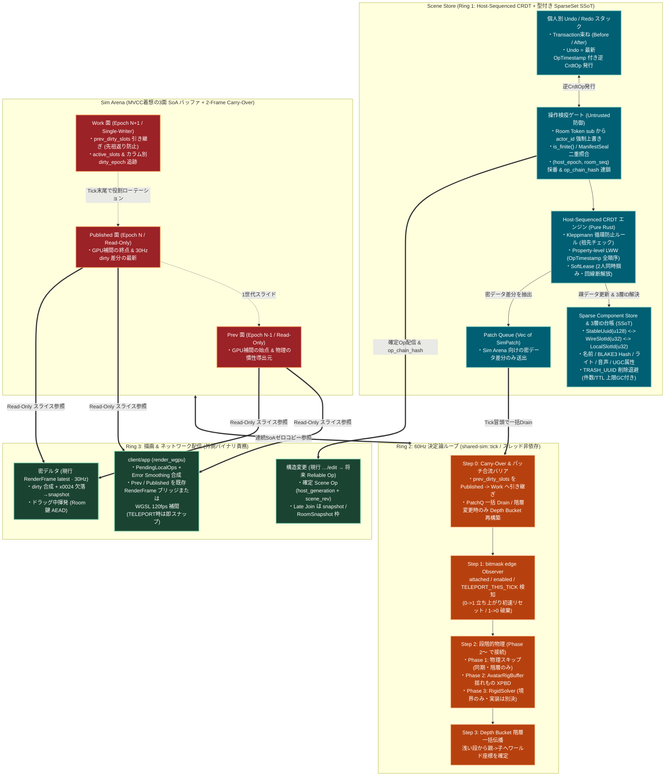

# Alchemy — 品質本線：Scene Store × Sim Arena

* **種別**: **品質本線**の仕様正本（セッション同期・シーン構造・実行面メモリ・段階物理の枠）
* **規模本線**: [spatial_interest.md](spatial_interest.md)（配信 interest / CCU。本ファイルと混同しない）
* **旧品質本線（archived）**: [archive/2026-11-27/mvcc_xpbd.md](archive/2026-11-27/mvcc_xpbd.md)（ページ CoW・`HISTORY_TICKS=128`）。思想文書 [archive/2026-11-27/alchemy_zero_base_spatial_lifecycle_architecture.md](archive/2026-11-27/alchemy_zero_base_spatial_lifecycle_architecture.md)（Loro 案は不採用）
* **差分配信用語**: **dirty 合成 + x0024 snapshot**（受信者別 `V_ack` 禁止。「XOR デルタ」語は使わない。ビット演算の立ち上がり検知は **bitmask edge**）
* **現状コードとの接続**: セッション疎構造の現行器は host `LiveEditLedger` + `scene_rev`。Scene Store は**これの後継**であり、横に別 SSoT を生やさない

### 語彙写像（メモ名 → 現行コード）

| 本正本の語 | 現行コード／契約 | 備考 |
|:---|:---|:---|
| `host_epoch` | `host_generation`（world CAS / GenRev） | 接続可。リネームは任意 |
| `room_seq` | `LiveEditLedger.tip` → `scene_rev` / EditCommit | 思想同型。Property-level LWW・`op_chain_hash` は未 |
| 30Hz 密デルタ | RenderFrame `net_tick` + dirty（latest、欠落は snapshot） | Reliable Op ログとは別クラス |
| 計画的 handover 速度 | **`…/sim_state`（正本）** | `frame_delta_xyz` は副案 |
| 実行面ページ資産 | `client/shared-sim/src/mvcc/` → 改称予定 **`sim_pages`** | SSoT ではない。opt-in backend |

### モジュール改称方針（コードは後段）

| 現行 | 予定名 | 役割 |
|:---|:---|:---|
| `shared-sim/src/mvcc/` | **`sim_pages/`** | ページ単位 SoA プール・学習／opt-in 資産 |
| （未実装）実行面 3 面 | **`sim_arena/`** | Prev / Published / Work |
| （未実装）疎ストア | **`scene_store/`** | Host-Sequenced + SparseSet。実装時は `LiveEditLedger` を表層化 |

---

## 1. 背景と基本設計方針（適材適所の原則と現実的な引き算）

本プロジェクト（Alchemy）は、コントロールプレーンを Elixir、空間実行・クライアントを Pure Rust で分担するように、**「各技術が得意な領域だけで 100% の力を発揮する」**ことを設計の第一原則とする。

空間コア（`client/shared-sim`）においても、過度な汎用ミドルウェア依存や「インフラ自作沼」による未完リスクを避け、**MVCC の世代分離という思想から着想を得た「Scene Store × Sim Arena」の二層分離**を品質本線とする（DB 級フル多版・Loro 本線は採用しない）。

1. **同期・メモリ基盤を最優先とし、物理は「後から差し替え可能なオプション層」とする**
    * 物理演算が一切動いていない Phase 1 の時点で、分散連合環境下での複数人リアルタイム共同編集・マルチプレイ Undo/Redo・親子階層操作・ホスト交代・120fps GPU 補間・30Hz ネットワーク差分同期がロック待ちゼロで成立する土台を最優先で固める。
2. **Scene Store × Sim Arena 二層分離**
   * **Scene Store**（Host-Sequenced CRDT ＋ 型付き `SparseSet<T>`）と、**Sim Arena**（3 面 SoA バッファ ＋ 2-Frame Dirty Carry-Over ＋ カラム世代追跡）へ責務を分離する。
   * 60Hz 書き手は実質 Single-Writer のため、過去 128 フレームの空間全体ロールバックは行わない。遅延補正は `PendingLocalOps` ＋ Error Smoothing。
3. **Host-Sequenced CRDT（Kleppmann 循環防止 ＋ Property-level LWW）**
   * 外部汎用 CRDT（Loro 等）と純粋 P2P の過去ログ巻き戻しを避け、**「データモデルは CRDT、リアルタイム確定順序はホスト連番」**とする。
   * 適用順序は `(host_epoch, room_seq)`（現行写像: `host_generation` + `scene_rev`）。無限ログ保持・ツリー巻き戻しはしない。
   * Dual-AST テキスト同時編集だけは将来、テキスト特化 CRDT を局所採用しうる（人承認・本線外）。
4. **物理層は段階導入。現行は Epoch/XPBD を維持**
   * Phase 2: アバター揺れもの XPBD（`AvatarRigBuffer`、空間 Slot に載せない）。
   * Phase 3: `RigidSolver` 境界。**`rapier3d` 再導入（旧メモ Phase 3a）は未採択**（guardrails: 新規依存は人承認・別決）。当面は既存 Native XPBD／不等式接触を品質の物理側とする。将来の AVBD 等も同様に別決。

---

## 2. 全体アーキテクチャ：Scene Store × Sim Arena と 3 連リング
`client/shared-sim` は `client/host-server`（60Hz 権威計算）と `client/app`（ローカル予測・90〜120Hz GPU 描画）の双方からリンクされる共通クレートであり、描画（`wgpu`）・OS タイマー（`std::time::Instant`）・OS スレッド（`std::thread`）・ネットワークソケットに一切依存しない純粋なシングルスレッド駆動可能な CPU シミュレーションコアとする。

推奨モジュール構成：`scene_store`（Scene Store） / `sim_arena`（Sim Arena）



### 時間軸別 SSoT（単一ストアに潰さない・並存も禁止）

| 層 | SSoT? | 担当 | 現行の器 | 方針 |
| :--- | :--- | :--- | :--- | :--- |
| **A. 永続・権限** | **永続 SSoT** | seal/save できる内容、canonical バイト | world `canonical` + `session_overlay`、ManifestSeal | 維持。Save で B から書き出す |
| **B. セッション構造** | **セッション疎 SSoT** | 親子・属性・spawn/despawn・Undo・連番 | **`LiveEditLedger` + `scene_rev`**（SlotGraph / SlotUndo） | **Scene Store に進化**（別名の新正本を横置きしない） |
| **C. 60Hz 密実行** | **実行面 SSoT** | 座標・delta・bitmask・物理パラメータ | `EpochSheet` / FrameBridge（目標: Sim Arena 3 面） | B から `SimPatch`。密 Transform を CRDT に載せない |
| **D. ワイヤ投影** | **否** | 配送用の見え方 | SceneManifest、RenderFrame、cell/lod | B/C から生成。正本を名乗らせない |
| **E. ページプール** | **否** | opt-in / 学習資産 | `mvcc/` → **`sim_pages`** | 品質本線の座を奪わない |

**禁止**: B を残したまま別モジュールを「Scene Store SSoT」と名乗る並存。

格納イメージ（B/C の中身）:

| 区分 | 格納対象 | 管理方式 |
| :--- | :--- | :--- |
| **Scene Store (B)** | 名前、BLAKE3、ライト／音声／UGC、親子、個人 Undo | Host-Sequenced + `SparseSet<T>` + 3層 ID（段階導入） |
| **Sim Arena (C)** | 座標・回転（`f64` セル＋局所 `f32`）、変位、Depth Bucket、bitmask、`TELEPORT_THIS_TICK` | 3 面 SoA + 2-Frame Dirty Carry-Over |
| **AvatarRigBuffer** | 末端ボーン・揺れもの（ローカル） | Slot 非管理。規模本線の Slot 爆発防止 |

---

## 3. Scene Store の詳細仕様（Host-Sequenced CRDT × 3層 ID × `SparseSet<T>`）

### 3.1 3層 ID 分離による「衝突ゼロ」と「30Hz 高速通信」の両立
ネットワーク・永続化の衝突回避と、30Hz リアルタイム配信の帯域・CPU 効率を両立するため、オブジェクト ID を以下の **3 層** に厳密分離する。

1. **`StableUuid (u128)`（世界不変 ID）**
   * UUIDv7 等のグローバル一意 ID。Spatial VCS（Git 保存・マージ）、Scene Store の `CrdtOp`（`Spawn` / `MoveNode` / `SetProperty`）、および個人別 `UndoTransaction` では **常に `StableUuid` を使用** する。
2. **`WireSlotId (u32)`（セッション通信用 4Byte 添字）**
   * `host_epoch` 内でホストが割り当てる 4Byte の一時通信 ID。`Spawn` 時および `RoomSnapshot` 内で `StableUuid <-> WireSlotId` の対応表を配布する。
   * 30Hz の高頻度 Transform デルタやドラッグ中ストリームは `StableUuid (16Byte)` ではなく **`WireSlotId (4Byte)`** で運び、帯域消費を 1/4 に圧縮する。
3. **`LocalSlotId (u32)`（各端末の Sim Arena / `SparseSet` ローカル添字）**
   * 各端末の SoA 配列インデックス。受信側では `wire_to_local: Vec<Option<LocalSlotId>>` の単純な配列参照だけで $O(1)$ 変換でき、30Hz 受信ホットパスから `HashMap<u128, u32>` のハッシュ検索を完全に排除する。

### 3.2 Host-Sequenced CRDT（Kleppmann 循環防止 ＋ LWW ＋ `TRASH_UUID` GC）
* **全順序タイムスタンプ**：`OpTimestamp { lamport: u64, actor_id: u64 }` により、オフライン分岐やホスト交代直後でも決定論的な勝敗が決まる。
* **リアルタイム適用ルール（過去ログ巻き戻しなし）**：
  * セッション中の確定適用順序は `(host_epoch, room_seq)` の単調増加連番に従う。
  * `MoveNode { node, new_parent }` 適用時は、`new_parent` からルートへ親ポインタを辿り `node` 自身に到達する場合は循環参照となるため No-op で弾く（Kleppmann 循環防止ルール）。
  * 過去タイムスタンプの遅延到着時に「既存ツリーを Undo → Apply → Redo で巻き戻す処理」は行わず、フレームスパイク・bitmask edge の不可逆副作用との矛盾・ログ無限肥大化を構造的に防ぐ。
* **削除（`TRASH_UUID`）と GC 上限契約**：
  * ノード削除は特別な破壊操作ではなく、仮想ノード **`TRASH_UUID`** の下へ `MoveNode` することで表現する。
  * 削除された瞬間に `SparseSet<T>` からは `swap_remove` で取り出し（実行中の `SparseSet` を常に 100% 生存オブジェクトのみで密着維持）、実体データは `TrashStore` へ退避する。
  * 長時間ルームでの OOM を防ぐため、**`TrashStore` には GC 上限（例：直近 200 ノード、または退避後 10 分超過で完全解放）** を設ける。GC 済みの `StableUuid` に対する Undo 要求が届いた場合はクラッシュさせず安全な No-op としてスキップする。
* **Spatial VCS（Git）との意味論境界**：
  * `OpTimestamp` と `room_seq` はセッション内・ホスト交代時の収束に限定し、Spatial VCS（Git Commit）へエクスポートする際は純粋なシーン構造（`StableUuid` キー＋決定論的ソート済みプロパティ）として書き出す。これにより Git の 3-way Merge や過去コミットへの Rollback 時にタイムスタンプのねじれが起きない。

### 3.3 型付き `SparseSet<T>` と個人別マルチプレイ Undo / Redo
* **`SparseSet<T>` が Scene Store の唯一の正（SSoT）**：外部 CRDT を外したことで二重持ちが消滅し、`sparse: Vec<Option<usize>>`、`dense_slots: Vec<LocalSlotId>`、`dense_values: Vec<T>` の 3 本（Pure Rust 約 60 行）がそのまま SSoT になる。Rust 標準 `HashMap` のようなランダムシードによる走査順ブレがなく、決定論的かつキャッシュ効率最速で全件走査できる。
* **個人別 Undo / Redo**：他人の作業を壊さないため、「時間を巻き戻す」のではなく**「個人別スタックから逆操作を取り出し、最新の `OpTimestamp` を付けた新規 `CrdtOp` として送信する」**方式とする。
  * 3D 空間ガード：① 親が `TRASH_UUID` へ移された際に他人がぶら下げた子ノードが残っていればワールド座標を維持して親をルート/祖父へ自動退避、② 循環を作る Undo は `host-server` で安全に Reject、③ 机の消滅・移動 Undo 時は近傍の静止剛体（Phase 3）のスリープビットを起床させる。

### 3.4 ドラッグ中揮発分離・`SoftLease`・楽観予測の Jitter 防止
* **60Hz ドラッグ座標の揮発分離**：VR で箱を掴んで動かしている最中の毎フレーム座標は CRDT ログに入れず、揮発 Datagram で `Sim Arena` へ流し、**手を離した瞬間（Commit）の 1 回だけ `SetProperty` として CRDT へ確定記録**する。
* **2 人同時掴み・回線断ガード（`SoftLease`）**：`host-server` 側で掴み対象ごとに短命の **`SoftLease { holder_actor_id: u64, lease_expires_tick: u64 }`**（例：90 Tick ＝ 1.5 秒間操作更新がなければ自動解放）を管理し、同時掴みの奪い合いワープと掴みっぱなし回線断によるロック放置を防ぐ。
* **楽観予測（Optimistic Update）の Jitter 防止**：高 RTT の分散連合環境（150〜250ms）でも手元が震えないよう、クライアント側は未承認操作を **`PendingLocalOps`** として分離保持する。サーバー確定面（`Published`）自体は汚さず、描画直前の予測合成層で未承認分を反映し、サーバー確定後にズレが生じた場合は 80〜120ms かけて減衰させる **Error Smoothing オフセット** で滑らかに吸収する。

---

## 4. Sim Arena の詳細仕様（MVCC 着想の 3 面 SoA バッファ ＋ 2-Frame Carry-Over）

### 4.1 3 面リングバッファと「2-Frame Dirty Carry-Over」（先祖返り防止契約）
Sim Arena は GPU の 120fps 補間（`Prev` と `Published` の同時読取）と 60Hz 計算（`Work` への独占書込）をロック待ちゼロで並走させるため、**`Prev`（Epoch $N-1$）・`Published`（Epoch $N$）・`Work`（Epoch $N+1$）の 3 面 SoA 配列**をローテーションする。

```text
【読取側 (Ring 3: GPU 120fps補間 & Zenoh 30Hz配信)】
   ├─ 面A: Prev      (Epoch N-1 / 確定済み・Read-Only) ← 補間の始点 ＆ 物理の慣性導出元
   └─ 面B: Published (Epoch N   / 確定済み・Read-Only) ← 補間の終点 ＆ dirty 通信差分の最新

【書込側 (Ring 2: 60Hz Single-Writer 計算ループ)】
   └─ 面C: Work      (Epoch N+1 / 計算中・独占書込)    ← Carry-Over ＋ パッチ合流 ＋ 階層伝播
```

* **⚠️ 必須契約：2-Frame Dirty Carry-Over（先祖返りバグの防止）**
  * ページ単位 CoW を廃して「動いた行（`active_slots`）だけ `Work` へ書く」方式を素直に実装すると、前フレームで動いて今フレーム静止したオブジェクトが、`Work`（＝2フレーム前の `Prev` が再利用された面）に残っていた古い座標へ先祖返りするバグが発生する。
  * これを全配列コピーなしで解決するため、Sim Arena は **「直前 Tick で書き換えた行一覧（`prev_dirty_slots: Vec<LocalSlotId>`）」** と **「さらに1つ前の Tick で書き換えた行一覧（`prev2_dirty_slots`）」** を保持し、Tick 冒頭（Step 0）で対象行のみ `Work[slot] = Published[slot]` と 1 回だけ引き継ぎコピーする。
  * これにより、**「静止している数万オブジェクトのコピー量は完全ゼロ」かつ「3 面すべてで 2 フレーム前への先祖返りが 0%」** を保証する。
* **カラム別 `dirty_epoch: u64`**：Transform のような高頻度更新カラムと、ProceduralBox サイズや Bitmask のような低頻度カラムで独立した最終更新 Epoch を記録し、変更がないカラムの比較・GPU 転送を丸ごとスキップする。

### 4.2 `SimPatch` 合流・2 層ビットマスク・`TELEPORT_THIS_TICK`
* **`SimPatch` による Tick 境界合流**：Ring 1 から Ring 2 へのページスワップは禁止とし、`SimPatch` キューを Step 0 で一括 Drain して `Work` 面へ適用する（Lost Update 防止）。
* **2 層ビットマスク（Resonite 流の編集体験）**：
  * `attached_masks: Vec<u64>`：Slot にコンポーネントが存在するか（インスペクター表示・パラメータ保持）。
  * `enabled_masks: Vec<u64>`：60Hz ループで実際に実行するか。
* **bitmask edge Observer と `TELEPORT_THIS_TICK`（補間ワープ防止）**：
  * `just_enabled = (enabled_curr ^ enabled_prev) & enabled_curr`（旧 `OnEnable` 相当。配信の「XOR デルタ」とは別概念）。物理ビットの `0 -> 1` 立ち上がり時は **必ず `Prev` 座標を `Curr` へ同期して初速ゼロリセット** を行う。
  * 新規生成（`Spawn`）・親子変更（`SetParent`）・瞬間移動・物理 `Enabled` ON のフレームでは **`STATE_TELEPORT_THIS_TICK` ビット**（または `interp_reset_epoch`）を立て、GPU 補間シェーダーが `Lerp/Slerp` をスキップして `Published` へ即スナップするようにする（生成時の原点からの高速残像や、親変更時のちぎれを防止）。

### 4.3 2 階層座標と空間 `Slot` vs `AvatarRigBuffer` の分離
* **2 階層座標**：空間セル原点は `f64`（ワイヤ境界 `binary64` 準拠）、Sim Arena 内部の座標はセル相対 `f32` とし、原点遠方での浮動小数点桁落ち（微振動）を遮断する。
* **`Slot` と `AvatarRigBuffer` の境界宣言（Phase 2 への必須布石）**：
  * アバター 1 体の 100〜150 本の末端ボーン・揺れものボーンを空間 `Slot` に登録すると、100〜1,000 人部屋で Slot 数が十数万へ爆発し、Scene Store と Depth Bucket が破綻する。
  * 空間 `Slot` として同期するのはアバターの **Root / Head / LeftHand / RightHand（＋フルトラ数点）のみ** とし、全身 IK および Phase 2 の XPBD 揺れものは Scene Store 非管理のローカル連続配列 **`AvatarRigBuffer`** へ明確に分離する。

---

## 5. ネットワーク・セキュリティ・0 秒ホスト交代契約（分散連合・Untrusted Host 防波堤）

### 5.1 トランスポート 2 系統分離（欠損厳禁 vs 欠損許容）
既存の Zenoh（`relay-server` / `wire_cap` / 短命 mTLS `x0068` / 非対称 ACL `x0067` / Room 鍵 AEAD `x0069`）の上で、性質の異なる 2 つのトラフィックを明確に分離する。

| トラフィック種別 | トランスポート契約 | 欠損時の振る舞い | 主なペイロード |
| :--- | :--- | :--- | :--- |
| **Scene Op ログ**<br>*(Scene Store 構造・属性変更)* | **現行**: `…/edit` + `scene_rev`。**目標**: Reliable 順序保証＋ `(host_epoch, room_seq)` 連番 | **欠損厳禁**（目標）。飛び検知時は欠損レンジ再送または snapshot 収束 | `Spawn` / `MoveNode` / `SetProperty` / `TRASH_UUID` / `SoftLease` |
| **Sim 30Hz デルタ**<br>*(Sim Arena 連続座標・掴み中)* | **現行**: RenderFrame latest（dirty 合成）＋ cell/lod。**目標も** best-effort / 低遅延 | **欠損許容**。欠落は x0024 どおり snapshot。古い tick は破棄 | Transform dirty、`TELEPORT_THIS_TICK`、ドラッグ中揮発座標 |

### 5.2 Late Join とホスト交代（速度復元の正本）
* **Late Join**：現行は Room `…/snapshot` 等。目標として Scene Store 全量＋実行面の **`RoomSnapshot`**（`snapshot_seq` / `op_chain_hash`）枠を用意し、以降の Op で追いつく。
* **計画的 handover の速度復元（正本）**: 既存 **`…/sim_state`**（量子化なし丸渡し）。crash 時は last-good / fail-closed（旧品質本線 §4.8 の契約を継承）。
* **`frame_delta_xyz`（副案）**: 30Hz デルタ同梱による昇格時近似復元。`sim_state` が取れない経路の補助であり、計画的 handover の第一正本にしない。
* **PC 版 `host-server` 昇格**: 最新状態を子プロセスへ IPC。Job Object / Process Group で道連れ終了。

### 5.3 Untrusted Host 防御と `apps/verifier` 監査証跡
ローカル `host-server` はユーザーの PC 上で動く Untrusted プロセスであるため、以下の四重防御を Phase 1 の契約へ最初から組み込む。

1. **同室内なりすまし遮断（`actor_id` 強制上書き）**：`host-server` 入口の検疫ゲートでは、クライアントが `CrdtOp` 内に申告した `actor_id` を一切信用せず、**Room Token の `sub` クレームから決定論的に導出した値で必ず上書き**する。
2. **無許可アセット差し込み遮断（`ManifestSeal` 二重照合）**：アセット参照（メッシュ・アバター・マテリアル等の BLAKE3 ハッシュ）を書き換える `SetProperty` は、`world-server` が署名発行した `ManifestSeal` に登録済みのハッシュのみ受理し、さらに**ゲスト側の描画直前にも `ManifestSeal` と照合**して未許可アセットを破棄する。
3. **`room_seq` 二枚舌・検閲の監査証跡（`op_chain_hash`）**：`host-server` は確定した `CrdtOp` を処理するたびに直前のハッシュと結合した操作連鎖ハッシュ **`op_chain_hash: [u8; 32]`** を更新し、定期フレームおよび `RoomSnapshot` へ `world-server` 発行の Room Host Token 署名とともに付与する。これにより `world-server (apps/verifier)` の抜き打ち監査で不正な分岐・改ざんを客観的に検知し、強制フェイルオーバーを発動できる。
4. **未来タイムスタンプ攻撃のクランプ**：受信した `OpTimestamp.lamport` が現在のルーム最大値から許容ドリフト上限を超えている場合は即座にドロップし、LWW の永久乗っ取りを遮断する。

---

## 6. コア Rust データ構造・契約仕様（`client/shared-sim`：`std` のみ）

Phase 1 の `client/shared-sim` は **`#![forbid(unsafe_code)]` かつ新規外部クレート追加ゼロ（`std` のみ）** で実装する。

```rust
#![forbid(unsafe_code)]

/// 外部・Scene Store・Spatial VCS (Git)・Undo 用の世界不変ID
pub type StableUuid = u128;

/// host_epoch 内の 30Hz 高頻度通信用 4Byte 添字 (帯域 1/4 圧縮)
pub type WireSlotId = u32;

/// 各端末の Sim Arena / SparseSet 内部専用の配列添字 (wire_to_local で O(1) 変換)
pub type LocalSlotId = u32;

/// 仮想のゴミ箱ノード固定 UUID (削除 = TRASH_UUID への MoveNode)
pub const TRASH_UUID: StableUuid = 0xFFFF_FFFF_FFFF_FFFF_FFFF_FFFF_FFFF_FFFE;
pub const ROOT_UUID: StableUuid  = 0x0000_0000_0000_0000_0000_0000_0000_0000;

/// 主要コンポーネント＆状態ビットマスク予約 (Phase 1〜3 共通)
pub const COMP_ALIVE: u64               = 1 << 0;
pub const COMP_TRANSFORM_DIRTY: u64     = 1 << 1;
pub const COMP_SDF_VISUAL: u64          = 1 << 2; // プロシージャル BOX 描画
pub const COMP_MESH_RENDER: u64         = 1 << 3;
pub const COMP_COLLIDER: u64            = 1 << 5; // Static / Dynamic 共通コライダー
pub const COMP_GRABBABLE: u64           = 1 << 6;
pub const COMP_RIGID_BODY: u64          = 1 << 9; // Phase 3: 剛体物理 (rapier3d -> AVBD)
pub const STATE_IS_GRABBED: u64         = 1 << 10; // VR 掴み中 (揮発ストリーム優先 / XPBD切替)
pub const STATE_TELEPORT_THIS_TICK: u64 = 1 << 11; // 生成・SetParent・ワープ時の GPU 補間無効化

/// 全ピア間で一意の全順序が定まる論理タイムスタンプ
#[derive(Clone, Copy, Debug, PartialEq, Eq, PartialOrd, Ord, Hash)]
pub struct OpTimestamp {
    pub lamport: u64,
    pub actor_id: u64, // host-server 入口で Room Token sub から強制導出
}

/// 信頼チャネル (Reliable Stream) で配送される確定 Scene Store 操作
#[derive(Clone, Debug)]
pub struct SequencedOp {
    pub host_epoch: u64,          // world-server がホスト交代ごとにインクリメント
    pub room_seq: u64,            // host-server 採番の単調増加連番 (欠損検知キー)
    pub op_chain_hash: [u8; 32],  // verifier 監査用の操作連鎖ハッシュ枠
    pub op: CrdtOp,
}

#[derive(Clone, Debug)]
pub enum CrdtOp {
    SpawnNode {
        ts: OpTimestamp,
        node: StableUuid,
        wire_slot: WireSlotId,
        parent: StableUuid,
    },
    MoveNode {
        ts: OpTimestamp,
        node: StableUuid,
        new_parent: StableUuid, // TRASH_UUID なら論理削除
    },
    SetProperty {
        ts: OpTimestamp,
        node: StableUuid,
        prop_key: u32,
        value: PropValue,
    },
}

/// 2人同時掴み・回線断放置を防ぐ短命リース (host-server 管理)
#[derive(Clone, Copy, Debug, PartialEq, Eq)]
pub struct SoftLease {
    pub holder_actor_id: u64,
    pub lease_expires_tick: u64, // 例: 無通信 90 Tick (1.5秒) で自動失効
}

/// Scene Store (Ring 1) -> Sim Arena (Ring 2) へ送る密データ差分パッチ
#[derive(Clone, Debug)]
pub enum SimPatch {
    AllocateSlot { slot: LocalSlotId, parent: Option<LocalSlotId> },
    FreeSlot { slot: LocalSlotId },
    SetParent { slot: LocalSlotId, parent: Option<LocalSlotId> },
    SetLocalTransform {
        slot: LocalSlotId,
        pos: [f32; 3],
        rot: [f32; 4],
        scale: [f32; 3],
        teleport: bool, // true なら STATE_TELEPORT_THIS_TICK を立てて補間スナップ
    },
    SetAttachedBits { slot: LocalSlotId, add: u64, remove: u64 },
    SetEnabledBits { slot: LocalSlotId, add: u64, remove: u64 },
    SetProceduralBox { slot: LocalSlotId, half_extents: [f32; 3], corner_radius: f32 },
}

/// 30Hz デルタ配信用の 1 行スナップショット (0秒ホスト交代時の 60Hz 速度復元対応)
#[derive(Clone, Copy, Debug, Default)]
pub struct NetTransformDelta {
    pub wire_slot: WireSlotId,
    pub pos: [f32; 3],
    pub rot: [f32; 4],
    /// 60Hz 1 Tick 分の変位 (x_curr - x_prev)。ホスト昇格時に x_prev = x_curr - delta で速度復元
    pub frame_delta_xyz: [f32; 3],
    pub teleport: bool,
}
```

---

## 7. 段階的実装ロードマップ（Phase 1 → Phase 2 → Phase 3）

以下の順序を厳守し、各 Phase がヘッドレス単体テスト（`cargo test`）と既存 CI（`./.scripts/ci.sh rust`）の通過を確認してから次へ進む。

### Phase 1：Scene Store × Sim Arena 同期基盤【最優先・物理ゼロ】
* **目的**：物理コード 0 行のまま、分散連合 VR に耐えうる同期・階層・編集・Undo・120fps 補間・既存 `RenderFrame` ブリッジの心臓部を完成させる。
* **実装タスク**：
  1. **Scene Store（`scene_store/`）の実装**：
     * 3 層 ID 台帳（`StableUuid` / `WireSlotId` / `LocalSlotId` と `wire_to_local: Vec<Option<LocalSlotId>>`）。
     * Host-Sequenced CRDT（Kleppmann 循環参照防止、Property-level LWW、許容ドリフトクランプ、`TRASH_UUID` 退避＋件数/TTL 上限 GC）。
     * 型付き `SparseSet<T>`（SSoT）、個人別 `LocalUndoHistory`（逆操作の最新 `OpTimestamp` 発行）、`SoftLease` 管理、および `RoomSnapshot` シリアライズ枠と `op_chain_hash` 更新枠。
  2. **Sim Arena（`sim_arena/`）の実装**：
     * 3 面 SoA バッファ（`Prev` / `Published` / `Work`）、**2-Frame Dirty Carry-Over（`prev_dirty_slots` 引き継ぎ）**、カラム別 `dirty_epoch`、`f64` セル原点＋局所 `f32` 座標。
     * 親子階層の平坦化（`parent_ids`、UI 用 `EulerTourEntry`、親→子伝播用 `DepthBucket`）を `SetParent` パッチ発生時のみ再構築。
     * 2 層ビットマスク（`attached_masks` / `enabled_masks`）、bitmask edge Observer、`STATE_TELEPORT_THIS_TICK` 制御、`ProceduralBox16B`。
     * 30Hz dirty 抽出と既存 RenderFrame ブリッジ。速度復元は **`sim_state` を正**とし、`frame_delta_xyz` は任意。
  3. **既存パイプラインへの縦貫通**:
     * **`LiveEditLedger` を Scene Store の表層として進化**（並行 SSoT 禁止）。
     * `RenderFrame (binary64)`・Room AEAD（`x0068` / `x0069`）を壊さない。
     * `PendingLocalOps` / Error Smoothing の接続フック。
* **完了基準（`cargo test` 必須）**：
  1. 先祖返りゼロ（3 面ローテーション後）。
  2. 循環防止・LWW・旧 `host_generation` 棄却・未来 lamport クランプ。
  3. 削除・個人 Undo・GC 後 Undo の No-op。
  4. 生成・`SetParent` 直後の `STATE_TELEPORT_THIS_TICK`。
  5. `#![forbid(unsafe_code)]`・Phase 1 で**新規**外部クレート追加なし（既存 `alchemy-protocol` / `arc-swap` / `bytemuck` / `glam` / `wide` は維持可）・`./.scripts/ci.sh rust` Green。

### Phase 2：アバターの揺れもの（XPBD × `AvatarRigBuffer`）
* 空間 Slot を増やさず髪・耳・尻尾・スカートをローカル計算。パラメータ変換は `client/sim-rig` 等へ分離。同期はしない（規模本線 LOD と整合）。


### Phase 3：剛体物理（枠のみ・実装は別決）
* `RigidSolver` トレイト境界と bitmask edge による初速リセット等の**枠**は定義してよい。
* **`rapier3d` / AVBD の具体実装・新規クレートは未採択**（人承認後に別スライス）。現行 Native XPBD・不等式接触を捨てない。

---

## 8. Cursor 実装時の厳守制約（Non-Negotiables）

1. **`#![forbid(unsafe_code)]`（クレート直下）**。Phase 1 で**新規**外部クレートを追加しない（既存依存の無断追加も禁止。人承認）。
2. **`shared-sim` は OS スレッド・`Instant`・wgpu・ソケットに非依存**。タイマー／IPC／描画は host / app。
3. **決定論・finite 検疫**。`-C target-feature=-fma` 方針を維持。
4. **セキュリティ境界を壊さない**: mTLS / ACL / Room AEAD / ManifestSeal / RenderFrame。移行は既存ブリッジ経由。
5. **Phase 飛び越し禁止**（揺れもの・剛体は Phase 1 Green 後）。**Rapier 再導入は未採択**。
6. **SSoT 並存禁止**: Scene Store 実装は `LiveEditLedger` の進化。world canonical と実行面と役割を混同しない。
7. **`mvcc/` は削除せず `sim_pages` へ改称**（別スライス）。品質本線の実行面目標名は `sim_arena`。
8. **規模 KPI を品質本線で宣言しない** → [spatial_interest.md](spatial_interest.md)。
9. **実装前に現状調査**し、変更ファイル一覧と完了基準テストを提示してからコード生成。

---

## 付録：Cursor へのスタートアップ指示プロンプト

```text
@.workspace/roadmap/scene_store_sim_arena.md を読み込んでください（品質本線）。

Scene Store（Host-Sequenced CRDT + SparseSet；LiveEditLedger の進化）× Sim Arena（3面 SoA + 2-Frame Dirty Carry-Over）の Phase 1 を進めます。物理・Rapier・新規 Reliable チャネルは入れません。

まだコードは書かず、`client/Cargo.toml`・`shared-sim`・host `LiveEditLedger`・RenderFrame / edit 境界・CI を調査し、次を提示してください。
1. Phase 1 のファイル一覧と LiveEditLedger 表層化の影響範囲
2. scene_store / sim_arena / sim_pages（旧 mvcc）のモジュール分割
3. Phase 1 完了基準の単体テスト設計
```
