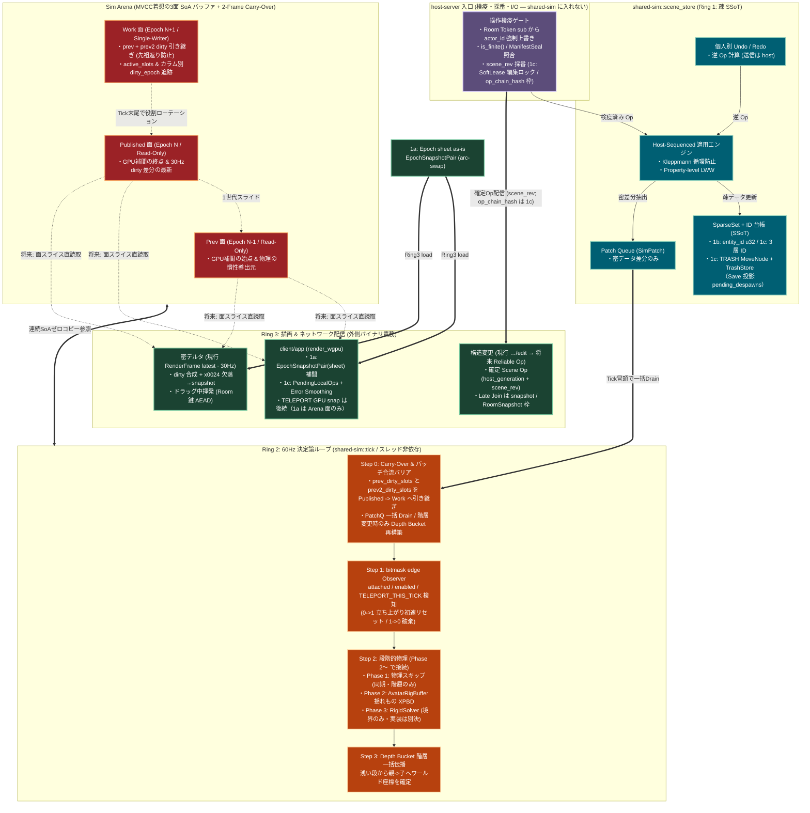

# Alchemy — 品質本線：Scene Store × Sim Arena

* **種別**: **品質本線**の仕様正本（セッション同期・シーン構造・実行面メモリ・段階物理の枠）
* **規模本線**: [spatial_interest.md](spatial_interest.md)（配信 interest / CCU。本ファイルと混同しない）
* **旧品質本線（archived）**: [archive/2026-11-27/mvcc_xpbd.md](archive/2026-11-27/mvcc_xpbd.md)（ページ CoW・`HISTORY_TICKS=128`）。思想文書 [archive/2026-11-27/alchemy_zero_base_spatial_lifecycle_architecture.md](archive/2026-11-27/alchemy_zero_base_spatial_lifecycle_architecture.md)（Loro 案は不採用）
* **差分配信用語**: **dirty 合成 + x0024 snapshot**（受信者別 `V_ack` 禁止。「XOR デルタ」語は使わない。ビット演算の立ち上がり検知は **bitmask edge**）
* **現状コードとの接続**: セッション疎構造の現行器は host `LiveEditLedger` + `scene_rev`。Scene Store は**これの後継**であり、横に別 SSoT を生やさない

### 語彙写像（メモ名 → 現行コード）

| 本正本の語 | 現行コード／契約 | 備考 |
|:---|:---|:---|
| `host_epoch` | `host_generation`（world CAS / GenRev） | 接続可。リネームは任意 |
| `room_seq` | `LiveEditLedger.tip` → `scene_rev` / EditCommit | 思想同型。Property-level LWW は Phase 1b。`op_chain_hash` は **Phase 1c 枠のみ**（DoD 必須外） |
| 30Hz 密デルタ | RenderFrame `net_tick` + dirty（latest、欠落は snapshot） | Reliable Op ログとは別クラス |
| 計画的 handover 速度 | **`…/sim_state`（正本）** | `frame_delta_xyz` は副案 |
| 実行面ページ資産 | `client/shared-sim/src/mvcc/` → 改称予定 **`sim_pages`** | SSoT ではない。opt-in backend |

### モジュール配置（shared-sim と host の境界）

| 場所 | 予定名 / 現行 | 持つもの | 持たないもの |
|:---|:---|:---|:---|
| `shared-sim` | **`scene_store/`**（x00dd–x00e0） | SparseSet・親子木・LWW/循環・`SimPatch` 生成・決定論 Undo 逆 Op 計算 | Room Token 検証・Zenoh put・`actor_id` 上書き・Save HTTP |
| `host-server` | **`LiveEditLedger` facade**（x00e0） | 検疫ゲート、`scene_rev` 採番、edit ワイヤ、Save 折込、facade が `scene_store` を呼ぶ | 疎コンポーネントの第二コピー（並存禁止） |
| `shared-sim` | **`sim_arena/`**（新） | 3 面 SoA・Carry-Over・bitmask・Depth Bucket | ネットワーク・時計 |
| `shared-sim` | `mvcc/` → **`sim_pages/`** | ページプール資産（opt-in） | 品質本線 SSoT |
| `shared-sim` / host | 既存 `FrameBridge` / `EpochSnapshotPair`（`arc-swap`） | Prev/Published **出版**（読取側ロック待ちゼロ） | Sim Arena 内部の Work 面を直接公開しない |

**並存禁止の意味**: host に古い `LiveEditLedger` 状態辞書を残したまま `scene_store` にも同じ親子を持たない。移行後の正は `shared-sim::scene_store`、host は入口と採番と永続 I/O だけ。

### モジュール改称方針（コードは後段）

| 現行 | 予定名 | 役割 |
|:---|:---|:---|
| `shared-sim/src/mvcc/` | **`sim_pages/`** | ページ単位 SoA プール・学習／opt-in 資産 |
| （未実装）実行面 3 面 | **`sim_arena/`** | Prev / Published / Work |
| （実装済）疎ストア | **`scene_store/`** | Host-Sequenced + SparseSet。host `LiveEditLedger` は facade（x00e0） |

---

## 1. 背景と基本設計方針（適材適所の原則と現実的な引き算）

本プロジェクト（Alchemy）は、コントロールプレーンを Elixir、空間実行・クライアントを Pure Rust で分担するように、**「各技術が得意な領域だけで 100% の力を発揮する」**ことを設計の第一原則とする。

空間コア（`client/shared-sim`）においても、過度な汎用ミドルウェア依存や「インフラ自作沼」による未完リスクを避け、**MVCC の世代分離という思想から着想を得た「Scene Store × Sim Arena」の二層分離**を品質本線とする（DB 級フル多版・Loro 本線は採用しない）。

1. **同期・メモリ基盤を最優先とし、物理は「後から差し替え可能なオプション層」とする**
    * 最終的な Phase 1（1a〜1c）で共同編集・Undo・ホスト交代・120fps 補間・30Hz dirty の土台を揃える。**着手の最小切片は §7 の Phase 1a**（Arena ＋ Carry-Over ＋ 既存出版のみ）。1a に Undo/CRDT/共同編集一式を持ち込まない。
2. **Scene Store × Sim Arena 二層分離**
   * **Scene Store**（Host-Sequenced CRDT ＋ 型付き `SparseSet<T>`）と、**Sim Arena**（3 面 SoA バッファ ＋ 2-Frame Dirty Carry-Over ＋ カラム世代追跡）へ責務を分離する。
   * 60Hz 書き手は実質 Single-Writer のため、過去 128 フレームの空間全体ロールバックは行わない。遅延補正（`PendingLocalOps` 等）は **Phase 1c / app**。
3. **Host-Sequenced CRDT（Kleppmann 循環防止 ＋ Property-level LWW）** — **Phase 1b 以降**
   * 外部汎用 CRDT（Loro 等）と純粋 P2P の過去ログ巻き戻しを避け、**「データモデルは CRDT、リアルタイム確定順序はホスト連番」**とする。
   * 適用順序は `(host_epoch, room_seq)`（現行写像: `host_generation` + `scene_rev`）。無限ログ保持・ツリー巻き戻しはしない。
   * Dual-AST テキスト同時編集だけは将来、テキスト特化 CRDT を局所採用しうる（人承認・本線外）。
4. **物理層は段階導入。現行は Epoch/XPBD を維持**
   * Phase 2: アバター揺れもの XPBD（`AvatarRigBuffer`、空間 Slot に載せない）。
   * Phase 3: `RigidSolver` 境界。**`rapier3d` 再導入（旧メモ Phase 3a）は未採択**（guardrails: 新規依存は人承認・別決）。当面は既存 Native XPBD／不等式接触を品質の物理側とする。将来の AVBD 等も同様に別決。

---

## 2. 全体アーキテクチャ：Scene Store × Sim Arena と 3 連リング
`client/shared-sim` は `client/host-server`（60Hz 権威計算）と `client/app`（ローカル予測・90〜120Hz GPU 描画）の双方からリンクされる共通クレートであり、描画（`wgpu`）・OS タイマー（`std::time::Instant`）・OS スレッド（`std::thread`）・ネットワークソケットに一切依存しない純粋なシングルスレッド駆動可能な CPU シミュレーションコアとする。

推奨モジュール構成：`scene_store`（Scene Store） / `sim_arena`（Sim Arena）



### 2.1 確定レーン（ライブ tip ≠ 明示 Save）— 旧 `mvcc_xpbd` §4.7 の後継

60Hz 実行面は「毎ティックの姿勢」だけを扱う。**生成・削除・親子・プロパティ編集**は別レーン（現行 `…/edit` / `LiveEditLedger`、将来 Scene Store Op）。

**VCS 前提（案 B / x00b3 · x00b9・本正本に移植）**:

- `EditCommit.scene_rev` = host の **ライブ tip**（セッション working-tree）。
- 永続（canonical / Spatial VCS）は **明示 Save のときだけ**進む（Git の commit 相当）。
- Spawn / Despawn / Reparent / SetField はいずれも **ライブ ≠ 永続**（Save body に `spawns`/`despawns`/`parents`/`fields`）。
- 競合は操作対象ごとの楽観ロック（`expected_parent` 等）。Undo は逆操作＋前提条件。
- 詳細履歴は [archive/2026-11-27/mvcc_xpbd.md](archive/2026-11-27/mvcc_xpbd.md) §4.7。**実装・VCS たたき台の参照先は本節**。

### 時間軸別 SSoT（単一ストアに潰さない・並存も禁止）

| 層 | SSoT? | 担当 | 現行の器 | 方針 |
| :--- | :--- | :--- | :--- | :--- |
| **A. 永続・権限** | **永続 SSoT** | seal/save できる内容、canonical バイト | world `canonical` + `session_overlay`、ManifestSeal | 維持。Save で B から書き出す |
| **B. セッション構造** | **セッション疎 SSoT** | 親子・属性・spawn/despawn・Undo・連番 | **`shared-sim::scene_store` + host `LiveEditLedger` facade**（x00e0 / x00e1 done · Phase 1b 閉じ） | host に第二コピーを残さない（§冒頭の配置表） |
| **C. 60Hz 密実行** | **実行面 SSoT** | 座標・delta・bitmask・物理パラメータ | `EpochSheet` / FrameBridge（目標: Sim Arena 3 面） | B から `SimPatch`。密 Transform を CRDT に載せない |
| **D. ワイヤ投影** | **否** | 配送用の見え方 | SceneManifest、RenderFrame、cell/lod | B/C から生成。正本を名乗らせない |
| **E. ページプール** | **否** | opt-in / 学習資産 | `mvcc/` → **`sim_pages`** | 品質本線の座を奪わない |

**禁止**: B を残したまま別モジュールを「Scene Store SSoT」と名乗る並存。

格納イメージ（B/C の中身）:

| 区分 | 格納対象 | 管理方式 |
| :--- | :--- | :--- |
| **Scene Store (B)** | 名前、BLAKE3、ライト／音声／UGC、親子、個人 Undo | Host-Sequenced + `SparseSet<T>` + 3層 ID（段階導入） |
| **Sim Arena (C)** | 座標・回転（`f64` セル＋局所 `f32`）、変位、Depth Bucket、bitmask、`TELEPORT_THIS_TICK` | 3 面 SoA + 2-Frame Dirty Carry-Over |
| **AvatarRigBuffer** | 末端ボーン・揺れもの（ローカル） | Slot 非管理。規模本線の Slot 爆発防止 |

---

## 3. Scene Store の詳細仕様（Host-Sequenced CRDT × 3層 ID × `SparseSet<T>`）

### 3.1 3層 ID と現行 `entity_id: u32` の移行

| 段階 | ワイヤ / 永続 | 内部 |
|:---|:---|:---|
| **現行〜Phase 1a/1b** | `entity_id: u32` | **SparseSet の sparse キー = `entity_id`**（配列長は max id+1 かハッシュ相当。穴があってよい）。**`entity_id == u32::MAX` は禁止**（sparse ABSENT センチネル予約；検疫・facade も通さない）。**dense 添字**は生存オブジェクトを詰めた走査用インデックスであり、`entity_id` そのものではない。Arena の行添字も dense／別マップで解決してよい。`StableUuid` はまだ必須にしない |
| **Phase 1c〜** | `WireSlotId` 配布＋永続 `StableUuid` | `wire_to_local` で O(1)。sparse キーを StableUuid 側へ寄せる移行 |

一気に全経路 StableUuid 化しない。Phase 1b 完了基準は **u32 `entity_id` のまま**循環防止・LWW・facade 化が Green であること。

### 3.2 Host-Sequenced 適用・削除モデル（Phase 分け）
* **全順序タイムスタンプ**：`OpTimestamp { lamport: u64, actor_id: u64 }`（1b 以降）。
* **リアルタイム適用**：`(host_epoch, room_seq)` 単調適用。循環 `MoveNode` は No-op。過去ログ巻き戻しなし。
* **削除（Phase 分け・確定）**:
  * **Phase 1b（当面）**: 現行どおり **`pending_despawns` / parent クリア系**を維持。**`TRASH_UUID` MoveNode と Trash GC は 1b DoD に入れない**。
  * **Phase 1c 以降**: 仮想ノード **`TRASH_UUID`** への `MoveNode` ＋ `TrashStore`（件数/TTL GC）。GC 済み Undo は No-op。
* **Spatial VCS**：セッション連番はエクスポートに載せない（構造のみ）。StableUuid キーは 1c 以降。

### 3.3 型付き `SparseSet<T>` と個人別マルチプレイ Undo / Redo
* **`SparseSet<T>` が Scene Store の唯一の正（SSoT）**：`sparse`（キー→dense）・`dense_slots`・`dense_values` の 3 本。1b のキーは `entity_id: u32`（§3.1）。走査は dense のみ（決定論・キャッシュ効率）。
* **個人別 Undo / Redo（1b は既存 SlotUndo 接続から）**：逆操作を最新タイムスタンプ付き新規 Op として送る。TRASH 周りの子ノード退避ガードは **1c（TRASH 導入後）**。

### 3.4 ドラッグ中揮発分離・掴み権威・楽観予測
* **60Hz ドラッグ座標の揮発分離**：掴み中の毎フレーム座標は疎ストア／CRDT に入れず、揮発ストリームで実行面へ流し、**手放し（Commit）の 1 回だけ**構造／姿勢を確定記録する。
* **物理掴み権威（現行・維持）**: 実行面の **`holder_slot` / `is_grabbed_mask` / `STATE_IS_GRABBED`**（`sim_pages` / Epoch 経路）が **唯一の物理掴み SSoT**。二系統にしない。
* **`SoftLease`（編集ロック・Phase 1c）**: host 入口の短命リースで、**同時の構造編集奪い合い**（inspector / Reparent 等）を防ぐ。物理 Grab の置換ではない。Phase 1a/1b の DoD に含めない。
* **楽観予測（Phase 1c / app）**: `PendingLocalOps` ＋ Error Smoothing。Published 面は汚さない。

---

## 4. Sim Arena の詳細仕様（MVCC 着想の 3 面 SoA バッファ ＋ 2-Frame Carry-Over）

### 4.1 3 面リングバッファと「2-Frame Dirty Carry-Over」（先祖返り防止契約）
Sim Arena は GPU の 120fps 補間（`Prev` と `Published` の同時読取）と 60Hz 計算（`Work` への独占書込）を並走させるため、**`Prev`（Epoch $N-1$）・`Published`（Epoch $N$）・`Work`（Epoch $N+1$）の 3 面 SoA 配列**をローテーションする。

**出版契約（Phase 1a 確定 / x00dc）**: Ring 2 は Single-Writer で Arena **Work** だけを書く。Tick 末尾は **`publish`（caller の f64 Epoch sheet `prev`/`curr` を `EpochSnapshotPair` へ as-is）→ `rotate_faces`**。Ring 3 が読むのは **sheet Arc**（Arena 面の overlay / live 共有はしない）。Arena の `Prev`/`Published`/`Work` は実行面ロール＋Carry-Over / TELEPORT 寿命用。将来の面スライス直読取は後続。「ロック待ちゼロ」は arc-swap 出版境界の話であり、Arena 内部の排他を否定するものではない。

```text
【読取側 (Ring 3 / Phase 1a)】
   EpochSnapshotPair ← host tick-start sheet (prev) + world.curr (curr)
   ※ Arena 面は Ring3 SSoT ではない（TELEPORT も Arena のみ；GPU snap は後続）

【実行面 (Ring 2: 60Hz Single-Writer)】
   ├─ Prev / Published / Work … 3 面ロール（Carry-Over・TELEPORT 寿命）
   └─ Work のみ独占書込 ← Carry-Over ＋ パッチ合流 ＋ 階層伝播
```

* **⚠️ 必須契約：2-Frame Dirty Carry-Over（先祖返りバグの防止）**
  * ページ単位 CoW を廃して「動いた行（`active_slots`）だけ `Work` へ書く」方式を素直に実装すると、前フレームで動いて今フレーム静止したオブジェクトが、`Work`（＝2フレーム前の `Prev` が再利用された面）に残っていた古い座標へ先祖返りするバグが発生する。
  * これを全配列コピーなしで解決するため、Sim Arena は **「直前 Tick で書き換えた行一覧（`prev_dirty_slots: Vec<LocalSlotId>`）」** と **「さらに1つ前の Tick で書き換えた行一覧（`prev2_dirty_slots`）」** を保持し、Tick 冒頭（Step 0）で対象行のみ `Work[slot] = Published[slot]` と 1 回だけ引き継ぎコピーする。
  * これにより、**「静止している数万オブジェクトのコピー量は完全ゼロ」かつ「3 面すべてで 2 フレーム前への先祖返りが 0%」** を保証する。
* **カラム別 `dirty_epoch: u64`**：Transform のような高頻度更新カラムと、ProceduralBox サイズや Bitmask のような低頻度カラムで独立した最終更新 Epoch を記録し、変更がないカラムの比較・GPU 転送を丸ごとスキップする。

### 4.2 `SimPatch` 合流・2 層ビットマスク・`TELEPORT_THIS_TICK`
* **`SimPatch` による Tick 境界合流**：Ring 1 から Ring 2 へのページスワップは禁止とし、`SimPatch` キューを Step 0 で一括 Drain して `Work` 面へ適用する（Lost Update 防止）。
* **2 層ビットマスク（Resonite 流の編集体験）**：
  * `attached_masks: Vec<u64>`：Slot にコンポーネントが存在するか（インスペクター表示・パラメータ保持）。
  * `enabled_masks: Vec<u64>`：60Hz ループで実際に実行するか。
* **bitmask edge Observer と `TELEPORT_THIS_TICK`（補間ワープ防止）**：
  * `just_enabled = (enabled_curr ^ enabled_prev) & enabled_curr`（旧 `OnEnable` 相当。配信の「XOR デルタ」とは別概念）。物理ビットの `0 -> 1` 立ち上がり時は **必ず `Prev` 座標を `Curr` へ同期して初速ゼロリセット** を行う。
  * 新規生成（`Spawn`）・親子変更（`SetParent`）・瞬間移動・物理 `Enabled` ON のフレームでは **`STATE_TELEPORT_THIS_TICK` ビット**（または `interp_reset_epoch`）を立て、GPU 補間シェーダーが `Lerp/Slerp` をスキップして `Published` へ即スナップするようにする（生成時の原点からの高速残像や、親変更時のちぎれを防止）。

### 4.3 2 階層座標と空間 `Slot` vs `AvatarRigBuffer` の分離
* **2 階層座標**：空間セル原点は `f64`（ワイヤ境界 `binary64` 準拠）、Sim Arena 内部の座標はセル相対 `f32` とし、原点遠方での浮動小数点桁落ち（微振動）を遮断する。
* **`Slot` と `AvatarRigBuffer` の境界宣言（Phase 2 への必須布石）**：
  * アバター 1 体の 100〜150 本の末端ボーン・揺れものボーンを空間 `Slot` に登録すると、100〜1,000 人部屋で Slot 数が十数万へ爆発し、Scene Store と Depth Bucket が破綻する。
  * 空間 `Slot` として同期するのはアバターの **Root / Head / LeftHand / RightHand（＋フルトラ数点）のみ** とし、全身 IK および Phase 2 の XPBD 揺れものは Scene Store 非管理のローカル連続配列 **`AvatarRigBuffer`** へ明確に分離する。

---

## 5. ネットワーク・セキュリティ・0 秒ホスト交代契約（分散連合・Untrusted Host 防波堤）

### 5.1 トランスポート 2 系統分離（欠損厳禁 vs 欠損許容）
既存の Zenoh（`relay-server` / `wire_cap` / 短命 mTLS `x0068` / 非対称 ACL `x0067` / Room 鍵 AEAD `x0069`）の上で、性質の異なる 2 つのトラフィックを明確に分離する。

| トラフィック種別 | トランスポート契約 | 欠損時の振る舞い | 主なペイロード |
| :--- | :--- | :--- | :--- |
| **Scene Op ログ**<br>*(Scene Store 構造・属性変更)* | **現行**: `…/edit` + `scene_rev`。**目標**: Reliable 順序保証＋ `(host_epoch, room_seq)` 連番 | **欠損厳禁**（目標）。飛び検知時は欠損レンジ再送または snapshot 収束 | `Spawn` / `MoveNode` / `SetProperty`（1b: `pending_despawns`）。**1c**: `TRASH_UUID` / `SoftLease` |
| **Sim 30Hz デルタ**<br>*(Sim Arena 連続座標・掴み中)* | **現行**: RenderFrame latest（dirty 合成）＋ cell/lod。**目標も** best-effort / 低遅延 | **欠損許容**。欠落は x0024 どおり snapshot。古い tick は破棄 | Transform dirty、`TELEPORT_THIS_TICK`、ドラッグ中揮発座標 |

### 5.2 Late Join とホスト交代（速度復元の正本）
* **Late Join（現行）**: Room `…/snapshot`。**Phase 1c 枠**: Scene Store 全量＋実行面の `RoomSnapshot`（任意で `op_chain_hash`）。
* **計画的 handover の速度復元（正本）**: 既存 **`…/sim_state`**。crash 時は last-good / fail-closed（旧 §4.8 継承）。
* **`frame_delta_xyz`（副案）**: 計画的 handover の第一正本にしない。
* **PC 版 `host-server` 昇格**: 最新状態を子プロセスへ IPC。Job Object / Process Group で道連れ終了。

### 5.3 Untrusted Host 防御と verifier
ローカル `host-server` は Untrusted。防御の層を分ける。

| 項目 | Phase | 内容 |
|:---|:---|:---|
| `actor_id` 強制上書き | **1b（必須）** | 申告値を信用せず Room Token `sub` から導出（現行 Intent/edit ゲートと同型） |
| ManifestSeal 照合 | **1b（必須・host）** | アセット参照 SetProperty / Spawn は seal 済みハッシュのみ（現行 x0039）。**ゲスト描画直前の二重破棄は本線後続**（現行 Frame 経路には無い。将来の防御強化） |
| lamport ドリフトゲート | **1b（必須）** | 未来時計の LWW 乗っ取り遮断（`max_lamport + DRIFT` 超過は Reject。梯子登りクランプ禁止） |
| **`op_chain_hash`** | **1c（枠のみ・DoD 外）** | 連鎖ハッシュ更新口と `World.Verifier` Behaviour への将来入力。Phase 1a/1b Green に必須としない |
| Spot-Check 統計 | **本線外** | Proprietary。OSS は Noop 注入点のみ |

---

## 6. コア Rust データ構造・契約仕様（`client/shared-sim`）

**依存契約（矛盾させない）**:

- `#![forbid(unsafe_code)]`（クレート直下）。
- **新規**外部クレート追加は Phase 1 全体で禁止（人承認なし）。
- **既存維持可**: `alchemy-protocol` / `arc-swap` / `bytemuck` / `glam` / `wide`（現行 `shared-sim`）。「`std` のみのグリーンフィールド」ではない。

```rust
#![forbid(unsafe_code)]

/// 外部・Scene Store・Spatial VCS (Git)・Undo 用の世界不変ID
pub type StableUuid = u128;

/// host_epoch 内の 30Hz 高頻度通信用 4Byte 添字 (帯域 1/4 圧縮)
pub type WireSlotId = u32;

/// 各端末の Sim Arena / SparseSet 内部専用の配列添字 (wire_to_local で O(1) 変換)
pub type LocalSlotId = u32;

/// 仮想のゴミ箱ノード固定 UUID (削除 = TRASH_UUID への MoveNode)
pub const TRASH_UUID: StableUuid = 0xFFFF_FFFF_FFFF_FFFF_FFFF_FFFF_FFFF_FFFE;
pub const ROOT_UUID: StableUuid  = 0x0000_0000_0000_0000_0000_0000_0000_0000;

/// 主要コンポーネント＆状態ビットマスク予約 (Phase 1〜3 共通)
/// `1<<4` / `1<<7` / `1<<8` は将来予約（未割当）。勝手に使わない。
pub const COMP_ALIVE: u64               = 1 << 0;
pub const COMP_TRANSFORM_DIRTY: u64     = 1 << 1;
pub const COMP_SDF_VISUAL: u64          = 1 << 2; // プロシージャル BOX 描画
pub const COMP_MESH_RENDER: u64         = 1 << 3;
pub const COMP_COLLIDER: u64            = 1 << 5; // Static / Dynamic 共通コライダー
pub const COMP_GRABBABLE: u64           = 1 << 6;
pub const COMP_RIGID_BODY: u64          = 1 << 9; // Phase 3 枠（実装は別決）
pub const STATE_IS_GRABBED: u64         = 1 << 10; // 物理掴み（holder_slot と整合）
pub const STATE_TELEPORT_THIS_TICK: u64 = 1 << 11; // 生成・SetParent・ワープ時の GPU 補間無効化

/// 全ピア間で一意の全順序が定まる論理タイムスタンプ
#[derive(Clone, Copy, Debug, PartialEq, Eq, PartialOrd, Ord, Hash)]
pub struct OpTimestamp {
    pub lamport: u64,
    pub actor_id: u64, // host-server 入口で Room Token sub から強制導出
}

/// 確定 Scene Store 操作（ワイヤは現行 EditCommit / 将来 SequencedOp）
#[derive(Clone, Debug)]
pub struct SequencedOp {
    pub host_epoch: u64,          // ↔ host_generation
    pub room_seq: u64,            // ↔ scene_rev
    pub op_chain_hash: [u8; 32],  // Phase 1c 枠。1a/1b DoD 外
    pub op: CrdtOp,
}

/// SetProperty の値（契約サンプル。実装で enum を拡張してよい）
#[derive(Clone, Debug)]
pub enum PropValue {
    Bool(bool),
    U32(u32),
    F32(f32),
    F32x3([f32; 3]),
    F32x4([f32; 4]),
    Bytes(Vec<u8>),
    Blake3([u8; 32]),
}

/// Phase **1c 形**の契約サンプル（ノード ID = `StableUuid`）。
/// Phase **1b** では `node` / `parent` / `new_parent` を **`entity_id: u32`** に読み替え、
/// `wire_slot` フィールドは省略（ワイヤ ID = entity_id）。TRASH_UUID 削除は 1c。
#[derive(Clone, Debug)]
pub enum CrdtOp {
    SpawnNode {
        ts: OpTimestamp,
        node: StableUuid,
        wire_slot: WireSlotId,
        parent: StableUuid,
    },
    MoveNode {
        ts: OpTimestamp,
        node: StableUuid,
        new_parent: StableUuid, // 1c: TRASH_UUID なら論理削除。1b は pending_despawns
    },
    SetProperty {
        ts: OpTimestamp,
        node: StableUuid,
        prop_key: u32,
        value: PropValue,
    },
}

/// 編集ロック用短命リース（Phase 1c）。物理 Grab の holder_slot とは別概念
#[derive(Clone, Copy, Debug, PartialEq, Eq)]
pub struct SoftLease {
    pub holder_actor_id: u64,
    pub lease_expires_tick: u64,
}

/// Scene Store (Ring 1) -> Sim Arena (Ring 2) へ送る密データ差分パッチ
#[derive(Clone, Debug)]
pub enum SimPatch {
    AllocateSlot { slot: LocalSlotId, parent: Option<LocalSlotId> },
    FreeSlot { slot: LocalSlotId },
    SetParent { slot: LocalSlotId, parent: Option<LocalSlotId> },
    SetLocalTransform {
        slot: LocalSlotId,
        pos: [f32; 3],
        rot: [f32; 4],
        scale: [f32; 3],
        teleport: bool, // true なら STATE_TELEPORT_THIS_TICK を立てて補間スナップ
    },
    SetAttachedBits { slot: LocalSlotId, add: u64, remove: u64 },
    SetEnabledBits { slot: LocalSlotId, add: u64, remove: u64 },
    SetProceduralBox { slot: LocalSlotId, half_extents: [f32; 3], corner_radius: f32 },
}

/// 30Hz dirty 配信用の 1 行（任意フィールド）
#[derive(Clone, Copy, Debug, Default)]
pub struct NetTransformDelta {
    pub wire_slot: WireSlotId,
    pub pos: [f32; 3],
    pub rot: [f32; 4],
    /// 副案のみ。計画的 handover の速度復元正本は `…/sim_state`
    pub frame_delta_xyz: [f32; 3],
    pub teleport: bool,
}
```

---

## 7. 段階的実装ロードマップ

着手は**縦スライス単位**。Phase 1 を一枚岩で実装しない。

### 実装スライス（`slices/`・着手順）

| ID | Phase | slug | 状態 | 詳細 |
|:---|:---|:---|:---|:---|
| [x00da](slices/x00da-sim-arena-scaffold.md) | 1a | sim-arena-scaffold | done | `sim_arena/` 3 面骨格 |
| [x00db](slices/x00db-sim-arena-carry-over.md) | 1a | sim-arena-carry-over | done | prev/prev2 Carry-Over + dirty_epoch |
| [x00dc](slices/x00dc-sim-arena-bridge-publish.md) | 1a 閉じ | sim-arena-bridge-publish | done | FrameBridge / 既存 arc-swap 出版 |
| [x00dd](slices/x00dd-scene-store-sparseset.md) | 1b | scene-store-sparseset | done | SparseSet + scene_store 骨格 |
| [x00de](slices/x00de-scene-store-lww-cycle.md) | 1b | scene-store-lww-cycle | done | LWW + 循環防止 |
| [x00df](slices/x00df-scene-store-sim-patch.md) | 1b | scene-store-sim-patch | done | SimPatch → Arena Drain |
| [x00e0](slices/x00e0-live-edit-facade.md) | 1b | live-edit-facade | done | LiveEditLedger facade |
| [x00e1](slices/x00e1-scene-store-undo-despawn.md) | 1b 閉じ | scene-store-undo-despawn | done | Undo + pending_despawns |
| [x00e2](slices/x00e2-soft-lease-edit-lock.md) | 1c | soft-lease-edit-lock | done | SoftLease |
| [x00e3](slices/x00e3-trash-uuid-gc.md) | 1c | trash-uuid-gc | done | TRASH_UUID + GC |
| [x00e4](slices/x00e4-three-layer-ids.md) | 1c | three-layer-ids | planned | 3層 ID |
| [x00e5](slices/x00e5-op-chain-room-snapshot.md) | 1c | op-chain-room-snapshot | planned | op_chain_hash + RoomSnapshot 枠 |
| [x00e6](slices/x00e6-pending-local-ops.md) | 1c | pending-local-ops | planned | PendingLocalOps（app） |
| [x00e7](slices/x00e7-mvcc-rename-sim-pages.md) | 改称 | mvcc-rename-sim-pages | planned | `mvcc/` → `sim_pages/` |
| [x00e8](slices/x00e8-avatar-rig-buffer-xpbd.md) | 2 | avatar-rig-buffer-xpbd | planned | AvatarRigBuffer XPBD |
| [x00e9](slices/x00e9-rigid-solver-boundary.md) | 3 | rigid-solver-boundary | planned | RigidSolver 境界のみ |

**次の着手:** [x00e4](slices/x00e4-three-layer-ids.md)（Phase 1c · 3層 ID。TRASH = [x00e3](slices/x00e3-trash-uuid-gc.md) **done**）。

### Phase 1a（最小垂直切片・最優先）：Sim Arena 3 面 ＋ Carry-Over ＋ 既存出版
* **目的**: 先祖返りゼロと Arena バリア（Carry-Over → publish → rotate）を、既存 `EpochSnapshotPair`（arc-swap）上で閉じる。**Phase 1a の Ring3 SSoT は host の f64 Epoch sheet（`start` / `world.curr`）**；Arena は Carry-Over / TELEPORT 寿命の補助（面を sheet に overlay しない）。物理・CRDT・SoftLease・3層 UUID は入れない。
* **タスク**: `sim_arena` に `Prev`/`Published`/`Work`、**`prev_dirty_slots` + `prev2_dirty_slots`**、カラム `dirty_epoch`、`STATE_TELEPORT_THIS_TICK`、host/bridge の sheet as-is 出版＋Arena rotate。
* **スライス**: [x00da](slices/x00da-sim-arena-scaffold.md) → [x00db](slices/x00db-sim-arena-carry-over.md) → [x00dc](slices/x00dc-sim-arena-bridge-publish.md)
* **DoD**: 静止後 3 tick で先祖返りしない単体テスト（bridge/host 経路含む）。CI rust Green。新規クレートなし。

### Phase 1b：`shared-sim::scene_store` ＋ host `LiveEditLedger` facade
* **目的**: セッション疎 SSoT を shared-sim に一本化。host は検疫・`scene_rev`・edit/Save I/O のみ。
* **タスク**: SparseSet（**sparse キー = `entity_id: u32`**）、循環防止、Property-level LWW、`SimPatch` → Arena、LiveEditLedger を facade 化（第二コピー禁止）。個人 Undo は既存 `SlotUndoStack` 接続から。**削除は現行 `pending_despawns` 維持**。
* **スライス**: [x00dd](slices/x00dd-scene-store-sparseset.md) → [x00de](slices/x00de-scene-store-lww-cycle.md) → [x00df](slices/x00df-scene-store-sim-patch.md) → [x00e0](slices/x00e0-live-edit-facade.md) → [x00e1](slices/x00e1-scene-store-undo-despawn.md)
* **DoD**: 循環 Reject・LWW・facade 経由の Reparent / Despawn（pending 系）。`actor_id`/ManifestSeal/lamport は現行ゲート維持。**TRASH_UUID / Trash GC / SoftLease / StableUuid / `op_chain_hash` は含めない**。

### Phase 1c（枠・後続スライス）：SoftLease / `op_chain_hash` / 3層 ID / `TRASH_UUID` / RoomSnapshot / PendingLocalOps
* **DoD 必須にしない**（1a/1b Green 後）。削除モデルを `TRASH_UUID` MoveNode へ移行してよいのはここから。`SoftLease` は編集ロック（物理 `holder_slot` と別）。
* **スライス**: [x00e2](slices/x00e2-soft-lease-edit-lock.md) … [x00e6](slices/x00e6-pending-local-ops.md)；改称 [x00e7](slices/x00e7-mvcc-rename-sim-pages.md)

### Phase 2：アバター揺れもの（XPBD × `AvatarRigBuffer`）
* 1a–1c の後。空間 Slot に載せない。スライス: [x00e8](slices/x00e8-avatar-rig-buffer-xpbd.md)

### Phase 3：剛体物理（枠のみ・実装は別決）
* `RigidSolver` 境界のみ可。**rapier3d / AVBD は未採択**。スライス: [x00e9](slices/x00e9-rigid-solver-boundary.md)

---

## 8. Cursor 実装時の厳守制約（Non-Negotiables）

1. **`#![forbid(unsafe_code)]`**。**新規**外部クレート禁止。既存 `alchemy-protocol` / `arc-swap` / `bytemuck` / `glam` / `wide` は維持可（§6）。
2. **`shared-sim` は OS スレッド・`Instant`・wgpu・ソケットに非依存**。
3. **決定論・finite 検疫**。
4. **セキュリティ境界を壊さない**。
5. **Phase 飛び越し禁止**。着手は **1a → 1b → 1c**。Rapier 未採択。
6. **SSoT 並存禁止**: 疎状態の正は `shared-sim::scene_store`。host `LiveEditLedger` は facade のみ。物理掴みの正は `holder_slot`（SoftLease と二重化しない）。
7. **`mvcc/` → `sim_pages` 改称**（別スライス）。実行面目標は `sim_arena`。
8. **規模 KPI を品質本線で宣言しない**。
9. **実装前に現状調査**し、変更ファイル一覧と当該スライスの DoD を提示してからコード生成。

---

## 付録：Cursor へのスタートアップ指示プロンプト

```text
@.workspace/roadmap/scene_store_sim_arena.md と
@.workspace/roadmap/slices/x00dc-sim-arena-bridge-publish.md を読み込んでください（品質本線・次スライス）。

次は x00dc（FrameBridge / 既存 arc-swap 出版への Sim Arena 配線）だけを実装してください。
1b/1c・物理は入れません。

変更ファイル一覧と本スライス DoD を確認してからコードを書いてください。
```
