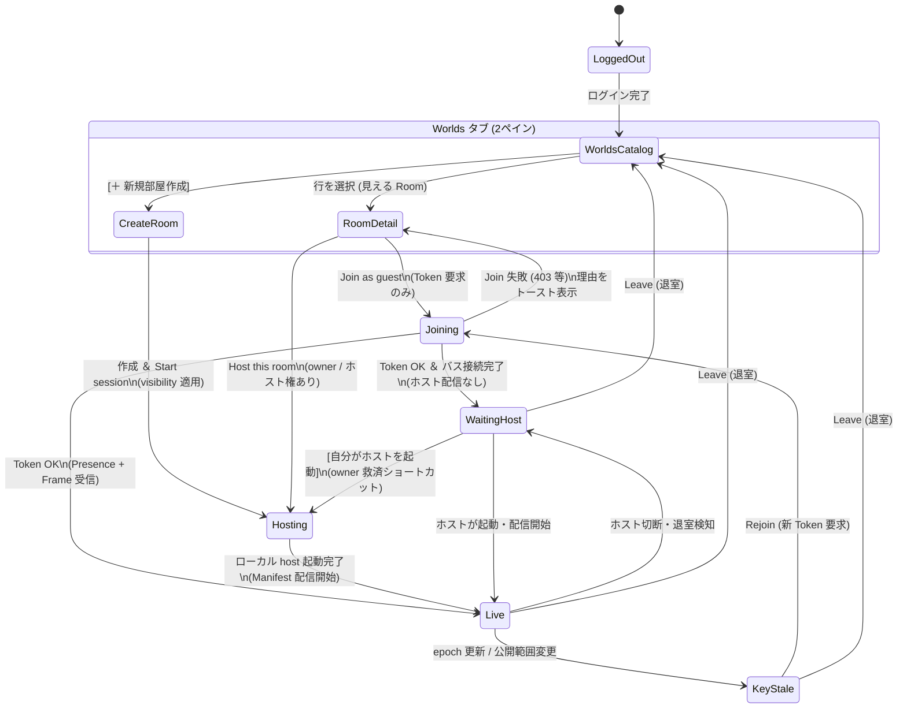

# x007c — Worlds カタログ / Join・Host 分離（草案）

> **ID:** `x007c` · **slug:** `worlds-catalog-join-host` · **status:** `active` · **area:** `[world, client, system_ui, docs]` · **depends_on:** `[x0034, x0035, x0036, x0037, x0018, x0019, x0032]`  
> **優先度:** UX 本線草案（評価 P0-2 Room key epoch とは分離。epoch 実装後に KeyStale を本採用）

目標: Dash に **Worlds タブ**を追加し、Room の **見える / 入れる / 読める / 回す** を UI 遷移で混ぜない。一覧はカタログのみ、Join は guest 入場券のみ、自 host 起動は別 CTA とし、役割（owner / guest）に応じて迷わない優先表示を行う。Join 成功後は必ず **Waiting for host / Live** を分岐し、待機中もユーザーが次の行動（退室・オーナーによるその場ホスト起動）を選べるようにする。

根拠: テスター手通し（2026-11-06）で Join 後に host 不在だと空間が動かないことが判明。visibility ACL（x0034–x0036）・仮作成 UI（x0037）はあるが **一覧 API / 一覧 UI は未整備**（[world-server.md](../../0_doc/architecture/world-server.md)）。評価提案の Room key epoch（[improvement-plan-2026-11-05.md](../../0_doc/evaluation/improvement-plan-2026-11-05.md) **P0-2**）とセットで「読める」境界を UI に載せる。

---

## 用語（三権＋ホスト）とユーザー向け表現

WAN 購読面・`wire_cap`・mTLS・`epoch` 等の内部用語は UI に出さず、ユーザーが「今どうなっていて、何をすればよいか」が直感的に分かる言葉に翻訳して表示する。  
（下記の絵文字は草案上の読みやすさ用。最終 UI は既存 Dash のテキスト／アイコントーンに合わせ、絵文字必須にはしない。）

| 内部概念 | サーバ／実行面 | 意味 | ユーザー向け UI 表示語（例） | まだ無いときの UI 挙動 |
|:---|:---|:---|:---|:---|
| **見える** | 一覧 API（本 Slice） | 候補として行を出してよい | カタログ一覧への表示 | 一覧に行が出ない（0件時は作成ガイドを表示） |
| **入れる** | `POST …/tokens`（既存 visibility ACL） | Room Token 発行可 | 「入室可能」バッジ / 入室ボタン有効 | ボタン無効化、または入室時エラー通知（「公開範囲により入室できません」） |
| **読める** | 有効 `room_key`（将来 epoch）＋ host 配信 | Manifest / Frame / Presence が生きている | **稼働中 (Live)** | **ホストの起動待ち (Waiting for host)** / **部屋の更新あり・再接続が必要 (KeyStale)** |
| **回す** | Start session / Host this room（既存 HostSupervisor） | 自前 host-server を立てて配信 | **ホストとして部屋を起動** | オーナー／権限保持者にのみ起動 CTA を提示 |

---

## 保証する / しない

| 保証する | 保証しない |
|:---|:---|
| world: 認証済み呼び出し元に **見える Room だけ**を返す一覧（visibility と同じ関係判定を流用） | 一覧レスポンスに `room_key` / Token / `wire_cap` を載せること |
| client: Worlds タブを **左：一覧 ／ 右：Room 詳細の 2 ペイン（Master-Detail）** で構成し、画面往復なしで部屋を比較・選択可能にする | Join が暗黙に host を spawn すること |
| client: **Join as guest** と **Host this room** を明確に別 CTA としつつ、自分の部屋（owner）では「Host this room」を主ボタンにして押し間違いを防ぐ | 一覧行の Live 状態を権威保証すること（best-effort ヒントまたは非表示） |
| Join 成功後の in-room 状態は **Waiting for host** と **Live** を明確に区別し、Waiting 画面内に「退室」および「（owner時）今すぐ自分がホストを起動」の導線を置く | デザイン最終化；XR 専用 Worlds；招待リンク本実装 |
| Waiting 中の owner 救済 CTA（owner のみ表示）。**MVP 実装は Leave → spawn host → rejoin**（バス鍵・seal retarget を単純化）。Rescue 対象は `shared.get_room_id()`（実入室）のみ；カタログ行プレビューの `home_room_id` は使わない。Host spawn は visibility `Applied`（owner PUT 成功）のみ | 入室維持のままの host 昇格；guest→host 権限モデル；他マシンの remote host 委任；social カタログの友達グラフ走査 |
| Home の固定 `ROOM_ID` Join / Start は Worlds へ移行（上級者・デバッグ向けに Settings 残し可） | **本 Slice 単体での Room key epoch 実装**（別 Slice。未実装時 KeyStale は殻のみ） |
| visibility 変更 UI がある場合、「既存参加者は再接続が必要」と明記 | |

---

## ユーザー視点での UX 改善原則（テスターの迷い防止）

1. **オーナーの「セルフ待機」事故を防ぐ（CTA の優先度制御＋待機画面からの直接起動）**
   - 部屋のオーナーが誤って `Join as guest` を押し、自分で自分のホストを待ち続けてしまう事故を防ぐ。
   - `role_hint == owner` の部屋を選択した際は、**「ホストとして部屋を起動 (Host this room)」をプライマリ（強調）ボタン**とし、`Join as guest` は「ゲストとして入室（別プロセスのホストに接続 / 待機テスト用）」としてセカンダリ配置にする。
   - 万が一オーナーが `Waiting for host` に入った場合も、待機オーバーレイ上に **「あなたはこの部屋のオーナーです → [今すぐホストを起動する]」** ボタンを出し、一度 Leave してやり直す手間をなくす。
2. **一覧と詳細の往復をなくす（Master-Detail 2 ペイン＋手動更新・空状態ケア）**
   - 一覧と詳細を別画面遷移にすると「入ってダメなら戻って選び直す」のがストレスになるため、左ペインに Room 一覧（＋ `[一覧を更新]` ボタンと `[すべて / 自分の部屋]` フィルタ）、右ペインに選択中 Room の詳細・CTA を常時並べる。
   - 見える Room が 0 件のとき（Empty State）は、空の表だけを出さず **「まだ参加できる部屋がありません → [新しい部屋を作る (Create world)]」** を中央に案内する。
3. **「なぜ動かないのか」を 0 秒で伝え、次の行動を塞がない（In-room Shell）**
   - `Waiting for host` では「壊れている・フリーズしている」と誤解されないよう、「入場券は取得済みです。ホストが起動すると自動的に空間が動き出します」と明示し、その場に **`[退室して一覧へ戻る (Leave)]`** ボタンを常設する。
   - `Live` 中にホストがいなくなった場合（`Live → WaitingHost`）は、「ホストとの接続が切れました。ホストの再復帰を待つか、退室してください」と初期入室待ちと区別してメッセージを出す。

---

## 画面構成・状態遷移

### 1. 画面階層ツリー（Master-Detail ＆ In-room Shell）

```text
Home（ログイン後 Dash）
 ├─ Worlds タブ（2ペイン構成）
 │   ├─ [左ペイン] カタログ一覧（見える Room のみ）
 │   │   ├─ ツールバー: [一覧を更新] / フィルタ [すべて | 自分の部屋] / [＋ 新規部屋作成 (Create world)]
 │   │   ├─ 一覧行（タップで右ペインに詳細を展開）
 │   │   └─ 0件時 (Empty State): 「部屋がありません」＋ [＋ 新規部屋作成] CTA
 │   │
 │   └─ [右ペイン] Room 詳細パネル（選択中 Room の「入れる／回す」分岐）
 │       ├─ [owner の場合]
 │       │   ├─ 主 CTA: ホストとして部屋を起動 (Host this room)  ← 自前 host を立てて Live へ
 │       │   ├─ 副 CTA: ゲストとして入室 (Join as guest)        ← Token のみ（host は立てない）
 │       │   └─ 設定:   公開範囲の変更 (Change visibility)      ← 「参加者は再接続が必要」と注記
 │       └─ [guest の場合]
 │           └─ 主 CTA: ゲストとして入室 (Join as guest)        ← Token のみ（host 不在時は待機へ）
 │
 └─ In-room shell（入室後の空間・オーバーレイ表示：「読める」状態の明示）
     ├─ Live（Frame / Manifest 受信中：通常プレイ状態）
     │   └─ メニュー内: [退室 (Leave)] / （owner時）[公開範囲変更]
     │
     ├─ Waiting for host（Token OK・バス接続済み・Frame 未着）
     │   ├─ ステータス表示: 「ホストの起動を待っています（ホストが開始すると自動で始まります）」
     │   ├─ 主アクション:   [退室して一覧へ戻る (Leave)]
     │   └─ オーナー救済:   [自分がホストを起動する (Host this room)] ※owner/権限保持時のみ表示
     │
     └─ KeyStale（鍵世代更新 / 公開範囲変更検知 ※epoch 実装後に本採用）
         ├─ ステータス表示: 「部屋の公開設定が更新されました。再接続してください」
         ├─ 主アクション:   [再接続する (Rejoin)]  ← 新 Token + 新 key 取得へ（403 時は一覧へ戻す）
         └─ 副アクション:   [退室する (Leave)]
```

### 2. 状態機械（Mermaid State Diagram）



---

## Worlds 一覧・Room 詳細の表示仕様

### 1. Worlds 一覧行に出す列（左ペイン）

| 列 | 出す内容（ユーザー向け表示） | 出さないもの（内部詳細） |
|:---|:---|:---|
| **部屋名 / ID** | `display_name`（未設定時は短縮 `room_id`） | `wire_cap`、内部トピックパス |
| **自分の役割** | オーナー（自分の部屋） / 表示なし（他人の部屋） | 内部 ACL 評価ツリー |
| **公開範囲** | Private / Friends / Public 等のラベル | 「誰でも平文が読める」等の過大・技術的表現 |
| **状態ヒント** | 稼働中 / ホスト不在（取得可能な範囲の best-effort）または非表示 | Zenoh キー・mTLS 状態・`room_key` |
| **入場可否** | 一覧は見える Room のみ。行に出すなら `入室可` | `forbidden` 行（見えない Room は一覧に載せない） |

### 2. Room 詳細パネルの CTA とマイクロコピー（右ペイン）

* **ホストとして部屋を起動 (`Host this room`)** — `owner`（またはホスト権があるとき）のみ表示・強調
  * 補足コピー: *「あなたの PC でこの部屋の空間サーバーを起動し、すぐに入室します」*
* **ゲストとして入室 (`Join as guest`)** — 入室権がある全員に表示（`owner` 時はセカンダリボタン）
  * 補足コピー: *「すでに開いている部屋へ参加します（※ホストが誰もいない場合は待機画面になります）」*
* **公開範囲の変更 (`Change visibility`)** — `owner` のみ
  * 補足コピー: *「※公開範囲を変更すると、現在入室中の参加者は再接続が必要になります」*
* **退室する (`Leave`)** — 入室中（`Live` / `WaitingHost` / `KeyStale`）のみ表示

---

## API 草案（見えるだけ）

| Method | Path（案） | Auth | 内容 |
|:---|:---|:---|:---|
| `GET` | `/api/v1/rooms`（または `/api/v1/rooms:search`） | Bearer（auth JWT） | 呼び出し元 `sub` に **見える** Room の要約一覧 |

* **要約フィールド案**:
  * `room_id`: Room 識別子
  * `display_name?`: 任意の表示名（無ければクライアント側で `room_id` を整形表示）
  * `visibility`: 現在の公開範囲ラベル
  * `owner_sub` / `owner_display_name?`: 誰の部屋か判別するためのオーナー表示情報
  * `role_hint`: **`owner` / `joinable` のみ**（一覧は見える Room に限定するため `forbidden` は返さない。Join 直前の ACL 変更は 403＋トーストで扱う）
  * `host_status_hint?` *(任意・best-effort)*: `live` / `waiting_host` / `unknown`
    * **観測源が無い間はフィールド省略または常に `unknown`**。world は現状 host 死活を持たない。本 Slice の Phase 1 では一覧 API に載せないことを既定とし、ヒントを出すなら別途観測契約（例: 拠点側の任意シグナル）を明記してから追加する。権威ではない。
* **絶対に載せないフィールド**: `room_key`, Token, `wire_cap`, scene 本体。
* **レース条件の扱い**: 一覧の「見える」判定は Token 門番（x0034–x0036）と同じ関係ソース（owner / friends / …）を使う。一覧取得直後に公開範囲が変更されて Join 時に `403 Forbidden` になり得るレースは許容し、UI は「公開範囲が変更されたため入室できませんでした」とトースト明示した上で一覧を再取得する。

---

## 既存 UI（x0037 Home）からの移行

| 今（x0037 Home） | 本 Slice（x007c Worlds） | ユーザー体験上の変化 |
|:---|:---|:---|
| Join Room（固定 `ROOM_ID`） | Worlds 一覧 → 詳細 → `Join as guest` | 部屋 ID を暗記・手入力せずに一覧から選べる |
| Start Session | 詳細の `Host this room` / `Create world` | 「新しく作る」と「既存の自分の部屋を回す」が明確に分かれる |
| Join 成功＝入った気になる（動かない原因が不明） | Join 成功 → `Waiting for host` / `Live` を必ず表示 | ホスト不在時に「ホスト待ち」と分かり、その場で退室やホスト起動ができる |

---

## やらない（本 Slice）

- Room key epoch / AAD 回転の実装本体（improvement **P0-2**・別採番）
- WAN ACL のキー式縮小・mTLS room 束縛
- Group ACL / 招待コード / ディープリンク本実装
- Prefab 多子・XR Inventory
- 一覧 API での権威ある host 死活保証
- 最終ビジュアル（絵文字アイコン必須化含む）

---

## Phase

| Phase | 内容 | 状態 |
|:---|:---|:---|
| 0 | Slice 草案 + 目次 / backlog | **done** |
| 1 | world 一覧 API + 単体テスト（visibility 行列）。`host_status_hint` は既定オフ | **done** |
| 2 | client Worlds タブ（2ペイン構成・更新ボタン・Empty State）+ Room 詳細 CTA 分離（owner 優先表示） | **done**（Desktop；XR は Desktop-only メッセージ） |
| 3 | Join 後 `Waiting for host` / `Live` シェル（ホスト不在の明示 ＋ Leave ＋ owner 直接 Host 起動導線） | **done**（Frame 到達で Live；3s stall で Live→WaitingHost；Host Rescue は leave→rejoin MVP；KeyStale は殻のみ） |
| 3b | レビュー重大修正: `ROOM_ID` env 同期・HostSupervisor room retarget 再起動・Host CTA owner のみ・カタログ owned∪public∪social 候補 | **done** |
| 4 | Home の固定 Join/Start を Worlds へ移設（Settings に上級者・デバッグ用として残し可） | **done**（Home＝Open Worlds / Create；Settings Advanced＝固定 ROOM_ID Join/Start） |
| 5 | architecture（client / world-server）鮮度更新・`KeyStale` 殻実装（epoch Slice 待ち） | **partial**（world-server.md retarget 保証追記；KeyStale UI 本採用は epoch 待ち） |

---

## 完了条件

1. 認証ユーザーが、visibility 上見えてよい Room だけを一覧で得られる（秘密フィールド無し）。0 件時は新規作成への誘導が出る。
2. `Join as guest` は host を起動せず、成功後に `Waiting for host` と `Live` が UI 上で一目で区別できる。
3. `Host this room` / `Create world`（および `Waiting for host` 内のオーナー救済ボタン）だけが自前 host を立てる。
4. テスターが「Join したのに動けない」とき、ログを読まなくても UI から「ホスト待ち」であることが分かり、1 クリックで退室（または自分がオーナーならホスト起動）できる。
5. architecture の保証表に「一覧＝見える／Join＝入れる／Live＝読める／Host＝回す」を追記する。

---

## 関連

- [x0037-client-access-level-ui.md](x0037-client-access-level-ui.md)（作成パネル・仮 UI）
- [x0034-visibility-token-gate.md](x0034-visibility-token-gate.md) ほか visibility
- [improvement-plan-2026-11-05.md](../../0_doc/evaluation/improvement-plan-2026-11-05.md) **P0-2** Room key epoch（KeyStale 本採用の前提）
- [client.md](../../0_doc/architecture/client.md) / [world-server.md](../../0_doc/architecture/world-server.md)

← [目次](../README.md)
