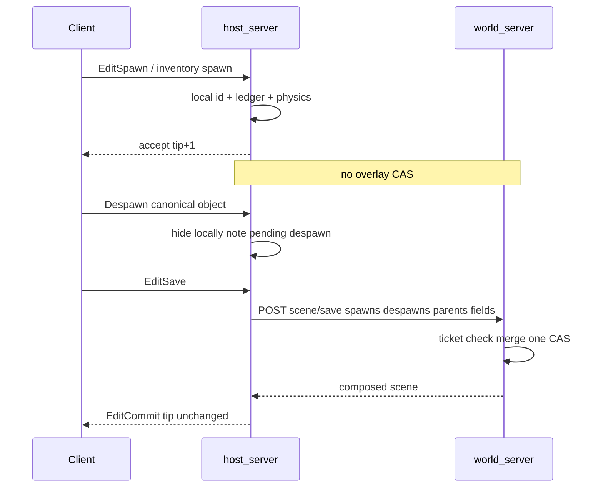

# x00b9 — Spawn 即 CAS 見直し（C）

> **ID:** `x00b9` · **slug:** `spawn-without-live-cas` · **status:** `done` · **area:** `[host, world, client, docs]` · **depends_on:** `[x00b7, x00b8, x00b3, x00b5]`  
> **優先度:** [mvcc_xpbd.md](../mvcc_xpbd.md) §4.7 VCS 負債の解消（案 B の例外を閉じる）  
> **後続:** Save As / Copy · Spatial VCS · Undo UI

目標: **`…/edit` Spawn/Despawn と inventory spawn/despawn が world への即時 overlay CAS をしない**。ライブ working tree は host 内だけ進め、永続は既存の明示 Save（x00b7/x00b8）に閉じる。Reparent/SetField と同型の「ライブ ≠ 永続」に揃える。

## 背景（現状の非対称）

| 操作 | ライブ | world への即書き |
|:---|:---|:---|
| Reparent / SetField | host ledger + FrameBridge | なし（Save で折込 · x00b8） |
| Save | tip 据え置き | overlay→canonical + patches（x00b7/x00b8） |
| **Spawn / Despawn** | tip + physics | **即 overlay CAS（VCS 負債）** |

案 B（x00b3）では Spawn 即 CAS を「移行期の例外」と明記済み。x00b7/x00b8 で Save 経路が揃ったので、例外を外す。

## 保証する / しない

| 保証する | 保証しない |
|:---|:---|
| Spawn 成功後、Save 前に Leave / dormant しても **canonical は変わらない**（未 Save は消える） | 未 Save spawn のクラッシュ耐性（host 落ちたら消えてよい） |
| canonical 由来の Despawn も Save 前 Leave では **正本に残る**（再 Host で復活） | pose の Save 永続 |
| Save 後は spawn 箱＋parent/fields が残り、`despawns` 対象は正本から消える | Spatial VCS / Save As / Undo UI |
| SpawnTicket（x00b5）の所有権検証は **弱めない**（検証点は Save 折込へ移動） | 多 host 同時 canonical 書き（Spatial VCS） |
| tip / `EditCommit` は案 B 維持（Save でも tip 据え置き） | Save 時の entity_id remap |
| inventory と `…/edit` は **同じ** 永続契約 | |

## 設計確定（Phase 0 承認済み）

| 項目 | 決定 |
|:---|:---|
| Save 載せ方 | **C1**: `POST …/scene/save` body に `spawns` / `despawns`（＋既存 `parents` / `fields`）を載せ、ticket 検証→マージを **1 packed CAS** |
| entity_id | **host 局所採番を押し通し**（scene max+1 / freelist）。Save 時に衝突 → 拒否（409 / `invalid_entry`）。remap しない。多人は **単一 active host 採番**で足りる；真の多 writer は VCS へ先送り |
| inventory | **`…/edit` と同時に C**（取り出しも Save するまで canonical に残らない） |
| Despawn | **新規 pending** は台帳から外すだけ。**canonical 由来**はライブで隠すだけ → Save の `despawns` で初めて正本削除 |
| SpawnTicket | ライブ時は host が保持；**Save 折込時に world が検証** |
| PIN | ワイヤ `EditSpawn` 形は維持。Save JSON 拡張のみなら docs 更新；peers が Save body を厳密パースするなら `…-x00b9` を検討（実装時判断） |

### Despawn の二種（Resonite: ワールドにある物を消す）

| 種別 | ライブ | Save なし Leave | Save |
|:---|:---|:---|:---|
| 今セッションで出した箱を消す | pending から削除 | もともと正本に無い | `spawns` に載せない |
| **保存済み**の箱を消す | sim/ledger から隠す | **正本に残る → 再入室で復活** | `despawns` で正本から削除 |

## Phase

| Phase | 内容 | 状態 |
|:---|:---|:---|
| 0 | Slice + Open 決定 | **done** |
| 1 | host: Spawn/Despawn・inventory から overlay CAS 除去 + pending 台帳 | **done** |
| 2 | world: Save body `spawns` / `despawns` + ticket 検証点移動 + tests | **done** |
| 3 | docs（mvcc §4.7「例外」削除、protocol/world 一言） | **done** |

## 起動確認（DoD）

1. spawn →（Save なし）→ Leave → 再 Host：箱は **無い**  
2. spawn → Save → Leave → 再 Host：箱は **残る**（x00b7）  
3. spawn → Reparent → SetField → Save：親子・色も残る（x00b8）  
4. inventory 取り出し → Save なし Leave：箱は **無い**（edit と同契約）  
5. 保存済み箱を Despawn → Save なし Leave → 再 Host：箱は **復活**  
6. 保存済み箱を Despawn → Save → 再 Host：箱は **無い**  
7. 不正 / 期限切れ SpawnTicket を Save に載せたとき拒否  
8. 非 writer Save → 403  
