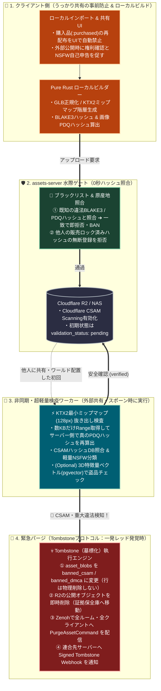

# Alchemy v2: 違法コンテンツ検疫・緊急パージ（Tombstone）設計 ＆ 優先度別実装ロードマップ仕様書

## 1. 背景と目的（Cursorエージェントへのコンテキスト共有）

Alchemy v2アーキテクチャでは、以下の「サーバーと通信の骨格」が確立されている。
- **コントロールプレーンと計算プレーンの分離**: `world-server` の100% Pure Elixir化（NIF完全廃止）と、空間・物理演算を担う Pure Rust `host-server`（`shared-sim`）の分離。
- **リアルタイム通信の一本化**: 独自UDPやPhoenix空間通信を廃止し、`zenoh-router`（`Zenohex` / Ephemeral mTLS + Zenoh ACL）へ統一。
- **RCE（任意コード実行）防御とサーバー負荷ゼロ化**: クライアント側のPure Rustデコーダ（`#![forbid(unsafe_code)]`）とローカルLOD/KTX2ビルダーにより、サーバー側で重い3D/画像展開を行わない設計。
- **`assets-server` の5層統合データモデル**: 第1層（CAS: `AssetBlob`）、第2層（Quota/権利: `StorageVault` / `BlobGrant`）、第3層（Drive/Comms）、第4層（Spatial VCS）、第5層（Shopfront）。

一方で、**「実際にユーザーがVR空間で身体を持ち、複数人で同時に制作し、個人〜企業が法的に安心してサーバーを運営する」** という実運用レイヤーにおいて、以下の **6つの盲点** が特定された。本仕様書では、全体ロードマップ（P0〜P4）を定義した上で、特に運営者の法的保護に直結する **「違法コンテンツ検疫・緊急パージ（Tombstone）機構」** と **「クライアント安全弁」** の詳細仕様を定める。

---

## 2. 特定された6つの盲点と全体実装ロードマップ（P0〜P4）

### 2.1 解決すべき6つの盲点
1. **アバター規格・Full-Body IK・揺れものの標準化**: GLB（およびVRMインポート変換）におけるヒューマノイドボーン規約、3点〜フルトラIK、SpringBone（揺れもの）、MToon表現、一人称視点座標（ViewPosition）の正規化仕様。
2. **空間内リアルタイム共同編集の競合解決とマルチプレイUndo/Redo**: 複数人が同時に同一オブジェクトやノードグラフを操作した際の調停（操作中ロック / CRDT）と、自分の操作履歴のみを逆適用するローカルスコープUndo。
3. **「0秒ホスト移譲」における物理・VM内部ステートの同期**: 描画用の `RenderFrame` だけでなく、Rapier3dの速度・角速度やFormula VMの内部変数を含む `SimState Snapshot` の定期同期。
4. **「合法なシェーダー／音声」による空間テロへのクライアント安全弁**: Nagaの文法検証を通過する「光過敏性点滅テロ」「視界ジャック」「爆音ノイズ」をクライアント側で即座に無力化する自衛機構。
5. **分散連合における違法コンテンツ（CSAM・重大権利侵害）の緊急パージと運営者保護**: 児童ポルノ（CSAM）等の一発レッド案件の0秒検知・墓標化（Tombstone）・P2Pキャッシュ強制消去と、「うっかり共有（著作権侵害）」の段階的ロック。
6. **公開エッジ `zenoh-router` の接続ディスカバリと短命mTLS自動配布**: `Room Token` 発行時に接続先 `zenoh-router` URIと短命クライアント証明書をセットで返し、IP直打ちを排除する導線。

### 2.2 優先度別ロードマップ（P0〜P4）

| 優先度 | フェーズ名 | 主要タスク |
| :--- | :--- | :--- |
| **P0** | **v2コア分離・通信一本化・セキュリティ境界（最優先）** | 1. NIF廃止と `host-server`（`shared-sim`）分離<br>2. Zenoh一本化とRoom TokenからのDNSディスカバリ＋短命mTLS配布<br>3. Zenoh ACL・入力サイズ制限・全浮動小数点 `is_finite()` サニタイズ<br>4. 4層ライセンス分離（Apache-2.0 / MPL-2.0 / Proprietary / BSL-1.1）適用 |
| **P1** | **最小空間ループ・アバター/IK・ローカル安全弁** | 1. v1第一級コンテンツ3本（`CanvasTest` / `BulletHell3D` / `FormulaTest`）の移植<br>2. ヒューマノイドGLB規約・IKソルバー・OSC（`rosc`）受信の実装<br>3. クライアント側ローカルセーフティ（Mute/Block・シェーダーPBRフォールバック・描画範囲制限） |
| **P2** | **クリエイト＆永続化・違法検疫基盤（本仕様書の核）** | 1. SQLite版 `assets-server`（第1〜4層）＋ Proof of Possession実装<br>2. **違法コンテンツ検疫（PDQ / KTX2最小ミップマップ検査）＆ Tombstone緊急パージ機構**<br>3. クライアント側LODビルダー＆BLAKE3事前照合付きP2Pキャッシュ<br>4. 共同編集ロック/CRDT・Dual Editor・`SimState Snapshot` 込みの0秒ホスト移譲 |
| **P3** | **分散連合＆軽量Web展開** | 1. `/.well-known/alchemy-node-info.json` とS2S連合ディスカバリ<br>2. `apps/verifier` 抜き打ち監査・着用権検証・連合間Tombstone Webhook連携<br>3. 軽量Webビューア（Wasm + WebGPU + Zenoh over WebTransport） |
| **P4** | **経済圏・スケールアウト** | 1. PostgreSQL移行・`market-server` ＋ `BillingProvider`（MoR / 180日コイン）接続<br>2. 3D特徴量検疫ワーカー（`pgvector`）とオープンリレー収益分配 |

---

## 3. 違法・不適切コンテンツの3段階分類と自動対処ポリシー

Google DriveやCloudflare等の大手クラウドの検閲モデルをベンチマークとし、「人間の目視監視に頼らず自動で回り、プロバイダ責任制限法および児童ポルノ禁止法等の法的リスクから運営者を守る」ため、対象コンテンツを以下の3レベルに分類してシステムの挙動を明確に分ける。

| レベル | 分類 | 対象コンテンツ例 | 検知トリガー | システムの自動処置（ペナルティと保護） |
| :--- | :--- | :--- | :--- | :--- |
| **Level 1** | **一発レッド**<br>*(絶対的違法)* | ・児童ポルノ（CSAM）<br>・実写の殺人・テロ・虐待<br>・マルウェア / クラッシュ爆弾 | ・Cloudflare CSAMスキャン<br>・知覚ハッシュ（PDQ）DB一致<br>・最小ミップマップAI検疫<br>・複数人の緊急通報 | **【即時墓標化（Tombstone）＆ アカウント永久凍結】**<br>1. `asset_blobs.validation_status` を `:banned_csam` に更新し即時配信停止。<br>2. R2/NASの公開バイナリを即時削除（証拠保全バケットへ隔離）。<br>3. 投稿者の `auth-server` アカウントを即時 `:suspended`（永久凍結）。<br>4. Zenoh経由で全ルーム・全クライアントのP2Pキャッシュから該当ハッシュを強制消去。 |
| **Level 2** | **うっかり共有**<br>*(権利侵害・海賊版)* | ・他人の有料3Dモデルの無断配布<br>・市販楽曲やアニメ画像の共有<br>・BOOTH等の規約違反再配布 | ・先願 `Origin Cert` ロック不一致<br>・3D特徴量（`pgvector`）類似検知<br>・権利者からのDMCA通報 | **【一発BANせず、共有ロック ＆ UI事前防止】**<br>1. **事前防止**: `grant_type == :purchased` または他人の `Origin Cert` があるアセットは、メール添付やグループ共有フォルダへのコピー自体をUI/APIでブロックし「商品リンクの共有」へ誘導。<br>2. **事後対処**: 通報確定時は該当Blobを「外部共有・パブリックスポーン不可（本人閲覧のみ）」にロックし警告通知（悪質な反復時のみ凍結）。 |
| **Level 3** | **ゾーニング違反**<br>*(合法・場所を選ぶ)* | ・成人向け（NSFW / R-18）アバター<br>・過度な露出、強いホラー表現 | ・テクスチャ肌色率 / シェイプ名<br>・軽量NSFW分類器<br>・クリエイターの自己申告 / 通報 | **【削除せず、部屋の属性に応じて自動フィルタリング】**<br>1. アセットに `content_rating: :nsfw` を付与。<br>2. Private部屋やNSFW許可部屋ではそのまま表示。<br>3. 全年齢Public部屋では自動的に「標準フォールバックアバター」へ置換表示。 |

---

## 4. アーキテクチャ全体図（水際検疫・最小ミップマップ検査・Tombstoneパージ）



---

## 5. サーバー負荷ゼロを実現する「KTX2最小ミップマップ検疫」仕様

VRプラットフォームでは、悪意あるユーザーが「違法画像（CSAM等）を3Dモデルの板ポリゴンのテクスチャとして `.glb` 内に隠してアップロードする」手口が存在する。しかし、`assets-server` 上で数十MBの4Kテクスチャや3Dモデルを毎回フル展開すると、サーバーCPUコストが破綻しRCEリスクも高まる。

これを解決するため、**「KTX2の最小ミップマップ（数KB）だけを使った超軽量サーバー検疫」** を実装する。

1. **クライアント側ビルド時の規約**:
   - クライアントのローカルビルダーがテクスチャをKTX2へ変換する際、必ずミップマップ階層（例：最大4096×4096 〜 最小64×64または128×128）を生成し、KTX2ヘッダのLevel Indexに各ミップマップのバイトオフセットとサイズを記録する。
2. **サーバー側検疫ワーカーの処理（HTTP Range Request）**:
   - 非同期検疫ワーカーは、R2上のファイル全体をダウンロードしない。
   - まず先頭数百バイト（GLBチャンクヘッダおよびKTX2 Level Index）のみをHTTP Range Requestで取得する。
   - 次に、**末尾付近にある「128×128（または64×64）の最小ミップマップ領域（数KB）」だけをRange取得**してメモリ上で展開する。
3. **知覚ハッシュ（PDQ）算出と照合**:
   - クライアントが自己申告したハッシュは偽装の可能性があるため、サーバー側で抜き出した最小ミップマップ画像から **Meta社製アルゴリズム「PDQ（256-bit Perceptual Hash）」** をPure Rust（または軽量ワーカー）で直接算出する。
   - 算出した `pdq_hash` と既知の違法ハッシュリスト（`blocked_perceptual_hashes` テーブル）のハミング距離（Hamming Distance $\le 30$ 等）を照合し、一致した場合は即座に **Level 1（Tombstone＋アカウント凍結）** を執行する。

---

## 6. `assets-server` データベーススキーマ拡張仕様（Ash / Ecto）

既存の5層モデル（特に `asset_blobs` と `blob_grants`）の外部キー整合性（`ON DELETE RESTRICT`）を壊さず、かつ同一違法ファイルの再アップロードを永久に阻止するため、**物理DELETEではなく「Tombstone（墓標化）」方式**を採用する。

### 6.1 `asset_blobs` テーブルの拡張（第1層：CAS）

```elixir
# apps/assets_server/lib/alchemy_assets/cas/asset_blob.ex の拡張フィールド案
attributes do
  attribute :blake3_hash, :string, primary_key?: true, allow_nil?: false
  attribute :byte_size, :integer, allow_nil?: false
  attribute :mime_type, :string, allow_nil?: false

  # 検疫・モデレーション状態（Tombstone対応）
  # :pending        - アップロード直後（本人のみプレビュー可）
  # :verified       - 軽量検疫通過（外部共有・Publicスポーン可）
  # :under_review   - 緊急通報の閾値到達による一時検疫ロック（新規スポーン停止）
  # :restricted_ip  - 著作権侵害（DMCA等）による外部共有ロック（本人のみ閲覧可）
  # :banned_dmca    - 悪質な権利侵害による墓標化（R2実体削除済み・再UP永久拒否）
  # :banned_csam    - CSAM等の絶対的違法データによる墓標化（R2隔離・アカウント即BAN・再UP永久拒否）
  attribute :validation_status, :atom do
    constraints one_of: [
      :pending,
      :verified,
      :under_review,
      :restricted_ip,
      :banned_dmca,
      :banned_csam
    ]
    default :pending
    allow_nil? false
  end

  # ゾーニング属性
  # :general (全年齢) / :sensitive (軽度露出等) / :nsfw (R-18・成人向け部屋限定)
  attribute :content_rating, :atom do
    constraints one_of: [:general, :sensitive, :nsfw]
    default :general
    allow_nil? false
  end

  # サーバー側で最小ミップマップから算出した256-bit PDQ知覚ハッシュ（Hex文字列 64文字）
  attribute :pdq_hash, :string, allow_nil?: true

  # Tombstone執行メタデータ
  attribute :tombstoned_at, :utc_datetime_usec, allow_nil?: true
  attribute :tombstone_reason, :string, allow_nil?: true
end
```

### 6.2 `blob_grants` テーブルの共有制御ルール（第2層：Vault / 権利）

「違法と知らずに共有してしまうパターン（Level 2）」をシステム的に防ぐため、`BlobGrant` に以下のバリデーションを強制する。

1. **再配布の自動ブロック**:
   - `grant_type == :purchased`（マーケット購入品）または `origin_creator_sub != current_user.sub`（他人が原産地証明を持つアセット）の `BlobGrant` について、ユーザーが「メール添付（`:mail_temp`）」「グループ共有Vaultへのコピー」「Publicダウンロード許可」を行おうとした場合、APIレベルで `403 Forbidden (error: :redistribution_prohibited)` を返す。
   - クライアントUIはファイル添付の代わりに「ショップ商品ページのURL（または `alchemy://shop/...` ディープリンク）を共有する」ボタンへ誘導する。

### 6.3 新設テーブル：`blocked_perceptual_hashes` ＆ `moderation_reports`

1. **`blocked_perceptual_hashes`（違法知覚ハッシュ・ブラックリスト）**:
   - `id` (UUID), `pdq_hash` (string, indexed), `category` (`:csam`, `:terror`, `:malware`), `source` (`:ncmec`, `:internal_tombstone`, `:federation_notice`), `inserted_at`
   - 一度でも `:banned_csam` になったBlobの `pdq_hash` は自動的にこのテーブルへ追加され、画像を少しリサイズ・色調変更した亜種の再アップロードも水際で遮断する。
2. **`moderation_reports`（通報＆コミュニティ緊急フェイルセーフ）**:
   - `id` (UUID), `target_blob_hash` (string), `reporter_user_id` (UUID), `category` (`:csam_illegal`, `:copyright_dmca`, `:nsfw_untagged`, `:crash_harassment`), `reason_text` (string), `status` (`:open`, `:resolved`, `:dismissed`)
   - **Auto-Quarantine（自動一時隔離）ルール**:
     - 同一の `target_blob_hash` に対して、信頼スコアを満たす異なるユーザーから一定時間内に $N$ 件（デフォルト $N = 3$、設定変更可）以上の `:csam_illegal` 通報が集まった瞬間、運営者の手動確認を待たずに該当 `AssetBlob` の `validation_status` を `:under_review` に自動変更し、R2の署名付きURL発行を一時停止する（深夜帯の放置を防ぐ安全弁）。

---

## 7. リアルタイム空間＆P2Pキャッシュ強制パージ仕様（Protobuf & Zenoh）

Alchemyではクライアント間でP2Pキャッシュ融通を行うため、R2上のファイルを消しただけでは、すでに入室しているユーザーのメモリやローカルディスクに違法データが残ってしまう。そのため、Tombstone執行と同時に **Zenoh経由でリアルタイム消去指令** を配信する。

### 7.1 `alchemy-protocol`（Protobuf）へのメッセージ追加

`protocol/proto/moderation.proto`（または既存の制御proto）に以下のメッセージを追加する。

```protobuf
syntax = "proto3";
package alchemy.moderation;

enum PurgeReason {
  PURGE_REASON_UNSPECIFIED = 0;
  PURGE_REASON_CSAM_ILLEGAL = 1; // 絶対的違法（ローカルキャッシュもゼロ上書き消去）
  PURGE_REASON_DMCA_TAKEDOWN = 2; // 権利侵害による削除
  PURGE_REASON_EMERGENCY_QUARANTINE = 3; // 通報閾値到達による一時凍結
}

// world-server / assets-server から全ルーム・全クライアントへ配信される強制パージ指令
message PurgeAssetCommand {
  string blake3_hash = 1;
  PurgeReason reason = 2;
  uint64 issued_at_unix_ms = 3;
  bytes operator_signature = 4; // 運営サーバーの秘密鍵による署名（偽造パージ攻撃の防止）
}
```

### 7.2 Zenohトピックと各コンポーネントの挙動

- **配信トピック**: `alchemy/{env}/system/moderation/purge` （全クライアント・全 `host-server` が常時Subscribe）
- **`host-server`（Rust）の挙動**:
  1. `PurgeAssetCommand` を受信し署名を検証。
  2. 現在のルームのシーングラフ（ECS / CRDT）を走査し、`blake3_hash` を参照しているすべての3Dエンティティ・スポーン物を即座に空間から破棄（Despawn）。
  3. 着用中アバターが該当ハッシュを含んでいた場合は、即座に標準フォールバックアバター（ロボットシルエット等）へ強制置換。
- **`client`（VRAlchemy Rust）の挙動**:
  1. VRAM上のテクスチャ・メッシュバッファから該当アセットを即座にアンロード。
  2. ローカルCASキャッシュ（ディスク上の難読化キャッシュファイル）から該当 `blake3_hash` のファイルを検索し、**中身をゼロ埋め上書き（Zero-fill）した上でファイルシステムから物理削除（Unlink）** する（ユーザーのPC上に違法データの痕跡を残させない保護措置）。

---

## 8. クライアント側ローカルセーフティ（空間テロ防衛）仕様

サーバー側の機械的検疫を素通りする「文法的に合法なシェーダーや音声による嫌がらせ（光過敏性発作テロ、視界ジャック、爆音ノイズ）」からユーザーを守るため、`client` クレートに以下の4つのローカル安全弁を実装する。

1. **ユーザー別ローカル即時遮断（Mute / Block / Avatar Fallback）**:
   - `system_ui` の参加者リストから1クリックで、特定ユーザーの「音声ミュート」「アバターを標準PBRシルエットへ置換」「スポーンしたオブジェクトとパーティクルの非表示」をローカルで即座に適用できる。
2. **カスタムシェーダーのバウンディングボックス＆輝度クランプ**:
   - 他人のアバターや小物のカスタムNode Shaderが、本来のメッシュ境界から極端に離れた頂点変形（ワールド全体を覆うポリゴン化）を行った場合、クライアントの描画パイプライン側でAABB（境界ボックス）を超えたピクセルをクリップする。
   - ポストプロセス前に異常な高輝度（HDRバッファの極端な発散や高周波の画面全体点滅）を検知した場合、自動でトーンマッピングによる減光または標準マテリアルへの強制フォールバックを行う。
3. **空間オーディオのハードリミッター（Audio DSP）**:
   - 専用DSPスレッドの最終出力段（および各音源ソース単位）にブリックウォール・リミッター（Brickwall Limiter）とNaN/Inf無音化フィルタを常時挿入し、いかなる入力が来てもユーザーの鼓膜を傷つける破裂音が出ないことを保証する。

---

## 9. Cursor エージェント向け段階的実装計画

Cursorで実装を進める際は、以下のPhase順に着手すること。

### Phase 1: `alchemy-protocol` と `assets-server` のTombstone基盤実装
- [ ] `protocol` に `PurgeAssetCommand` を定義し、Rust / Elixir コードを再生成する。
- [ ] `assets-server` の `AssetBlob` リソースに `validation_status` (`:pending`, `:verified`, `:under_review`, `:restricted_ip`, `:banned_dmca`, `:banned_csam`)、`content_rating`、`pdq_hash`、`tombstoned_at` を追加する。
- [ ] `blocked_perceptual_hashes` と `moderation_reports` リソースを作成し、同一Blobへの `:csam_illegal` 通報が3件に達した時点で `validation_status` を `:under_review` に自動遷移させるAshアクションを実装する。
- [ ] Tombstone執行アクション（`execute_tombstone`）を実装する（DB行は残したままステータス変更 ＋ R2公開バケットからのオブジェクト削除 ＋ Zenohへの `PurgeAssetCommand` Publish）。

### Phase 2: 「うっかり共有」防止ガードと水際ハッシュ照合
- [ ] `assets-server` のアップロードAPIで、`blake3_hash` および `pdq_hash` がブラックリスト（または既知の `:banned_csam` / `:banned_dmca` レコード）に一致した場合、アップロードを即時拒否するゲートを実装する。
- [ ] `BlobGrant` において、`grant_type == :purchased` または他人の `Origin Cert` 付きアセットをメール添付・グループ共有・公開配布しようとした際に拒否するポリシーを実装する。

### Phase 3: クライアント＆ホスト側の `PurgeAssetCommand` 受信とローカルキャッシュ消去
- [ ] `host-server`（`shared-sim`）で `alchemy/{env}/system/moderation/purge` をSubscribeし、該当ハッシュのエンティティ即時破棄・アバター強制フォールバックを実装する。
- [ ] `client` のアセットキャッシュ層で `PurgeAssetCommand` 受信時にVRAM解放およびローカルキャッシュファイルのゼロ上書き削除（Secure Wipe）を実装する。

### Phase 4: KTX2最小ミップマップ検疫ワーカーとローカルセーフティUI
- [ ] KTX2ファイルの末尾から最小ミップマップ（128×128以下）のみを抽出してサーバー側でPDQハッシュを算出する軽量検疫モジュールを実装する。
- [ ] `client`（`system_ui` / `render` / `audio`）にローカル安全弁（ユーザー別シェーダー強制PBRフォールバック、描画AABB制限、Audioハードリミッター）を実装する。